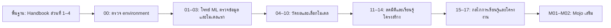

# Machine Learning ลงมือทำด้วย Python 🇹🇭

หลักสูตรภาษาไทยต่อจาก **ส่วนที่ 1–4 ของ Python Data Science Handbook** สำหรับผู้ที่ใช้ IPython/Jupyter, NumPy, pandas และ Matplotlib ได้แล้ว และกำลังเริ่มส่วนที่ 5: Machine Learning เนื้อหาเริ่มจากการตั้งโจทย์และสร้างโมเดลแรก ไปจนถึงการประเมินผล เตรียม feature ลดมิติ จัดกลุ่ม และทำโครงงานที่บันทึกโมเดลกลับมาใช้ได้

**17 บท ML + 1 บทตรวจความพร้อม + 2 บทเสริม Mojo** · ใช้ CPU · ไม่มีบริการเสียเงินหรือ API key · ใช้ข้อมูลใน scikit-learn และข้อมูลจำลอง

ทุกบทมีคำอธิบายสำหรับผู้เรียน โค้ดที่คัดลอกได้ครบชุด ไฟล์ Python, Jupyter notebook, แบบฝึกหัดพร้อมแนวคำตอบ และลิงก์อ่านต่อ อ่าน [แนวคิด ML จาก Python Data Science Handbook](https://jakevdp.github.io/PythonDataScienceHandbook/05.00-machine-learning.html) ควบคู่ได้ เนื้อหาภาษาไทยและตัวอย่างใน repo นี้เขียนขึ้นใหม่

## พื้นฐานก่อนเข้าเรียน

ผู้เรียนผ่านส่วนต่อไปนี้มาแล้ว โดยใช้ทักษะเดิมลงมือทดลองตลอดหลักสูตร:

| ส่วนในหนังสือ | ทักษะที่นำมาใช้กับ ML |
|---|---|
| [1. IPython: Beyond Normal Python](https://jakevdp.github.io/PythonDataScienceHandbook/01.00-ipython-beyond-normal-python.html) | ใช้ notebook, help, traceback และจับเวลาการทดลอง |
| [2. Introduction to NumPy](https://jakevdp.github.io/PythonDataScienceHandbook/02.00-introduction-to-numpy.html) | indexing, shape, broadcasting, masks และ vectorized computation |
| [3. Data Manipulation with Pandas](https://jakevdp.github.io/PythonDataScienceHandbook/03.00-introduction-to-pandas.html) | เลือก/รวมตาราง จัดการ missing values, groupby และรักษา index |
| [4. Visualization with Matplotlib](https://jakevdp.github.io/PythonDataScienceHandbook/04.00-introduction-to-matplotlib.html) | สร้างและอ่านกราฟ distribution, scatter, subplots และ colorbar |

เริ่มเรียน ML ได้โดยยังไม่รู้ scikit-learn, train/test split, metrics หรือ gradient descent เพราะเป็นเนื้อหาใหม่ของหลักสูตรนี้ อ่าน [ขอบเขตพื้นฐานและแบบตรวจความพร้อม](docs/prerequisites.md) หากต้องการทบทวนจุดเชื่อมจากส่วนที่ 1–4

## เตรียม environment ของหลักสูตร

ดาวน์โหลด repo เป็น ZIP แล้วแตกไฟล์ หรือ clone จาก URL ของ repo นี้ จากนั้นเปิด terminal ในโฟลเดอร์ที่มี `pyproject.toml`

```bash
git clone https://github.com/KOPE-SOLUTION/machine-learning.git
cd machine-learning
```

ติดตั้ง [Python 3.11–3.13](https://www.python.org/downloads/) และ [uv](https://docs.astral.sh/uv/getting-started/installation/) แล้วรัน:

```bash
uv sync --frozen
uv run --frozen python lessons/00-setup/lesson.py
uv run --frozen python lessons/03-first-classifier/lesson.py
uv run --frozen jupyter lab
```

ใน JupyterLab ใช้บท 00 ตรวจ environment ประมาณ 10–15 นาที แล้วเริ่มเนื้อหา ML ที่ `lessons/01-ml-workflow/lesson.ipynb` หากใช้ Python/venv ปกติหรือ Google Colab ดู [คู่มือติดตั้งและแก้ปัญหา](docs/setup.md)

แพ็กเกจหลักล็อกรุ่นเพื่อทำซ้ำ: NumPy 2.2.6, pandas 2.3.2, scikit-learn 1.7.1 และ Matplotlib 3.10.3 ไฟล์ `uv.lock` ล็อก dependency ทางอ้อมด้วย เอกสารออนไลน์รุ่น stable อาจใหม่กว่าหลักสูตร; ใช้ลิงก์ scikit-learn 1.7 ในแต่ละบทเมื่อเทียบ API

## เส้นทางการเรียน



เมื่อ environment พร้อม ให้เริ่มบท 01 แล้วต่อบท 02 ซึ่งใช้ pandas/Matplotlib ตรวจความเหมาะสมของข้อมูลสำหรับ ML โดยเน้น target leakage, index alignment และ feature schema หากต้องการเห็นโครงงานเร็ว ให้เรียน 01–06 → 08 → 10 → 16 แล้วกลับมาเติมบทอื่น บท 17 ช่วยตรวจว่าการแบ่งข้อมูลตรงกับการใช้งานจริงหรือไม่

เวลาโดยประมาณรวม 15–22 ชั่วโมงเมื่ออ่าน รัน และทำแบบฝึกหัด; ไม่ใช่ความยาววิดีโอ วิดีโอประกอบยังไม่มีลิงก์เผยแพร่ใน repo ฉบับนี้ ใช้รหัสบทเทียบกับหัวข้อในชุดวิดีโอได้

## บทเรียน

| บท | เนื้อหา | ชิ้นงานที่ได้ |
|---|---|---|
| 00 | [ตรวจ environment และสัญญาข้อมูลของ scikit-learn](lessons/00-setup/README.md) | ตรวจความพร้อม 10–15 นาที |
| 01 | [Machine Learning คืออะไร และทำไมต้องมี baseline](lessons/01-ml-workflow/README.md) | โจทย์ ML กับ baseline |
| 02 | [ตรวจข้อมูลสำหรับ ML: leakage, schema และ EDA](lessons/02-data-and-plots/README.md) | รายงาน audit และ feature ที่อนุญาตให้ใช้ |
| 03 | [โมเดลแรกด้วย scikit-learn และ KNN](lessons/03-first-classifier/README.md) | Pipeline จำแนกดอกไม้ |
| 04 | [วัดผลให้ตรงโจทย์: accuracy, precision, recall และ F1](lessons/04-validation-and-metrics/README.md) | รายงาน confusion matrix และ metrics |
| 05 | [Linear Regression และการอ่านความผิดพลาด](lessons/05-linear-regression/README.md) | เส้นทำนายและ residual plot |
| 06 | [เตรียมตัวเลข หมวดหมู่ และค่าที่หาย](lessons/06-feature-engineering/README.md) | Pipeline จัดการค่าที่หาย/หมวดหมู่ |
| 07 | [จำแนกข้อความด้วย Naive Bayes](lessons/07-naive-bayes-text/README.md) | ตัวจำแนกข้อความสั้น |
| 08 | [Support Vector Machines และขอบเขตไม่เป็นเส้นตรง](lessons/08-support-vector-machines/README.md) | ขอบเขต linear/RBF SVM |
| 09 | [Decision Trees, Random Forests และ overfitting](lessons/09-trees-and-forests/README.md) | ตาราง train/CV และ feature importance |
| 10 | [เลือก hyperparameter ด้วย CV และ learning curve](lessons/10-tuning-and-learning-curves/README.md) | Grid search และ learning curve |
| 11 | [PCA: ลดมิติโดยเก็บความแปรปรวน](lessons/11-principal-components/README.md) | PCA pipeline และกราฟ variance |
| 12 | [Manifold Learning และการอ่านภาพ t-SNE](lessons/12-manifold-learning/README.md) | ภาพเปรียบเทียบ PCA/t-SNE |
| 13 | [K-means: ค้นกลุ่มโดยไม่มี label](lessons/13-kmeans-clustering/README.md) | กลุ่มข้อมูลและการเลือก k |
| 14 | [Gaussian Mixtures และ Kernel Density Estimation](lessons/14-mixtures-and-density/README.md) | กราฟ GMM/KDE |
| 15 | [เขียน Gradient Descent ด้วย NumPy](lessons/15-gradient-descent/README.md) | Gradient descent จาก NumPy |
| 16 | [โครงงาน: จำแนกภาพตัวเลขและนำโมเดลกลับมาใช้](lessons/16-digits-project/README.md) | โมเดลตัวเลขพร้อมรายงานและไฟล์ทำนาย |
| 17 | [ข้อมูลคนเดิม ข้อมูลเวลา และการประเมินให้ตรงการใช้งาน](lessons/17-time-and-groups/README.md) | แผน split ตามกลุ่มและเวลา |
| M01 | [Gradient descent ด้วย Mojo](mojo/01-gradient-descent/README.md) | คำนวณ w,b ด้วย typed loop |
| M02 | [เรียก scikit-learn จาก Mojo](mojo/02-python-interop/README.md) | ใช้ Python pipeline จากโปรแกรม Mojo |

Mojo เป็นเส้นทางเสริม แยก environment จากบทหลัก และยังไม่ได้ทดสอบ compiler ในการตรวจรอบนี้ อ่าน [สถานะและการติดตั้ง Mojo](mojo/README.md) ก่อนเริ่ม

## วิธีใช้แต่ละบท

1. อ่านโจทย์และแนวคิด แล้วลองคาดการณ์ผลก่อนรัน
2. รัน `lesson.py` หรือเปิด `lesson.ipynb` จากต้นจนจบ เลือกอย่างใดอย่างหนึ่ง
3. เปลี่ยนตัวแปรหนึ่งอย่าง บันทึกผลและอธิบายว่าทำไมจึงเปลี่ยน
4. ทำแบบฝึกหัดก่อนเปิดแนวคำตอบ และเทียบกับแหล่งอ่านต่อ

ทุก `lesson.py` ทำงานได้อิสระ เมื่อรันจากโฟลเดอร์หลัก รูปและโมเดลจะถูกบันทึกใน `outputs/` ซึ่งไม่รวมเข้า Git เพื่อไม่เก็บ artifact ที่เกิดจากแต่ละการทดลอง

## สิ่งที่ควรจำตลอดหลักสูตร

- แยก test ก่อน preprocessing และการตัดสินใจเกี่ยวกับโมเดล
- Fit scaler, imputer, encoder และ PCA เฉพาะข้อมูลฝึกในแต่ละ fold ผ่าน Pipeline
- มี baseline และเลือก metric ตามโจทย์ ไม่เลือกจากตัวเลขที่ดูสูงที่สุด
- ใช้ validation/CV เลือกโมเดล แล้วใช้ test รายงานผลสุดท้าย
- random seed ช่วยทำซ้ำ แต่ไม่ได้รับรองว่าข้อมูลเป็นตัวแทนที่ดี
- ข้อมูลจำลองและชุดข้อมูลเล็กใช้ฝึกแนวคิด ไม่ใช่หลักฐานความพร้อมใช้งานจริง

## เอกสารเสริม

- [พื้นฐานจาก Handbook ส่วนที่ 1–4 และแบบตรวจความพร้อม](docs/prerequisites.md)
- [คณิตศาสตร์ที่ใช้ในหลักสูตร](docs/math-primer.md)
- [ศัพท์ ML ไทย–อังกฤษ](docs/glossary.md)
- [ที่มาของข้อมูลและขอบเขตการใช้](docs/datasets.md)
- [Model card สำหรับโครงงานตัวเลข](docs/model-card.md)
- [เอกสารอ้างอิงและแผนที่อ่านคู่กับ Handbook](docs/references.md)
- [วิธีตรวจซ้ำและสถานะการทดสอบ](docs/verification.md)

## ตรวจการทำงานในเครื่องตัวเอง

```bash
uv run --frozen python scripts/check_materials.py
uv run --frozen python -m unittest discover -s tests -v
uv run --frozen python scripts/verify_course.py
uv run --frozen python scripts/verify_course.py --mode notebooks
```

ผลตรวจอยู่ใน `outputs/verification/` มี GitHub Actions สำหรับตรวจ Python 3.11/3.13 บน Windows/Linux เมื่อ repo ถูกเผยแพร่ สถานะในเครื่องนี้บันทึกแยกจากสถานะ CI เพื่อไม่สับสนว่าทดสอบแพลตฟอร์มใดแล้ว

## การใช้เนื้อหาและการอ้างอิง

โค้ดและข้อความต้นฉบับของ repo นี้ใช้ [MIT License](LICENSE) แหล่งอ้างอิงและข้อมูลภายนอกคงสิทธิ์ตามเจ้าของเดิม อ่าน [ที่มาและสิทธิ์ของแหล่งอ้างอิง](THIRD_PARTY_NOTICES.md) ตัวอย่างใน repo ไม่ใช่คำแปลหรือสำเนาบทหนังสือทั้งบท

