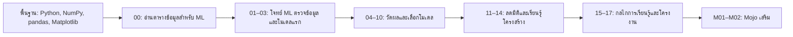

# Machine Learning ลงมือทำด้วย Python 🇹🇭

หลักสูตร Machine Learning ภาษาไทยสำหรับผู้ที่เขียน Python และใช้ Jupyter notebook, NumPy, pandas และ Matplotlib ได้แล้ว โดยเริ่มเรียน ML ได้จากพื้นฐาน เนื้อหาเริ่มจากการตั้งโจทย์และสร้างโมเดลแรก ไปจนถึงการประเมินผล เตรียม feature ลดมิติ จัดกลุ่ม และทำโครงงานที่บันทึกโมเดลกลับมาใช้ได้

**17 บท ML + 1 บทเริ่มต้นกับข้อมูล + 2 บทเสริม Mojo** · ใช้ CPU · ไม่มีบริการเสียเงินหรือ API key · ใช้ข้อมูลใน scikit-learn และข้อมูลจำลอง

ทุกบทเริ่มด้วยพื้นฐานที่ใช้ต่อ อธิบายคำศัพท์ ML ใหม่และไล่ขั้นตอนก่อนรัน มีคำอธิบายสำหรับผู้เรียน โค้ดที่คัดลอกได้ครบชุด ไฟล์ Python, Jupyter notebook, แบบฝึกหัดพร้อมแนวคำตอบ และลิงก์อ่านต่อ เนื้อหาภาษาไทยและตัวอย่างใน repo นี้เขียนขึ้นใหม่

## พื้นฐานก่อนเข้าเรียน

ควรเขียน Python เบื้องต้นและใช้ Jupyter notebook ได้ พร้อมทักษะ NumPy, pandas และ Matplotlib ตามตาราง หากต้องการเรียนหรือทบทวน สามารถดูวิดีโอในช่อง **KOPE SOLUTION** แล้วนำทักษะเดิมมาลงมือทดลองตลอดหลักสูตร:

| เนื้อหาพื้นฐานในช่อง YouTube | ทักษะที่นำมาใช้กับ ML |
|---|---|
| [NumPy](https://www.youtube.com/watch?v=KghryuGZFMU&list=PLtB6tPOso1cYC_CP2LQSj7JlY2_SAAYO3) | indexing, shape, broadcasting, masks และ vectorized computation |
| [pandas](https://www.youtube.com/watch?v=Ejgb1q1A8uU&list=PLtB6tPOso1cY5OS1uyQjvrktkA-rHw2pU) | เลือก/รวมตาราง จัดการ missing values, groupby และรักษา index |
| [Matplotlib](https://www.youtube.com/watch?v=tUmJrKmaos8&list=PLea-bfI_jPIA) | สร้างและอ่านกราฟ distribution, scatter, subplots และ colorbar |

ควรรัน notebook จากต้นจนจบ อ่าน traceback และค้น help ได้ด้วย ส่วน scikit-learn, train/test split, metrics และ gradient descent จะเริ่มเรียนในหลักสูตรนี้ อ่าน [ทักษะพื้นฐานและแบบตรวจความพร้อม](docs/prerequisites.md) เพื่อเช็กว่าพร้อมเริ่มบทแรกหรือยัง

## สิ่งที่ต้องเตรียม

ใช้ Python, NumPy, pandas และ Matplotlib ที่ใช้เรียนก่อนหน้านี้ได้เลย เปิดโปรแกรมเดิมที่ใช้สร้างไฟล์ `.ipynb` เช่น Jupyter หรือ VS Code ส่วน Google Colab ใช้เป็นทางเลือกได้

ไลบรารีที่เพิ่มสำหรับ ML คือ **scikit-learn** หาก import ได้แล้วไม่ต้องติดตั้งซ้ำ หากยังไม่มี ดู [วิธีติดตั้งจาก cell](docs/start-here.md)

## วิธีเรียน

1. สร้างไฟล์ notebook ใหม่ เช่น `ml-00.ipynb` แบบเดียวกับที่ใช้เรียน Matplotlib
2. เปิด [README บท 00](lessons/00-setup/README.md) อ่านคำอธิบาย แล้วคัดลอกโค้ด Python ลงใน cell
3. กด **Shift+Enter** แล้วอ่านผลลัพธ์ใต้ cell เทียบกับคำอธิบาย
4. ทดลองเปลี่ยนค่า ทำแบบฝึกหัด และบันทึกไฟล์ของตัวเอง
5. สร้างไฟล์ใหม่สำหรับ [บท 01](lessons/01-ml-workflow/README.md) แล้วเรียนต่อจากตารางด้านล่าง

โค้ดแต่ละบทเตรียมข้อมูลไว้ครบ จึงสร้าง `.ipynb` ไว้ในโฟลเดอร์ที่สะดวกได้ ดู [ตัวอย่างขั้นตอนเริ่มเรียน](docs/start-here.md) หากต้องการทำตามทีละขั้น

## เส้นทางการเรียน

หลังอ่านข้อมูลในบท 00 ให้เริ่มบท 01 แล้วต่อบท 02 ซึ่งใช้ pandas/Matplotlib ตรวจความเหมาะสมของข้อมูลสำหรับ ML โดยเน้น target leakage, index alignment และ feature schema หากต้องการเห็นโครงงานเร็ว ให้เรียน 01–06 → 08 → 10 → 16 แล้วกลับมาเติมบทอื่น บท 17 ช่วยตรวจว่าการแบ่งข้อมูลตรงกับการใช้งานจริงหรือไม่

เวลาโดยประมาณรวม 15–22 ชั่วโมงเมื่ออ่าน รัน และทำแบบฝึกหัด; ไม่ใช่ความยาววิดีโอ วิดีโอประกอบยังไม่มีลิงก์เผยแพร่ใน repo ฉบับนี้ ใช้รหัสบทเทียบกับหัวข้อในชุดวิดีโอได้

## บทเรียน

| บท | เนื้อหา | ชิ้นงานที่ได้ |
|---|---|---|
| 00 | [สร้าง notebook และอ่านข้อมูลสำหรับ ML](lessons/00-setup/README.md) | รู้จัก sample, feature, target และ X/y |
| 01 | [Machine Learning คืออะไร และทำไมต้องมี baseline](lessons/01-ml-workflow/README.md) | โจทย์ ML กับ baseline |
| 02 | [ตรวจข้อมูลสำหรับ ML: leakage, schema และ EDA](lessons/02-data-and-plots/README.md) | รายงาน audit และ feature ที่อนุญาตให้ใช้ |
| 03 | [โมเดลแรกด้วย scikit-learn และ KNN](lessons/03-first-classifier/README.md) | Pipeline จำแนกดอกไม้ |
| 04 | [วัดผลให้ตรงโจทย์: accuracy, precision, recall และ F1](lessons/04-validation-and-metrics/README.md) | รายงาน confusion matrix และ metrics |
| 05 | [Linear Regression และการอ่านความผิดพลาด](lessons/05-linear-regression/README.md) | เส้นทำนายและ residual plot |
| 06 | [เตรียมตัวเลข หมวดหมู่ และค่าที่หาย](lessons/06-feature-engineering/README.md) | Pipeline จัดการค่าที่หาย/หมวดหมู่ |
| 07 | [จำแนกข้อความด้วย Naive Bayes](lessons/07-naive-bayes-text/README.md) | ตัวจำแนกข้อความสั้น |
| 08 | [Support Vector Machines และขอบเขตไม่เป็นเส้นตรง](lessons/08-support-vector-machines/README.md) | ขอบเขต linear/RBF SVM |
| 09 | [Decision Trees, Random Forests และ overfitting](lessons/09-trees-and-forests/README.md) | ตาราง train/CV และ feature importance |
| 10 | [เลือก hyperparameter ด้วย CV และ learning curve](lessons/10-tuning-and-learning-curves/README.md) | Grid search และ learning curve |
| 11 | [PCA: ลดมิติโดยเก็บความแปรปรวน](lessons/11-principal-components/README.md) | PCA pipeline และกราฟ variance |
| 12 | [Manifold Learning และการอ่านภาพ t-SNE](lessons/12-manifold-learning/README.md) | ภาพเปรียบเทียบ PCA/t-SNE |
| 13 | [K-means: ค้นกลุ่มโดยไม่มี label](lessons/13-kmeans-clustering/README.md) | กลุ่มข้อมูลและการเลือก k |
| 14 | [Gaussian Mixtures และ Kernel Density Estimation](lessons/14-mixtures-and-density/README.md) | กราฟ GMM/KDE |
| 15 | [เขียน Gradient Descent ด้วย NumPy](lessons/15-gradient-descent/README.md) | Gradient descent จาก NumPy |
| 16 | [โครงงาน: จำแนกภาพตัวเลขและนำโมเดลกลับมาใช้](lessons/16-digits-project/README.md) | โมเดลตัวเลขพร้อมรายงานและไฟล์ทำนาย |
| 17 | [ข้อมูลคนเดิม ข้อมูลเวลา และการประเมินให้ตรงการใช้งาน](lessons/17-time-and-groups/README.md) | แผน split ตามกลุ่มและเวลา |
| M01 | [Gradient descent ด้วย Mojo](mojo/01-gradient-descent/README.md) | คำนวณ w,b ด้วย typed loop |
| M02 | [เรียก scikit-learn จาก Mojo](mojo/02-python-interop/README.md) | ใช้ Python pipeline จากโปรแกรม Mojo |

Mojo เป็นบทเสริมหลังเรียน Python ML และมี [คู่มือเฉพาะของ Mojo](mojo/README.md)

## ไฟล์ประกอบแต่ละบท

- `README.md`: คำอธิบาย โค้ด ผลที่คาด และแบบฝึกหัดพร้อมแนวคำตอบ
- `lesson.ipynb`: notebook ที่เตรียมไว้ให้เลือกใช้แทนการสร้างเอง
- `lesson.py`: โค้ดชุดเดียวกันในรูปแบบสคริปต์

เริ่มจาก README และ notebook ที่สร้างเองได้เลย เมื่อลองใหม่ ให้รันจาก cell แรกเพื่อให้ตัวแปรครบ โค้ดแต่ละบทไม่อาศัยตัวแปรจากบทก่อน

บทที่สร้างกราฟหรือโมเดลจะบันทึกไฟล์ลง `outputs/` ใต้โฟลเดอร์ที่ notebook กำลังทำงานอยู่

## สิ่งที่ควรจำตลอดหลักสูตร

- แยก test ก่อน preprocessing และการตัดสินใจเกี่ยวกับโมเดล
- Fit scaler, imputer, encoder และ PCA เฉพาะข้อมูลฝึกในแต่ละ fold ผ่าน Pipeline
- มี baseline และเลือก metric ตามโจทย์ ไม่เลือกจากตัวเลขที่ดูสูงที่สุด
- ใช้ validation/CV เลือกโมเดล แล้วใช้ test รายงานผลสุดท้าย
- random seed ช่วยทำซ้ำ แต่ไม่ได้รับรองว่าข้อมูลเป็นตัวแทนที่ดี
- ข้อมูลจำลองและชุดข้อมูลเล็กใช้ฝึกแนวคิด ไม่ใช่หลักฐานความพร้อมใช้งานจริง

## เอกสารเสริม

- [เริ่มเรียนจาก README แล้วก๊อปโค้ดไป Jupyter/Colab](docs/start-here.md)
- [เริ่มต้น Ubuntu WSL, ย้ายโฟลเดอร์ และข้อควรรู้เรื่อง GPU](docs/wsl.md)
- [การติดตั้งเพิ่มเติมสำหรับเครื่องใหม่](docs/setup.md)
- [ทักษะพื้นฐานและแบบตรวจความพร้อม](docs/prerequisites.md)
- [คณิตศาสตร์ที่ใช้ในหลักสูตร](docs/math-primer.md)
- [ศัพท์ ML ไทย–อังกฤษ](docs/glossary.md)
- [ที่มาของข้อมูลและขอบเขตการใช้](docs/datasets.md)
- [Model card สำหรับโครงงานตัวเลข](docs/model-card.md)
- [เอกสารอ้างอิงและแหล่งอ่านเพิ่มเติม](docs/references.md)
- [ที่มาของเนื้อหา ตัวอย่าง และภาพในแต่ละบท](docs/content-origin.md)
- [วิธีตรวจซ้ำและสถานะการทดสอบ](docs/verification.md)

## การใช้เนื้อหาและการอ้างอิง

โค้ดและข้อความต้นฉบับของ repo นี้ใช้ [MIT License](LICENSE) แหล่งอ้างอิงและข้อมูลภายนอกคงสิทธิ์ตามเจ้าของเดิม อ่าน [ที่มาและสิทธิ์ของแหล่งอ้างอิง](THIRD_PARTY_NOTICES.md) และ [แผนที่เนื้อหาที่เขียนขึ้นสำหรับหลักสูตร](docs/content-origin.md)

