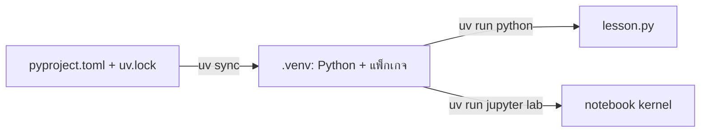

# สร้าง environment ตั้งแต่ต้น

[กลับหน้าแรก](../README.md) · [เริ่มเรียนแบบก๊อปวาง](start-here.md) · [บท 00](../lessons/00-setup/README.md) · [Ubuntu WSL, การย้ายโฟลเดอร์ และ GPU](wsl.md)

หน้านี้สำหรับติดตั้งเครื่องใหม่ แยก environment หรือแก้ปัญหา หากเปิด notebook และใช้ NumPy/pandas/Matplotlib ได้แล้ว ให้เริ่มที่ [วิธีเรียนจาก README](start-here.md) และบท 00 ได้เลย ไม่ต้องทำตามวิธีติดตั้งทุกแบบ

หลักสูตรใช้ Python 3.11–3.13 แบบ 64-bit และ CPU สำหรับผู้เริ่มต้นบน Windows แนะนำ **Ubuntu 24.04 บน WSL 2 → เก็บ repo ใน `~/projects` → Python 3.12 → uv** ใช้เส้นทางเดียวตลอดหลักสูตร ส่วน Mojo มี environment เสริมของตัวเอง

หากยังไม่มี WSL หรือยังไม่ได้ clone ให้ทำตาม [ขั้นตอนติดตั้งและ clone](wsl.md) ก่อน แล้วเปิด Ubuntu terminal ในโฟลเดอร์หลักที่มี `pyproject.toml` คำสั่ง `bash` ในหน้านี้ใช้ใน Ubuntu terminal; คำสั่ง `powershell` ใช้ใน Windows PowerShell

## Environment, venv, pip และ uv คืออะไร

Environment คือชุด Python และแพ็กเกจที่โปรเจกต์ใช้ เช่น หลักสูตรนี้ใช้ scikit-learn 1.7.1 ขณะที่อีกโปรเจกต์อาจใช้คนละรุ่น การแยก environment ช่วยให้ติดตั้งแพ็กเกจของแต่ละงานได้โดยไม่ปะปนกัน

| ชื่อ | หน้าที่ในหลักสูตร |
|---|---|
| Python | โปรแกรมที่อ่านและรันโค้ด `.py` |
| `.venv/` | โฟลเดอร์ environment ของโปรเจกต์ มี Python ที่ใช้งานและแพ็กเกจที่ติดตั้ง |
| `venv` | โมดูลมาตรฐานของ Python สำหรับสร้าง environment |
| `pip` | เครื่องมือติดตั้งแพ็กเกจลง Python ที่เลือก |
| `uv` | เครื่องมือจัดการ Python, environment และแพ็กเกจ; อ่าน lockfile และเรียกโปรแกรมใน environment ให้ |
| `pyproject.toml` | รายการ dependency และรุ่น Python ที่ repo รองรับ |
| `uv.lock` | รุ่น dependency ที่ resolve ไว้ รวมแพ็กเกจทางอ้อมและเงื่อนไขแพลตฟอร์ม |
| Jupyter kernel | process Python ที่รัน cell ของ notebook ต้องเลือก environment ที่ติดตั้งแพ็กเกจไว้ |

`uv` ใช้จัดการเครื่องมือก่อนและระหว่างรันโปรแกรม ไม่ต้อง `import uv` ในบทเรียน และไม่ได้ติดตั้งไดรเวอร์ GPU ให้ `uv sync` สร้าง `.venv` ได้เอง จึงไม่จำเป็นต้องเรียก `python -m venv` ก่อน

ภาพรวมของวิธี uv:



เลือก **วิธี A หรือ B เพียงวิธีเดียว** ใน checkout หนึ่งชุด วิธี B มีไว้ฝึกจัด environment ด้วยตัวเองและใช้แทน uv ได้ อย่าติดตั้งแพ็กเกจด้วย pip เพิ่มใน environment ที่ต้องการให้ตรง lockfile เพราะ `uv sync` อาจนำแพ็กเกจนอก lockfile ออกเมื่อ sync ครั้งถัดไป

## วิธี A: uv — เส้นทางหลัก

### 1. ติดตั้ง uv ใน Ubuntu

ใช้ [installer ทางการของ Astral](https://docs.astral.sh/uv/getting-started/installation/) รุ่นเดียวกับที่ใช้ตรวจหลักสูตร:

```bash
curl -LsSf https://astral.sh/uv/0.8.18/install.sh | sh
export PATH="$HOME/.local/bin:$PATH"
uv --version
```

คาดว่าจะเห็น `uv 0.8.18` หากติดตั้งแล้วไม่ต้องทำซ้ำ หากเปิด terminal ใหม่แล้วยังหา uv ไม่พบ ให้เปิด Ubuntu ใหม่ หรือเพิ่ม `$HOME/.local/bin` เข้า PATH ตามข้อความจาก installer ติดตั้ง uv แยกจาก `.venv` ของโปรเจกต์เพื่อให้ยังเรียกเครื่องมือได้เมื่อสร้าง environment ใหม่

### 2. สร้าง environment และติดตั้งแพ็กเกจ

```bash
cd ~/projects/machine-learning
uv python install 3.12
uv sync --frozen --python 3.12
uv run --frozen python -c "import sys; print(sys.executable)"
uv run --frozen python lessons/00-setup/lesson.py
```

- `uv python install 3.12` เตรียม Python 3.12; ไม่ต้องเปลี่ยน Python ของระบบ Ubuntu
- `uv sync --frozen --python 3.12` สร้าง `.venv` แล้วติดตั้งตาม `uv.lock` ที่อยู่ใน repo โดยไม่ resolve lockfile ใหม่ อย่าแก้รายการ dependency แล้วคาดว่า `--frozen` จะสร้าง lockfile ให้
- `uv run --frozen ...` เรียกคำสั่งผ่าน environment ของ repo ไม่ต้อง activate ก่อน
- `sys.executable` ควรชี้เข้า `machine-learning/.venv/bin/` เช่น `python` หรือ `python3` และบท 00 ควรแสดง `X shape: (150, 4)` กับ `y shape: (150,)`

ต้องใช้อินเทอร์เน็ตตอนติดตั้ง Python และแพ็กเกจ ครั้งต่อไปบทเรียนหลักใช้ข้อมูลที่ติดมากับไลบรารีหรือสร้างเอง repo นี้มี `pyproject.toml` และ `uv.lock` แล้ว จึงไม่ต้องใช้ `uv init` หรือ `uv add` เพื่อเริ่มเรียน

### 3. เปิด notebook และเริ่มเรียน

```bash
uv run --frozen jupyter lab
```

เปิด URL `http://localhost:...` ที่ terminal แสดงใน browser ของ Windows โดยใช้ port และ token ตาม output จริง อย่าแชร์ URL ที่มี token เปิด `lessons/00-setup/lesson.ipynb` เลือก Python 3 แล้ว Restart Kernel → Run All จากนั้นเริ่มบท 01 หากต้องการหยุด Jupyter ให้กลับมาที่ terminal กด Ctrl+C และยืนยันตามข้อความ

ครั้งต่อไปเปิด Ubuntu แล้วใช้เพียง:

```bash
cd ~/projects/machine-learning
uv run --frozen jupyter lab
```

หรือรันไฟล์โดยตรง:

```bash
uv run --frozen python lessons/03-first-classifier/lesson.py
```

## วิธี B: สร้าง environment เองด้วย venv + pip

เส้นทางนี้ไม่ต้องติดตั้ง uv เริ่มหลัง clone repo แล้ว ตัวอย่าง Ubuntu 24.04 ใช้ Python ระบบรุ่น 3.12:

```bash
sudo apt update
sudo apt install -y python3-venv
cd ~/projects/machine-learning
python3 --version
python3 -m venv .venv
source .venv/bin/activate
python -m pip install -r requirements.txt
python -c "import sys; print(sys.executable)"
python lessons/00-setup/lesson.py
python -m jupyterlab
```

ตรวจ `python3 --version` ว่าเป็น 3.11–3.13 ก่อนสร้าง environment; Ubuntu รุ่นอื่นอาจใช้ Python คนละรุ่น `source .venv/bin/activate` ปรับ PATH ของ terminal ปัจจุบันให้เรียก Python จาก `.venv` ส่วน `python -m pip` ทำให้ pip ติดตั้งลง Python ตัวเดียวกับที่จะรันโค้ด ไม่ใช้ `sudo pip install`

หลังปิด Jupyter ใช้ `deactivate` เพื่อออกจาก environment การ deactivate ไม่ลบไฟล์หรือแพ็กเกจ ถ้าเปิด terminal ใหม่ ให้ activate ใหม่:

```bash
cd ~/projects/machine-learning
source .venv/bin/activate
python lessons/03-first-classifier/lesson.py
python -m jupyterlab
```

คำสั่งในบทเรียนที่ขึ้นต้น `uv run --frozen python` ให้แทนด้วย `python` หลัง activate แล้ว หรือใช้ `.venv/bin/python` โดยตรงก็ได้ `requirements.txt` ล็อกรุ่น dependency หลัก ส่วน dependency ทางอ้อมอาจต่างกันตามเวลาที่ติดตั้ง จึงใช้วิธี A เมื่อต้องการ environment ตาม `uv.lock`

### Windows โดยไม่ใช้ WSL / macOS

หลักสูตร Python รันบน Windows ได้เช่นกัน หากใช้ Windows Python 3.12 ให้เปิด PowerShell ใน repo:

```powershell
py -3.12 -m venv .venv
.\.venv\Scripts\python.exe -m pip install -r requirements.txt
.\.venv\Scripts\python.exe lessons/00-setup/lesson.py
.\.venv\Scripts\python.exe -m jupyterlab
```

เรียก Python โดยตรงจึงไม่ต้องเปลี่ยน execution policy บน macOS ใช้ Python 3.11–3.13 ที่ติดตั้งไว้กับขั้นตอน `python3 -m venv` แบบ Linux โดยข้ามคำสั่ง `apt` การติดตั้ง Mojo ให้ดูแพลตฟอร์มที่รองรับใน [คู่มือเสริม](../mojo/README.md)

## หากยังใช้ repo ใน /mnt/c

ใช้ได้ แต่ต้องแยก environment Windows/Linux เพราะ executable และแพ็กเกจ native ใช้ร่วมกันไม่ได้ สำหรับ checkout ที่ใช้ร่วมกัน ให้เลือกชื่อ `.venv-wsl` ใน Ubuntu:

```bash
export UV_PROJECT_ENVIRONMENT=.venv-wsl
uv sync --frozen --python 3.12
uv run --frozen python lessons/00-setup/lesson.py
uv run --frozen jupyter lab
```

ตัวแปรนี้มีผลกับ terminal ปัจจุบัน หากเปิดใหม่ต้องตั้งอีกครั้ง เมื่อเปลี่ยนไปใช้ checkout ใน `~/projects` ให้ใช้ `unset UV_PROJECT_ENVIRONMENT` เพื่อกลับไปค่าเริ่มต้น `.venv` ไม่คัดลอก environment เก่าจาก Windows หรือจากคนละ path; สร้างใหม่จาก lockfile

## Notebook และ kernel

เปิด JupyterLab จาก environment เดียวกับที่ติดตั้งแพ็กเกจ หากใช้ VS Code ให้เปิดโฟลเดอร์ผ่าน WSL extension แล้วเลือก Python interpreter หรือ notebook kernel เป็น `.venv/bin/python` ภายใน Ubuntu ตาม [คู่มือ VS Code กับ WSL](https://code.visualstudio.com/docs/remote/wsl) การเลือก interpreter กับ notebook kernel เป็นคนละรายการใน UI จึงควรตรวจทั้งคู่

หาก import ไม่ผ่าน ให้รัน `import sys; print(sys.executable)` ใน cell เพื่อตรวจว่า kernel ใช้ Python ตัวเดียวกับ terminal แล้ว Restart Kernel → Run All หลังเปลี่ยน environment

## คัดลอกโค้ดจาก README

1. ติดตั้งแพ็กเกจด้วยวิธีใดวิธีหนึ่งข้างต้น แล้วเปิด notebook ด้วย environment นั้น
2. คัดลอกบล็อก `python` ทั้งชุด รวม import และฟังก์ชัน ไป cell เดียวใน notebook เปล่าแล้วรัน หรือบันทึกเป็นไฟล์ `.py` แล้วรันจาก terminal
3. บล็อก `bash`/`powershell` เป็นคำสั่ง terminal ไม่วางใน cell Python ตรง ๆ ส่วนบล็อก `mojo` ให้บันทึกเป็นไฟล์ `.mojo` ตามคู่มือเสริม
4. รูปและไฟล์ที่สร้างจะอยู่ใน `outputs/` ใต้ working directory ปัจจุบัน หากต้องการให้ตรงเส้นทางในคู่มือ ให้เริ่มที่ root ของ repo
5. หากทดลองเปลี่ยนตัวแปร ให้ Restart Kernel → Run All ก่อนสรุปผล เพื่อไม่ใช้ object ที่ fit จากการทดลองก่อนหน้าโดยไม่ตั้งใจ

README แต่ละบทมีข้อมูลตัวอย่างอยู่ในโค้ดหรือ loader ของ scikit-learn ครบ ไม่ต้องหา CSV เพิ่ม บท 16 สร้าง input CSV ตัวอย่างหลังฝึกเสร็จ ให้รันคำสั่งทำนายหลังเห็นไฟล์นั้นแล้ว

Notebook มี cell แรกสำหรับกลับไป working directory ของ repo เมื่อเปิดจากโฟลเดอร์บทเรียน โค้ดตัวอย่างไม่จำเป็นต้องรันบทก่อนหน้า หากคัดลอกไป notebook เปล่า ให้รัน Python block ทั้งชุดตามลำดับ

## Google Colab

ดาวน์โหลด lesson.ipynb ของบทที่สนใจ แล้วเลือก Upload notebook ใน [Colab](https://colab.research.google.com/) เพิ่ม cell แรกด้วยคำสั่ง:

```python
%pip install numpy==2.2.6 pandas==2.3.2 scikit-learn==1.7.1 matplotlib==3.10.3 scipy==1.16.1 joblib==1.5.1
```

ถ้า Colab แจ้งว่าต้อง restart session ให้ restart ก่อน Run All runtime ควรใช้ Python 3.11–3.13; Colab อาจเปลี่ยนเวอร์ชันในอนาคต จึงใช้ environment ในเครื่องเป็นทางเลือกหลักที่ล็อกได้ แนวทาง Colab ยังไม่ได้ทดสอบในรอบตรวจนี้

ไฟล์ใน outputs/ ของ Colab เป็นไฟล์ชั่วคราว ต้องดาวน์โหลดก่อนจบ session บท 16 รันฝึกใน notebook ได้ครบ แต่ CLI predict.py ต้องดาวน์โหลดไฟล์ lesson.py และ predict.py ให้อยู่ด้วยกันด้วย เส้นทาง Mojo ไม่รวมอยู่ในขั้นตอน Colab นี้

## เมื่อเกิดข้อผิดพลาด

| อาการ | ตรวจและแก้ |
|---|---|
| `uv: command not found` | ติดตั้ง uv ใน Ubuntu และตรวจ PATH; uv ฝั่ง Windows ไม่ใช่การติดตั้งฝั่ง Ubuntu |
| `ensurepip is not available` ตอนสร้าง venv | ติดตั้ง `python3-venv` ที่ตรงกับ Python ของ Ubuntu แล้วสร้างใหม่ |
| `externally-managed-environment` | กำลังติดตั้งลง Python ระบบ ให้สร้าง/activate `.venv` ก่อน |
| `No module named sklearn` | ใช้ Python จาก `.venv` ที่ติดตั้งแล้ว ชื่อแพ็กเกจติดตั้งคือ `scikit-learn` |
| เปิด notebook แล้ว import ไม่ผ่าน | ตรวจ kernel และ `sys.executable` ว่าเป็น environment ของ repo |
| `File not found` | เริ่มคำสั่งที่โฟลเดอร์หลักซึ่งมี `pyproject.toml`; ชื่อไฟล์ Linux แยกตัวพิมพ์เล็ก/ใหญ่ |
| รูปไม่เด้งเป็นหน้าต่าง | เปิดไฟล์ PNG ใน `outputs/` หรือใช้ notebook |
| รัน terminal แล้วค้างหลังวาดรูป | ปิดหน้าต่างกราฟเพื่อให้สคริปต์ทำงานต่อ |
| คะแนนต่างทศนิยมเล็กน้อย | ตรวจเวอร์ชัน แพลตฟอร์ม และ seed; ผล floating point อาจต่างได้ |
| uv แจ้งไม่มี lockfile | ตรวจว่า clone/ดาวน์โหลด repo ครบ รวม `uv.lock` |
| TLS/เครือข่ายติดตั้งไม่ได้ | ตรวจ proxy/เครือข่ายแล้วติดตั้งใหม่ ไม่ปิดการตรวจ certificate |

## แก้โค้ดแล้วปรับ README/notebook

ไฟล์ lesson.py เป็นแหล่งโค้ดหลัก หากแก้โค้ดให้รัน:

```bash
uv run --frozen python scripts/sync_materials.py
uv run --frozen python scripts/sync_materials.py --check
uv run --frozen python scripts/verify_course.py --mode readmes
```

คำสั่งสร้าง notebook ใหม่จะล้าง output และการแก้ cell ที่ทำเฉพาะใน notebook หากต้องการเก็บการทดลองส่วนตัว ให้ Save As ชื่ออื่นก่อน โหมด `readmes` รันบล็อก Python จาก README ทุกบทและตัวอย่างคณิตศาสตร์ใน process ใหม่แต่ละบล็อก ส่วน `--mode all` รวมสคริปต์ บล็อก README และ notebook ดู [วิธีตรวจซ้ำ](verification.md)

## อ้างอิง

- [Python: venv](https://docs.python.org/3.12/library/venv.html) — environment แยกต่อโปรเจกต์และการสร้างใหม่เมื่อย้าย path
- [uv: installation](https://docs.astral.sh/uv/getting-started/installation/) — ติดตั้งเครื่องมือ
- [uv: projects](https://docs.astral.sh/uv/guides/projects/) — ความสัมพันธ์ระหว่าง pyproject, lockfile และ environment
- [uv: locking and syncing](https://docs.astral.sh/uv/concepts/projects/sync/) — พฤติกรรม `--frozen` และการ sync
