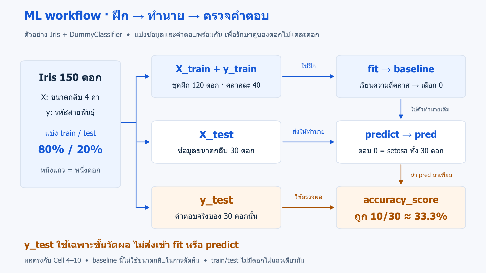

# 01 · เริ่มต้น Machine Learning

[กลับสารบัญ](../../README.md) · [Notebook](lesson.ipynb) · [Python](lesson.py)

เริ่มจากข้อมูลดอกไม้ Iris เพื่อรู้จัก **X/y → train/test → fit → predict → วัดผล** และสร้างคะแนนอ้างอิงด้วย baseline

## ก่อนเริ่มบทนี้

ใช้พื้นฐาน Python, NumPy และ pandas ที่เรียนมาแล้ว บทนี้เริ่มอธิบาย ML ตั้งแต่ต้นและเตรียมข้อมูลเองครบ ไม่ต้องรันตัวแปรจากบท 00 ก่อน หากยังไม่ได้เปิด notebook ดู [วิธีเริ่มเรียน](../../docs/start-here.md)

## Machine Learning คืออะไร

**Machine Learning (ML)** คือการให้คอมพิวเตอร์เรียนรู้รูปแบบจากตัวอย่าง เพื่อนำไปทำนายหรือค้นหาโครงสร้างในข้อมูล เช่น เรียนจากขนาดกลีบของดอกไม้ที่รู้สายพันธุ์แล้ว เพื่อนำไปทำนายสายพันธุ์ของดอกใหม่

**Model (โมเดล)** คือกฎหรือความสัมพันธ์ที่ใช้สร้างคำทำนาย ส่วน **algorithm (อัลกอริทึม)** คือวิธีสร้างโมเดลจากข้อมูล

| ประเภทโจทย์ | คำตอบที่ต้องการ | ตัวอย่าง |
|---|---|---|
| **Classification — การจำแนกประเภท** | หมวดหมู่ | สายพันธุ์ดอกไม้ |
| **Regression — การถดถอย** | ค่าปริมาณ | ระยะเวลาจัดส่งเป็นชั่วโมง |
| **Clustering — การจัดกลุ่ม** | กลุ่มที่ค้นพบจากข้อมูล | กลุ่มพฤติกรรมผู้ใช้ โดยไม่ให้คำตอบกลุ่มตอนฝึก |

Classification และ regression ที่เรียนในหลักสูตรเป็น **Supervised Learning** คือเรียนจากตัวอย่างพร้อมคำตอบ ส่วน clustering เป็นตัวอย่างของ **Unsupervised Learning** ที่ค้นโครงสร้างโดยไม่ให้คำตอบกลุ่มตอนฝึก กลุ่มที่ได้ต้องตีความเพิ่มเติมและไม่จำเป็นต้องตรงกับหมวดหมู่ที่คนกำหนด

## โจทย์ Iris: ใช้ข้อมูลอะไร ทำนายอะไร

Iris มีดอกไม้ **150 ดอก** แต่ละดอกมีข้อมูลขนาด 4 ค่า หน่วยเซนติเมตร และมีสายพันธุ์หนึ่งในสามชนิด: setosa, versicolor หรือ virginica

โจทย์คือ **ใช้ขนาดที่วัดได้ทำนายสายพันธุ์** ข้อมูลนำเข้าเป็นค่าที่วัดไว้แล้ว ไม่ใช่ภาพถ่ายดอกไม้

| คำศัพท์ | ความหมายในบทนี้ | ตัวแปร |
|---|---|---|
| **Sample** | ตัวอย่างหนึ่งรายการ = ดอกไม้หนึ่งดอก | หนึ่งแถวใน X |
| **Feature** | ข้อมูลที่ใช้ทำนาย = ความยาว/ความกว้างของกลีบเลี้ยงและกลีบดอก | X มี 4 คอลัมน์ |
| **Target / label** | คำตอบที่ต้องการทำนาย = สายพันธุ์ | y มีหนึ่งคำตอบต่อดอก |
| **Class** | หมวดหมู่คำตอบหนึ่งประเภท | 0 = setosa, 1 = versicolor, 2 = virginica |

**Sepal** คือกลีบเลี้ยง ส่วน **petal** คือกลีบดอก รหัส 0, 1, 2 ใช้แทนชื่อสายพันธุ์ จึงยังเป็นโจทย์ classification แม้เก็บคำตอบเป็นตัวเลข

X และ y ต้องจับคู่กันถูกแถว ตัวอย่างเช่น แถวแรกของ X มีค่า `[5.1, 3.5, 1.4, 0.2]` และ y ของแถวนั้นเป็น 0 หมายถึง setosa

## แบ่งข้อมูลก่อนฝึก แล้วจึงตรวจคำตอบ

หากฝึกและตรวจด้วยข้อมูลชุดเดิมอย่างเดียว จะยังไม่รู้ว่าใช้กับตัวอย่างใหม่ได้ดีแค่ไหน จึงแยก **train (ชุดฝึก)** และ **test (ชุดทดสอบ)** ไว้คนละชุด ความสามารถในการใช้สิ่งที่เรียนกับตัวอย่างใหม่เรียกว่า **generalization**



*ลำดับและตัวเลขตรงกับ Cell 4–10; เส้นทางของ y_test ไปถึงขั้นวัดผลเท่านั้น* · [เปิดภาพ SVG](../../assets/figures/01-ml-workflow-baseline.svg)

- **fit:** เรียนจาก `X_train, y_train`
- **predict:** รับ `X_test` แล้วสร้างคำทำนาย `pred` โดยไม่ได้รับ `y_test`
- **วัดผล:** นำคำตอบจริง `y_test` มาเทียบกับ `pred` หลังทำนายเสร็จ

เราเก็บคำตอบของ test ไว้เพื่อตรวจผล แต่ไม่ให้ตัวทำนายใช้คำตอบนั้นระหว่างฝึกหรือทำนาย

## ทำไมเริ่มด้วย baseline

**Baseline** คือวิธีง่าย ๆ ที่ใช้สร้างคะแนนอ้างอิง ก่อนเปรียบเทียบกับโมเดลที่ซับซ้อนขึ้น บทนี้ใช้ **DummyClassifier** ตัวทำนายสำหรับงาน classification และกำหนด `strategy="most_frequent"` ให้ตอบคลาสที่พบมากที่สุดใน train ทุกครั้ง

ตัวทำนายนี้เรียนความถี่จาก `y_train` **ไม่ได้เรียนความสัมพันธ์ระหว่างขนาดกลีบกับสายพันธุ์** แม้รับ X ตามรูปแบบการใช้งานของ scikit-learn จุดประสงค์คือเรียนขั้นตอนและสร้างคะแนนตั้งต้น ก่อนใช้โมเดลที่นำขนาดกลีบมาช่วยตัดสินในบท 03

- **จุดเด่น:** เรียบง่ายและช่วยบอกว่าการตอบตามความถี่ของคลาสทำได้กี่คะแนน
- **ข้อจำกัด:** ไม่ปรับคำตอบตามลักษณะของดอกไม้ จึงแยกสายพันธุ์จากขนาดกลีบไม่ได้

ใน train ชุดนี้มีคลาสละ 40 ดอกเท่ากัน เมื่อเสมอกัน ตัวทำนายเลือกคลาส 0 จึงตอบ setosa ทุกดอก ไม่ได้สุ่มคำตอบใหม่ในแต่ละแถว

## Accuracy อ่านอย่างไร

**Accuracy = จำนวนที่ทายถูก ÷ จำนวนที่ทดสอบทั้งหมด**

บทนี้ทายถูก 10 จาก 30 ดอก จึงได้ `10/30 ≈ 0.333` หรือ **33.3%** เป็นสัดส่วนที่ทายถูกในชุดทดสอบ ไม่ใช่ความมั่นใจต่อดอกไม้หนึ่งดอก และ baseline ไม่ได้มีคะแนน 33.3% เสมอไปในทุกชุดข้อมูล

## ลงมือทำ

สร้าง `ml-01.ipynb` แล้วคัดลอก **Cell 1–10 แยกกันตามลำดับ** กด **Shift+Enter** หลังพิมพ์แต่ละ cell หรือเปิด [notebook ที่เตรียมไว้](lesson.ipynb)

หาก Cell 1 แจ้ง `No module named sklearn` ให้เพิ่ม cell ด้านบน รัน `%pip install scikit-learn==1.7.1` แล้ว restart kernel และรันตั้งแต่ Cell 1 ใหม่ ถ้า import ได้อยู่แล้ว ใช้ต่อได้เลย ดูรายละเอียดใน [วิธีเริ่มเรียน](../../docs/start-here.md)

ชื่อตอนติดตั้งคือ **scikit-learn** ส่วนชื่อตอน import คือ **sklearn**

<!-- CODE:CELLS -->

<!-- CODE:START -->
### Cell 1 — นำเข้าเครื่องมือ

```python
import pandas as pd
from sklearn.datasets import load_iris
from sklearn.dummy import DummyClassifier
from sklearn.metrics import accuracy_score
from sklearn.model_selection import train_test_split
```

**อ่านโค้ด:** pandas ใช้จัดตาราง ส่วน scikit-learn เตรียมเครื่องมือ 4 อย่าง: `load_iris` โหลดข้อมูล, `train_test_split` แบ่งข้อมูล, `DummyClassifier` สร้าง baseline และ `accuracy_score` วัดผล

**ผลที่ได้:** ไม่มีข้อความแสดงเป็นเรื่องปกติ เพราะ cell นี้นำเข้าเครื่องมือ ถ้าไม่มี error จึงไปต่อได้

### Cell 2 — อ่านข้อมูล Iris และแยก feature กับ target

```python
data = load_iris(as_frame=True)
X = data.data
y = data.target

print(X.head(3).to_string(index=False))
print("First three labels:", y.head(3).to_list())
print("Classes:", dict(enumerate(data.target_names.tolist())))
```

**อ่านโค้ด**

- `load_iris(as_frame=True)` โหลดชุดข้อมูล Iris ที่มากับ scikit-learn โดยให้ข้อมูลอยู่ในรูปแบบ pandas ตัวแปร `data` เก็บทั้งตาราง คำตอบ และชื่อสายพันธุ์
- `X = data.data` เลือกตารางขนาดกลีบ 4 คอลัมน์ ส่วน `y = data.target` เลือกคำตอบที่ตรงกับแต่ละแถว X/y เป็นชื่อที่นิยมใช้ ไม่ใช่คำสงวนของ Python
- `head(3)` แสดง 3 แถวแรก; `to_string(index=False)` จัดตารางเป็นข้อความโดยซ่อน index และ `to_list()` แสดงคำตอบเป็นรายการ
- `dict(enumerate(data.target_names.tolist()))` จับคู่รหัสที่เริ่มจาก 0 กับชื่อสายพันธุ์

**ผลที่ได้:** แถวแรกมีค่า `5.1, 3.5, 1.4, 0.2` หน่วยเซนติเมตร และคำตอบเป็น 0 = setosa ทั้งสามแถวแรกเป็น setosa แต่ข้อมูลทั้งชุดมี 3 สายพันธุ์

### Cell 3 — ตรวจรูปร่างและลำดับแถวของ X/y

```python
print("X shape:", X.shape)
print("y shape:", y.shape)
assert X.shape == (150, 4)
assert y.shape == (150,)
assert X.index.equals(y.index)
print("Shape and index checks passed")
```

**อ่านโค้ด**

- `X.shape` เป็น `(150, 4)` หมายถึง 150 ตัวอย่าง ตัวอย่างละ 4 features ส่วน `y.shape` เป็น `(150,)` หมายถึงคำตอบหนึ่งมิติ 150 ค่า
- `assert` ตรวจเงื่อนไข ถ้าผิดจะหยุดด้วย `AssertionError` ตัวเลข 150 และ 4 เป็นขนาดเฉพาะของ Iris
- `X.index.equals(y.index)` ตรวจว่า index และลำดับแถวตรงกัน ช่วยตรวจการจับคู่ แต่ไม่ได้พิสูจน์ว่าคำตอบในต้นฉบับถูกทุกค่า

**ผลที่ได้:** `Shape and index checks passed`

### Cell 4 — แบ่งข้อมูลพร้อมคำตอบเป็น train และ test

```python
X_train, X_test, y_train, y_test = train_test_split(
    X, y, test_size=0.2, stratify=y, random_state=42
)
print("X_train:", X_train.shape)
print("X_test:", X_test.shape)
print("y_train:", y_train.shape)
print("y_test:", y_test.shape)
```

**อ่านโค้ด**

- `train_test_split(X, y, ...)` แบ่ง X/y พร้อมกันเพื่อรักษาคู่ข้อมูลกับคำตอบ คืนค่าตามลำดับ `X_train, X_test, y_train, y_test`
- `test_size=0.2` กัน 20% ไว้ทดสอบ จึงเหลือ train 120 ดอกและ test 30 ดอก สัดส่วนนี้เป็นตัวเลือกของตัวอย่าง ไม่ใช่กฎตายตัว
- `stratify=y` ช่วยรักษาสัดส่วนคลาสให้ใกล้เคียงข้อมูลเดิม ไม่ได้เพิ่มคลาสที่มีน้อยให้เท่าคลาสอื่น
- `random_state=42` ทำให้แบ่งซ้ำได้เมื่อข้อมูลและเงื่อนไขเดิม เลข 42 ไม่ได้ทำให้โมเดลแม่นขึ้น

**ผลที่ได้:** X_train `(120, 4)`, X_test `(30, 4)`, y_train `(120,)`, y_test `(30,)`

การแบ่งแบบนี้ใช้ฝึกแนวคิดกับ Iris ข้อมูลตามเวลาหรือคนเดิมหลายแถวต้องพิจารณาวิธีแบ่งเพิ่มเติมในบท 17

### Cell 5 — ตรวจจำนวนคลาสหลังแบ่งข้อมูล

```python
class_counts = pd.DataFrame({
    "train": y_train.value_counts().sort_index(),
    "test": y_test.value_counts().sort_index(),
})
class_counts.index.name = "class"
print(class_counts.to_string())
```

**อ่านโค้ด:** `value_counts()` นับแต่ละรหัสสายพันธุ์ และ `sort_index()` เรียงรหัส 0, 1, 2 ก่อนแสดง train/test คู่กัน ส่วน `class_counts.index.name` ตั้งชื่อหัวแถวว่า class

**ผลที่ได้:** ทุกคลาสมี train 40 ดอกและ test 10 ดอก ซึ่งรักษาสัดส่วนเท่ากันเหมือนข้อมูลเดิม

### Cell 6 — ฝึก baseline จากชุด train

```python
baseline = DummyClassifier(strategy="most_frequent")
baseline.fit(X_train, y_train)
print("Baseline trained")
```

**อ่านโค้ด**

- `DummyClassifier(strategy="most_frequent")` สร้างตัวทำนายและกำหนดให้ตอบคลาสที่พบมากที่สุดใน train
- `fit(X_train, y_train)` คือขั้นเรียนจากชุดฝึก สำหรับ baseline นี้สิ่งที่เรียนคือความถี่ของคลาสใน y_train ไม่ได้เรียนจากค่าขนาดกลีบ
- เมื่อจำนวนเท่ากันทั้ง 3 คลาส ตัวอย่างนี้เลือกคลาส 0 ดังนั้นคำทำนายที่จะได้คือ setosa ทุกดอก

**ผลที่ได้:** `Baseline trained` หมายถึงฝึกเสร็จ ยังไม่ได้วัดว่าทาย test ถูกกี่ดอก

### Cell 7 — ทำนายโดยส่งเฉพาะ X_test

```python
pred = baseline.predict(X_test)
print("Predictions:", pred)
print("Prediction shape:", pred.shape)
```

**อ่านโค้ด:** `predict(X_test)` รับเฉพาะข้อมูลที่ต้องการทำนายและคืนคำตอบตามลำดับแถวของ X_test โดยไม่รับ y_test

**ผลที่ได้:** `pred` เป็น array รูปร่าง `(30,)` และมีค่า 0 ทั้ง 30 ค่า เป็นผลตามวิธี most_frequent ไม่ใช่โค้ดค้างหรือสุ่มผิด

### Cell 8 — เปรียบเทียบคำทำนายกับคำตอบจริง

```python
results = pd.DataFrame({"actual": y_test, "predicted": pred})
results["correct"] = results["actual"] == results["predicted"]
print(results.head(10).to_string())
```

**อ่านโค้ด**

- `actual` คือคำตอบจริงจาก y_test ส่วน `predicted` คือคำทำนายจาก pred โดย pred เรียงตาม X_test และ y_test ที่แบ่งมาพร้อมกัน
- `results["actual"] == results["predicted"]` เปรียบเทียบทีละแถว ได้ True เมื่อทายถูก และ False เมื่อทายผิด
- `head(10)` แสดงเพียง 10 แถวแรก แต่การวัดผลใน Cell 9 ใช้ครบทั้ง 30 ดอก เลข index ด้านซ้ายเป็นหมายเลขแถวเดิมของ Iris

**ผลที่ได้:** แถว index 38 มี actual=0, predicted=0 จึงถูก ส่วนแถว 127 มี actual=2, predicted=0 จึงผิด การนำคำตอบมาแสดงหลัง predict ไม่ได้ส่งเฉลยกลับเข้าโมเดล

### Cell 9 — วัดผลด้วย accuracy

```python
accuracy = accuracy_score(y_test, pred)
print(f"Baseline test accuracy: {accuracy:.3f}")
print(f"Correct percentage: {accuracy:.1%}")
```

**อ่านโค้ด:** `accuracy_score(y_test, pred)` เทียบคำตอบจริงกับคำทำนายครบทั้งชุด `:.3f` แสดงทศนิยม 3 ตำแหน่ง ส่วน `:.1%` แสดงเปอร์เซ็นต์ทศนิยม 1 ตำแหน่ง ทั้งสองบรรทัดเป็นคะแนนค่าเดียวกัน

**ผลที่ได้:** `Baseline test accuracy: 0.333` และ `Correct percentage: 33.3%`

### Cell 10 — คำนวณ accuracy เองจากจำนวนที่ทายถูก

```python
correct_count = int((pred == y_test).sum())
total_count = len(y_test)
manual_accuracy = correct_count / total_count
print("Correct test predictions:", correct_count, "of", total_count)
print(f"Manual accuracy: {manual_accuracy:.3f}")
print("Same result:", manual_accuracy == accuracy)
```

**อ่านโค้ด:** `pred == y_test` เปรียบเทียบตามลำดับของดอกไม้ และ `.sum()` นับ True เป็น 1 จึงนับจำนวนที่ทายถูกได้ จากนั้นหารด้วยจำนวนดอกไม้ที่ทดสอบ

**ผลที่ได้:** ทายถูก `10 of 30`, `Manual accuracy: 0.333` และ `Same result: True` ตรงกับ accuracy_score เพราะใช้คำตอบและคำทำนายชุดเดียวกัน
<!-- CODE:END -->

## สิ่งที่ได้จากการทดลอง

เราได้ขั้นตอนฝึกและวัดผลครบ พร้อม baseline accuracy **33.3%** การชนะ baseline เพียงอย่างเดียวยังไม่พอจะสรุปว่าพร้อมใช้งานจริง ต้องดูข้อมูล วิธีวัด และลักษณะความผิดพลาดด้วย

ตัวอย่างนี้กำหนดวิธี baseline ไว้ก่อนดูผล test เมื่อเริ่มปรับหรือเลือกโมเดล ให้ใช้ validation/Cross-validation แล้วเก็บ test ไว้ประเมินท้ายสุด จะขยายใน [บท 04](../04-validation-and-metrics/README.md)

## แบบฝึกท้ายบท

**1. ทำไม y เป็นเลข 0, 1, 2 แต่โจทย์ยังเป็น classification?**

<details>
<summary>ดูเฉลย</summary>

เพราะเลขเหล่านี้เป็นรหัสของสายพันธุ์ ไม่ใช่ค่าปริมาณที่ต้องการประมาณ X ของแต่ละดอกมีความยาว/ความกว้างของกลีบเลี้ยงและกลีบดอก ส่วน y บอกสายพันธุ์ของดอกนั้น

</details>

**2. ถ้าชุดทดสอบมี A 90 รายการและ B 10 รายการ แล้วตอบ A ทุกครั้ง จะได้ accuracy เท่าไร?**

<details>
<summary>ดูเฉลย</summary>

ได้ 90/100 = 90% แต่ทาย B ผิดทุกครั้ง จึงต้องอ่านคะแนนร่วมกับสัดส่วนคลาสและความผิดพลาดที่สำคัญ

</details>

**3. ถ้าสลับเฉพาะ y แล้วนำมาจับคู่กับ X ตามตำแหน่ง จะเกิดอะไรขึ้น?**

<details>
<summary>ดูเฉลย</summary>

คำตอบอาจไปอยู่กับคนละดอก แม้จำนวนแถวยังเท่ากัน ต้องรักษาคู่ X/y ตลอดการเลือกและแบ่งข้อมูล การตั้ง index ใหม่ให้เลขตรงกันอย่างเดียวไม่แก้คู่ข้อมูลที่สลับผิด

</details>

**4. ลองตั้งโจทย์ classification อีกหนึ่งงาน พร้อม baseline**

<details>
<summary>ดูแนวคำตอบ</summary>

ตัวอย่าง: ทำนายว่าพัสดุจะล่าช้าหรือไม่ตอนรับคำสั่งซื้อ หนึ่งแถวคือหนึ่งคำสั่งซื้อ ใช้ระยะทางและบริการที่เลือก คำตอบคือล่าช้า/ไม่ล่าช้า baseline ตอบคลาสที่พบบ่อยที่สุดใน train ส่วนเวลาส่งสำเร็จจริงเป็นข้อมูลอนาคต ใช้เป็น feature ตอนรับคำสั่งซื้อไม่ได้

</details>

ต่อที่ [บท 02 — ตรวจข้อมูลสำหรับ ML](../02-data-and-plots/README.md) ก่อนสร้างโมเดล KNN ที่ใช้ขนาดกลีบในบท 03

## อ้างอิง

- [scikit-learn: load_iris — ข้อมูลและชื่อสายพันธุ์](https://scikit-learn.org/1.7/modules/generated/sklearn.datasets.load_iris.html)
- [scikit-learn: train_test_split — การแบ่งข้อมูล](https://scikit-learn.org/1.7/modules/generated/sklearn.model_selection.train_test_split.html)
- [scikit-learn: DummyClassifier — ตัวทำนาย baseline](https://scikit-learn.org/1.7/modules/generated/sklearn.dummy.DummyClassifier.html)
- [scikit-learn: accuracy_score — สัดส่วนคำตอบที่ถูกต้อง](https://scikit-learn.org/1.7/modules/generated/sklearn.metrics.accuracy_score.html)
- [แหล่งอ่านเพิ่มเติมของหลักสูตร](../../docs/references.md)
