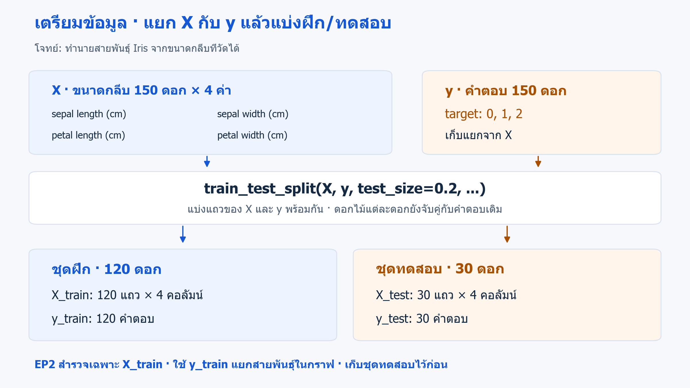
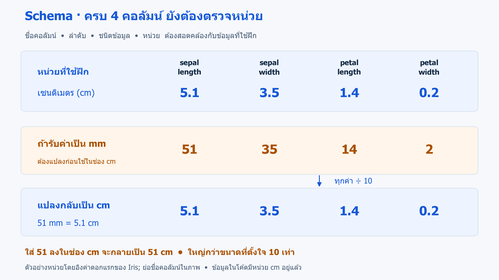

# 02 · รู้จักข้อมูลก่อนสร้างโมเดล

[กลับสารบัญ](../../README.md) · [Notebook](lesson.ipynb) · [Python](lesson.py)

**โจทย์เดิมจาก EP1:** ทำนายสายพันธุ์ Iris จากขนาดกลีบสี่ค่า บทนี้ตรวจข้อมูลที่จะใช้ฝึกให้เข้าใจก่อนนำไปสร้างโมเดล KNN ในบท 03

บทหลักมี **5 cell** ใช้ชื่อตัวแปรและการแบ่ง X/y แบบเดียวกับบท 01:

| Cell | ทำอะไร | ทำไปเพื่ออะไร |
|---|---|---|
| 1 | โหลดตาราง | ดูว่าหนึ่งแถวและแต่ละคอลัมน์หมายถึงอะไร |
| 2 | แยก X กับ y | แยกข้อมูลที่ใช้ทำนายออกจากคำตอบ |
| 3 | แบ่ง train/test | เก็บชุดทดสอบไว้ แล้วสำรวจเฉพาะชุดฝึก |
| 4 | ตรวจตารางสถิติ | ดูช่วงค่า ค่าหาย และชนิดข้อมูล |
| 5 | วาดกราฟ | ดูรูปแบบของขนาดกลีบในแต่ละสายพันธุ์ |

สร้าง `ml-02.ipynb` ใช้ kernel เดิมจากบท 01 แล้วรัน **Cell 1–5 แยกกันตามลำดับ** ใน Jupyter ด้วย Shift+Enter ส่วน **Cell 6 เป็นการบันทึกไฟล์ เลือกทำได้** ใช้พื้นฐาน pandas และ Matplotlib ที่เคยเรียนแล้ว

หากเคยรันฉบับก่อนหน้า ให้ Restart Kernel แล้วใช้โค้ดฉบับนี้ตั้งแต่ Cell 1 เพื่อให้ตัวแปรตรงกัน

<!-- CODE:CELLS -->

<!-- CODE:START -->
### Cell 1 — โหลดตารางดอกไม้

```python
import matplotlib.pyplot as plt
from sklearn.datasets import load_iris
from sklearn.model_selection import train_test_split

data = load_iris(as_frame=True)
frame = data.frame.copy()

print("Table shape:", frame.shape)
frame.head(3)
```

**ทำเพื่อ:** ดูว่าหนึ่งแถวแทนอะไร และมีคอลัมน์ใดบ้าง ก่อนเลือกข้อมูลให้โมเดล

- `as_frame=True` ให้ข้อมูลอยู่ในรูปตาราง pandas ส่วน `data.frame` รวมขนาดกลีบกับคำตอบไว้แล้ว
- `frame = data.frame.copy()` คัดลอกตารางมาใช้งาน โดยไม่แก้ตารางต้นฉบับใน `data.frame`
- `head(3)` แสดงสามแถวแรก ตารางเต็มยังมี 150 แถว

**ผลที่ได้:** `(150, 5)` คือ 150 ดอก ขนาดกลีบสี่คอลัมน์และ `target` หนึ่งคอลัมน์ ขนาดใช้หน่วยเซนติเมตร; sepal คือกลีบเลี้ยง และ petal คือกลีบดอก ส่วน target 0, 1, 2 แทน setosa, versicolor, virginica ตามลำดับ

### Cell 2 — แยกข้อมูลเข้า X และคำตอบ y

```python
X = frame[data.feature_names].copy()
y = frame["target"].copy()

print("X columns:", X.columns.tolist())
print("X shape:", X.shape)
print("y shape:", y.shape)
```

**ทำเพื่อ:** แยกสิ่งที่ใช้ทำนายออกจากสิ่งที่ต้องการทำนาย

- `data.feature_names` คือชื่อขนาดกลีบสี่คอลัมน์ จึงเลือกเฉพาะสี่คอลัมน์เข้า X
- `y` เก็บรหัสสายพันธุ์จาก `target` แยกไว้เป็นคำตอบ
- `X.columns.tolist()` แสดงรายชื่อคอลัมน์ที่เลือก เพื่อตรวจด้วยตาว่าไม่มี `target` ปะปน

**ผลที่ได้:** X มีขนาด `(150, 4)` ส่วน y มี 150 คำตอบ ทั้งสองชุดยังจับคู่กันตามแถวเดิม

**ทำไมไม่ใส่ target ใน X?** เราต้องการทำนายสายพันธุ์ของดอกใหม่ที่ยังไม่รู้คำตอบ หากใส่ target หรือชื่อสายพันธุ์เข้า X จะเท่ากับส่งเฉลยให้ดู เรียกว่า **Target leakage** ส่วนการเก็บคำตอบแยกเป็น y เพื่อสอนตอนฝึกและตรวจผลตอนทดสอบ เป็นขั้นตอนปกติ



*ภาพเชื่อม Cell 2–3: X และ y ถูกแบ่งพร้อมกัน โดยข้อมูลแต่ละดอกยังจับคู่กับคำตอบของดอกนั้น* · [เปิดภาพ SVG](../../assets/figures/02-data-and-plots-feature-selection.svg)

### Cell 3 — แบ่งชุดฝึกและชุดทดสอบแบบบท 01

```python
X_train, X_test, y_train, y_test = train_test_split(
    X, y, test_size=0.2, stratify=y, random_state=42
)

print("X_train:", X_train.shape, "y_train:", y_train.shape)
print("X_test:", X_test.shape, "y_test:", y_test.shape)
print("Training class counts:\n", y_train.value_counts().sort_index())
```

**ทำเพื่อ:** กันข้อมูลส่วนหนึ่งไว้ทดสอบในภายหลัง แล้วสำรวจเฉพาะชุดฝึก

ส่งเข้าไปสองชุด คือ X และ y แต่ละชุดถูกแบ่งเป็น train/test จึงรับกลับ **สี่ชุด** ตามลำดับ `X_train, X_test, y_train, y_test` จำนวนชุดที่คืนมาไม่เกี่ยวกับจำนวนคอลัมน์ใน X

- `test_size=0.2` กัน 20% เป็นชุดทดสอบ
- `stratify=y` รักษาสัดส่วนสายพันธุ์; เป็นเงื่อนไขการแบ่ง ไม่ใช่ข้อมูลอีกชุดที่คืนออกมา
- `random_state=42` ทำให้แบ่งซ้ำได้เหมือนเดิมเมื่อใช้ข้อมูลเดิม
- `value_counts().sort_index()` นับคำตอบในชุดฝึก แล้วเรียงตามรหัส 0, 1, 2

**ผลที่ได้:** X_train มี 120 แถว 4 คอลัมน์ คู่กับ y_train 120 คำตอบ สายพันธุ์ละ 40 ดอก ส่วน X_test มี 30 แถว คู่กับ y_test 30 คำตอบ

จากนี้ใช้ **X_train** ตรวจสถิติและวาดกราฟ โดยใช้ **y_train** ช่วยแยกสายพันธุ์ในภาพ เก็บ X_test และ y_test ไว้ เพื่อไม่ให้ข้อมูลทดสอบมาช่วยตัดสินใจระหว่างพัฒนาโมเดล

### Cell 4 — ตรวจค่าข้างในชุดฝึก

```python
summary = X_train.agg(["min", "max", "mean", "std"]).T
summary["missing"] = X_train.isna().sum()
summary["dtype"] = X_train.dtypes.astype(str)

summary.round(3)
```

**ทำเพื่อ:** ดูช่วงค่าที่วัดได้ ตรวจค่าหายและชนิดข้อมูล ก่อนนำข้อมูลไปฝึกโมเดล

- `agg(...).T` สรุปค่าต่ำสุด สูงสุด ค่าเฉลี่ย และส่วนเบี่ยงเบนมาตรฐาน แล้วจัดให้หนึ่งแถวเป็นหนึ่ง feature
- `isna().sum()` นับค่าหาย ส่วน `dtypes.astype(str)` นำชื่อชนิดข้อมูลมาใส่ในรายงาน
- `round(3)` แสดงทศนิยมสามตำแหน่ง โดยไม่เขียนทับค่าต้นฉบับใน summary

**อ่านผล:** missing เป็น 0 และ dtype เป็น float64 ทั้งสี่คอลัมน์ เช่น ความยาวกลีบดอกในชุดฝึกอยู่ระหว่าง 1.1–6.9 cm หากพบค่าหายหรือตัวเลขผิดจากที่คาด ต้องตรวจที่มาก่อน; การเติมค่าหายจะเรียนในบท 06

การสำรวจด้วยสถิติและกราฟเรียกว่า **EDA (Exploratory Data Analysis)** ใช้เครื่องมือ pandas และ Matplotlib ที่เคยเรียน โดยเน้นอ่านข้อมูลเพื่อเตรียมสร้างโมเดล

### Cell 5 — ดูว่าขนาดกลีบต่างกันตามสายพันธุ์อย่างไร

```python
fig, ax = plt.subplots(figsize=(6, 4))
markers = {0: "o", 1: "s", 2: "^"}

for label, name in enumerate(data.target_names):
    subset = X_train.loc[y_train == label]
    ax.scatter(
        subset["petal length (cm)"],
        subset["petal width (cm)"],
        label=name,
        marker=markers[label],
        alpha=0.75
    )

ax.set(
    xlabel="petal length (cm)",
    ylabel="petal width (cm)",
    title="Iris: training data only"
)
ax.legend()
fig.tight_layout()
plt.show()
```

**ทำเพื่อ:** ดูว่าขนาดกลีบดอกสองค่ามีรูปแบบที่อาจช่วยแยกสายพันธุ์ได้หรือไม่

- `enumerate(data.target_names)` วนทีละรหัส 0, 1, 2 พร้อมชื่อสายพันธุ์
- `y_train == label` เลือกคำตอบของสายพันธุ์นั้น แล้ว `X_train.loc[...]` เลือกข้อมูลดอกไม้แถวเดียวกันมาวาด
- แกน x คือความยาวกลีบดอก ส่วนแกน y คือความกว้างกลีบดอก ทั้งคู่มีหน่วย cm
- `label=name` ใส่ชื่อใน legend ส่วน `markers[label]` แยกด้วยวงกลม สี่เหลี่ยม และสามเหลี่ยม


**อ่านผล:** หนึ่งจุดแทนหนึ่งดอก กลุ่ม setosa แยกค่อนข้างชัด ส่วน versicolor กับ virginica ทับกันบางส่วน รูปนี้ช่วยให้เข้าใจข้อมูล แต่ยังบอกคะแนนทำนายของโมเดลไม่ได้ · [เปิดภาพ SVG](../../assets/figures/02-data-and-plots-iris.svg)

เราใช้ y_train เพื่อแยกสีและรูปทรงในภาพเท่านั้น ไม่ได้นำคำตอบไปเพิ่มเป็นคอลัมน์ใน X_train และแม้วาดสองแกน ข้อมูล X_train ยังมีสี่ feature เหมือนเดิม

**จบบทหลัก:** ได้ข้อมูลเข้าแยกจากคำตอบ ชุดฝึก/ทดสอบ ตารางตรวจข้อมูล และกราฟของชุดฝึก พร้อมต่อ [บท 03: KNN และ Pipeline](../03-first-classifier/README.md)

### Cell 6 — บันทึกตารางและกราฟ (เลือกทำ)

```python
import os
from pathlib import Path

out = Path("outputs/02-data-and-plots")
if os.name == "nt":
    out = (
        Path.home()
        / "Documents/L/L04_CoreData/machine-learning"
        / "practics/outputs/02-data-and-plots"
    )

out.mkdir(parents=True, exist_ok=True)

summary.to_csv(out / "feature-audit.csv", index_label="feature")
fig.savefig(out / "iris.png", dpi=140)
plt.close(fig)

print("Saved CSV:", (out / "feature-audit.csv").resolve())
print("Saved figure:", (out / "iris.png").resolve())
```

**ทำเพื่อ:** เก็บผลจาก Cell 4–5 ไว้เปิดดูนอก Jupyter รันหลัง Cell 5 เมื่ออยากได้ไฟล์ CSV และ PNG

- `os.name == "nt"` เลือกตำแหน่งสำหรับ Windows ใต้โฟลเดอร์ผู้ใช้จาก `Path.home()`
- `mkdir(parents=True, exist_ok=True)` สร้างโฟลเดอร์ที่ยังไม่มี และรันซ้ำได้
- `summary.to_csv(...)` บันทึกตาราง ส่วน `fig.savefig(...)` บันทึกกราฟจาก Cell 5 แล้ว `plt.close(fig)` ปิด figure
- `resolve()` แสดงตำแหน่งเต็มของไฟล์ เพื่อเปิดได้ถูกโฟลเดอร์

**ตำแหน่งบน Windows:** `practics/outputs/02-data-and-plots/` ภายในโปรเจกต์ `Documents/L/L04_CoreData/machine-learning` ใต้โฟลเดอร์ผู้ใช้ หากเก็บโปรเจกต์ไว้ที่อื่น ให้ปรับตำแหน่งใน cell นี้ ส่วน WSL/Colab ใช้ `outputs/02-data-and-plots/` ใต้โฟลเดอร์ที่ notebook ทำงาน
<!-- CODE:END -->

## อ่านเพิ่มเมื่อพร้อม

<details>
<summary>ชื่อคอลัมน์ครบแล้ว ยังต้องดูหน่วยด้วย: Schema</summary>

**Schema** คือข้อตกลงเรื่องชื่อ ลำดับ ชนิดข้อมูล และหน่วยของคอลัมน์ ข้อมูลที่ส่งให้โมเดลตอนทำนายต้องสอดคล้องกับตอนฝึก



เช่น `51 mm = 5.1 cm` หากนำเลข 51 ใส่ในช่องที่ใช้หน่วย cm จะใหญ่กว่าค่าที่ตั้งใจสิบเท่า แม้จำนวนคอลัมน์จะครบก็ตาม

*ภาพเป็นตัวอย่างสมมติโดยอิงค่าดอกแรกของ Iris; ข้อมูลในบทเป็น cm อยู่แล้ว จึงไม่ต้องหาร 10 ในโค้ด* · [เปิดภาพ SVG](../../assets/figures/02-data-and-plots-schema.svg)

</details>

<details>
<summary>ถ้าเปลี่ยน target เป็นชื่อสายพันธุ์ จะใช้เป็น X ได้ไหม?</summary>

**ไม่ได้สำหรับโจทย์นี้** เพราะชื่อสายพันธุ์ยังเป็นคำตอบที่ต้องการทำนาย หากนำคอลัมน์ชื่อเข้า X ก่อนแบ่งชุด มันจะติดไปทั้ง X_train และ X_test จึงเป็น target leakage แม้ลบคอลัมน์ target ไปแล้วก็ตาม

โค้ดบทหลักเลือกเฉพาะขนาดกลีบสี่ค่าเข้า X จึงไม่มีคอลัมน์คำตอบปะปน ส่วน y_train ใช้เป็นเฉลยตอนฝึก และ y_test ใช้ตรวจผลหลังทำนาย

</details>

อยากตรวจข้อมูลเพิ่ม: [assert, ค่าอนันต์, แถวซ้ำ และคอลัมน์ค่าคงที่](../../docs/ep02-extra-checks.md) เป็นส่วนเสริมหลังรันบทหลัก ไม่จำเป็นต้องรันเพื่อเรียนบทถัดไป

## อ้างอิง

- [scikit-learn: load_iris และข้อมูลที่คืนมา](https://scikit-learn.org/1.7/modules/generated/sklearn.datasets.load_iris.html)
- [scikit-learn: train_test_split](https://scikit-learn.org/1.7/modules/generated/sklearn.model_selection.train_test_split.html)
- [scikit-learn: Data leakage](https://scikit-learn.org/1.7/common_pitfalls.html#data-leakage)
- [pandas: DataFrame.copy](https://pandas.pydata.org/pandas-docs/version/2.3/reference/api/pandas.DataFrame.copy.html)
- [ทบทวนพื้นฐานและลิงก์บทเรียนในช่อง](../../docs/prerequisites.md)
