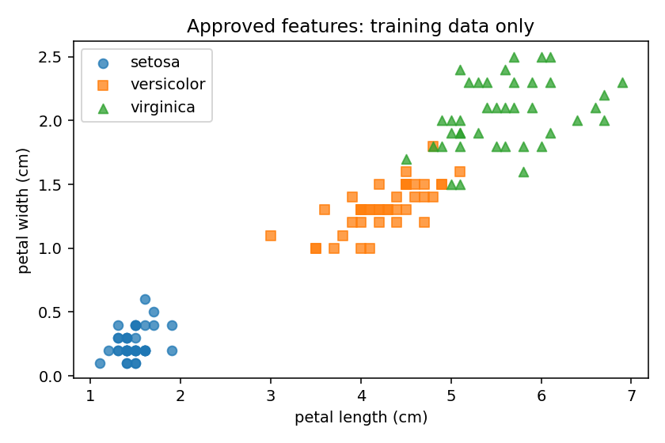

# 02 · ตรวจข้อมูลสำหรับ ML: leakage, schema และ EDA

[กลับสารบัญ](../../README.md) · [Notebook](lesson.ipynb) · [Python](lesson.py)

บทนี้เลือกข้อมูลที่ใช้ทำนายสายพันธุ์ Iris ได้จริง และตรวจชุดฝึกก่อนสร้างโมเดล

**ใช้สิ่งที่เรียนแล้ว:** NumPy, pandas, Matplotlib และ X/y กับ train/test จาก [บท 01](../01-ml-workflow/README.md) จะไม่ทวนคำสั่งพื้นฐาน

## ใจความใหม่

- **Feature:** ข้อมูลที่มีให้ใช้ตอนทำนาย เช่น ขนาดกลีบของดอกไม้ดอกใหม่ที่ยังไม่รู้สายพันธุ์
- **Target leakage:** การนำคำตอบหรือข้อมูลที่ได้จากคำตอบมาใช้เป็น feature เช่น นำ `species_name` ที่แปลงจาก `target` ไปใส่ใน X แม้ลบคอลัมน์ `target` ออกแล้ว ก็ยังมีคำตอบรั่วเข้าโมเดล
- **EDA (การสำรวจข้อมูล):** ใช้สถิติและกราฟตรวจข้อมูลก่อนพัฒนาโมเดล บทนี้กัน test ไว้ก่อน แล้วสำรวจเฉพาะ **train**

## ลงมือทำ

สร้าง `ml-02.ipynb` แล้วรัน **Cell 1–10 แยกกันตามลำดับ** ใน Jupyter เพื่อให้ตารางท้ายแต่ละ cell แสดงครบ ใช้ kernel เดิมจากบท 01

<!-- CODE:CELLS -->

<!-- CODE:START -->
### Cell 1 — เตรียมเครื่องมือ

```python
from pathlib import Path

import matplotlib.pyplot as plt
import numpy as np
import pandas as pd
from sklearn.datasets import load_iris
from sklearn.model_selection import train_test_split
```

**อ่านโค้ด:** `load_iris` ใช้โหลดข้อมูลดอกไม้ ส่วน `train_test_split` ใช้แบ่งชุดข้อมูล และ `Path` ใช้กำหนดที่บันทึกไฟล์ใน Cell 10

NumPy, pandas และ Matplotlib ใช้งานต่อจากพื้นฐานเดิม Cell นี้นำเข้าเครื่องมือ จึงยังไม่มีผลลัพธ์แสดง

### Cell 2 — โหลดข้อมูลและอ่านโครงสร้างตาราง

```python
data = load_iris(as_frame=True)
frame = data.frame.copy()

print("Table shape:", frame.shape)
frame.head(3)
```

**อ่านโค้ด**

- `load_iris(as_frame=True)` โหลด Iris โดยให้ข้อมูลอยู่ในรูปแบบ pandas พร้อมชื่อคอลัมน์ ตัวแปร `data` เก็บทั้งข้อมูล คำตอบ และชื่อสายพันธุ์
- `data.frame` คือตารางที่รวมขนาดกลีบสี่คอลัมน์กับ `target` ไว้ด้วยกัน
- `frame = data.frame.copy()` คัดลอกตารางนั้นมาเก็บใน `frame` เพื่อเพิ่มคอลัมน์หรือแก้ข้อมูลต่อ โดยไม่เปลี่ยนตารางต้นฉบับใน `data.frame`
- `frame.head(3)` แสดงสามแถวแรกใต้ cell เพื่อให้เห็นชื่อคอลัมน์และตัวอย่างค่า

**ผลที่ได้:** shape `(150, 5)` คือ 150 ดอก 5 คอลัมน์ โดยหนึ่งแถวแทนหนึ่งดอก

**คำศัพท์:** sepal คือกลีบเลี้ยง ส่วน petal คือกลีบดอก ขนาดมีหน่วยเซนติเมตร

### Cell 3 — เพิ่มคอลัมน์ตัวอย่างและดูการจับคู่รหัสกับชื่อ

```python
frame["sample_id"] = np.arange(len(frame))
label_names = dict(enumerate(data.target_names))
frame["species_name"] = frame["target"].map(label_names)  # สร้างจากคำตอบ: ใช้ทำนายไม่ได้

frame.loc[[0, 50, 100], ["sample_id", "target", "species_name"]]
```

**อ่านโค้ด**

- `np.arange(len(frame))` สร้างเลข 0–149 ให้ `sample_id` ใช้เป็นเลขลำดับแถวในตัวอย่างนี้
- `dict(enumerate(data.target_names))` จับคู่รหัสกับชื่อเป็น `{0: "setosa", 1: "versicolor", 2: "virginica"}` แล้วเก็บใน `label_names`
- `frame["target"].map(label_names)` แปลงรหัสในแต่ละแถวเป็นชื่อ แล้วเก็บใน `species_name`
- `frame.loc[[0, 50, 100], ["sample_id", "target", "species_name"]]` เลือกสามแถวและสามคอลัมน์มาแสดง เพื่อดูหนึ่งตัวอย่างต่อสายพันธุ์ ตารางเดิมยังมี 150 แถว

**คอลัมน์ที่ตัดออกจาก X**

- `species_name` สร้างจากคำตอบ หากนำเข้า X จะเกิด target leakage
- `sample_id` เป็นลำดับแถวในตัวอย่างนี้ ไม่ใช่ลักษณะดอกไม้

### Cell 4 — เลือก feature ที่ใช้ได้และแยก X กับ y

```python
features = list(data.feature_names)
forbidden = {"target", "species_name", "sample_id"}
assert forbidden.isdisjoint(features)

X = frame[features]
y = frame["target"]
assert X.index.equals(y.index)

print("Approved features:", features)
print("Excluded columns:", sorted(forbidden))
print("X shape:", X.shape)
print("y shape:", y.shape)
```

**อ่านโค้ด**

- `list(data.feature_names)` ดึงชื่อขนาดกลีบสี่คอลัมน์จากชุดข้อมูล จึงไม่ติดคอลัมน์ที่เพิ่มเองใน Cell 3
- `forbidden.isdisjoint(features)` ตรวจว่าสองกลุ่มชื่อไม่มีชื่อซ้ำกัน ถ้าไม่ผ่าน `assert` จะหยุดโค้ดให้แก้รายการ feature
- `frame[features]` เลือกเฉพาะข้อมูลเข้า X ส่วน `frame["target"]` เลือกคำตอบเป็น y
- `X.index.equals(y.index)` ตรวจว่า index ของ X และ y ตรงกันทั้งค่าและลำดับ เพื่อให้ข้อมูลแต่ละดอกจับคู่กับคำตอบถูกแถว

**ผลที่ได้:** `X: (150, 4)` และ `y: (150,)`

**Schema:** ข้อตกลงเรื่องชื่อ ลำดับ ชนิดข้อมูล และหน่วยของคอลัมน์ ข้อมูลตอนทำนายต้องตรงกับตอนฝึก

ตัวอย่าง: ต้องแปลงมิลลิเมตรเป็นเซนติเมตรก่อน แม้ shape จะถูกต้อง

### Cell 5 — กัน test แล้วเลือกแถวสำหรับสำรวจ

```python
train_idx, test_idx = train_test_split(
    frame.index, test_size=0.2, stratify=y, random_state=42
)
assert set(train_idx).isdisjoint(test_idx)

train = frame.loc[train_idx].copy()
print("Train rows:", len(train_idx), "Reserved test rows:", len(test_idx))
print("Training class counts:\n", train["target"].value_counts().sort_index())
```

**อ่านโค้ด**

- `train_test_split(frame.index, ...)` แบ่ง **index ของแถว** แล้วเก็บไว้ใน `train_idx` และ `test_idx` เพื่อใช้เลือกข้อมูลจากตารางเดิม
- `test_size=0.2` กัน 20% เป็น test ส่วน `stratify=y` ช่วยรักษาสัดส่วนสายพันธุ์ และ `random_state=42` ทำให้แบ่งซ้ำได้เหมือนเดิมเมื่อข้อมูลเดิม
- `set(train_idx).isdisjoint(test_idx)` ตรวจว่าไม่มี index อยู่ทั้งสองชุด
- `frame.loc[train_idx].copy()` เลือกเฉพาะแถวฝึกและคัดลอกมาเป็น `train` สำหรับสำรวจต่อ
- `value_counts().sort_index()` นับจำนวนแต่ละสายพันธุ์ แล้วแสดงตามรหัส 0, 1, 2

**ผลที่ได้:** train 120 แถว คลาสละ 40 และ test 30 แถว

ใช้ **train เท่านั้น** สำหรับสถิติและกราฟถัดไป

index ไม่ซ้ำยังไม่รับรองว่าเป็นคนละตัวอย่างจริง ดูกรณีคนเดิมหลายแถวในบท 17

### Cell 6 — สรุปช่วงค่า ค่าหาย และชนิดข้อมูล

```python
summary = train[features].agg(["min", "max", "mean", "std"]).T
summary["missing"] = train[features].isna().sum()
summary["dtype"] = train[features].dtypes.astype(str)

summary.round(3)
```

**อ่านโค้ด**

- `train[features]` จำกัดตารางให้เหลือ feature ของชุดฝึก จึงไม่รวมคำตอบหรือแถว test
- `agg(["min", "max", "mean", "std"]).T` สรุปสถิติ แล้วสลับแถวกับคอลัมน์ให้หนึ่งแถวแทนหนึ่ง feature
- `isna().sum()` นับค่าหายของแต่ละคอลัมน์ ส่วน `dtypes.astype(str)` นำชื่อชนิดข้อมูลมาใส่ในตารางรายงาน
- `summary.round(3)` แสดงค่าทศนิยมสามตำแหน่ง โดยยังไม่ได้เขียนทับค่าใน `summary`

**ผลที่ได้:** `missing=0` และ `float64` ทุก feature การอ่านค่าสถิติใช้พื้นฐาน pandas เดิม

### Cell 7 — ตรวจ NaN และค่าที่เป็นอนันต์

```python
matrix = train[features].to_numpy()

assert np.isfinite(matrix).all(), "Handle non-finite values inside a training pipeline"
assert len(features) == matrix.shape[1]

print("Matrix shape:", matrix.shape)
print("All feature values are finite")
```

**อ่านโค้ด**

- `train[features].to_numpy()` เปลี่ยนค่าจาก DataFrame เป็น array โดยคงลำดับคอลัมน์ใน `features` ไว้ แล้วเก็บใน `matrix`
- `np.isfinite(matrix).all()` ตรวจว่าทุกค่าไม่ใช่ NaN หรือ infinity ถ้าพบค่าใดไม่ผ่าน `assert` จะหยุด
- `matrix.shape[1]` คือจำนวนคอลัมน์ ใช้ตรวจว่ามีครบตามรายการ feature

**ผลที่ได้:** matrix ขนาด `(120, 4)` ผ่านทั้งสองเงื่อนไข

ยังต้องตรวจว่าค่าที่วัดสมเหตุสมผล หากพบค่าหายจะจัดการใน Pipeline ตามบท 06

### Cell 8 — ตรวจ feature ที่ซ้ำและคอลัมน์ค่าคงที่

```python
duplicate_mask = train[features].duplicated(keep=False)
constant_features = train[features].columns[
    train[features].nunique() <= 1
].tolist()

print("Duplicate feature rows in train:", duplicate_mask.sum())
print("Constant features in train:", constant_features)
train.loc[duplicate_mask, features + ["target"]]
```

**อ่านโค้ด**

- `duplicated(keep=False)` ทำเครื่องหมายทุกแถวในกลุ่มที่มีค่า feature ซ้ำกัน รวมทั้งแถวแรก
- `duplicate_mask.sum()` นับจำนวนแถวที่ถูกทำเครื่องหมาย จึงได้ 2 แถวสำหรับข้อมูลซ้ำหนึ่งคู่
- `nunique() <= 1` เลือกคอลัมน์ที่มีค่าแตกต่างกันไม่เกินหนึ่งค่า เพื่อหาคอลัมน์ค่าคงที่
- `train.loc[duplicate_mask, features + ["target"]]` แสดงแถวที่ซ้ำพร้อมคำตอบ เพื่อให้ตรวจรายละเอียดได้

**ผลที่ได้:** พบแถวซ้ำหนึ่งคู่ และไม่พบคอลัมน์ค่าคงที่ (`[]`)

อย่าเพิ่งลบแถวซ้ำ ต้องตรวจว่าเป็นคนละดอกที่วัดได้เท่ากัน หรือบันทึกดอกเดิมซ้ำ

### Cell 9 — วาดกราฟจาก train และอ่านความหมาย

```python
fig, ax = plt.subplots(figsize=(6, 4))

for label, name in label_names.items():
    subset = train[train["target"] == label]
    ax.scatter(
        subset[features[2]],
        subset[features[3]],
        label=name,
        alpha=0.75
    )

ax.set(
    xlabel=features[2],
    ylabel=features[3],
    title="Approved features: training data only"
)
ax.legend()
fig.tight_layout()
plt.show()
```

**อ่านโค้ด**

- `label_names.items()` วนทีละคู่รหัสกับชื่อสายพันธุ์ ส่วน `train[train["target"] == label]` เลือกเฉพาะดอกไม้สายพันธุ์นั้นมาวาด
- `features[2]` คือความยาวกลีบดอก และ `features[3]` คือความกว้างกลีบดอก จึงใช้เป็นแกน x และ y
- `label=name` ตั้งชื่อชุดจุดสำหรับ legend ส่วน `plt.show()` แสดงกราฟใต้ cell

**อ่านผล:** setosa แยกค่อนข้างชัด ส่วนอีกสองสายพันธุ์ยังทับกันบางส่วน

สีใช้คำตอบเพื่อช่วยอ่านภาพ แต่ไม่ส่งเป็น feature กราฟนี้ยังไม่ใช่คะแนนโมเดล และ X ที่เลือกไว้ยังมีสี่ feature

### Cell 10 — บันทึกตารางและรูปกราฟ

```python
import os

out = Path("outputs/02-data-and-plots")
if os.name == "nt":
    out = (
        Path.home()
        / "Documents/L/L04_CoreData/machine-learning"
        / "practics/outputs/02-data-and-plots"
    )

out.mkdir(parents=True, exist_ok=True)

summary.to_csv(out / "feature-audit.csv", index_label="feature")
fig.savefig(out / "iris.png", dpi=140)
plt.close(fig)

print("Saved CSV:", (out / "feature-audit.csv").resolve())
print("Saved figure:", (out / "iris.png").resolve())
```

**อ่านโค้ด**

- `Path(...)` กำหนดโฟลเดอร์ปลายทาง ส่วน `os.name == "nt"` เลือกตำแหน่งสำหรับ Windows และ `Path.home()` คือโฟลเดอร์ผู้ใช้ปัจจุบัน
- `mkdir(parents=True, exist_ok=True)` สร้างโฟลเดอร์ที่ยังไม่มี รวมถึงโฟลเดอร์ชั้นบน และรันซ้ำได้เมื่อโฟลเดอร์มีอยู่แล้ว
- `summary.to_csv(..., index_label="feature")` บันทึกตาราง โดยตั้งชื่อคอลัมน์ index ว่า `feature`
- `fig.savefig(...)` บันทึกรูปจากตัวแปร `fig` ที่สร้างใน Cell 9 จากนั้น `plt.close(fig)` ปิด figure เมื่อใช้งานเสร็จ
- `resolve()` ใช้แสดงตำแหน่งเต็มของไฟล์ เพื่อให้เปิดถูกโฟลเดอร์

**ตำแหน่งไฟล์บน Windows:** ใช้ `practics/outputs/02-data-and-plots/` ในโปรเจกต์ `Documents/L/L04_CoreData/machine-learning` ใต้โฟลเดอร์ผู้ใช้

หากวางโปรเจกต์ที่อื่น ให้ปรับส่วนนี้ให้ตรงกับเครื่องตัวเอง

WSL/Colab ใช้ `outputs/02-data-and-plots/` ใต้โฟลเดอร์ที่ notebook ทำงาน
<!-- CODE:END -->

## อ่านผล

ผลที่ได้มีสามส่วน:

- รายการ feature สี่คอลัมน์ที่ใช้ทำนายได้
- ตารางตรวจข้อมูล บันทึกเป็น `feature-audit.csv`
- กราฟของชุดฝึก บันทึกเป็น `iris.png`

เปิดไฟล์ตามตำแหน่งที่ Cell 10 แสดง แล้วต่อ [บท 03: KNN และ Pipeline](../03-first-classifier/README.md)



<details>
<summary>ฝึกต่อพร้อมแนวคำตอบ</summary>

**ลองคิด:** ลบ target แล้วแต่เก็บ species_name ไว้ ใช้เป็น X ได้หรือไม่?

**เฉลย:** ใช้ไม่ได้ เพราะ `species_name` สร้างจากคำตอบ การนำคอลัมน์นี้เข้า X คือ **target leakage**

ผลตรวจที่กรอกหลังรู้สายพันธุ์ก็ต้องตัดออก หากยังไม่มีข้อมูลนั้นตอนทำนาย

</details>

## อ้างอิง

- [pandas: DataFrame.copy](https://pandas.pydata.org/pandas-docs/version/2.3/reference/api/pandas.DataFrame.copy.html)
- [scikit-learn: load_iris และข้อมูลที่คืนมา](https://scikit-learn.org/1.7/modules/generated/sklearn.datasets.load_iris.html)
- [scikit-learn: Data leakage](https://scikit-learn.org/1.7/common_pitfalls.html#data-leakage)
- [pandas: ตรวจแถวซ้ำ](https://pandas.pydata.org/pandas-docs/version/2.3/reference/api/pandas.DataFrame.duplicated.html)
- [ทบทวนพื้นฐานและลิงก์บทเรียนในช่อง](../../docs/prerequisites.md)
