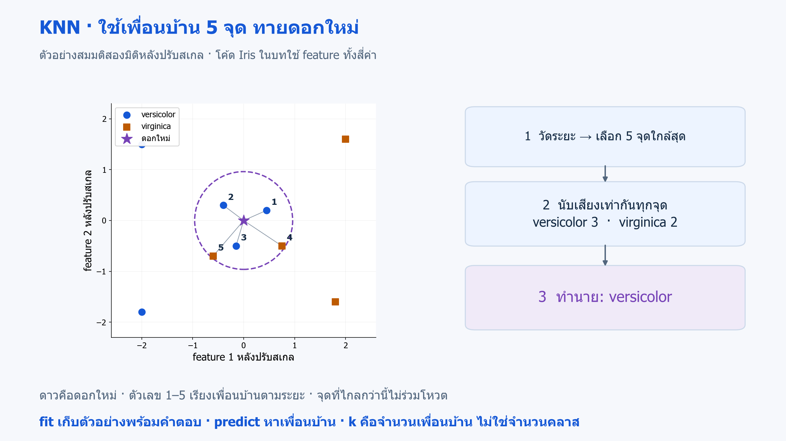
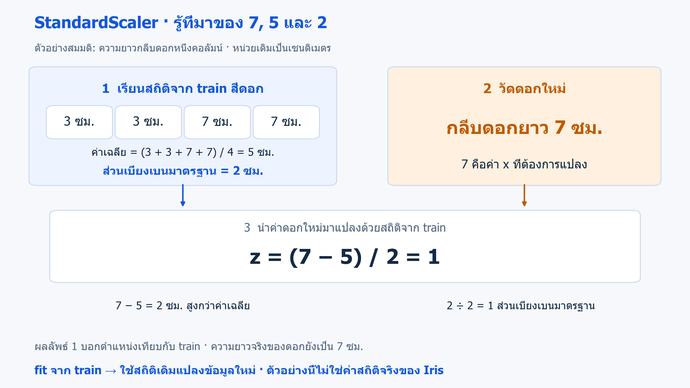
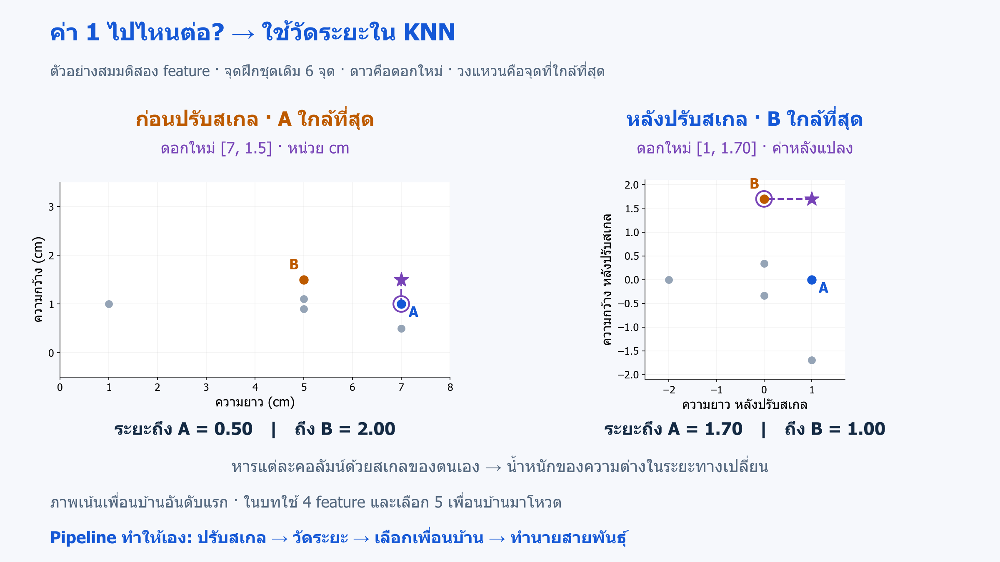

# 03 · โมเดลแรกด้วย scikit-learn และ KNN

[กลับสารบัญ](../../README.md) · [Notebook](lesson.ipynb) · [Python](lesson.py)

บทนี้ใช้ **KNN** ทำนาย Iris จากขนาดกลีบ พร้อมรวมการปรับสเกลและโมเดลเป็น Pipeline

**ใช้สิ่งที่เรียนแล้ว:** X/y, baseline และการเลือก feature จากบท 01–02

## KNN คืออะไร

**KNN ย่อมาจาก K-Nearest Neighbors** เป็นอัลกอริทึมที่ทำนายโดยอาศัยตัวอย่างที่มีค่า feature ใกล้เคียงกันที่สุดจำนวน `k` ตัวอย่าง

KNN สำหรับการทำนายเป็น **Supervised Learning — การเรียนรู้แบบมีผู้สอน** เพราะชุดฝึกมีทั้งข้อมูล `X` และคำตอบ `y` เช่น ขนาดกลีบพร้อมสายพันธุ์ของดอกไม้แต่ละดอก

| ประเภทงาน | คำตอบที่ต้องการ | KNN รวมคำตอบอย่างไร |
|---|---|---|
| **Classification — การจำแนกประเภท** | คลาส เช่น สายพันธุ์ Iris | ลงคะแนนจากคลาสของเพื่อนบ้าน |
| **Regression — การทำนายค่าตัวเลข** | ตัวเลข เช่น ระยะเวลาจัดส่ง | เฉลี่ยค่าคำตอบของเพื่อนบ้าน |

ตัวอย่างทั้งสองแบบนี้ให้น้ำหนักเพื่อนบ้านเท่ากัน ส่วนการให้น้ำหนักตามระยะทางจะพบใน [บท 10](../10-tuning-and-learning-curves/README.md)

**บทนี้ใช้ Classification** ผ่าน `KNeighborsClassifier` ส่วนงาน Regression ใช้ `KNeighborsRegressor` ซึ่งยังไม่ต้องเขียนในบทนี้

คำว่า Classification ใช้เรียก **การจำแนกเป็นประเภทที่มีคำตอบตัวอย่างอยู่แล้ว** ส่วน **Clustering — การจัดกลุ่ม** เป็นการค้นกลุ่มจากความคล้ายโดยไม่มี label กำกับแบบนี้ จะเรียนในบท 13

## หลักการทำงานของ KNN

1. **เตรียมตัวอย่างอ้างอิง:** ตอน `fit` เก็บ feature ของชุดฝึกพร้อมคำตอบ
2. **วัดความใกล้:** ตอน `predict` วัดระยะระหว่างข้อมูลที่ต้องการทำนายกับตัวอย่างในชุดฝึก
3. **เลือกเพื่อนบ้าน:** เลือก `k` ตัวอย่างที่ใกล้ที่สุด
4. **รวมคำตอบ:** โหวตคลาสสำหรับ Classification หรือเฉลี่ยค่าคำตอบสำหรับ Regression

**ตัวอย่าง Classification:** กำหนด `k=5` แล้วเพื่อนบ้านเป็น versicolor 3 ดอก และ virginica 2 ดอก เมื่อให้คะแนนเสียงเท่ากันจึงทาย **versicolor**



**อ่านภาพ:** ดาวคือดอกใหม่ เลข 1–5 เรียงจุดจากใกล้ไปไกล และนับเฉพาะห้าจุดในวงเส้นประ ภาพสมมติใช้สอง feature เพื่อให้มองเห็นระยะได้ ส่วนโค้ดใช้สี่ feature; ภาพนี้ไม่ใช่ผลของดอกใหม่ใน Cell 3 · [เปิดภาพ SVG](../../assets/figures/03-first-classifier-knn.svg)

**ตัวอย่าง Regression:** ถ้าเพื่อนบ้าน 3 รายมีระยะเวลาจัดส่ง 2, 3 และ 4 วัน การเฉลี่ยแบบน้ำหนักเท่ากันจะทาย **3 วัน**

คำว่า “ใกล้” หมายถึงระยะทางจากค่า feature ไม่ใช่แถวที่อยู่ติดกันในตาราง โค้ดนี้ใช้ **Euclidean distance** หรือระยะทางเส้นตรงในพื้นที่ของ feature หลังปรับสเกล เช่น จุดสองมิติที่ต่างกัน 3 และ 4 หน่วยมีระยะ `√(3² + 4²) = 5`

### ค่า k มีผลอย่างไร

`k` คือ **จำนวนเพื่อนบ้าน** ไม่ใช่จำนวนคลาส Iris มี 3 คลาส แต่ใช้ `k=5` ได้

- **k เล็ก:** คำตอบเปลี่ยนตามตัวอย่างใกล้ ๆ ได้มาก จึงไวต่อข้อมูลรบกวนหรือ label ผิด
- **k ใหญ่:** คำตอบเรียบขึ้น แต่อาจรวมตัวอย่างที่ไกลจนกลบรูปแบบเฉพาะบริเวณ

บทนี้กำหนด `k=5` เพื่อเรียนวิธีทำงาน ยังไม่ได้อ้างว่าเป็นค่าที่ดีที่สุด การเลือก k ด้วย **Cross-validation (CV)** อยู่ในบท 10 และต้องไม่เลือกจากคะแนน test

### จุดเด่นและข้อจำกัด

| จุดเด่น | ข้อจำกัดที่ต้องพิจารณา |
|---|---|
| หลักการตรงไปตรงมา ตรวจเพื่อนบ้านที่นำมาใช้ทำนายได้ | ผลขึ้นกับการเลือก feature วิธีวัดระยะทาง และค่า k |
| ใช้ได้ทั้งจำแนกประเภทและทำนายตัวเลข | สเกลที่ต่างกันและ feature ที่ไม่เกี่ยวข้องอาจรบกวนระยะทาง |
| ตามรูปแบบเฉพาะบริเวณได้ โดยไม่กำหนดเส้นแบ่งเป็นเส้นตรง | เมื่อ feature มาก ความใกล้ไกลอาจแยกตัวอย่างได้ยากขึ้น |
| ขั้นฝึกเน้นเก็บตัวอย่างอ้างอิง | ต้องเก็บชุดฝึก และการหาเพื่อนบ้านอาจช้าเมื่อข้อมูลมาก |

ในบทนี้ใช้ KNN กับ Iris ซึ่งมี feature ตัวเลขเพียงสี่ค่า เพื่อให้ตามขั้นตอนตั้งแต่เตรียมข้อมูลจนถึงคำทำนายได้ครบ

## ทำไมต้องใช้ StandardScaler

KNN ใช้ระยะทางในการตัดสินใจ คอลัมน์ที่มีช่วงการกระจายกว้างจึงอาจมีอิทธิพลต่อระยะทางมากกว่าคอลัมน์อื่น แม้ใช้หน่วยเซนติเมตรเหมือนกันก็ตาม

**StandardScaler** ปรับแต่ละคอลัมน์ โดยเทียบค่านั้นกับค่าเฉลี่ยและการกระจายของคอลัมน์ใน train มาดูที่มาของตัวเลขก่อนอ่านสูตร:

1. **ข้อมูลฝึก:** สมมติคอลัมน์ความยาวกลีบดอกของ train สี่ดอกเป็น `[3, 3, 7, 7]` ซม. ค่าเฉลี่ยคือ `(3 + 3 + 7 + 7) / 4 = 5` ซม. และส่วนเบี่ยงเบนมาตรฐานแบบที่ StandardScaler ใช้เท่ากับ **2 ซม.** เพราะตัวอย่างนี้ทุกค่าห่างจากค่าเฉลี่ย 2 ซม.
2. **ข้อมูลที่จะนำมาแปลง:** ต่อมาวัดกลีบดอกของดอกใหม่ได้ **7 ซม.** เลข **7 จึงเป็นค่าข้อมูลเข้า หรือ x** ของดอกนี้ ส่วน 5 และ 2 เป็นสถิติที่เรียนไว้จาก train
3. **แทนค่าในสูตร:** ลบค่าเฉลี่ยเพื่อดูว่าห่างจากค่าเฉลี่ยเท่าไร แล้วหารด้วยส่วนเบี่ยงเบนมาตรฐานเพื่อเปลี่ยนหน่วยของระยะห่างนั้น

`z = (x − ค่าเฉลี่ย train) / ส่วนเบี่ยงเบนมาตรฐาน train`

สำหรับดอกใหม่นี้: **`z = (7 − 5) / 2 = 1`**



**อ่านผล:** ดอกนี้ยังมีกลีบดอกยาว 7 ซม. แต่เราแทน feature ด้วยค่า **1** เพื่อบอกว่าอยู่สูงกว่าค่าเฉลี่ย train หนึ่งส่วนเบี่ยงเบนมาตรฐาน ค่า 1 นี้จึงไม่ใช่ความยาว 1 ซม. หรือรหัสสายพันธุ์ · [เปิดภาพ SVG](../../assets/figures/03-first-classifier-scaling.svg)

ถ้าดอกอื่นวัดได้ **5 ซม.** จะแปลงเป็น **0** เพราะเท่าค่าเฉลี่ย และถ้าวัดได้ **3 ซม.** จะแปลงเป็น **−1** เพราะต่ำกว่าค่าเฉลี่ยหนึ่งส่วนเบี่ยงเบนมาตรฐาน

ตัวเลขด้านบนเป็น **ตัวอย่างสมมติสำหรับอ่านสูตร** ใน Cell 2 `StandardScaler` จะคำนวณค่าเฉลี่ยและส่วนเบี่ยงเบนมาตรฐานของทั้งสี่คอลัมน์จาก `X_train` ให้เอง จึงไม่ต้องใส่ค่า 5 และ 2 ลงในโค้ด

### ได้ค่า 1 แล้ว นำไปทำอะไรต่อ?

**ค่า 1 เป็นข้อมูลเข้าให้ KNN ใช้ต่อ ยังไม่ใช่คำทำนาย** หมายถึง feature นี้สูงกว่าค่าเฉลี่ย train หนึ่งส่วนเบี่ยงเบนมาตรฐาน ไม่ได้หมายถึงสายพันธุ์หมายเลข 1 หรือโอกาสถูก 100%

สำหรับ Iris เราปรับครบทั้งสี่ feature ของแต่ละดอก แล้วให้ KNN ทำตามลำดับ:

**feature หลังปรับสเกล → คำนวณระยะทางกับดอกใน train → เลือก 5 ดอกที่ใกล้ที่สุด → โหวตสายพันธุ์**

จึงไม่ได้ใช้ค่า 1 เพียงค่าเดียวตัดสินสายพันธุ์ แต่ใช้ร่วมกับ feature อื่นที่ปรับสเกลแล้ว ทั้งดอกใหม่และดอกใน train ต้องอยู่บนสเกลเดียวกัน

### การปรับสเกลมีอิทธิพลต่อคำทำนายอย่างไร?

KNN รวมความต่างของทุก feature เพื่อวัดระยะ การหารแต่ละคอลัมน์ด้วยส่วนเบี่ยงเบนมาตรฐานทำให้ความต่างเหล่านั้นมีน้ำหนักต่อระยะทางเปลี่ยนไป เช่น คอลัมน์ที่กระจายกว้างจะถูกหารด้วยค่ามากกว่า **ลำดับเพื่อนบ้านจึงอาจเปลี่ยน และผลโหวตอาจเปลี่ยนตาม**



**อ่านภาพ:** ดอกใหม่คือดาว ก่อนปรับสเกล A ใกล้ที่สุด แต่หลังปรับสเกล B ใกล้ที่สุด ภาพเน้นเพื่อนบ้านอันดับแรกเพื่อให้เห็นผลของสเกล; โค้ดในบทเลือก **5 เพื่อนบ้าน** ไม่ใช่หนึ่งดอก

ภาพใช้ข้อมูลสมมติสองคอลัมน์อีกชุดหนึ่ง เพื่อวาดระยะให้เห็นได้ ความยาวของดอกใหม่ 7 ซม. แปลงเป็น 1 ส่วนความกว้างใช้ค่าเฉลี่ย train 1 ซม. และส่วนเบี่ยงเบนมาตรฐานประมาณ 0.294 ซม. จึงแปลง 1.5 ซม. เป็นประมาณ 1.70 จาก (1.5 − 1) / 0.294 ทั้งสองค่าถูกใช้ร่วมกันในการวัดระยะ ตัวเลขนี้ไม่ใช่ค่าของดอกใน Cell 3 · [เปิดภาพ SVG](../../assets/figures/03-first-classifier-scaling-distance.svg)

**ในโค้ดไม่ต้องทำขั้นตอนนี้เพิ่มเอง:** `model.predict(new_flower)` รับค่าที่วัดเป็นเซนติเมตร แล้ว Pipeline จะปรับสเกลและส่งผลให้ KNN ต่อโดยอัตโนมัติ จึงไม่ต้องแทนค่าใน `new_flower` ด้วย 1 หรือปรับสเกลซ้ำก่อนส่งเข้า Pipeline

ต้องเรียนสถิติจาก **train เท่านั้น** แล้วใช้ค่าเดิมแปลง test และข้อมูลใหม่ เพื่อไม่ให้ข้อมูล test ปนเข้าขั้นฝึก การปรับสเกลไม่ได้ทำให้ข้อมูลมีการแจกแจงปกติ และไม่ได้รับประกันว่าคะแนนจะสูงขึ้นทุกชุดข้อมูล

## Pipeline รวมขั้นตอนอย่างไร

**Pipeline** คือการต่อขั้นตอนเตรียมข้อมูลกับโมเดลให้ทำงานตามลำดับ บทนี้ใช้ `StandardScaler → KNN`

| การเรียก Pipeline | สิ่งที่เกิดขึ้น |
|---|---|
| `fit(X_train, y_train)` | scaler เรียนสถิติและแปลง train → KNN เก็บตัวอย่างพร้อมคำตอบ |
| `predict(X_new)` | scaler ใช้สถิติเดิมแปลงข้อมูล → KNN หาเพื่อนบ้านและคืนคำตอบ |

เมื่อเรียก `model.predict` จึงส่งค่าขนาดกลีบหน่วยเซนติเมตรเข้าไปได้เลย Pipeline จัดการปรับสเกลให้ ข้อมูลที่ส่งเข้าต้องมีสี่คอลัมน์ในลำดับและหน่วยเดียวกับตอนฝึก

## ลงมือทำ

สร้าง Notebook ใหม่แล้วรัน **Cell 1–3 ตามลำดับ** หรือเปิด [Notebook ของบทนี้](lesson.ipynb) ใช้ kernel เดิมได้เลย อ่านคำอธิบายใต้โค้ดแต่ละช่วงประกอบผลที่ได้

<!-- CODE:CELLS -->

<!-- CODE:START -->
### Cell 1 — โหลดและแบ่งข้อมูล

```python
from sklearn.datasets import load_iris
from sklearn.dummy import DummyClassifier
from sklearn.metrics import accuracy_score, classification_report
from sklearn.model_selection import train_test_split
from sklearn.neighbors import KNeighborsClassifier
from sklearn.pipeline import make_pipeline
from sklearn.preprocessing import StandardScaler

data = load_iris()
X_train, X_test, y_train, y_test = train_test_split(
    data.data, data.target, test_size=0.2, stratify=data.target, random_state=42
)
```

**อ่านโค้ด**

- `load_iris()` คืนข้อมูลพร้อมรายละเอียดชุดข้อมูล โดย `data.data` เป็น array ของ feature สี่ค่า และ `data.target` เป็นรหัสคำตอบ
- บทนี้ไม่ได้ขอ `as_frame=True` จึงใช้ array แทน DataFrame แบบบท 02
- `train_test_split` คืน X_train, X_test, y_train, y_test ตามลำดับ โดยจับคู่ข้อมูลกับคำตอบให้ตรงกัน
- `test_size=0.2` กัน test 30 ดอก ส่วน `stratify=data.target` รักษาสัดส่วนคลาส และ seed 42 ใช้ทำซ้ำ

### Cell 2 — ฝึก Pipeline และเทียบ baseline

```python
model = make_pipeline(StandardScaler(), KNeighborsClassifier(n_neighbors=5))
model.fit(X_train, y_train)
baseline = DummyClassifier(strategy="most_frequent").fit(X_train, y_train)
pred = model.predict(X_test)
print(f"Baseline accuracy: {accuracy_score(y_test, baseline.predict(X_test)):.3f}")
print(f"KNN test accuracy: {accuracy_score(y_test, pred):.3f}")
print(classification_report(y_test, pred, target_names=data.target_names))
```

**อ่านโค้ด**

- `make_pipeline(StandardScaler(), KNeighborsClassifier(n_neighbors=5))` ต่อการปรับสเกลกับ KNN ตามลำดับ โดย KNN ใช้เพื่อนบ้าน 5 ตัว
- `model.fit(X_train, y_train)` ให้ scaler เรียนสถิติจาก train แล้วส่งข้อมูลที่ปรับสเกลให้ KNN
- `DummyClassifier(...).fit(...)` สร้างและฝึก baseline ในบรรทัดเดียว โดย `fit` คืนโมเดลที่ฝึกแล้ว ส่วน `strategy="most_frequent"` ให้ทายคลาสพบบ่อยใน train
- `model.predict(X_test)` ใช้ scaler ที่ fit แล้วแปลง test ก่อนทำนาย ไม่ได้เรียนสถิติใหม่จาก test
- `accuracy_score(y_test, pred)` เทียบคำตอบจริงกับคำทำนาย ส่วน `classification_report` แยกคะแนนรายคลาส โดย `target_names` ใส่ชื่อสายพันธุ์ในรายงาน

### Cell 3 — ทำนายดอกไม้ดอกใหม่

```python
new_flower = [[5.1, 3.5, 1.4, 0.2]]
label = model.predict(new_flower)[0]
print("New flower:", data.target_names[label])
```

**อ่านโค้ด**

- `[[5.1, 3.5, 1.4, 0.2]]` ใช้วงเล็บสองชั้นให้ได้ข้อมูลหนึ่งแถว สี่คอลัมน์ ตามรูปแบบ `(n_samples, n_features)` ที่โมเดลรับ
- ค่าทั้งสี่เรียงเป็นความยาว/ความกว้างกลีบเลี้ยง แล้วตามด้วยความยาว/ความกว้างกลีบดอก หน่วยเซนติเมตร
- `predict(new_flower)[0]` เลือกรหัสคำตอบของดอกแรกจากผลทำนายที่เป็น array
- `data.target_names[label]` แปลงรหัสนั้นเป็นชื่อสายพันธุ์ ซึ่งตัวอย่างนี้ได้ setosa
<!-- CODE:END -->

## อ่านผล

- เทียบ accuracy ของ KNN กับ baseline
- ดูคำทำนายของดอกใหม่ ซึ่งได้ **setosa**
- รายงาน precision, recall และ F1 จะอธิบายใน [บท 04](../04-validation-and-metrics/README.md)

## แบบฝึกท้ายบท

**ลองคิด:** fit scaler ก่อนแบ่ง train/test ได้หรือไม่?

<details>
<summary>ดูเฉลย</summary>

**เฉลย:** ไม่ได้ เพราะ scaler จะเรียนสถิติที่ปนข้อมูล test

ต้องแบ่งข้อมูลก่อน แล้ว fit Pipeline เฉพาะ train ส่วน test ให้ใช้สถิติที่เรียนไว้แล้ว

</details>

## อ้างอิง

- [scikit-learn: Pipeline และการเรียกใช้แต่ละขั้น](https://scikit-learn.org/1.7/modules/compose.html)
- [Handbook: Introducing Scikit-Learn](https://jakevdp.github.io/PythonDataScienceHandbook/05.02-introducing-scikit-learn.html)
- [scikit-learn: Nearest Neighbors](https://scikit-learn.org/1.7/modules/neighbors.html)
- [KNeighborsClassifier: ค่า k, weights และระยะทาง](https://scikit-learn.org/1.7/modules/generated/sklearn.neighbors.KNeighborsClassifier.html)
- [KNeighborsRegressor: การเฉลี่ยคำตอบของเพื่อนบ้าน](https://scikit-learn.org/1.7/modules/generated/sklearn.neighbors.KNeighborsRegressor.html)
- [StandardScaler](https://scikit-learn.org/1.7/modules/generated/sklearn.preprocessing.StandardScaler.html)
- [Common pitfalls](https://scikit-learn.org/1.7/common_pitfalls.html)
