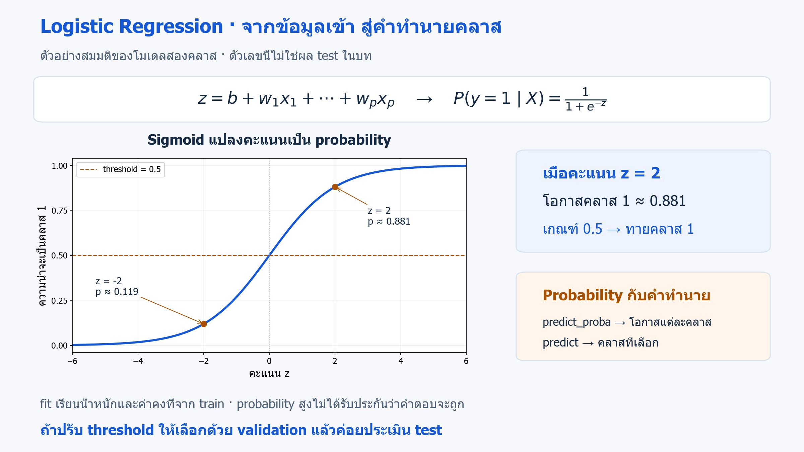
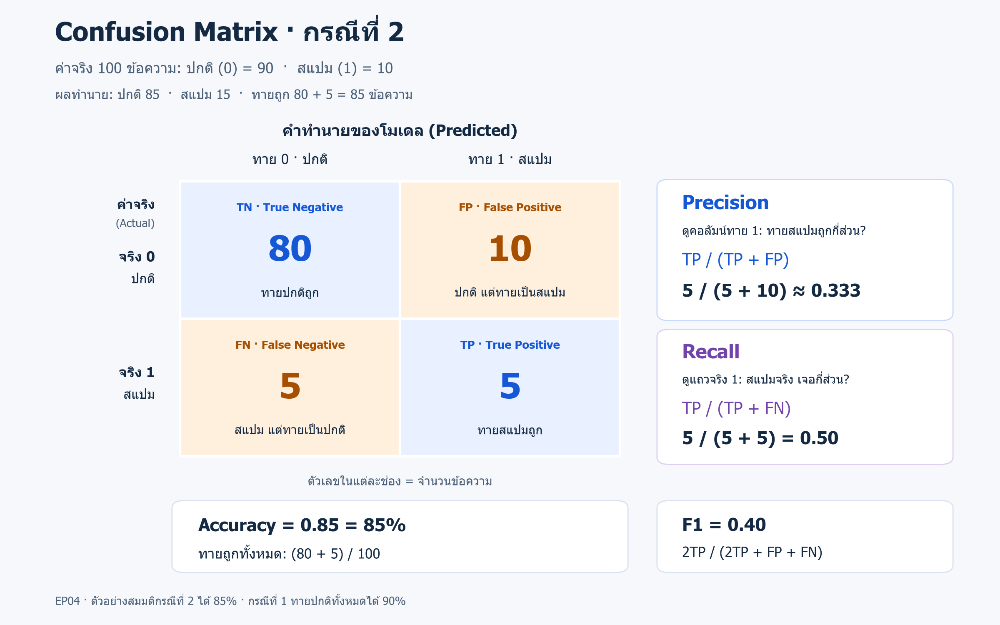

# 04 · Logistic Regression และการวัดผล: accuracy, precision, recall และ F1

[กลับสารบัญ](../../README.md) · [Notebook](lesson.ipynb) · [Python](lesson.py)

บทนี้เรียน **Logistic Regression** สำหรับจำแนกสองคลาส แล้วอ่าน accuracy, precision, recall และ F1 เพื่อใช้ validation เลือกโมเดลก่อนประเมิน test

**ใช้สิ่งที่เรียนแล้ว:** fit/predict, baseline และ Pipeline จากบท 01–03

## Logistic Regression: โมเดลสำหรับ Classification — บทนี้เริ่มจากสองคลาส

**Logistic Regression — การถดถอยโลจิสติก** เป็นโมเดล **Supervised Learning สำหรับ Classification** เรียนจาก X พร้อมคำตอบ y แม้ชื่อมีคำว่า Regression แต่ใช้จำแนกประเภท เช่น สแปมหรือไม่ใช่สแปม ไม่ใช่งาน Regression ที่ทำนายค่าต่อเนื่อง เช่น ราคาบ้าน

Logistic Regression ใช้จำแนกได้ทั้ง **สองคลาสและหลายคลาส**:

| รูปแบบการจำแนก | ตัวอย่างคำตอบที่ต้องการ |
|---|---|
| **Binary classification — สองคลาส** | ไม่ใช่สแปม / สแปม |
| **Multiclass classification — หลายคลาส** | สายพันธุ์ Iris: setosa / versicolor / virginica |

ทั้งสองแบบเป็นงาน **Classification** เหมือนกัน ต่างกันที่จำนวนคลาส ส่วน KNN ในบท 03 ทำได้ทั้งงาน Classification และงาน Regression

**บทนี้ใช้เพียงสองคลาส คือ 0 และ 1** เพื่อฝึกอ่าน confusion matrix และคะแนนของคลาส 1 ก่อน โดยยังไม่ทดลอง Logistic Regression แบบหลายคลาส

**โจทย์ที่ลงมือทำ:** รับ feature ตัวเลข 8 คอลัมน์ แล้วให้โมเดลทำนายคลาส 0 หรือ 1 หนึ่งคำตอบต่อแถว จากนั้นเทียบคำทำนายกับคำตอบจริงเพื่อวัดผล

ก่อนเขียนโค้ด เราจะใช้ **ตัวอย่างสมมติข้อความปกติ/สแปม 100 ข้อความ** เพื่อฝึกอ่านคะแนน ส่วนการทดลองใน Jupyter ใช้ข้อมูลตัวเลขจำลอง จึงไม่ได้อ่านข้อความหรือทำนายสแปมจริง

**หลักการทำงานสำหรับสองคลาสในบทนี้:**

1. ตอน `fit` เรียนค่าน้ำหนักของแต่ละ feature และค่าคงที่จาก train โดยใช้ความผิดพลาดแบบ **log loss** ร่วมกับการควบคุมขนาดน้ำหนัก ค่า log loss เพิ่มมากเมื่อโมเดลมั่นใจแต่ตอบผิดคลาส
2. นำ feature คูณน้ำหนักแล้วรวมกับค่าคงที่ ได้ **คะแนนรวม `z`** จากนั้นใช้ **sigmoid** แปลงเป็นความน่าจะเป็นของคลาส 1 โดย `z` ตรงนี้เป็นคะแนนของโมเดล ไม่ใช่ Z-score จาก StandardScaler ในบท 03
3. `predict_proba` คืนความน่าจะเป็น ส่วน `predict` ใช้เกณฑ์ตัดสินหรือ **threshold** เพื่อคืนคลาส 0/1 โดยบทนี้ใช้เกณฑ์เริ่มต้น 0.5



*ตัวอย่างสมมติสำหรับอธิบายโมเดล ไม่ใช่ผลจากการรันข้อมูลทดสอบ* · [เปิดภาพ SVG](../../assets/figures/04-validation-and-metrics-logistic.svg)

**ตัวอย่าง:** เมื่อโมเดลให้โอกาสเป็นคลาส 1 เท่ากับ 0.8 เกณฑ์ 0.5 จะทาย 1 แต่ถ้าใช้เกณฑ์ 0.9 จะทาย 0 การเปลี่ยนเกณฑ์จึงเปลี่ยน FP/FN ได้ ต้องเลือกเกณฑ์ด้วย validation ตามต้นทุนความผิดพลาด แล้วค่อยประเมิน test

**จุดเด่น:** เป็นโมเดลเริ่มต้นที่ฝึกได้รวดเร็วในหลายงาน และให้ probability เพื่อพิจารณา threshold **ข้อจำกัด:** แนวแบ่งเป็นเชิงเส้นใน feature ที่ป้อนเข้าไป และ probability ที่สูงไม่ได้รับประกันว่าจะทายถูกตามสัดส่วนนั้นจริง

เราจะเทียบกับ **DummyClassifier** จาก [บท 01](../01-ml-workflow/README.md) ซึ่งทายคลาสที่พบบ่อยใน train ทุกแถว แล้วใช้คะแนนต่อไปนี้ตรวจว่า Logistic Regression ช่วยจับคลาส 1 ได้ดีขึ้นเพียงใด

## จากคำทำนายไปสู่ Confusion Matrix

สมมติมีข้อความ **100 ข้อความ: ปกติ 90 และสแปม 10** โดยกำหนดคลาส 0 = ปกติ และคลาส 1 = สแปม ตัวเลข 90/10 นี้บอกจำนวนคำตอบจริง ยังไม่ใช่คะแนนของโมเดล

### กรณีที่ 1 — Baseline ทายว่าปกติทุกข้อความ

Baseline ทายเป็นคลาส 0 ทั้ง 100 ข้อความ จึงถูก 90 และผิด 10

**Accuracy = จำนวนที่ทายถูก ÷ จำนวนทั้งหมด = 90/100 = 0.90 หรือ 90%** แต่ตรวจพบสแปม 0 จาก 10 ข้อความ

### กรณีที่ 2 — โมเดลทายทั้งปกติและสแปม

คราวนี้สมมติให้โมเดลทำนายข้อความ 100 ข้อความชุดเดิม แล้วได้ผลดังนี้:

- ในข้อความปกติ 90 ข้อความ: ทายว่าปกติถูก 80 และทายผิดเป็นสแปม 10
- ในข้อความสแปม 10 ข้อความ: ทายผิดว่าปกติ 5 และทายว่าสแปมถูก 5

รวมแล้วโมเดล **ทายว่าปกติ 85 ข้อความ และทายว่าสแปม 15 ข้อความ** ส่วนที่ทายถูกคือปกติ 80 + สแปม 5 = **85 ข้อความ**

**Accuracy ของกรณีนี้ = (80 + 5)/100 = 0.85 หรือ 85%** จึงต่างจาก 90% ของ baseline เพราะใช้ผลทำนายคนละแบบ ไม่ใช่เปลี่ยนสูตรคำนวณ

### จัดคำตอบจริงและคำทำนายเป็นตาราง

นำผลทำนายจากกรณีที่ 2 มาแยกตามคำตอบจริงและคำทำนาย จะได้ตารางที่เรียกว่า **Confusion matrix** โดย **แถวเป็นค่าจริง และคอลัมน์เป็นคำทำนาย** ตัวเลขในแต่ละช่องคือจำนวนข้อความที่เข้าคู่นั้น

บทนี้เรียกคลาส 1 ที่ต้องการตรวจหา ว่า **positive** และคลาส 0 ว่า **negative**



*สรุปผลทำนายสมมติของกรณีที่ 2* · [เปิดภาพ SVG](../../assets/figures/04-validation-and-metrics-confusion-matrix.svg)

| ค่าจริง / คำทำนาย | ทาย 0: ปกติ | ทาย 1: สแปม |
|---|---|---|
| จริง 0: ปกติ | **TN — True Negative:** 80 ข้อความ ทายปกติถูก | **FP — False Positive:** 10 ข้อความ ปกติแต่ทายเป็นสแปม |
| จริง 1: สแปม | **FN — False Negative:** 5 ข้อความ สแปมแต่ทายเป็นปกติ | **TP — True Positive:** 5 ข้อความ ทายสแปมถูก |

ช่องบนซ้ายกับล่างขวาคือคำทำนายที่ถูก นำ **TN + TP** มาหารจำนวนทั้งหมดจึงได้ accuracy

## อ่านคะแนนอื่นจากผลทำนายชุดเดียวกัน

ใช้ผลทำนายจาก **กรณีที่ 2** คำนวณคะแนนต่อ โดยให้ P แทน precision และ R แทน recall:

| Metric | ใช้ดูอะไร | สูตร | ค่าจากกรณีที่ 2 |
|---|---|---|---|
| Accuracy | ทายถูกทั้งหมดกี่ส่วน | (TP + TN) / N | (5 + 80)/100 = **0.85** |
| Precision | ที่ทายว่าเป็นสแปม ถูกกี่ส่วน | TP / (TP + FP) | 5/(5 + 10) ≈ **0.333** |
| Recall | สแปมจริง ตรวจพบกี่ส่วน | TP / (TP + FN) | 5/(5 + 5) = **0.50** |
| F1 | รวม precision และ recall | 2PR / (P + R) | **0.40** |

N คือจำนวนข้อความทั้งหมด กรณีนี้มี 100 ข้อความ

**เปรียบเทียบให้ชัด:** baseline ได้ accuracy 90% แต่ตรวจไม่พบสแปมเลย ส่วนโมเดลในกรณีที่ 2 ได้ accuracy 85% และตรวจพบสแปม 5 จาก 10 ข้อความ จึงต้องดู recall และ precision ร่วมด้วย ไม่ตัดสินจาก accuracy เพียงค่าเดียว

## เลือกโมเดลด้วย validation ในการทดลอง

การทดลองที่จะทำต่อไปใช้ **ข้อมูลตัวเลขจำลอง 1,500 แถว** แทนตัวอย่างข้อความ 100 ข้อความข้างบน ผลคะแนนจึงเป็นคนละชุดกัน

แบ่งข้อมูลเป็น train 900 แถว, validation 300 แถว และ test 300 แถว แล้วทำตามลำดับนี้:

1. ฝึกโมเดลบน train
2. เลือกโมเดลจาก F1 บน validation
3. ฝึกตัวเลือกนั้นใหม่บน `X_dev` ซึ่งรวม train กับ validation เป็น 1,200 แถว
4. ประเมินด้วย test

**Average precision (AP):** คะแนนที่สรุป precision และ recall จากการเรียงคะแนนทำนายผ่านหลาย threshold

การคำนวณ AP ใช้คะแนนคลาส 1 จาก `predict_proba` ไม่ใช้ label ที่ทายแล้ว และ AP มีความหมายต่างจาก accuracy

## ลงมือทำ

สร้าง Notebook ใหม่แล้วรัน **Cell 1–3 ตามลำดับ** หรือเปิด [Notebook ของบทนี้](lesson.ipynb) ใช้ kernel เดิมได้เลย อ่านคำอธิบายใต้โค้ดแต่ละช่วงประกอบผลที่ได้

<!-- CODE:CELLS -->

<!-- CODE:START -->
### Cell 1 — สร้างข้อมูลและแยก train/validation/test

```python
from sklearn.datasets import make_classification
from sklearn.dummy import DummyClassifier
from sklearn.linear_model import LogisticRegression
from sklearn.metrics import (
    accuracy_score, average_precision_score, confusion_matrix,
    precision_score, recall_score, f1_score,
)
from sklearn.model_selection import train_test_split
from sklearn.pipeline import make_pipeline
from sklearn.preprocessing import StandardScaler

X, y = make_classification(
    n_samples=1500, n_features=8, n_informative=5,
    weights=[0.9, 0.1], flip_y=0.02, random_state=42,
)
X_dev, X_test, y_dev, y_test = train_test_split(
    X, y, test_size=0.2, stratify=y, random_state=42
)
X_train, X_valid, y_train, y_valid = train_test_split(
    X_dev, y_dev, test_size=0.25, stratify=y_dev, random_state=42
)
```

**อ่านโค้ด**

- `make_classification` สร้างข้อมูลจำลอง 1,500 แถว 8 feature โดย `n_informative=5` กำหนดจำนวน feature ที่ใช้สร้างสัญญาณแยกคลาส
- `weights=[0.9, 0.1]` ตั้งสัดส่วนคลาสก่อนเติมความผิดพลาดของ label ด้วย `flip_y=0.02` สัดส่วนสุดท้ายจึงอาจไม่ใช่ 90/10 พอดี
- แบ่งรอบแรกกัน test 20% เหลือ `X_dev` 1,200 แถวสำหรับพัฒนาโมเดล
- แบ่งรอบสองกัน validation 25% **ของ X_dev** คือ 300 แถว จึงเหลือ train 900 แถว

**ผลที่ได้:** ตอนนี้มีข้อมูล train 900 แถว, validation 300 แถว และ test 300 แถว ยังไม่ได้ฝึกหรือทำนาย จึงยังไม่มีคะแนนแสดงใต้ cell

### Cell 2 — เปรียบเทียบโมเดลบน validation

```python
models = {
    "baseline": DummyClassifier(strategy="most_frequent"),
    "logistic": make_pipeline(StandardScaler(), LogisticRegression(max_iter=1000)),
}
valid_scores = {}
for name, model in models.items():
    model.fit(X_train, y_train)
    pred = model.predict(X_valid)
    valid_scores[name] = f1_score(y_valid, pred, zero_division=0)
    print(name, {
        "accuracy": round(accuracy_score(y_valid, pred), 3),
        "precision": round(precision_score(y_valid, pred, zero_division=0), 3),
        "recall": round(recall_score(y_valid, pred), 3),
        "f1": round(valid_scores[name], 3),
    })
```

**อ่านโค้ด**

- `models` เก็บชื่อกับโมเดลแต่ละตัว เพื่อวนฝึกและประเมินด้วยข้อมูลชุดเดียวกัน
- `fit(X_train, y_train)` ใช้ชุดฝึก ส่วน `predict(X_valid)` ใช้ทำนายชุด validation
- `valid_scores[name]` เก็บ F1 ของแต่ละโมเดล เพื่อใช้เลือกใน Cell ถัดไป
- `zero_division=0` ให้รายงาน 0 เมื่อสูตรของ metric นั้นหารด้วยศูนย์ ไม่ได้เปลี่ยนคำทำนายของโมเดล

**การตั้งค่าของโมเดลใน cell นี้**

- `StandardScaler` เรียนค่าเฉลี่ยและส่วนเบี่ยงเบนมาตรฐานจาก train ภายใน Pipeline แล้วใช้ค่าเดิมแปลง validation
- `max_iter=1000` เป็นเพดานรอบของตัวแก้ปัญหา ไม่ได้บังคับให้ฝึกครบ 1,000 รอบ และไม่ใช่ threshold
- `LogisticRegression` รุ่นที่ใช้มี L2 regularization และ `C=1.0` เป็นค่าตั้งต้น เพื่อควบคุมขนาดน้ำหนัก ค่า C น้อยลงควบคุมเข้มขึ้น บทนี้ยังไม่ค้นหาค่า C

**อ่านผล:** บรรทัด baseline และ logistic เป็นคะแนนบน validation 300 แถวของการทดลองนี้ จึงไม่ใช่ 90% และ 85% จากตัวอย่างข้อความก่อนลงมือทำ

### Cell 3 — ฝึกตัวเลือกที่ชนะและประเมิน test

```python
chosen = max(valid_scores, key=valid_scores.get)
final = models[chosen].fit(X_dev, y_dev)
test_pred = final.predict(X_test)
positive_column = list(final.classes_).index(1)
test_probability = final.predict_proba(X_test)[:, positive_column]
print("Selected:", chosen)
print("Test actual counts (class 0, class 1):", (y_test == 0).sum(), (y_test == 1).sum())
print("Test predicted counts (class 0, class 1):", (test_pred == 0).sum(), (test_pred == 1).sum())
print("Test confusion matrix (rows=true, columns=predicted):\n",
      confusion_matrix(y_test, test_pred, labels=[0, 1]))
print(f"Test accuracy: {accuracy_score(y_test, test_pred):.3f}")
print(f"Test F1: {f1_score(y_test, test_pred):.3f}")
print(f"Test average precision: {average_precision_score(y_test, test_probability):.3f}")
```

**อ่านโค้ด**

- `max(valid_scores, key=valid_scores.get)` เลือก **ชื่อโมเดล** ที่มี F1 บน validation สูงสุด
- `models[chosen].fit(X_dev, y_dev)` ฝึกโมเดลที่เลือกใหม่ด้วย train รวม validation ก่อนประเมิน test
- `list(final.classes_).index(1)` หาว่าคลาส 1 อยู่คอลัมน์ใดของผล `predict_proba`
- `[:, positive_column]` เลือก probability ของคลาส 1 ทุกแถว เพื่อใช้คำนวณ average precision
- `confusion_matrix(..., labels=[0, 1])` กำหนดลำดับคลาสของแถวและคอลัมน์ ส่วน F1 ใช้ label จาก `predict` ต่างจาก AP ที่ใช้ probability

**อ่านสรุปก่อนตาราง:** `Test actual counts` นับคำตอบจริง ส่วน `Test predicted counts` นับว่าทายคลาส 0 และ 1 อย่างละกี่แถว เช่น `(test_pred == 1).sum()` นับแถวที่ทายเป็น 1 จำนวนที่ทายเป็น 1 ยังไม่ใช่จำนวนที่ทายถูก ต้องอ่านคู่กับค่าจริงใน confusion matrix

`Test accuracy` ใช้คำทำนาย `test_pred` ชุดเดียวกับตาราง จึงเท่ากับผลรวมแนวทแยงหารด้วยจำนวนแถว test
<!-- CODE:END -->

## อ่านผล

baseline มี accuracy สูง แต่ F1 เป็นศูนย์ ให้เทียบ F1 กับ Logistic Regression บน validation ก่อนดูผล test

**ตัวอย่างผลเมื่อใช้ข้อมูลและ seed ตามบทนี้:** test มีคลาสจริง 0 จำนวน 267 แถว และคลาสจริง 1 จำนวน 33 แถว โมเดลทาย 0 จำนวน 280 แถว และทาย 1 จำนวน 20 แถว

Confusion matrix เป็น `[[263, 4], [17, 16]]`: ทายถูก 263 + 16 = 279 จาก 300 แถว จึงได้ **test accuracy = 279/300 = 0.93 หรือ 93%** ส่วน F1 ประมาณ 0.604

**แยกตัวเลขสามชุด:** 90% เป็น baseline สมมติที่ทายปกติทั้งหมด, 85% เป็นผลสมมติของกรณีที่ 2 และ 93% เป็นผล test ของการทดลองนี้ ต้องอ่านว่ากำลังประเมินคำทำนายชุดใดเสมอ

รายงานหลายคลาสจากบท 03 มีค่าเฉลี่ยสองแบบ:

- **Macro average:** ให้น้ำหนักทุกคลาสเท่ากัน
- **Weighted average:** ถ่วงน้ำหนักตามจำนวนตัวอย่างของคลาสนั้น (`support`)

## แบบฝึกท้ายบท

**ลองคิด:** ถ้าต้องลด FN ควรดูอะไรและเลือก threshold จากชุดใด?

<details>
<summary>ดูเฉลย</summary>

**เฉลย:** ดู recall พร้อมติดตาม precision

ใช้ validation เปรียบเทียบ threshold เช่น 0.3, 0.5 และ 0.7 แล้วตรึงค่าที่เลือกก่อนประเมิน test

</details>

## อ้างอิง

- [Logistic Regression](https://scikit-learn.org/1.7/modules/linear_model.html#logistic-regression)
- [LogisticRegression: พารามิเตอร์และค่าตั้งต้น](https://scikit-learn.org/1.7/modules/generated/sklearn.linear_model.LogisticRegression.html)
- [Accuracy: นับคำทำนายที่ถูกเทียบกับจำนวนทั้งหมด](https://scikit-learn.org/1.7/modules/generated/sklearn.metrics.accuracy_score.html)
- [Confusion matrix: แถวจริงและคอลัมน์ทำนาย](https://scikit-learn.org/1.7/modules/generated/sklearn.metrics.confusion_matrix.html)
- [Metrics and scoring](https://scikit-learn.org/1.7/modules/model_evaluation.html)
- [Cross-validation](https://scikit-learn.org/1.7/modules/cross_validation.html)
- [Google MLCC: Classification](https://developers.google.com/machine-learning/crash-course/classification)
