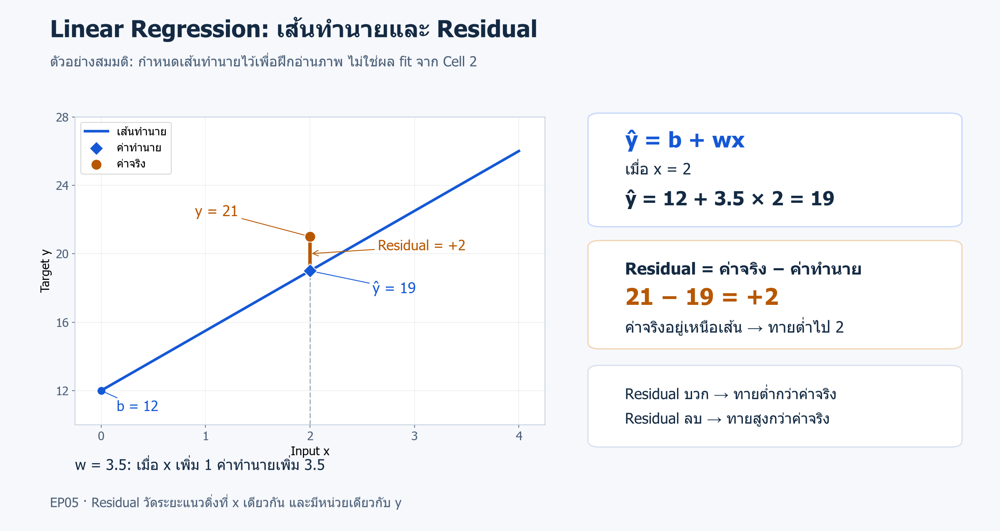
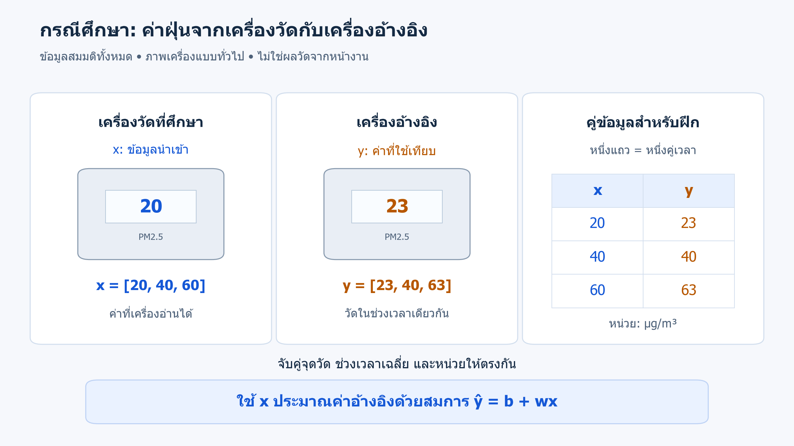
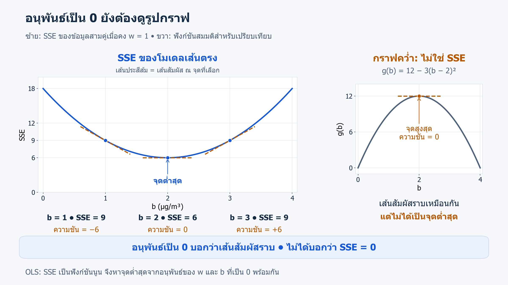
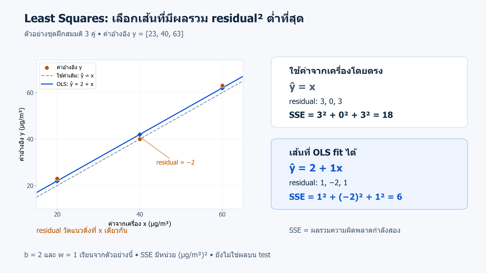
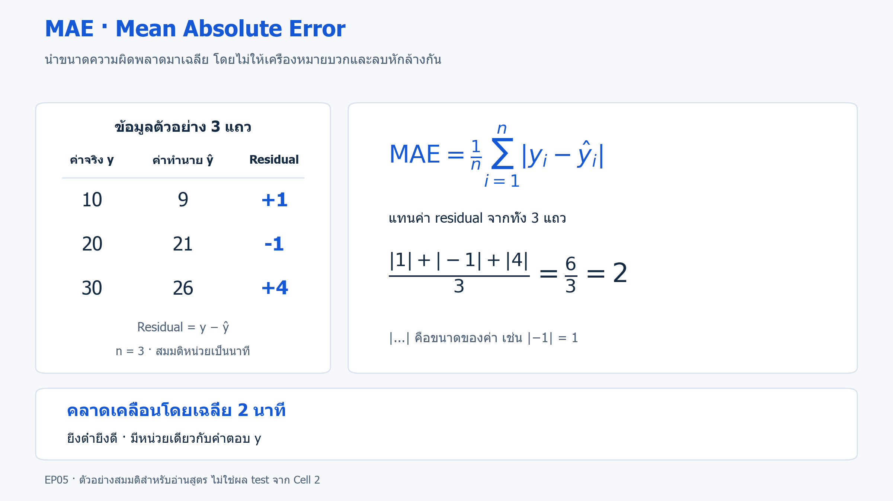
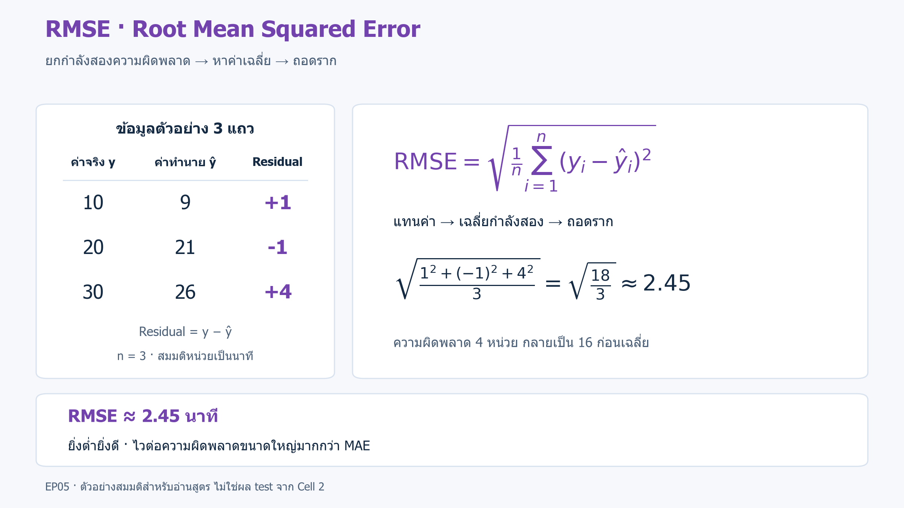
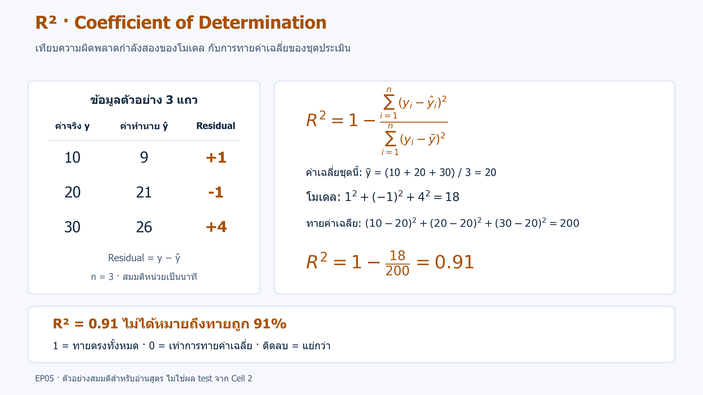
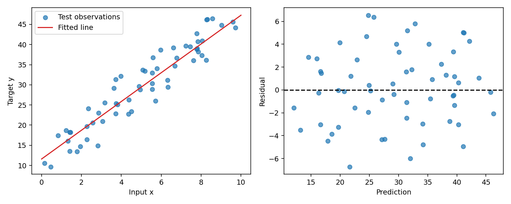

# 05 · Linear Regression และการอ่านความผิดพลาด

[กลับสารบัญ](../../README.md) · [Notebook](lesson.ipynb) · [Python](lesson.py)

บทนี้รับตัวเลข x หนึ่งค่าต่อแถว แล้วใช้ **Linear Regression ทำนายตัวเลข y** จากนั้นเทียบค่าจริงกับคำทำนาย เพื่ออ่าน residual, MAE, RMSE และ R²

**ใช้สิ่งที่เรียนแล้ว:** train/test และ baseline จากบท 01; การสร้าง array และกราฟใช้ NumPy/Matplotlib เดิม

## ใจความใหม่

### Linear Regression คืออะไร

**Linear Regression — การถดถอยเชิงเส้น** เป็นโมเดล **Supervised Learning สำหรับ Regression** เรียนรู้จากข้อมูลฝึกที่มีทั้งข้อมูลนำเข้าและค่าจริงที่เป็นตัวเลข เช่น ระยะทางคู่กับระยะเวลาจัดส่ง จากนั้นใช้ระยะทางของรายการใหม่ทำนายระยะเวลาจัดส่ง

ในโค้ด `X` เก็บ **features — ข้อมูลนำเข้า** ส่วน `y` เก็บ **target — ค่าจริงของตัวแปรที่ต้องการทำนาย**

บทนี้มีข้อมูลนำเข้าเพียงหนึ่งคอลัมน์ จึงเขียนสมการเป็น **ŷ = b + wx** โดย x คือค่าที่ป้อนเข้าไป และ ŷ คือค่าที่โมเดลทำนาย:

- **b — intercept:** ค่าทำนายเมื่อ x = 0 อ่านจาก `intercept_`
- **w — slope:** เมื่อ x เพิ่ม 1 ค่าทำนายเปลี่ยนไป w หน่วย อ่านจาก `coef_[0]`

### Least Squares กับ OLS ต่างกันอย่างไร

**Least Squares (LS) — วิธีกำลังสองน้อยที่สุด** เริ่มจากคำนวณ `(ค่าจริง − ค่าทำนาย)²` แยกแต่ละแถว แล้วเลือกพารามิเตอร์ที่ทำให้ผลรวมของทุกแถวในชุดฝึกต่ำที่สุด

| คำ | หมายถึงอะไร |
|---|---|
| **Least Squares (LS)** | หลักการลดผลรวมความผิดพลาดกำลังสอง ใช้กับแบบจำลองได้หลายรูปแบบ |
| **Ordinary Least Squares (OLS)** | การใช้ Least Squares กับโมเดลเชิงเส้น โดยรวมความผิดพลาดกำลังสองของแต่ละแถวตรง ๆ ไม่มีการถ่วงน้ำหนักแถวให้ต่างกัน |

**OLS เป็นรูปแบบหนึ่งของ Least Squares** คำว่า ordinary ช่วยระบุว่าใช้ผลรวมกำลังสองแบบไม่ถ่วงน้ำหนักแถว ในบริบทการถดถอยเชิงเส้นจึงอาจพบการเรียก OLS สั้น ๆ ว่า least squares

**ในบทนี้:** Linear Regression กำหนดรูปสมการ `ŷ = b + wx` ส่วน OLS ใช้หา w และ b ที่ทำให้ผลรวม `(y − ŷ)²` บน train ต่ำที่สุด ผ่าน `LinearRegression().fit(...)` เส้นที่ได้จึงไม่จำเป็นต้องผ่านทุกจุด

**Residual — ค่าที่ทำนายคลาดจากค่าจริง:** คำนวณด้วย **ค่าจริง − ค่าทำนาย** (`y − ŷ`) เครื่องหมายบวกหรือลบบอกว่าทายต่ำหรือสูงกว่าค่าจริง



**อ่านภาพ:** กำหนด b = 12, w = 3.5 และ x = 2 จะทายได้ 19 หากค่าจริงคือ 21 จะได้ residual = 21 − 19 = +2 หมายถึงทายต่ำไป 2 หน่วย ส่วน residual ติดลบหมายถึงทายสูงกว่าค่าจริง

ภาพนี้กำหนดค่าขึ้นเพื่ออธิบายสมการ ส่วนเส้นที่ฝึกจริงจะเรียนค่าน้ำหนักจากข้อมูล ([เปิดภาพขนาดเต็ม](../../assets/figures/05-linear-regression-residual-explained.svg))

**หลักการทำงาน:** เรียน w และ b จากข้อมูลนำเข้า x ที่จับคู่กับค่าจริง y ในชุดฝึก แล้วใช้สมการทำนายค่า y สำหรับ x ใหม่ หากมีข้อมูลนำเข้าหลายคอลัมน์ จะมีน้ำหนักแยกให้แต่ละคอลัมน์

- **จุดเด่น:** เป็นจุดเริ่มต้นที่เรียบง่าย ทำนายได้รวดเร็ว และอ่านน้ำหนักในสมการได้
- **ข้อจำกัด:** เส้นตรงอาจจับความสัมพันธ์โค้งได้ไม่ครบ และ least squares ไวต่อค่าผิดปกติที่สร้าง error ใหญ่ หากใช้ทำนายนอกช่วงข้อมูลฝึกต้องพิจารณาว่าความสัมพันธ์เดิมยังใช้ได้หรือไม่

### กรณีศึกษา: เปรียบเทียบค่าฝุ่นกับเครื่องอ้างอิง

งานวัดคุณภาพอากาศอาจต้องเปรียบเทียบค่าจากเครื่องที่ศึกษา กับค่าจากเครื่องอ้างอิง เราจะใช้บริบทนี้ฝึกอ่านสมการเส้นตรงและความผิดพลาด

**ข้อมูลและภาพในกรณีศึกษานี้สร้างขึ้นเพื่อการเรียน:** ใช้ชื่อเครื่องทั่วไป ไม่ระบุยี่ห้อ รุ่น ลูกค้า หรือสถานที่ และตัวเลขไม่ใช่ผลวัดจากหน้างาน

สมมติว่าเรามีค่าฝุ่น PM2.5 จากเครื่องทั้งสอง ซึ่งวัดที่จุดเดียวกันและจับคู่ช่วงเวลาเดียวกัน เป้าหมายคือ **ใช้ค่าจากเครื่องที่ศึกษา ประมาณค่าให้สอดคล้องกับเครื่องอ้างอิง**:

- **x:** ค่าจากเครื่องที่ศึกษา สมมติเป็น `[20, 40, 60]`
- **y:** ค่าจากเครื่องอ้างอิงที่จับคู่กัน สมมติเป็น `[23, 40, 63]`
- **ŷ:** ค่าที่สมการทำนายจาก x โดยทุกค่ามีหน่วย **µg/m³ — ไมโครกรัมต่อลูกบาศก์เมตร**



*ภาพวาดเพื่ออธิบายแหล่งข้อมูล ไม่ใช่ภาพเครื่องที่ใช้ในหน้างาน* · [เปิดภาพ SVG](../../assets/figures/05-linear-regression-sensor-pairs.svg)

#### OLS: ตั้งโจทย์ก่อนหาค่า w และ b

ใช้ข้อมูลสมมติ `(x, y) = (20, 23), (40, 40), (60, 63)` ทั้ง 3 คู่เป็น **ชุดฝึก** เรารู้ค่า x และ y แล้ว แต่ยังไม่รู้ w และ b ของเส้น `ŷ = b + wx`

**สิ่งที่ OLS ต้องลด** คือผลรวมความผิดพลาดกำลังสอง หรือ **SSE — Sum of Squared Errors** เขียนจากข้อมูลแต่ละคู่ได้ดังนี้:

```text
SSE(b, w) = [23 − (b + 20w)]²
          + [40 − (b + 40w)]²
          + [63 − (b + 60w)]²
```

เช่น แถวแรกมี x = 20 จึงทำนายเป็น b + 20w แล้วนำไปลบออกจากค่าจริง 23 ก่อนยกกำลังสอง อีกสองแถวคำนวณแบบเดียวกันแล้วนำมารวม

#### ทำไมอนุพันธ์เป็น 0 จึงยังไม่พอ

**อนุพันธ์บอกความชันของกราฟ SSE เมื่อเปลี่ยนพารามิเตอร์** ส่วนค่า SSE บอกผลรวมความผิดพลาดกำลังสอง เป็นคนละปริมาณกัน

**อนุพันธ์เป็น 0 หมายถึงเส้นสัมผัสราบ ณ จุดนั้น แต่ยังไม่ยืนยันว่าเป็นจุดต่ำสุด** สำหรับฟังก์ชันทั่วไป จุดที่อนุพันธ์เป็น 0 อาจเป็นจุดสูงสุด หรือจุดราบที่ไม่ใช่ทั้งจุดสูงสุดและจุดต่ำสุดได้ จึงต้องพิจารณารูปกราฟหรือเงื่อนไขทางคณิตศาสตร์ประกอบ

เพื่อแยกดูทีละตัวแปร **ลองตรึง w = 1 แล้วเลื่อนเฉพาะ b** โดยใช้ข้อมูลสามคู่เดิม ค่าที่ตรึงเป็นเพียงการตั้งไว้สำหรับอ่านกราฟ ยังไม่ได้ใช้กราฟนี้หาทั้ง w และ b:

```text
SSE(b) = (3 − b)² + (−b)² + (3 − b)²
       = 3b² − 12b + 18
       = 3(b − 2)² + 6

อนุพันธ์เทียบกับ b = 6b − 12
```

เช่น เมื่อ b = 2 จะได้อนุพันธ์ `6×2 − 12 = 0` แต่ `SSE = 1² + (−2)² + 1² = 6`



*ภาพซ้ายใช้ข้อมูลฝึกสมมติสามคู่; ภาพขวาใช้ g(b) = 12 − 3(b − 2)² เพื่อแสดงว่าอนุพันธ์เป็น 0 ก็เป็นจุดสูงสุดได้* · [เปิดภาพ SVG](../../assets/figures/05-linear-regression-sse-derivative.svg)

เมื่อเพิ่ม b จากซ้ายไปขวาในกราฟ SSE:

- **ก่อนถึง b = 2:** กราฟลาดลง อนุพันธ์ติดลบ และ SSE ลดลง
- **ที่ b = 2:** เส้นสัมผัสราบ อนุพันธ์เป็น 0 และ SSE ต่ำสุดเท่ากับ 6
- **หลัง b = 2:** กราฟลาดขึ้น อนุพันธ์เป็นบวก และ SSE เพิ่มขึ้น

แม้เส้นสัมผัสจะราบที่ b = 2 แต่เมื่อขยับไป b = 1.9 หรือ 2.1 จะได้ SSE = 6.03 ซึ่งสูงขึ้น การมีอนุพันธ์เป็น 0 จึงไม่ได้หมายความว่า SSE จะคงเดิมเมื่อขยับออกจากจุดนั้น

**เหตุผลที่ใช้กับ OLS ได้:** SSE ของโมเดลเชิงเส้นเป็น **ฟังก์ชันนูน (convex)** ซึ่งมองเป็นผิวรูปชามเมื่อพิจารณา w และ b ร่วมกัน ดังนั้นจุดที่อนุพันธ์เทียบกับ **ทั้ง w และ b เป็น 0 พร้อมกัน** จึงเป็นจุดต่ำสุดของ SSE ภาพที่ตรึง w ไว้ช่วยอธิบายความชันได้เพียงด้านเดียว

เมื่อ x ไม่เท่ากันทุกแถวเหมือนข้อมูลชุดนี้ จะหา w และ b ที่จุดต่ำสุดได้เพียงชุดเดียว จึงใช้อนุพันธ์ทั้งสองตั้งสมการเพื่อหาสูตรความชันและค่าคงที่ของเส้นตรง

<details>
<summary>อ่านเพิ่มเติม: พิสูจน์สูตร w และ b ด้วยอนุพันธ์อย่างละเอียด พร้อมตัวอย่างคำนวณ</summary>

ส่วนนี้หาที่มาของสูตรสำหรับ **เส้นตรงที่มีข้อมูลนำเข้าหนึ่งคอลัมน์และมีค่าคงที่ b** โดยใช้ข้อมูลฝึกทุกแถว สามารถอ่านตามลำดับตั้งแต่ตั้งโจทย์จนได้คำตอบ โดยไม่ต้องเดาค่า w หรือ b ไว้ก่อน

**1. แยกสิ่งที่รู้แล้วออกจากสิ่งที่ต้องหา**

- `xᵢ` และ `yᵢ` คือข้อมูลนำเข้าและค่าจริงของแถวที่ i เมื่อได้รับชุดฝึกแล้วจะถือเป็นค่าคงที่ระหว่างหาสมการ
- `n` คือจำนวนแถว ส่วน `Σ` หมายถึงรวมทุกแถวตั้งแต่ i = 1 ถึง n
- `x̄ = (Σxᵢ)/n` และ `ȳ = (Σyᵢ)/n` คือค่าเฉลี่ยของ x และ y จากชุดฝึก
- `w` คือความชัน และ `b` คือค่าคงที่ของเส้นทำนาย **สองค่านี้เป็นสิ่งที่เราต้องหา**

เขียนค่าทำนาย ความผิดพลาดของแต่ละแถว และผลรวมความผิดพลาดกำลังสองตามลำดับ:

```text
ค่าทำนายแถวที่ i:       ŷᵢ = b + wxᵢ
Residual แถวที่ i:      rᵢ = yᵢ − ŷᵢ = yᵢ − b − wxᵢ

SSE(b, w) = r₁² + r₂² + ... + rₙ²
          = Σrᵢ²
          = Σ(yᵢ − b − wxᵢ)²
```

เราใช้ `rᵢ` เป็นชื่อย่อของ residual เพื่อเขียนสูตรได้สั้นลง เป้าหมายคือหา **w และ b ที่ทำให้ SSE ต่ำที่สุด** ไม่ได้กำหนดให้ residual ทุกแถวต้องเป็นศูนย์

**2. อนุพันธ์ที่ใช้คืออะไร และตัวคูณ −2 มาจากไหน**

SSE ขึ้นอยู่กับพารามิเตอร์สองตัว จึงใช้ **อนุพันธ์ย่อย (partial derivative)** เพื่อดูผลของการเปลี่ยนทีละตัว:

- `∂SSE/∂b` อ่านว่า “อนุพันธ์ย่อยของ SSE เทียบกับ b” คือดูความชันเมื่อเปลี่ยน b โดยคง w ไว้
- `∂SSE/∂w` คือดูความชันเมื่อเปลี่ยน w โดยคง b ไว้

เครื่องหมาย `∂` ใช้เขียนอนุพันธ์ย่อย นิพจน์ `∂SSE/∂b` ไม่ใช่การนำค่า SSE มาหารด้วยค่า b

กฎที่ต้องใช้มีสองส่วน: **อนุพันธ์ของกำลังสอง** และ **กฎลูกโซ่ (chain rule)** ถ้าตั้งชื่อพารามิเตอร์ที่กำลังเปลี่ยนว่า t จะเขียนได้ว่า:

```text
อนุพันธ์ของ r² เทียบกับ t = 2r × อนุพันธ์ของ r เทียบกับ t
```

ต้องคูณอนุพันธ์ของ r อีกครั้ง เพราะ r เองก็เปลี่ยนตามพารามิเตอร์ด้วย สำหรับ `rᵢ = yᵢ − b − wxᵢ`:

```text
เมื่อหาอนุพันธ์เทียบกับ b และคง w ไว้:
∂rᵢ/∂b = 0 − 1 − 0 = −1

เมื่อหาอนุพันธ์เทียบกับ w และคง b ไว้:
∂rᵢ/∂w = 0 − 0 − xᵢ = −xᵢ
```

ค่า yᵢ และ xᵢ มาจากข้อมูล จึงเป็นค่าคงที่ ส่วนอนุพันธ์ของ `−b` เทียบกับ b คือ −1 และอนุพันธ์ของ `−wxᵢ` เทียบกับ w คือ −xᵢ

ลองดูเฉพาะแถวแรกของข้อมูลสมมติ ซึ่งมี x = 20 และ y = 23:

```text
Residual แถวแรก = 23 − b − 20w

อนุพันธ์ของ (23 − b − 20w)² เทียบกับ b
= 2(23 − b − 20w) × (−1)
= −2(23 − b − 20w)

อนุพันธ์ของ (23 − b − 20w)² เทียบกับ w
= 2(23 − b − 20w) × (−20)
= −40(23 − b − 20w)
```

เลข **2** มาจากกำลังสอง ส่วน **−1 หรือ −20** มาจากอนุพันธ์ของนิพจน์ในวงเล็บ สำหรับแถวทั่วไป ตัวคูณกรณี w จึงเป็น **−2xᵢ**

อนุพันธ์ของผลรวมเท่ากับผลรวมของอนุพันธ์ เราจึงคำนวณแยกแต่ละแถวแล้วรวมได้:

```text
∂SSE/∂b = Σ[2rᵢ × (−1)]
        = −2Σrᵢ
        = −2Σ(yᵢ − b − wxᵢ)

∂SSE/∂w = Σ[2rᵢ × (−xᵢ)]
        = −2Σxᵢrᵢ
        = −2Σxᵢ(yᵢ − b − wxᵢ)
```

**3. ทำไมจึงตั้งอนุพันธ์ทั้งสองให้เท่ากับ 0**

เรากำลังหาค่า w และ b ที่ทำให้ความชันของ SSE เป็นศูนย์เมื่อเปลี่ยนพารามิเตอร์แต่ละตัว จึงต้องแก้ **สองสมการพร้อมกัน**:

```text
∂SSE/∂b = 0
∂SSE/∂w = 0
```

สำหรับฟังก์ชันทั่วไป เงื่อนไขนี้อย่างเดียวยังยืนยันจุดต่ำสุดไม่ได้ แต่ **SSE ของโมเดลเชิงเส้นเป็นฟังก์ชันนูน** จึงใช้จุดที่อนุพันธ์ทั้งสองเป็นศูนย์เป็นจุดต่ำสุดได้ ในขั้นที่ 10 จะตรวจด้วยผลรวมกำลังสองอีกครั้งสำหรับข้อมูลสามคู่นี้

การตั้งสมการอนุพันธ์ให้เป็น 0 เป็นวิธีหาค่าพารามิเตอร์ ไม่ใช่การกำหนดให้ค่า SSE เป็น 0 และการคง w ไว้ตอนหาอนุพันธ์เทียบกับ b ก็ไม่ได้หมายความว่าเลือกค่า w สุดท้ายไว้แล้ว

**4. เริ่มจากสมการของ b เพื่อเขียน b ในรูปของ w**

นำอนุพันธ์เทียบกับ b มาเท่ากับศูนย์ แล้วหารทั้งสองข้างด้วย −2:

```text
−2Σ(yᵢ − b − wxᵢ) = 0

  Σ(yᵢ − b − wxᵢ) = 0
```

กระจายผลรวม โดย b มีค่าเดียวกันทุกแถวจึงรวมได้ nb และ w เป็นตัวคูณร่วมจึงนำออกนอกผลรวมได้:

```text
Σyᵢ − Σb − Σ(wxᵢ) = 0

Σyᵢ − nb − wΣxᵢ = 0
```

ย้าย nb ไปอีกข้าง แล้วหารทุกพจน์ด้วย n:

```text
nb = Σyᵢ − wΣxᵢ

 b = (Σyᵢ)/n − w(Σxᵢ)/n
```

แทนชื่อค่าเฉลี่ย `ȳ = (Σyᵢ)/n` และ `x̄ = (Σxᵢ)/n` จึงได้:

```text
b = ȳ − wx̄
```

ตอนนี้ยังไม่ได้ค่าตัวเลขของ b เพราะยังไม่รู้ w แต่รู้แล้วว่า **เมื่อหา w ได้ จะนำไปคำนวณ b จากค่าเฉลี่ยของข้อมูลได้ทันที**

**5. ใช้สมการของ w แล้วแทน b ที่เพิ่งจัดรูปได้**

นำอนุพันธ์เทียบกับ w มาเท่ากับศูนย์ แล้วหารด้วย −2:

```text
−2Σxᵢ(yᵢ − b − wxᵢ) = 0

   Σxᵢ(yᵢ − b − wxᵢ) = 0
```

แทน `b = ȳ − wx̄` เฉพาะตำแหน่ง b แล้วจัดวงเล็บด้านในทีละบรรทัด:

```text
yᵢ − b − wxᵢ
= yᵢ − (ȳ − wx̄) − wxᵢ
= yᵢ − ȳ + wx̄ − wxᵢ
= (yᵢ − ȳ) − w(xᵢ − x̄)
```

เครื่องหมายหน้าวงเล็บเป็นลบ จึงเปลี่ยน `−wx̄` ที่อยู่ในวงเล็บเป็น `+wx̄` เมื่อเปิดวงเล็บ จากนั้นดึง w ออกจากสองพจน์สุดท้าย

นำผลที่ได้กลับไปใส่ในสมการของ w แล้วกระจายผลรวม:

```text
Σxᵢ[(yᵢ − ȳ) − w(xᵢ − x̄)] = 0

Σxᵢ(yᵢ − ȳ) − wΣxᵢ(xᵢ − x̄) = 0

wΣxᵢ(xᵢ − x̄) = Σxᵢ(yᵢ − ȳ)
```

บรรทัดสุดท้ายได้จากการย้ายพจน์ที่มี w ไปอีกข้าง ต่อไปจะเปลี่ยนผลรวมทั้งสองให้เขียนด้วยค่าที่ลบค่าเฉลี่ยแล้ว

**6. ทำไมจึงเปลี่ยน xᵢ ให้เป็น xᵢ − x̄ ในสูตร w ได้**

เริ่มจากสมบัติของค่าเฉลี่ย: ผลรวมของค่าที่ลบค่าเฉลี่ยแล้วเท่ากับศูนย์ เพราะ

```text
Σ(xᵢ − x̄) = Σxᵢ − nx̄
           = Σxᵢ − n[(Σxᵢ)/n]
           = Σxᵢ − Σxᵢ
           = 0
```

ทำแบบเดียวกันกับ y จะได้ `Σ(yᵢ − ȳ) = 0` เช่น ข้อมูล x = [20, 40, 60] มีค่าเฉลี่ย 40 ผลรวมหลังลบค่าเฉลี่ยจึงเป็น `−20 + 0 + 20 = 0`

จากนั้นเขียน `xᵢ = (xᵢ − x̄) + x̄` ซึ่งเป็นค่าเดิม เพราะลบแล้วบวก x̄ กลับเข้าไป

เริ่มจากผลรวมที่คูณกับ w:

```text
Σxᵢ(xᵢ − x̄)
= Σ[(xᵢ − x̄) + x̄](xᵢ − x̄)
= Σ(xᵢ − x̄)² + x̄Σ(xᵢ − x̄)
= Σ(xᵢ − x̄)² + x̄ × 0
= Σ(xᵢ − x̄)²
```

แล้วทำแบบเดียวกันกับผลรวมอีกข้าง:

```text
Σxᵢ(yᵢ − ȳ)
= Σ[(xᵢ − x̄) + x̄](yᵢ − ȳ)
= Σ(xᵢ − x̄)(yᵢ − ȳ) + x̄Σ(yᵢ − ȳ)
= Σ(xᵢ − x̄)(yᵢ − ȳ) + x̄ × 0
= Σ(xᵢ − x̄)(yᵢ − ȳ)
```

จึงไม่ได้เปลี่ยนค่าในสูตรโดยไม่มีเหตุผล พจน์ส่วนที่เพิ่มมาหายไปได้เพราะคูณกับผลรวมที่เป็นศูนย์

**7. ได้สูตร w และ b**

แทนผลรวมที่จัดรูปใหม่ลงในสมการจากขั้นที่ 5:

```text
wΣ(xᵢ − x̄)² = Σ(xᵢ − x̄)(yᵢ − ȳ)
```

ถ้า x มีค่าแตกต่างกันอย่างน้อยสองค่า จะมีอย่างน้อยหนึ่งแถวที่ `xᵢ − x̄` ไม่เป็นศูนย์ ทำให้ผลรวมกำลังสอง `Σ(xᵢ − x̄)² > 0` จึงหารทั้งสองข้างด้วยผลรวมนี้ได้:

```text
w = Σ[(xᵢ − x̄)(yᵢ − ȳ)] ÷ Σ(xᵢ − x̄)²

b = ȳ − wx̄
```

สมการของ b ยังเขียนเป็น `b + wx̄ = ȳ` ได้ จึงเห็นว่า **เส้น OLS ที่มีค่าคงที่ b ผ่านจุดค่าเฉลี่ย (x̄, ȳ)** นี่เป็นผลที่ได้จากการหาอนุพันธ์ ไม่ใช่เงื่อนไขที่เดาขึ้นมาเอง

ถ้า x เท่ากันทุกแถว ตัวส่วนจะเป็น 0 และใช้สูตรหารนี้ไม่ได้ ข้อมูลแบบนั้นไม่เพียงพอที่จะแยกหาความชัน w และค่าคงที่ b ให้ได้คำตอบเพียงชุดเดียว

**8. แทนตัวเลขจากข้อมูลสามคู่ในสมการอนุพันธ์**

กลับมาใช้ข้อมูลฝึกสมมติ `(20, 23), (40, 40), (60, 63)` โดย **ยังไม่ใส่ w = 1 หรือ b = 2 ลงไป** เพื่อดูว่าคำตอบเกิดจากการแก้สมการอย่างไร

จาก `∂SSE/∂b = 0` เมื่อหารด้วย −2 จะได้:

```text
(23 − b − 20w) + (40 − b − 40w) + (63 − b − 60w) = 0

(23 + 40 + 63) − 3b − (20 + 40 + 60)w = 0

126 − 3b − 120w = 0
3b + 120w = 126
 b + 40w = 42
 b = 42 − 40w
```

ส่วน `∂SSE/∂w = 0` เมื่อหารด้วย −2 จะมีค่า x ของแต่ละแถวคูณ residual อยู่:

```text
20(23 − b − 20w) + 40(40 − b − 40w) + 60(63 − b − 60w) = 0
```

กระจายผลคูณแล้วรวมพจน์ชนิดเดียวกัน:

```text
(20×23 + 40×40 + 60×63)
− (20 + 40 + 60)b
− (20² + 40² + 60²)w = 0

(460 + 1600 + 3780) − 120b − (400 + 1600 + 3600)w = 0

5840 − 120b − 5600w = 0
120b + 5600w = 5840
```

ตอนนี้มีสองสมการสำหรับสองพารามิเตอร์ นำ `b = 42 − 40w` จากสมการแรกมาแทนในสมการที่สอง:

```text
120(42 − 40w) + 5600w = 5840
5040 − 4800w + 5600w = 5840
         5040 + 800w = 5840
                800w = 5840 − 5040
                800w = 800
                   w = 1
```

นำ w ที่หาได้กลับไปคำนวณ b:

```text
b = 42 − 40w
  = 42 − 40×1
  = 2
```

จึงได้ **w = 1, b = 2 และเส้นทำนาย ŷ = 2 + x** จากการแก้สมการ ไม่ได้เลือกสองค่านี้เพราะเห็นว่าเส้นดูเหมาะสม ในหัวข้อแทนค่าหลังส่วนที่ยุบนี้จะคำนวณด้วยสูตรค่าเฉลี่ยอีกวิธี ซึ่งให้คำตอบเดียวกัน

**9. แทนคำตอบกลับไปตรวจอนุพันธ์ทั้งสองและค่า SSE**

เมื่อ w = 1 และ b = 2 จะทำนายได้ [22, 42, 62] จึงมี residual เท่ากับ [1, −2, 1]

```text
∂SSE/∂b = −2[1 + (−2) + 1]
        = −2×0
        = 0

∂SSE/∂w = −2[20×1 + 40×(−2) + 60×1]
        = −2[20 − 80 + 60]
        = −2×0
        = 0

SSE = 1² + (−2)² + 1²
    = 1 + 4 + 1
    = 6
```

**อนุพันธ์ทั้งสองเป็น 0 แต่ SSE เท่ากับ 6** เพราะความชันของ SSE กับค่าความผิดพลาดเป็นคนละสิ่งกัน โมเดลยังมี residual แต่หาเส้นตรงเส้นอื่นที่ทำให้ผลรวมกำลังสองต่ำกว่านี้ไม่ได้ ตามการตรวจในขั้นถัดไป

**10. ยืนยันว่าเป็นจุดต่ำสุดเมื่อเปลี่ยนทั้ง w และ b**

เพื่อไม่หยุดแค่คำว่า “อนุพันธ์เป็น 0” ลองขยับจากคำตอบที่หาได้ โดยตั้งชื่อส่วนที่ขยับว่า:

```text
b ใหม่ = 2 + u    โดย u คือส่วนที่เพิ่มหรือลดจาก b = 2
w ใหม่ = 1 + v    โดย v คือส่วนที่เพิ่มหรือลดจาก w = 1
```

u และ v เป็นจำนวนจริง จะบวก ลบ หรือศูนย์ก็ได้ เช่น u = 1, v = 0 หมายถึงเปลี่ยน b เป็น 3 แต่คง w = 1 ไว้ ส่วน u = 0, v = 0 หมายถึงใช้คำตอบเดิม

เมื่อเปลี่ยนพารามิเตอร์ ค่าทำนายจะเปลี่ยนจาก `2 + xᵢ` เป็น:

```text
ŷᵢ ใหม่ = (2 + u) + (1 + v)xᵢ
        = (2 + xᵢ) + (u + vxᵢ)
```

ค่าทำนายจึงเพิ่มขึ้น `u + vxᵢ` และ residual ใหม่จะเท่ากับ **residual เดิม − (u + vxᵢ)** สำหรับทั้งสามแถว:

```text
SSE(2 + u, 1 + v)
= [1 − (u + 20v)]²
  + [−2 − (u + 40v)]²
  + [1 − (u + 60v)]²
```

ใช้สูตร `(a − c)² = a² − 2ac + c²` เปิดกำลังสองทุกแถว แล้วรวมพจน์ที่มี u และ v:

```text
SSE(2 + u, 1 + v)
= 1² + (−2)² + 1²
  − 2u[1 + (−2) + 1]
  − 2v[20×1 + 40×(−2) + 60×1]
  + (u + 20v)² + (u + 40v)² + (u + 60v)²
```

วงเล็บที่คูณกับ −2u และ −2v เป็นศูนย์ทั้งคู่ ซึ่งตรงกับผลรวมในสมการอนุพันธ์ที่เพิ่งตรวจ จึงเหลือ:

```text
SSE(2 + u, 1 + v)
= 6 + (u + 20v)² + (u + 40v)² + (u + 60v)²
≥ 6
```

**ทุกพจน์กำลังสองมีค่าอย่างน้อย 0** ไม่ว่าจะเปลี่ยน u และ v เป็นค่าใด SSE จึงต่ำกว่า 6 ไม่ได้ นี่เป็นการยืนยันจุดต่ำสุดสำหรับการเปลี่ยนทั้งสองพารามิเตอร์ ไม่ใช่ดูแค่กราฟที่ตรึง w ไว้

หากต้องการให้ SSE ยังเท่ากับ 6 พจน์กำลังสองทั้งสามต้องเป็นศูนย์พร้อมกัน:

```text
u + 20v = 0
u + 40v = 0
u + 60v = 0
```

นำสมการที่สองลบสมการแรก จะได้ `20v = 0` จึงมี v = 0 แล้วแทนกลับได้ u = 0 ดังนั้น **ข้อมูลชุดนี้มีคำตอบที่ให้ SSE ต่ำสุดเพียงชุดเดียว คือ b = 2 และ w = 1**

เชื่อมกลับไปยังกราฟ SSE ที่ตรึง w = 1: การคง w ไว้หมายถึง v = 0 จึงเหลือ

```text
SSE(2 + u, 1) = 6 + u² + u² + u²
              = 6 + 3u²
```

เพราะ u = b − 2 จึงเขียนเป็น `SSE(b, 1) = 6 + 3(b − 2)²` ตรงกับกราฟรูปชาม จุดต่ำสุดอยู่ที่ b = 2 และมี SSE = 6

</details>

#### แทนค่าจากข้อมูลทั้งสามคู่เพื่อหา w และ b

ใช้สูตรสำหรับเส้นตรงที่มีข้อมูลนำเข้าหนึ่งคอลัมน์และมีค่าคงที่ b โดย `ค่าเฉลี่ย x` และ `ค่าเฉลี่ย y` คำนวณจากชุดฝึก:

```text
w = ผลรวม [(x − ค่าเฉลี่ย x) × (y − ค่าเฉลี่ย y)]
    ÷ ผลรวม (x − ค่าเฉลี่ย x)²

b = ค่าเฉลี่ย y − w × ค่าเฉลี่ย x
```

สูตร w และ b ใช้ข้อมูลครบทั้งสามคู่ ต่อไปจะคำนวณตามลำดับ: ค่าเฉลี่ย → ตัวเศษและตัวส่วนของ w → b → ค่าทำนาย

**1. หาค่าเฉลี่ยของ x และ y**

```text
ค่าเฉลี่ย x = (20 + 40 + 60) ÷ 3 = 40
ค่าเฉลี่ย y = (23 + 40 + 63) ÷ 3 = 42
```

**2. หาความชัน w**

สำหรับเส้นตรงที่มีข้อมูลนำเข้าหนึ่งคอลัมน์และมีค่าคงที่ b สูตร OLS หา w โดยนำ x และ y ของแต่ละแถวมาลบค่าเฉลี่ยของตัวเอง แล้วคำนวณสองส่วน:

- **ตัวเศษ:** คูณ `(x − ค่าเฉลี่ย x)` กับ `(y − ค่าเฉลี่ย y)` ของแถวเดียวกัน แล้วรวมทุกแถว
- **ตัวส่วน:** ยกกำลังสอง `(x − ค่าเฉลี่ย x)` แล้วรวมทุกแถว

แทนค่าเฉลี่ย x = 40 และค่าเฉลี่ย y = 42 ที่เพิ่งคำนวณได้:

```text
ตัวเศษ = (20−40)×(23−42) + (40−40)×(40−42) + (60−40)×(63−42)
       = (−20)×(−19) + 0×(−2) + 20×21
       = 380 + 0 + 420 = 800

ตัวส่วน = (20−40)² + (40−40)² + (60−40)²
        = 400 + 0 + 400 = 800

w = ตัวเศษ ÷ ตัวส่วน = 800 ÷ 800 = 1
```

**3. หาค่าคงที่ b**

เส้น OLS ที่มีค่าคงที่ b จะผ่านจุดค่าเฉลี่ยของข้อมูล จึงหา b ได้จาก **ค่าเฉลี่ย y − w × ค่าเฉลี่ย x**:

```text
b = 42 − 1×40
  = 2
```

**4. นำค่าที่ได้มาเขียนสมการทำนาย**

แทน **w = 1** และ **b = 2** ใน ŷ = b + wx จึงได้ **ŷ = 2 + 1x** หรือ **ŷ = x + 2**

แทนค่า x ทีละแถวเพื่อดูว่าเส้นที่ fit ได้ทำนายอะไร:

| x | ค่าจริง y | แทนค่าใน ŷ = 2 + 1x | ค่าทำนาย ŷ | Residual = y − ŷ |
|---:|---:|---|---:|---:|
| 20 | 23 | 2 + 1×20 | 22 | 23 − 22 = 1 |
| 40 | 40 | 2 + 1×40 | 42 | 40 − 42 = −2 |
| 60 | 63 | 2 + 1×60 | 62 | 63 − 62 = 1 |

จึงได้ `SSE = 1² + (−2)² + 1² = 6` เส้นที่ fit ได้ยังคลาดเคลื่อนทั้งสามแถว แต่มีผลรวมความผิดพลาดกำลังสองต่ำที่สุดสำหรับข้อมูลชุดนี้

การคำนวณมือแสดงที่มาของค่าที่ `LinearRegression().fit(...)` หาให้สำหรับข้อมูลสามคู่นี้ โดยอ่าน w ได้จาก `coef_[0]` และ b จาก `intercept_` ส่วน Cell 1–3 ใช้ข้อมูลจำลองอีกชุด จึงได้ค่า w และ b ต่างจากกรณีศึกษาฝุ่น

#### Least Squares: เปรียบเทียบความผิดพลาดของสองเส้น

เมื่อได้เส้นจาก OLS แล้ว เปรียบเทียบ SSE กับการใช้ค่าจากเครื่องโดยตรง หรือ ŷ = x โดยคำนวณบนข้อมูลสามคู่ชุดเดียวกัน:

| เส้นที่พิจารณา | ค่าทำนาย ŷ | Residual = y − ŷ | ผลรวม residual² |
|---|---|---|---|
| ใช้ค่าจากเครื่องโดยตรง: **ŷ = x** | 20, 40, 60 | 3, 0, 3 | 3² + 0² + 3² = **18** |
| เส้นที่ OLS fit ได้: **ŷ = 2 + 1x** | 22, 42, 62 | 1, −2, 1 | 1² + (−2)² + 1² = **6** |

**ทำไมต้องยกกำลังสอง?** เพื่อไม่ให้ความผิดพลาดบวกกับลบหักล้างกัน เช่น `1 − 2 + 1 = 0` ทั้งที่ยังทายผิดทุกแถว เมื่อยกกำลังสองจะได้ `1 + 4 + 1 = 6` และความผิดพลาดที่ใหญ่กว่าจะมีผลมากขึ้น

OLS หา **b = 2 และ w = 1** จากข้อมูลสามคู่นี้เอง ไม่ได้จำกัดให้เลือกเพียงสองเส้นในตาราง และไม่ได้กำหนดว่าเครื่องวัดทุกเครื่องต้องบวก 2



*ผลรวมกำลังสองนี้คำนวณบนชุดฝึกสมมติ มีหน่วย (µg/m³)² และยังไม่ใช่ MAE หรือคะแนนบน test* · [เปิดภาพ SVG](../../assets/figures/05-linear-regression-sensor-least-squares.svg)

**จากตัวอย่างไปสู่งานจริง:** fit สมการจาก train แล้วประเมินกับข้อมูลที่กันไว้ เช่น ช่วงเวลาภายหลังที่ไม่ได้ใช้เลือกหรือ fit โมเดล เทียบกับการใช้ค่าจากเครื่องโดยตรงด้วย MAE และ RMSE ซึ่งมีหน่วยเดียวกับค่าฝุ่น พร้อมดู R² และกราฟ residual การ fit ดีบนสามแถวนี้ยังไม่ยืนยันว่าจะใช้กับข้อมูลใหม่ได้ดี

เครื่องอ้างอิงเป็นค่าที่ใช้เทียบในโจทย์ ไม่ได้หมายถึงค่าที่ปราศจากความคลาดเคลื่อน การประมาณนี้ใช้ค่าที่วัดในช่วงเวลาเดียวกัน จึงไม่ใช่การพยากรณ์ฝุ่นล่วงหน้า

แนวคิดการจับคู่ข้อมูลเซนเซอร์กับเครื่องอ้างอิงและใช้สมการเชิงเส้นปรับข้อมูล มีตัวอย่างใน [เครื่องมือวิเคราะห์ของ US EPA](https://www.epa.gov/air-sensor-toolbox/air-sensor-collocation-macro-analysis-tool) กรณีศึกษานี้เป็นการวิเคราะห์ข้อมูล ไม่ได้ระบุอัลกอริทึมภายในเครื่องหรือขั้นตอนปรับตั้งอุปกรณ์

### วัดความผิดพลาดอย่างไร

เริ่มจากมี **ค่าจริงและค่าทำนายของแถวเดียวกัน** แล้วจึงคำนวณความผิดพลาด ตัวอย่างสมมติด้านล่างใช้ค่าคู่นี้ชุดเดียวกันทั้งสาม metric

| Metric | ชื่อเต็มและวิธีอ่าน |
|---|---|
| **MAE** | **Mean Absolute Error:** หาว่าแต่ละแถวทายต่างจากค่าจริงกี่หน่วย โดยไม่คิดเครื่องหมาย แล้วหาค่าเฉลี่ย ยิ่งต่ำยิ่งดี |
| **RMSE** | **Root Mean Squared Error:** ยกกำลังสองความผิดพลาดแต่ละแถว หาค่าเฉลี่ย แล้วถอดรากที่สอง ยิ่งต่ำยิ่งดี และให้ความผิดพลาดขนาดใหญ่มีผลมากกว่า MAE |
| **R²** | **Coefficient of Determination:** เปรียบเทียบผลรวมความผิดพลาดกำลังสองของโมเดล กับการใช้ค่าเฉลี่ย y ของชุดประเมินทายทุกแถว; 1 คือทายตรงทั้งหมด, 0 คือได้ผลรวมเท่ากัน และค่าติดลบคือโมเดลมีผลรวมมากกว่า |

**ตัวอย่างสำหรับคำนวณ MAE, RMSE และ R²:** ค่าจริง `y = [10, 20, 30]` และค่าทำนาย `ŷ = [9, 21, 26]` จึงมี residual `[1, -1, 4]` สมมติให้หน่วยเป็นนาที

**อ่านสัญลักษณ์:** `n` คือจำนวนแถว, `i` คือลำดับแถว, `yᵢ` คือค่าจริง, `ŷᵢ` คือค่าทำนาย และ `Σ` คือรวมค่าทุกแถว ส่วน `ȳ` คือค่าเฉลี่ยของค่าจริงในชุดที่กำลังประเมิน

**MAE — เฉลี่ยขนาดความผิดพลาด**



`|...|` คือค่าสัมบูรณ์ เช่น `|−1| = 1` จึงได้ MAE = (1 + 1 + 4) / 3 = **2 นาที** ([ภาพขนาดเต็ม](../../assets/figures/05-linear-regression-mae-formula.svg))

**RMSE — เฉลี่ยกำลังสองแล้วถอดราก**



ผลรวมกำลังสองคือ 1 + 1 + 16 = 18 จึงได้ RMSE = √(18 / 3) ≈ **2.45 นาที** การยกกำลังสองทำให้ความผิดพลาดขนาดใหญ่มีผลมากขึ้น ([ภาพขนาดเต็ม](../../assets/figures/05-linear-regression-rmse-formula.svg))

**R² — เทียบกับการทายค่าเฉลี่ยของชุดประเมิน**



ค่าเฉลี่ยค่าจริงคือ `ȳ = 20` หากทาย 20 ทุกแถวจะมีผลรวมความผิดพลาดกำลังสอง = (10 − 20)² + (20 − 20)² + (30 − 20)² = **200** ส่วนโมเดลมีผลรวม **18** จึงได้ R² = 1 − 18/200 = **0.91**

ค่า 0.91 ไม่ได้หมายถึงทายถูก 91% แต่หมายถึงลดผลรวมความผิดพลาดกำลังสองได้ 91% เมื่อเทียบกับการทายค่าเฉลี่ยของตัวอย่างชุดนี้ ([ภาพขนาดเต็ม](../../assets/figures/05-linear-regression-r2-formula.svg))

**ตัวอย่างสามแถวนี้ใช้ฝึกคำนวณสูตร** ส่วนการทดลองจริงใช้ test 60 แถว จึงได้คะแนนอีกชุดหนึ่ง

- **หน่วย:** MAE และ RMSE มีหน่วยเดียวกับ y เช่น ถ้า y เป็นนาที MAE = 2 คือคลาดเคลื่อนโดยเฉลี่ย 2 นาที ส่วน R² ไม่ใช่เปอร์เซ็นต์ความถูกต้อง
- **Baseline:** `DummyRegressor` เรียนค่าเฉลี่ยจาก train ซึ่งอาจต่างจากค่าเฉลี่ยของชุดประเมินที่ใช้เป็นจุดอ้างอิงใน R²
- **กราฟ residual:** ดูว่าจุดกระจายรอบศูนย์โดยไม่มีรูปแบบชัดเจนหรือไม่ หากเหลือรูปโค้ง โมเดลอาจยังจับรูปแบบไม่ครบ

การทำนาย y จาก x ได้ดี ยังไม่ได้ยืนยันว่าการเปลี่ยน x เป็นสาเหตุให้ y เปลี่ยน บทนี้กำหนดโมเดลและการทดลองไว้ล่วงหน้า จึงใช้ train/test เพื่อฝึกและรายงานผล หากจะเลือกหรือปรับโมเดลเพิ่มเติม ให้ใช้ validation หรือ cross-validation (CV) ตามบท 04 และเก็บข้อมูลที่ยังไม่ใช้ตัดสินใจไว้ประเมินท้ายสุด

## ลงมือทำ

สร้าง Notebook ใหม่แล้วรัน **Cell 1–3 ตามลำดับ** หรือเปิด [Notebook ของบทนี้](lesson.ipynb) ใช้ kernel เดิมได้เลย อ่านคำอธิบายใต้โค้ดแต่ละช่วงประกอบผลที่ได้

<!-- CODE:CELLS -->

<!-- CODE:START -->
### Cell 1 — สร้างข้อมูลสำหรับทำนายตัวเลข

```python
from pathlib import Path

import matplotlib.pyplot as plt
import numpy as np
from sklearn.dummy import DummyRegressor
from sklearn.linear_model import LinearRegression
from sklearn.metrics import mean_absolute_error, root_mean_squared_error, r2_score
from sklearn.model_selection import train_test_split

rng = np.random.default_rng(42)
X = rng.uniform(0, 10, size=(240, 1))
y = 12 + 3.5 * X[:, 0] + rng.normal(0, 3, size=len(X))
X_train, X_test, y_train, y_test = train_test_split(
    X, y, test_size=0.25, random_state=42
)
```

**อ่านโค้ด**

- `np.random.default_rng(42)` สร้างตัวสุ่มที่ทำซ้ำได้ เพื่อให้ตัวอย่างและ noise เหมือนเดิมเมื่อรันใหม่
- `size=(240, 1)` สร้างข้อมูลนำเข้า `X` เป็น 240 แถว หนึ่งคอลัมน์ ส่วน `X[:, 0]` หยิบคอลัมน์นั้นมาใช้สร้างค่าจริงจำลอง `y` ของแต่ละแถว
- `12 + 3.5 * X[:, 0]` คือสมการจริงที่ตั้งไว้ แล้วเติม noise จาก `rng.normal(0, 3, ...)` ซึ่งมีค่าเฉลี่ย 0 และส่วนเบี่ยงเบนมาตรฐาน 3
- `train_test_split(..., test_size=0.25)` กัน test 25% ได้ train 180 แถว และ test 60 แถว
- สมการ `12 + 3.5 * x` ใช้สร้างข้อมูลจำลองเท่านั้น โมเดลจะเรียน b และ w จาก train เอง ไม่ได้รับค่า 12 และ 3.5 ตอน fit

**ผลที่ได้:** Cell นี้สร้างตัวแปร จึงยังไม่มี output แสดงใต้ cell

### Cell 2 — ฝึกเส้นตรงและวัดความผิดพลาด

```python
baseline = DummyRegressor(strategy="mean").fit(X_train, y_train)
model = LinearRegression().fit(X_train, y_train)
pred = model.predict(X_test)
print("Actual y (first 5):", y_test[:5].round(2))
print("Predicted y (first 5):", pred[:5].round(2))
print(f"Baseline MAE: {mean_absolute_error(y_test, baseline.predict(X_test)):.3f}")
print(f"Linear MAE: {mean_absolute_error(y_test, pred):.3f}")
print(f"Linear RMSE: {root_mean_squared_error(y_test, pred):.3f}")
print(f"Linear R2: {r2_score(y_test, pred):.3f}")
print(f"Learned intercept={model.intercept_:.3f}, slope={model.coef_[0]:.3f}")
```

**อ่านโค้ด**

- `DummyRegressor(strategy="mean")` คำนวณค่าเฉลี่ยของ `y_train` แล้วใช้ค่าเฉลี่ยเดียวกันทายทุกแถว เป็น baseline ของโจทย์ตัวเลข
- `LinearRegression().fit(...)` หา b และ w โดยยกกำลังสองความผิดพลาดแต่ละแถวของ train แล้วรวมกัน และเลือกค่าที่ทำให้ผลรวมต่ำที่สุด จากนั้น `predict(X_test)` คืนตัวเลขทำนายหนึ่งค่าต่อแถว สมการที่เรียนจากข้อมูลชุดนี้จึงต่างจากตัวอย่างฝุ่นสามแถว
- ฟังก์ชัน MAE, RMSE และ R² รับ `y_test` กับ `pred` เพื่อเทียบค่าจริงกับค่าทำนายของแถวเดียวกัน
- `model.intercept_` คือ b ที่เรียนได้ ส่วน `model.coef_[0]` คือ w ของ feature แรก ควรใกล้ 12 และ 3.5 ตามสมการจำลอง

**อ่านผลตามลำดับ:** สองบรรทัดแรกให้เทียบค่าจริงกับคำทำนายห้าแถวแรกในตำแหน่งเดียวกัน ส่วน MAE, RMSE และ R² ถัดมาคำนวณจาก test ทั้ง 60 แถว การปัดเลขด้วย `round(2)` ใช้แสดงผลเท่านั้น

### Cell 3 — วาดเส้นทำนายและ residual

```python
fig, axes = plt.subplots(1, 2, figsize=(10, 4))
grid = np.linspace(0, 10, 100).reshape(-1, 1)
axes[0].scatter(X_test[:, 0], y_test, label="Test observations", alpha=0.7)
axes[0].plot(grid[:, 0], model.predict(grid), color="tab:red", label="Fitted line")
axes[0].set(xlabel="Input x", ylabel="Target y")
axes[0].legend()
axes[1].scatter(pred, y_test - pred, alpha=0.7)
axes[1].axhline(0, color="black", linestyle="--")
axes[1].set(xlabel="Prediction", ylabel="Residual")
fig.tight_layout()
out = Path("outputs/05-linear-regression")
out.mkdir(parents=True, exist_ok=True)
figure_path = out / "regression.png"
fig.savefig(figure_path, dpi=140)
print("Saved figure:", figure_path.resolve())
plt.show()
plt.close(fig)
```

**อ่านโค้ด**

- `np.linspace(...).reshape(-1, 1)` สร้างจุด x สำหรับวาดเส้น แล้วจัดให้เป็นข้อมูลสองมิติที่โมเดลรับ โดย `-1` ให้ NumPy คำนวณจำนวนแถวเอง
- `model.predict(grid)` สร้างค่าบนเส้นที่ฝึกแล้ว ไม่ได้ฝึกโมเดลใหม่ตามจุด grid
- `y_test - pred` คือ residual ใช้วาดเทียบกับคำทำนายในกราฟขวา จุดเหนือศูนย์หมายถึงทายต่ำกว่าค่าจริง ส่วนจุดใต้ศูนย์คือทายสูงกว่าค่าจริง
- `axhline(0)` วางเส้นอ้างอิง residual ศูนย์ ส่วน `savefig` บันทึกภาพก่อนปิด figure ตามวิธีในบท 02
- `Path("outputs/05-linear-regression")` อ้างอิงจากโฟลเดอร์ที่ notebook ทำงาน ส่วน `figure_path.resolve()` แสดงตำแหน่งเต็มของไฟล์ที่บันทึก

**ผลที่ได้:** ตำแหน่งไฟล์จาก `Saved figure:` และกราฟสองช่อง โดย `plt.show()` แสดงกราฟก่อน `plt.close(fig)` ปิด figure
<!-- CODE:END -->

## อ่านผล

ตัวอย่างผลเมื่อใช้ค่าตั้งต้นในบท:

```text
Baseline MAE: 8.599
Linear MAE: 2.663
Linear RMSE: 3.253
Linear R2: 0.895
Learned intercept=11.599, slope=3.567
```

Linear Regression มี MAE ต่ำกว่า baseline บน test ชุดนี้ โดยคลาดเคลื่อนเฉลี่ยประมาณ 2.663 หน่วย ส่วน R² = 0.895 ไม่ได้หมายถึงทายถูก 89.5%

ได้ slope ใกล้ 3.5 และ intercept ใกล้ 12 แต่ไม่จำเป็นต้องตรงพอดี เพราะข้อมูลฝึกมี noise และมีจำนวนจำกัด

- **กราฟซ้าย:** เทียบข้อมูลกับเส้นทำนาย
- **กราฟขวา:** แสดง residual โดยจุดเหนือศูนย์หมายถึงทายต่ำกว่าค่าจริง

ไฟล์ภาพ: `outputs/05-linear-regression/regression.png` ใต้โฟลเดอร์ที่ notebook ทำงาน โดย Cell 3 พิมพ์ตำแหน่งเต็มหลังบันทึก

หาก notebook ทำงานจากโฟลเดอร์ `practics` จะได้ `practics/outputs/05-linear-regression/regression.png`; เมื่อเปิด notebook ของบทโดยตรง อาจได้โฟลเดอร์ปลายทางต่างกัน ให้ดูบรรทัด `Saved figure:` เป็นหลัก



## แบบฝึกท้ายบท

**ลองทำ:** เพิ่มส่วนโค้ง `0.8 * X[:, 0] ** 2` ในสมการข้อมูล แล้วดู residual

<details>
<summary>ดูแนวคำตอบ</summary>

**แนวคำตอบ:** เส้นตรงอาจเหลือรูปโค้งในกราฟ residual

หากจะลอง `PolynomialFeatures` ให้เลือก degree ด้วย validation หรือ CV โดยไม่ใช้ test เลือกค่า

</details>

## อ้างอิง

- [scikit-learn course: ความหมายของ feature, target และ label](https://inria.github.io/scikit-learn-mooc/appendix/glossary.html)

- [Handbook: Linear Regression](https://jakevdp.github.io/PythonDataScienceHandbook/05.06-linear-regression.html)
- [scikit-learn: LinearRegression และ least squares](https://scikit-learn.org/1.7/modules/generated/sklearn.linear_model.LinearRegression.html)
- [scikit-learn: Ordinary Least Squares](https://scikit-learn.org/1.7/modules/linear_model.html#ordinary-least-squares)
- [NIST: Least Squares และที่มาของสูตรความชันกับค่าคงที่](https://www.itl.nist.gov/div898/handbook/pmd/section4/pmd431.htm)
- [NIST: Linear Least Squares Regression](https://www.itl.nist.gov/div898/handbook/pmd/section1/pmd141.htm)
- [US EPA: เปรียบเทียบข้อมูลเซนเซอร์กับเครื่องอ้างอิงและสมการเชิงเส้น](https://www.epa.gov/air-sensor-toolbox/air-sensor-collocation-macro-analysis-tool)
- [scikit-learn: Mean Absolute Error](https://scikit-learn.org/1.7/modules/generated/sklearn.metrics.mean_absolute_error.html)
- [scikit-learn: Root Mean Squared Error](https://scikit-learn.org/1.7/modules/generated/sklearn.metrics.root_mean_squared_error.html)
- [scikit-learn: R² score](https://scikit-learn.org/1.7/modules/generated/sklearn.metrics.r2_score.html)
