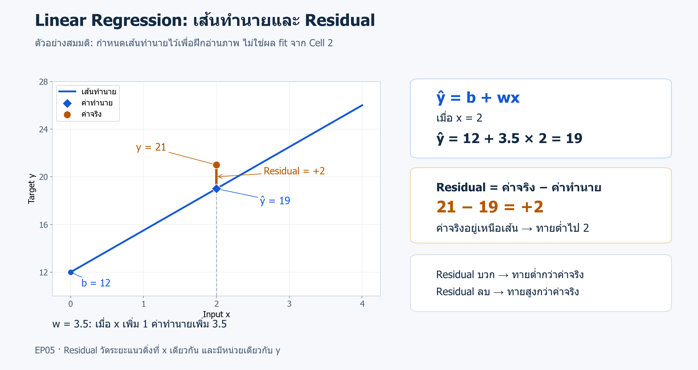
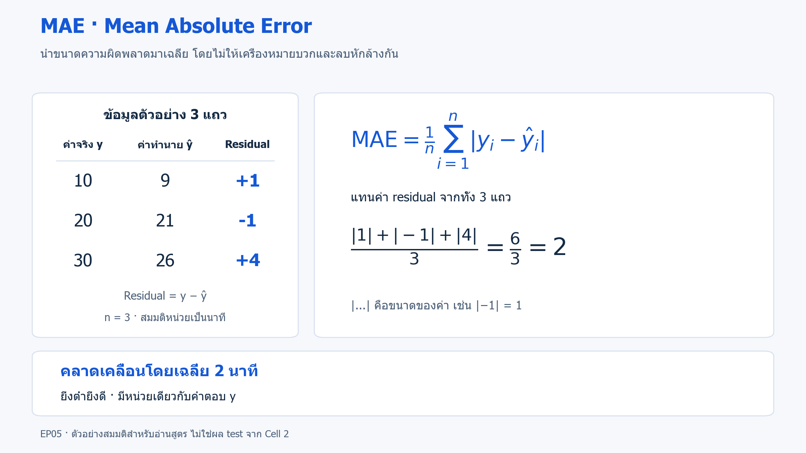
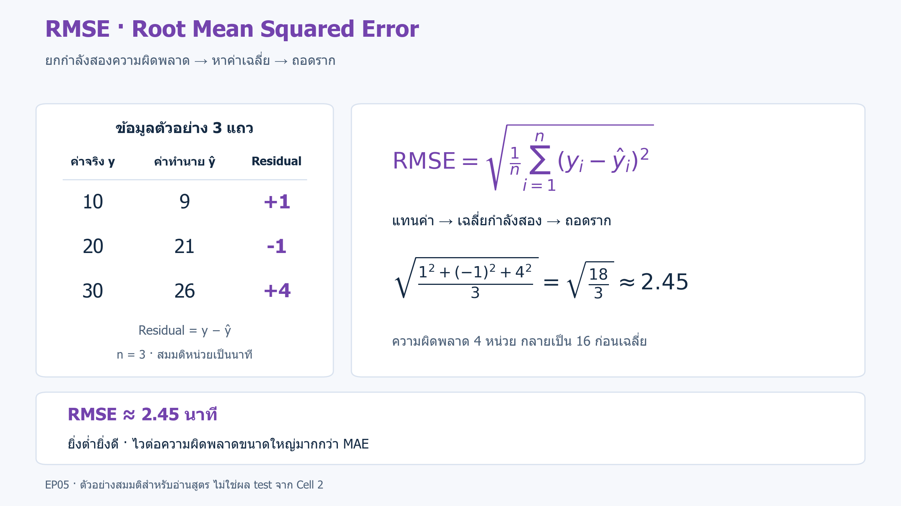
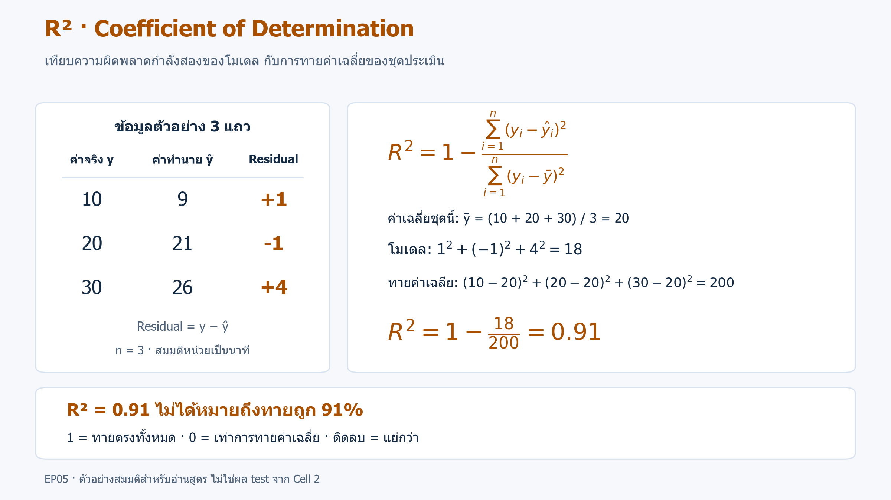
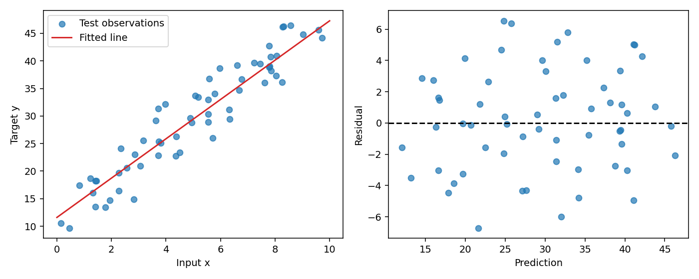

# 05 · Linear Regression และการอ่านความผิดพลาด

[กลับสารบัญ](../../README.md) · [Notebook](lesson.ipynb) · [Python](lesson.py)

บทนี้รับตัวเลข x หนึ่งค่าต่อแถว แล้วใช้ **Linear Regression ทำนายตัวเลข y** จากนั้นเทียบค่าจริงกับคำทำนาย เพื่ออ่าน residual, MAE, RMSE และ R²

**ใช้สิ่งที่เรียนแล้ว:** train/test และ baseline จากบท 01; การสร้าง array และกราฟใช้ NumPy/Matplotlib เดิม

## ใจความใหม่

### Linear Regression คืออะไร

**Linear Regression — การถดถอยเชิงเส้น** เป็นโมเดล **Supervised Learning สำหรับ Regression** เรียนจาก feature พร้อมคำตอบตัวเลข เช่น ใช้ระยะทางทำนายระยะเวลาจัดส่ง

บทนี้ใช้ feature เดียว จึงเขียนสมการเป็น **ŷ = b + wx** โดย ŷ คือคำทำนาย:

- **b — intercept:** ค่าทำนายเมื่อ x = 0 อ่านจาก `intercept_`
- **w — slope:** เมื่อ x เพิ่ม 1 ค่าทำนายเปลี่ยนไป w หน่วย อ่านจาก `coef_[0]`

การ fit แบบ **least squares** เลือก w และ b ให้ผลรวมความผิดพลาดกำลังสองของ train ต่ำที่สุด โดยวัดความผิดพลาดในแนวดิ่งที่ x เดียวกัน

**Residual:** ค่าจริงลบคำทำนาย (`y − ŷ`)



**อ่านภาพ:** กำหนด b = 12, w = 3.5 และ x = 2 จะทายได้ 19 หากค่าจริงคือ 21 จะได้ residual = 21 − 19 = +2 หมายถึงทายต่ำไป 2 หน่วย ส่วน residual ติดลบหมายถึงทายสูงกว่าค่าจริง

ภาพนี้กำหนดค่าขึ้นเพื่ออธิบายสมการ ส่วนเส้นที่ฝึกจริงจะเรียนค่าน้ำหนักจากข้อมูล ([เปิดภาพขนาดเต็ม](../../assets/figures/05-linear-regression-residual-explained.svg))

**หลักการทำงาน:** เรียน w และ b จากคู่ x/y ใน train แล้วใช้สมการนั้นทำนาย x ใหม่ กรณีหลาย feature จะมีน้ำหนักแยกให้แต่ละคอลัมน์

- **จุดเด่น:** เป็นจุดเริ่มต้นที่เรียบง่าย ทำนายได้รวดเร็ว และอ่านน้ำหนักในสมการได้
- **ข้อจำกัด:** เส้นตรงอาจจับความสัมพันธ์โค้งได้ไม่ครบ และ least squares ไวต่อค่าผิดปกติที่สร้าง error ใหญ่ หากใช้ทำนายนอกช่วงข้อมูลฝึกต้องพิจารณาว่าความสัมพันธ์เดิมยังใช้ได้หรือไม่

### วัดความผิดพลาดอย่างไร

เริ่มจากมี **ค่าจริงและค่าทำนายของแถวเดียวกัน** แล้วจึงคำนวณความผิดพลาด ตัวอย่างสมมติด้านล่างใช้ค่าคู่นี้ชุดเดียวกันทั้งสาม metric

| Metric | ชื่อเต็มและวิธีอ่าน |
|---|---|
| **MAE** | **Mean Absolute Error:** นำขนาด residual ที่ไม่คิดเครื่องหมายมาเฉลี่ย ยิ่งต่ำยิ่งดี |
| **RMSE** | **Root Mean Squared Error:** ยกกำลังสอง residual แล้วเฉลี่ยและถอดราก ยิ่งต่ำยิ่งดี และไวต่อความผิดพลาดขนาดใหญ่มากกว่า MAE |
| **R²** | **Coefficient of Determination:** เทียบความผิดพลาดกำลังสองกับการทายค่าเฉลี่ยของชุดประเมิน; 1 คือทายตรงทั้งหมด, 0 คือเท่าการทายค่าเฉลี่ยนั้น และค่าติดลบคือแย่กว่า |

**ตัวอย่างสำหรับคำนวณ MAE, RMSE และ R²:** ค่าจริง `y = [10, 20, 30]` และค่าทำนาย `ŷ = [9, 21, 26]` จึงมี residual `[1, -1, 4]` สมมติให้หน่วยเป็นนาที

**อ่านสัญลักษณ์:** `n` คือจำนวนแถว, `i` คือลำดับแถว, `yᵢ` คือค่าจริง, `ŷᵢ` คือค่าทำนาย และ `Σ` คือรวมค่าทุกแถว ส่วน `ȳ` คือค่าเฉลี่ยของค่าจริงในชุดที่กำลังประเมิน

**MAE — เฉลี่ยขนาดความผิดพลาด**



`|...|` คือค่าสัมบูรณ์ เช่น `|−1| = 1` จึงได้ MAE = (1 + 1 + 4) / 3 = **2 นาที** ([ภาพขนาดเต็ม](../../assets/figures/05-linear-regression-mae-formula.svg))

**RMSE — เฉลี่ยกำลังสองแล้วถอดราก**



ผลรวมกำลังสองคือ 1 + 1 + 16 = 18 จึงได้ RMSE = √(18 / 3) ≈ **2.45 นาที** การยกกำลังสองทำให้ความผิดพลาดขนาดใหญ่มีผลมากขึ้น ([ภาพขนาดเต็ม](../../assets/figures/05-linear-regression-rmse-formula.svg))

**R² — เทียบกับการทายค่าเฉลี่ยของชุดประเมิน**



ค่าเฉลี่ยค่าจริงคือ `ȳ = 20` หากทาย 20 ทุกแถวจะมีผลรวมความผิดพลาดกำลังสอง = (10 − 20)² + (20 − 20)² + (30 − 20)² = **200** ส่วนโมเดลมีผลรวม **18** จึงได้ R² = 1 − 18/200 = **0.91**

ค่า 0.91 ไม่ได้หมายถึงทายถูก 91% แต่หมายถึงลดผลรวมความผิดพลาดกำลังสองได้ 91% เมื่อเทียบกับการทายค่าเฉลี่ยของตัวอย่างชุดนี้ ([ภาพขนาดเต็ม](../../assets/figures/05-linear-regression-r2-formula.svg))

**ตัวอย่างสามแถวนี้ใช้ฝึกคำนวณสูตร** ส่วนการทดลองจริงใช้ test 60 แถว จึงได้คะแนนอีกชุดหนึ่ง

- **หน่วย:** MAE และ RMSE มีหน่วยเดียวกับ y เช่น ถ้า y เป็นนาที MAE = 2 คือคลาดเคลื่อนโดยเฉลี่ย 2 นาที ส่วน R² ไม่ใช่เปอร์เซ็นต์ความถูกต้อง
- **Baseline:** `DummyRegressor` เรียนค่าเฉลี่ยจาก train ซึ่งอาจต่างจากค่าเฉลี่ยของชุดประเมินที่ใช้เป็นจุดอ้างอิงใน R²
- **กราฟ residual:** ดูว่าจุดกระจายรอบศูนย์โดยไม่มีรูปแบบชัดเจนหรือไม่ หากเหลือรูปโค้ง โมเดลอาจยังจับรูปแบบไม่ครบ

ผลนี้ไม่ได้ยืนยันเหตุและผล บทนี้กำหนดโมเดลและการทดลองไว้ล่วงหน้า จึงใช้ train/test เพื่อฝึกและรายงานผล หากจะเลือกหรือปรับโมเดลเพิ่มเติม ให้ใช้ validation หรือ cross-validation (CV) ตามบท 04 และเก็บข้อมูลที่ยังไม่ใช้ตัดสินใจไว้ประเมินท้ายสุด

## ลงมือทำ

สร้าง Notebook ใหม่แล้วรัน **Cell 1–3 ตามลำดับ** หรือเปิด [Notebook ของบทนี้](lesson.ipynb) ใช้ kernel เดิมได้เลย อ่านคำอธิบายใต้โค้ดแต่ละช่วงประกอบผลที่ได้

<!-- CODE:CELLS -->

<!-- CODE:START -->
### Cell 1 — สร้างข้อมูลสำหรับทำนายตัวเลข

```python
from pathlib import Path

import matplotlib.pyplot as plt
import numpy as np
from sklearn.dummy import DummyRegressor
from sklearn.linear_model import LinearRegression
from sklearn.metrics import mean_absolute_error, root_mean_squared_error, r2_score
from sklearn.model_selection import train_test_split

rng = np.random.default_rng(42)
X = rng.uniform(0, 10, size=(240, 1))
y = 12 + 3.5 * X[:, 0] + rng.normal(0, 3, size=len(X))
X_train, X_test, y_train, y_test = train_test_split(
    X, y, test_size=0.25, random_state=42
)
```

**อ่านโค้ด**

- `np.random.default_rng(42)` สร้างตัวสุ่มที่ทำซ้ำได้ เพื่อให้ตัวอย่างและ noise เหมือนเดิมเมื่อรันใหม่
- `size=(240, 1)` สร้าง X เป็น 240 แถว หนึ่ง feature ส่วน `X[:, 0]` หยิบค่าคอลัมน์นั้นมาเป็นเวกเตอร์สำหรับสร้าง y
- `12 + 3.5 * X[:, 0]` คือสมการจริงที่ตั้งไว้ แล้วเติม noise จาก `rng.normal(0, 3, ...)` ซึ่งมีค่าเฉลี่ย 0 และส่วนเบี่ยงเบนมาตรฐาน 3
- `train_test_split(..., test_size=0.25)` กัน test 25% ได้ train 180 แถว และ test 60 แถว
- สมการ `12 + 3.5 * x` ใช้สร้างข้อมูลจำลองเท่านั้น โมเดลจะเรียน b และ w จาก train เอง ไม่ได้รับค่า 12 และ 3.5 ตอน fit

**ผลที่ได้:** Cell นี้สร้างตัวแปร จึงยังไม่มี output แสดงใต้ cell

### Cell 2 — ฝึกเส้นตรงและวัดความผิดพลาด

```python
baseline = DummyRegressor(strategy="mean").fit(X_train, y_train)
model = LinearRegression().fit(X_train, y_train)
pred = model.predict(X_test)
print("Actual y (first 5):", y_test[:5].round(2))
print("Predicted y (first 5):", pred[:5].round(2))
print(f"Baseline MAE: {mean_absolute_error(y_test, baseline.predict(X_test)):.3f}")
print(f"Linear MAE: {mean_absolute_error(y_test, pred):.3f}")
print(f"Linear RMSE: {root_mean_squared_error(y_test, pred):.3f}")
print(f"Linear R2: {r2_score(y_test, pred):.3f}")
print(f"Learned intercept={model.intercept_:.3f}, slope={model.coef_[0]:.3f}")
```

**อ่านโค้ด**

- `DummyRegressor(strategy="mean")` เรียนค่าเฉลี่ย y_train แล้วใช้ค่านั้นทายทุกแถว เป็น baseline ของโจทย์ตัวเลข
- `LinearRegression().fit(...)` สร้างโมเดลและฝึกในบรรทัดเดียว จากนั้น `predict(X_test)` คืนตัวเลขทำนายหนึ่งค่าต่อแถว
- ฟังก์ชัน MAE, RMSE และ R² รับ `y_test` กับ `pred` เพื่อเทียบคำตอบจริงกับคำทำนายชุดเดียวกัน
- `model.intercept_` คือ b ที่เรียนได้ ส่วน `model.coef_[0]` คือ w ของ feature แรก ควรใกล้ 12 และ 3.5 ตามสมการจำลอง

**อ่านผลตามลำดับ:** สองบรรทัดแรกให้เทียบค่าจริงกับคำทำนายห้าแถวแรกในตำแหน่งเดียวกัน ส่วน MAE, RMSE และ R² ถัดมาคำนวณจาก test ทั้ง 60 แถว การปัดเลขด้วย `round(2)` ใช้แสดงผลเท่านั้น

### Cell 3 — วาดเส้นทำนายและ residual

```python
fig, axes = plt.subplots(1, 2, figsize=(10, 4))
grid = np.linspace(0, 10, 100).reshape(-1, 1)
axes[0].scatter(X_test[:, 0], y_test, label="Test observations", alpha=0.7)
axes[0].plot(grid[:, 0], model.predict(grid), color="tab:red", label="Fitted line")
axes[0].set(xlabel="Input x", ylabel="Target y")
axes[0].legend()
axes[1].scatter(pred, y_test - pred, alpha=0.7)
axes[1].axhline(0, color="black", linestyle="--")
axes[1].set(xlabel="Prediction", ylabel="Residual")
fig.tight_layout()
out = Path("outputs/05-linear-regression")
out.mkdir(parents=True, exist_ok=True)
figure_path = out / "regression.png"
fig.savefig(figure_path, dpi=140)
print("Saved figure:", figure_path.resolve())
plt.show()
plt.close(fig)
```

**อ่านโค้ด**

- `np.linspace(...).reshape(-1, 1)` สร้างจุด x สำหรับวาดเส้น แล้วจัดให้เป็นข้อมูลสองมิติที่โมเดลรับ โดย `-1` ให้ NumPy คำนวณจำนวนแถวเอง
- `model.predict(grid)` สร้างค่าบนเส้นที่ฝึกแล้ว ไม่ได้ฝึกโมเดลใหม่ตามจุด grid
- `y_test - pred` คือ residual ใช้วาดเทียบกับคำทำนายในกราฟขวา จุดเหนือศูนย์หมายถึงทายต่ำกว่าค่าจริง ส่วนจุดใต้ศูนย์คือทายสูงกว่าค่าจริง
- `axhline(0)` วางเส้นอ้างอิง residual ศูนย์ ส่วน `savefig` บันทึกภาพก่อนปิด figure ตามวิธีในบท 02
- `Path("outputs/05-linear-regression")` อ้างอิงจากโฟลเดอร์ที่ notebook ทำงาน ส่วน `figure_path.resolve()` แสดงตำแหน่งเต็มของไฟล์ที่บันทึก

**ผลที่ได้:** ตำแหน่งไฟล์จาก `Saved figure:` และกราฟสองช่อง โดย `plt.show()` แสดงกราฟก่อน `plt.close(fig)` ปิด figure
<!-- CODE:END -->

## อ่านผล

ตัวอย่างผลเมื่อใช้ค่าตั้งต้นในบท:

```text
Baseline MAE: 8.599
Linear MAE: 2.663
Linear RMSE: 3.253
Linear R2: 0.895
Learned intercept=11.599, slope=3.567
```

Linear Regression มี MAE ต่ำกว่า baseline บน test ชุดนี้ โดยคลาดเคลื่อนเฉลี่ยประมาณ 2.663 หน่วย ส่วน R² = 0.895 ไม่ได้หมายถึงทายถูก 89.5%

ได้ slope ใกล้ 3.5 และ intercept ใกล้ 12 แต่ไม่จำเป็นต้องตรงพอดี เพราะข้อมูลฝึกมี noise และมีจำนวนจำกัด

- **กราฟซ้าย:** เทียบข้อมูลกับเส้นทำนาย
- **กราฟขวา:** แสดง residual โดยจุดเหนือศูนย์หมายถึงทายต่ำกว่าค่าจริง

ไฟล์ภาพ: `outputs/05-linear-regression/regression.png` ใต้โฟลเดอร์ที่ notebook ทำงาน โดย Cell 3 พิมพ์ตำแหน่งเต็มหลังบันทึก

หาก notebook ทำงานจากโฟลเดอร์ `practics` จะได้ `practics/outputs/05-linear-regression/regression.png`; เมื่อเปิด notebook ของบทโดยตรง อาจได้โฟลเดอร์ปลายทางต่างกัน ให้ดูบรรทัด `Saved figure:` เป็นหลัก



## แบบฝึกท้ายบท

**ลองทำ:** เพิ่มส่วนโค้ง `0.8 * X[:, 0] ** 2` ในสมการข้อมูล แล้วดู residual

<details>
<summary>ดูแนวคำตอบ</summary>

**แนวคำตอบ:** เส้นตรงอาจเหลือรูปโค้งในกราฟ residual

หากจะลอง `PolynomialFeatures` ให้เลือก degree ด้วย validation หรือ CV โดยไม่ใช้ test เลือกค่า

</details>

## อ้างอิง

- [Handbook: Linear Regression](https://jakevdp.github.io/PythonDataScienceHandbook/05.06-linear-regression.html)
- [scikit-learn: LinearRegression และ least squares](https://scikit-learn.org/1.7/modules/generated/sklearn.linear_model.LinearRegression.html)
- [scikit-learn: Mean Absolute Error](https://scikit-learn.org/1.7/modules/generated/sklearn.metrics.mean_absolute_error.html)
- [scikit-learn: Root Mean Squared Error](https://scikit-learn.org/1.7/modules/generated/sklearn.metrics.root_mean_squared_error.html)
- [scikit-learn: R² score](https://scikit-learn.org/1.7/modules/generated/sklearn.metrics.r2_score.html)
