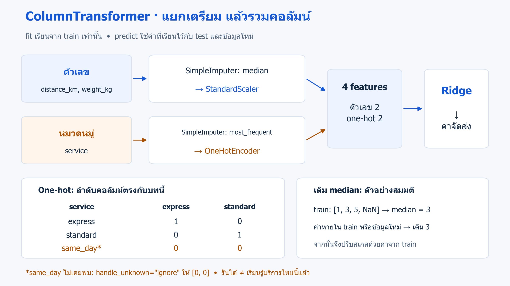
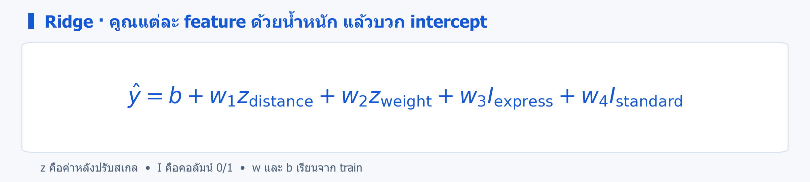
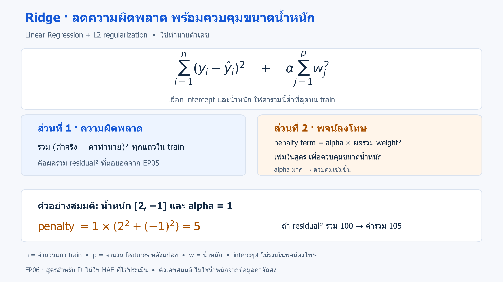
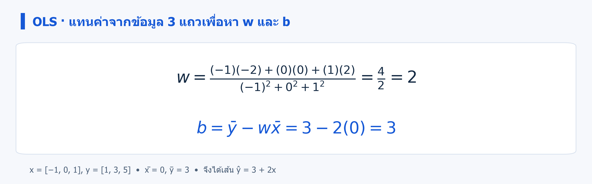
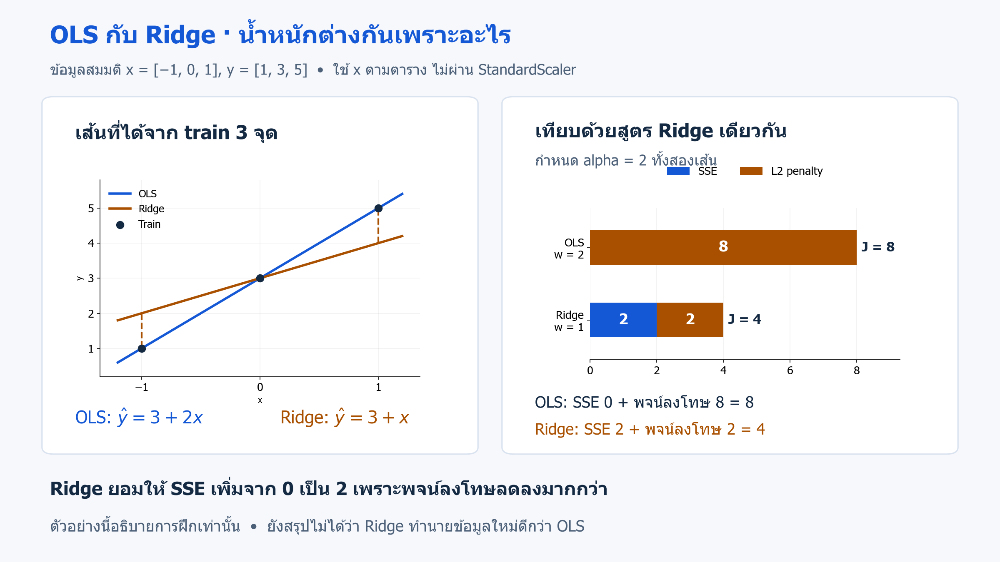
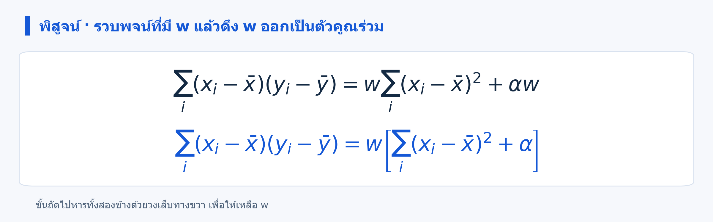
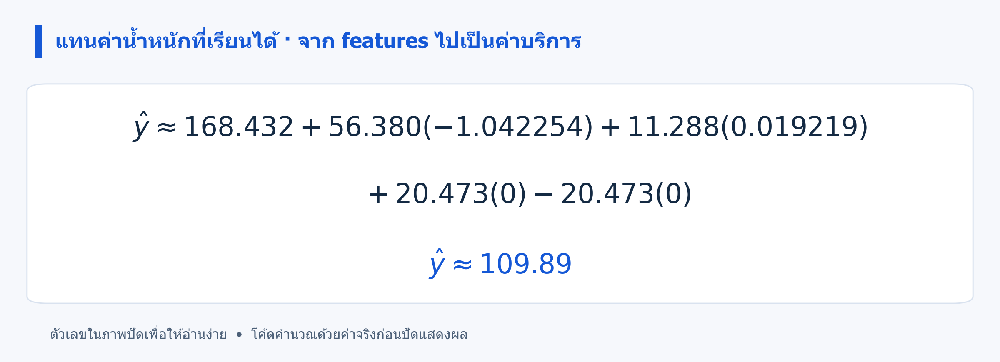

# 06 · Ridge Regression กับการเตรียมตัวเลข หมวดหมู่ และค่าที่หาย

[กลับสารบัญ](../../README.md) · [Notebook](lesson.ipynb) · [Python](lesson.py)

บทนี้เตรียมตารางที่มีตัวเลข หมวดหมู่ และค่าหายด้วย **ColumnTransformer** แล้วเรียน **Ridge Regression** เพื่อทำนายค่าบริการส่งสินค้าจำลอง

**ใช้สิ่งที่เรียนแล้ว:** pandas, Pipeline/StandardScaler จาก [บท 03](../03-first-classifier/README.md) และ regression/MAE จาก [บท 05](../05-linear-regression/README.md)

## เตรียมข้อมูลคนละชนิดให้โมเดลใช้ร่วมกัน

**Feature Engineering — การสร้างหรือปรับรูปแบบ feature** คือการสร้างหรือแปลงข้อมูลนำเข้าให้โมเดลใช้ได้เหมาะสม เช่น สร้างระยะทางจากพิกัด หรือเปลี่ยนประเภทบริการเป็นตัวเลข บทนี้เน้นเตรียมคอลัมน์ที่มีอยู่ให้โมเดลรับได้

**ColumnTransformer** แยกคอลัมน์ไปเตรียมตามชนิดข้อมูล เช่น ส่งระยะทางกับน้ำหนักไปเติมค่าหายและปรับสเกล ส่วนประเภทบริการแปลงเป็นคอลัมน์ 0/1 แล้วนำผลมาต่อเป็นตารางตัวเลขชุดเดียวให้โมเดลใช้



*อ่านจากข้อมูลดิบ → เติมค่าหายและแปลงหมวดหมู่ → Ridge → ค่าบริการหนึ่งตัวเลข ตัวอย่าง median ด้านล่างสมมติขึ้นเพื่ออธิบายการเติมค่า* · [เปิดภาพ SVG](../../assets/figures/06-feature-engineering-preprocessing.svg)

### SimpleImputer: คำนวณค่าทดแทนจาก train แล้วนำไปเติมช่องว่าง

- **ตัวเลข:** เติมด้วยมัธยฐานของคอลัมน์ เช่น train มี `[1, 3, 5, NaN]` จะคำนวณมัธยฐานจากค่าที่มีอยู่ ได้ 3 แล้วเก็บค่านี้ไว้เติมช่องว่าง ทั้งใน train และข้อมูลใหม่
- **หมวดหมู่:** เติมด้วยค่าที่พบบ่อย เช่น `[express, express, standard]` จะเลือก express ซึ่งพบมากที่สุด แล้วเก็บค่านี้ไว้เติมช่องว่าง

### fit กับ transform ต่างกันอย่างไร

**แบ่ง train/test ก่อน แล้วใช้เฉพาะ train เพื่อเรียนรู้ค่าที่ใช้เตรียมข้อมูล** ส่วน test และข้อมูลใหม่ยังต้องผ่านการเตรียมข้อมูลเหมือนกัน โดยใช้ค่าที่เก็บจาก train

- **fit = เรียนรู้ค่าที่ต้องใช้** เช่น มัธยฐานสำหรับเติมช่องว่าง ค่าเฉลี่ยและส่วนเบี่ยงเบนมาตรฐานสำหรับปรับสเกล และรายการหมวดหมู่สำหรับ one-hot
- **transform = แปลงข้อมูลโดยใช้ผลจาก fit** ตัวเติมค่าใช้ค่าทดแทนเดิม ตัวปรับสเกลใช้ค่าเฉลี่ยและส่วนเบี่ยงเบนมาตรฐานเดิม ส่วน one-hot ใช้รายการหมวดหมู่เดิมที่เรียนจาก train

| ข้อมูล | เรียนรู้ค่าที่ใช้เตรียมข้อมูล | แปลงก่อนส่งเข้า Ridge |
|---|---|---|
| train | เรียนรู้จากชุดนี้ | แปลงด้วยค่าที่เพิ่งเรียนรู้ |
| test | ไม่เรียนรู้ใหม่ | ใช้ค่าที่เก็บจาก train |
| ข้อมูลใหม่ | ไม่เรียนรู้ใหม่ | ใช้ค่าที่เก็บจาก train |

**ตัวอย่าง:** น้ำหนักใน train มี `[1, 3, 5]` จึงเก็บมัธยฐาน 3 ไว้เติมช่องว่าง หาก test มี `[100, NaN]` จะเติมเป็น `[100, 3]` โดยไม่คำนวณมัธยฐานใหม่จาก test

**Pipeline ต่อการเตรียมข้อมูลเข้ากับ Ridge:** ตอน fit จะเรียนรู้และแปลง train ก่อนฝึก Ridge ส่วนตอน predict จะนำ test หรือข้อมูลใหม่ผ่าน ColumnTransformer ด้วยค่าที่เรียนไว้ แล้วจึงทำนาย

Pipeline ไม่ได้แบ่งข้อมูลหรือเลือก train ให้เอง เราต้องส่งเฉพาะ train เข้า fit หากส่งข้อมูลทั้งหมดเข้า fit ข้อมูล test ก็ยังรั่วเข้าขั้นฝึกได้

### One-hot encoding: เปลี่ยนหมวดหมู่เป็นคอลัมน์ 0/1

ใช้คอลัมน์แยกแทนการกำหนดรหัสที่ทำให้โมเดลตีความว่าประเภทบริการมีลำดับหรือระยะห่างเชิงตัวเลข โดยต้องตรวจชื่อและลำดับคอลัมน์หลังแปลงก่อนอ่านค่า

**เมื่อ train มีเฉพาะ express และ standard** encoder จะเรียนรู้สองประเภทนี้ และสร้างสองคอลัมน์สำหรับ service ดังนี้:

| service | service_express | service_standard |
|---|---:|---:|
| express | 1 | 0 |
| standard | 0 | 1 |
| same_day ที่พบภายหลัง | 0 | 0 |

แถว same_day เป็นผลของ `OneHotEncoder(handle_unknown="ignore")` เมื่อพบหมวดหมู่ที่ **ไม่เคยพบตอน fit** ไม่ว่าจะพบใน test หรือข้อมูลใหม่ จะให้เฉพาะคอลัมน์ one-hot ของ service เป็น 0 ทั้งคู่ ส่วนคอลัมน์ตัวเลขยังแปลงตามปกติ **ไม่มีคอลัมน์ service_same_day เพิ่มขึ้นระหว่าง predict**

หาก same_day อยู่ใน train ตั้งแต่ตอน fit การตั้งค่าในบทนี้จะสร้างคอลัมน์ `service_same_day` เพิ่ม และแถวที่เป็นบริการนี้จะมีค่า 1 ในคอลัมน์นั้น จึงไม่ได้ให้ same_day เป็นศูนย์เสมอไป

**สำหรับข้อมูลในบทนี้:** train และ test มีเฉพาะ express กับ standard ส่วน same_day เป็นรายการใหม่ที่สร้างเพิ่มหลังฝึกโมเดล โมเดลจึงยังไม่เคยเรียนค่าบริการของประเภทนี้

**จุดเด่นของ ColumnTransformer:** เตรียมตัวเลขและหมวดหมู่ด้วยวิธีต่างกันได้ภายใน Pipeline เดียว

**สิ่งที่ต้องระวัง:** ต้องเลือกคอลัมน์และวิธีเตรียมให้เหมาะเอง การเติม median เป็นการใช้ค่าทดแทน ไม่ได้กู้ค่าน้ำหนักจริงกลับมา

สำหรับ one-hot การตั้งค่าในบทนี้สร้างหนึ่งคอลัมน์ต่อหมวดหมู่ที่พบตอน fit เช่น บริการ 2 ประเภทเพิ่ม 2 คอลัมน์ แต่ถ้าเปลี่ยนเป็นคอลัมน์สินค้าที่มี 1,000 ประเภท ก็จะเพิ่ม 1,000 คอลัมน์ ตารางที่มีทั้งแถวและคอลัมน์จำนวนมากอาจใช้หน่วยความจำมากและฝึกช้าลง

นี่เป็นข้อเสียด้านทรัพยากร **ไม่ได้หมายถึงห้ามมีคอลัมน์เกินจำนวนที่กำหนด** จำนวนที่เหมาะสมขึ้นกับข้อมูล โมเดล และหน่วยความจำของเครื่อง บทนี้มีบริการเพียงสองประเภท จึงเพิ่มเพียงสองคอลัมน์

OneHotEncoder มีตัวเลือก `max_categories` เพื่อรวมหมวดหมู่ที่พบน้อยและจำกัดจำนวนคอลัมน์ที่สร้างต่อคอลัมน์ต้นทาง แต่บทนี้ไม่ได้ตั้งค่านี้ จึงไม่มีเพดานจำนวนคอลัมน์จากตัวเลือกนี้

## Ridge Regression คืออะไร และเพิ่มอะไรจาก Linear Regression

**Ridge Regression — การถดถอยแบบริดจ์** เป็นโมเดล Supervised Learning สำหรับงาน Regression หรือทำนายตัวเลข เช่น ค่าบริการส่งสินค้า โมเดลเรียนจากข้อมูลนำเข้า (features) คู่กับค่าที่ต้องการทำนาย (target)

**คำอ่าน:** Ridge อ่านว่า **ริดจ์** `/rɪdʒ/` หนึ่งพยางค์ ส่วน Ridge Regression อ่านว่า **ริดจ์ รีเกรสชัน** คำว่า ridge แปลตรงตัวว่า **สันเขา** หรือ **แนวสันนูน** ในชื่อโมเดลใช้ทับศัพท์ว่า **ริดจ์** · [ฟังเสียงและดูความหมายจาก Cambridge](https://dictionary.cambridge.org/dictionary/learner-english/ridge)

**ที่มาของชื่อ:** ชื่อนี้สืบมาจาก **Ridge Analysis** ซึ่งเป็นวิธีวิเคราะห์พื้นผิวทางคณิตศาสตร์เพื่อหาค่าสูงสุดหรือต่ำสุดภายใต้ข้อจำกัด งานของ Hoerl และ Kennard (1970) อธิบายว่าการประมาณค่าของ Ridge Regression มีความคล้ายคลึงทางคณิตศาสตร์กับการวิเคราะห์พื้นผิวของฟังก์ชันกำลังสอง จึงใช้ชื่อ Ridge Regression ตามมา · [อ่านบทความต้นฉบับ หน้า 57](https://papers.baulab.info/papers/also/Hoerl-1970.pdf#page=3)

Ridge ใช้สมการเส้นตรงเช่นเดียวกับ Linear Regression แต่เปลี่ยนวิธีเลือก **coefficient (สัมประสิทธิ์ หรือน้ำหนักที่คูณกับ feature)** ระหว่างฝึก: นอกจากลดความผิดพลาดแล้ว ยังควบคุมขนาดน้ำหนักด้วย **L2 regularization**

### จากข้อมูลที่เตรียมแล้ว ไปเป็นคำทำนาย

ColumnTransformer เตรียมข้อมูล ส่วน Ridge เรียนค่าน้ำหนักและทำนาย หลังเตรียมตารางค่าจัดส่งจะได้ 4 features:

- `z_distance` และ `z_weight` คือระยะทางและน้ำหนักหลังเติมค่าหายแล้วปรับสเกลด้วย StandardScaler
- `I_express` และ `I_standard` คือคอลัมน์ 0/1 ที่บอกว่าเป็นบริการแต่ละชนิดหรือไม่
- `w₁, w₂, w₃, w₄` คือน้ำหนักที่ Ridge เรียนให้แต่ละ feature ส่วน `b` คือ intercept หรือค่าคงที่ที่บวกในสมการ

**สมการทำนายค่าจัดส่งของ Ridge:** นำ feature ทั้ง 4 คอลัมน์หลังเตรียมข้อมูลมาคูณน้ำหนักของแต่ละคอลัมน์ รวมผล แล้วบวก intercept:



[เปิดภาพ SVG](../../assets/figures/06-feature-engineering-formula-prediction.svg)

**ตอน fit:** Pipeline เตรียมข้อมูลจาก `X_train` แล้วส่ง features ที่แปลงแล้วทั้ง 4 คอลัมน์ พร้อมค่าจัดส่งที่เก็บใน `y_train` ให้ Ridge หาน้ำหนัก `w₁, w₂, w₃, w₄` และค่าคงที่ `b` ร่วมกัน

**ตอน predict:** Pipeline เตรียมข้อมูลรายการที่จะทำนายด้วยค่าที่เก็บจาก train จากนั้น Ridge คูณ features ทั้ง 4 ค่ากับน้ำหนักของแต่ละคอลัมน์ รวมผล แล้วบวก `b` ได้ค่าจัดส่งที่ทำนาย `ŷ` หนึ่งค่าต่อรายการ

**สูตรสร้างข้อมูลจำลองใช้ทำอะไร?** เรากำหนดสูตรขึ้นมาเพื่อสร้างตัวเลขค่าจัดส่ง แล้วเก็บตัวเลขที่คำนวณได้ไว้ใน `y` สำหรับใช้เป็น target ตอนฝึก Ridge ได้รับ features หลังเตรียมข้อมูลคู่กับค่าจัดส่งของแต่ละแถว และหาน้ำหนักกับ `b` จากคู่ข้อมูลฝึกเอง

### ตอน fit: ลด SSE พร้อมควบคุมขนาดน้ำหนัก

ใน EP5 **Ordinary Least Squares (OLS)** เลือกน้ำหนักและ intercept ให้ **SSE — ผลรวมความผิดพลาดกำลังสองบน train** ต่ำที่สุด ส่วน Ridge เพิ่ม **พจน์ลงโทษ (penalty term)** ซึ่งเป็นค่าที่เพิ่มเพื่อควบคุมขนาดน้ำหนัก

ให้ `J` เป็นค่ารวมที่ Ridge ต้องลดระหว่างฝึก, `α` (อัลฟา หรือ `alpha` ในโค้ด) เป็นตัวกำหนดความเข้มของการควบคุม และ `Σ` (ซิกมา) หมายถึงนำค่ามาบวกกัน:



*ตัวเลขสมมติเพื่ออ่านสองส่วนของสูตร ไม่ใช่น้ำหนักจากข้อมูลค่าจัดส่ง* · [เปิดภาพ SVG](../../assets/figures/06-feature-engineering-ridge.svg)

`yᵢ` คือค่าจริงของแถวที่ i, `ŷᵢ` คือค่าทำนาย, `n` คือจำนวนแถว train และ `p` คือจำนวน features หลังแปลง **intercept ไม่รวมในพจน์ลงโทษ** พจน์ L2 ของ Ridge คือ `alpha × ผลรวมกำลังสองของน้ำหนัก` ซึ่งบวกเข้ากับ SSE เพื่อหาค่ารวม J ที่ใช้ฝึก

ตัวอย่างสมมติ: น้ำหนัก `[2, -1]` และ `alpha=1` ให้พจน์ลงโทษ `1 × (2² + (-1)²) = 5` ถ้า SSE เท่ากับ 100 ค่ารวมคือ `J = 100 + 5 = 105`


**แยกการฝึกกับการประเมินผล:** Ridge ลด `J` บน train เพื่อหาน้ำหนัก ส่วนบทนี้ใช้ **MAE บน test** ประเมินว่าค่าบริการที่ทำนายคลาดเคลื่อนเฉลี่ยเท่าไร พจน์ลงโทษไม่ได้ถูกบวกเข้า MAE และค่ารวม J ไม่ใช่คะแนนความแม่นยำ

### ตัวอย่างคำนวณ: ทำไมน้ำหนักจึงเปลี่ยนจาก 2 เป็น 1

ใช้ข้อมูลสมมติขนาดเล็กเพียง 3 แถว เพื่อเห็นขั้นตอนคำนวณ โดย `x` เป็น feature หนึ่งคอลัมน์ และ `y` เป็น target:

| x | y |
|---:|---:|
| −1 | 1 |
| 0 | 3 |
| 1 | 5 |

ตัวอย่างนี้ใช้ x ตามตารางโดยตรง ไม่ผ่าน StandardScaler และเป็นคนละชุดกับข้อมูลค่าจัดส่ง 400 แถว

**1. เริ่มจาก OLS ที่เรียนใน EP5**

เราจะหา **w (ค่าน้ำหนัก หรือสัมประสิทธิ์ที่คูณกับ x)** และ **b (ค่าคงที่)** ของเส้น `ŷ = b + wx` ให้ SSE บนข้อมูลสามแถวนี้ต่ำที่สุด โดยใช้สูตรเดียวกับ EP5 แต่แทนด้วยข้อมูลของตัวอย่างนี้

**ในสมการเส้นตรงที่มี feature เดียว w เป็นทั้งน้ำหนักและความชัน** เป็นค่าตัวเดียวกัน แต่บอกคนละมุม:

- **น้ำหนัก (weight):** ค่าที่นำมาคูณกับข้อมูลนำเข้า x
- **ความชัน (slope):** บอกว่าเมื่อ x เพิ่ม 1 หน่วย ค่าทำนาย ŷ เปลี่ยนไปเท่าไร โดย b คงเดิม

ดังนั้นการเรียก w ว่า “ความชัน” ในตัวอย่างหนึ่ง feature ไม่ได้เปลี่ยนความหมายของ w จากค่าน้ำหนักของโมเดล

**สูตร OLS สำหรับหา w และ b:** ใช้กับเส้นตรงที่มี feature เดียวและมี intercept โดยค่า x ต้องมีอย่างน้อยสองค่าที่ต่างกัน เพื่อให้ตัวส่วนของสูตร w ไม่เป็นศูนย์

ให้ `x̄` (เอ็กซ์บาร์) และ `ȳ` (วายบาร์) เป็นค่าเฉลี่ยของ x และ y ส่วน `Σ` (ซิกมา) หมายถึงรวมค่าจากทุกแถว ตัวห้อย i ระบุแถว และ n คือจำนวนแถว ซึ่งตัวอย่างนี้มี n = 3


[เปิดภาพ SVG](../../assets/figures/06-feature-engineering-formula-ols-weights.svg)

สูตร w ให้นำ **ผลรวมผลคูณของส่วนต่างจากค่าเฉลี่ย** หารด้วย **ผลรวมกำลังสองของส่วนต่าง x** แล้วนำ w ที่ได้ไปหา b ตามลำดับ:

- **หาค่าเฉลี่ยเพื่อใช้ในสูตร:** `x̄ = (−1 + 0 + 1) / 3 = 0` และ `ȳ = (1 + 3 + 5) / 3 = 3`
- **ลบค่าเฉลี่ยทีละแถว:** `x − x̄` ได้ `[−1, 0, 1]` และ `y − ȳ` ได้ `[−2, 0, 2]`
- **หาตัวเศษของ w:** คูณส่วนต่าง x กับส่วนต่าง y ของแถวเดียวกัน แล้วรวมผล ได้ `(−1)(−2) + (0)(0) + (1)(2) = 4`
- **หาตัวส่วนของ w:** ยกกำลังสองส่วนต่าง x แต่ละแถว แล้วรวมผล ได้ `(−1)² + 0² + 1² = 2`

เมื่อรู้ที่มาของตัวเศษ 4 และตัวส่วน 2 แล้ว จึงนำมาหารเพื่อหา w จากนั้นแทน w ในสูตร b:



[เปิดภาพ SVG](../../assets/figures/06-feature-engineering-formula-ols-substitution.svg)

ได้ **w = 2 และ b = 3** จึงเขียนสมการเป็น **ŷ = 3 + 2x** เมื่อแทน x เป็น −1, 0, 1 จะทำนายได้ `[1, 3, 5]` ตรงกับ y ทุกแถว จึงมี SSE = 0 สำหรับข้อมูลตัวอย่างนี้

**ดูความหมายของ w = 2 จากค่าทำนายของเส้นที่เพิ่งหาได้:**

| x | แทนค่าใน ŷ = 3 + 2x | ค่าทำนาย ŷ |
|---:|---|---:|
| 0 | 3 + 2 × 0 | 3 |
| 1 | 3 + 2 × 1 | 5 |

เมื่อ x เพิ่มจาก 0 เป็น 1 ค่าทำนายเพิ่มจาก 3 เป็น 5 หรือเพิ่ม 2 หน่วย **w = 2 จึงเป็นทั้งน้ำหนักที่คูณ x และความชันของเส้นตรง** ส่วน b = 3 คือค่าทำนายเมื่อ x = 0


**2. เพิ่ม L2 โดยกำหนด alpha = 2**

สำหรับ Ridge ที่มี feature เดียวและเรียน intercept ใช้ตัวเศษเดิม แต่เพิ่ม alpha ในตัวส่วนของสูตร w ส่วนสูตร b ยังเหมือนเดิม:


[เปิดภาพ SVG](../../assets/figures/06-feature-engineering-formula-weights.svg)

แทนค่าผลรวมที่เพิ่งคำนวณ: `w = 4 / (2 + 2) = 1` และ `b = 3 − 1(0) = 3` จึงได้ `ŷ = 3 + x` ที่มาของการบวก alpha ในตัวหารอยู่ในหัวข้อพิสูจน์แบบยุบด้านล่าง

สำหรับเส้น Ridge `ŷ = 3 + x` น้ำหนัก w = 1 จึงเป็นความชัน 1 ด้วย: เมื่อ x เพิ่มจาก 0 เป็น 1 ค่าทำนายเพิ่มจาก 3 เป็น 4 หรือเพิ่มเพียง 1 หน่วย เทียบกับเส้น OLS ที่เพิ่ม 2 หน่วย

เมื่อนำ x ทั้งสามค่ามาทำนาย ได้ `[2, 3, 4]` ความผิดพลาด `y − ŷ` คือ `[−1, 0, 1]` จึงมี `SSE = (−1)² + 0² + 1² = 2` และพจน์ลงโทษ `2 × 1² = 2`

**3. เทียบทั้งสองเส้นด้วยสูตร Ridge ที่ alpha = 2 เท่ากัน**

| ค่าน้ำหนักที่นำมาเปรียบเทียบ | SSE บน train | พจน์ลงโทษที่ alpha = 2 | J = SSE + พจน์ลงโทษ |
|---|---:|---:|---:|
| เส้น OLS: b = 3, w = 2 | 0 | 2 × 2² = 8 | 8 |
| เส้น Ridge: b = 3, w = 1 | 2 | 2 × 1² = 2 | 4 |

Ridge ยอมให้ SSE เพิ่มจาก 0 เป็น 2 เพราะพจน์ลงโทษลดจาก 8 เป็น 2 ทำให้ค่ารวมลดจาก 8 เป็น 4 นี่คือเหตุผลที่เลือกน้ำหนักต่างจาก OLS **ไม่ได้แปลว่า Ridge ทำนายข้อมูลใหม่ได้ดีกว่าเสมอ** ตัวอย่างนี้ยังไม่มี test และข้อมูลทั้งสามจุดวางอยู่บนเส้นตรงพอดี



*เส้นประแนวตั้งแสดง residual ของ Ridge ส่วนแท่งทางขวาแยก SSE กับพจน์ลงโทษที่ alpha = 2 เท่ากัน* · [เปิดภาพ SVG](../../assets/figures/06-feature-engineering-ridge-tradeoff.svg)

<details>
<summary>อ่านเพิ่มเติม: พิสูจน์สูตร w และ b ของ Ridge ทีละขั้น พร้อมเหตุผล</summary>

เราจะพิสูจน์สูตรหาน้ำหนัก w และค่าคงที่ b ของ Ridge สำหรับ feature เดียวและข้อมูล `n` แถว โดยกำหนด `alpha > 0` ให้น้ำหนักความผิดพลาดของทุกแถวเท่ากัน และไม่ลงโทษ intercept วิธีคำนวณต่อยอดจากการหา w และ b ของ OLS ใน EP5

**1. เขียนสิ่งที่ต้องลดให้ครบ ก่อนหาอนุพันธ์**

แทน `ŷᵢ = b + wxᵢ` ลงใน SSE แล้วบวกพจน์ลงโทษของน้ำหนักหนึ่งค่า:


[เปิดภาพ SVG](../../assets/figures/06-feature-engineering-formula-proof-objective.svg)

ให้ `rᵢ = yᵢ − b − wxᵢ` เป็น residual เพื่อเขียนขั้นตอนถัดไปให้สั้นลง

**2. หา b โดยดูว่า J เปลี่ยนอย่างไรเมื่อขยับ b แต่ตรึง w ไว้**

อนุพันธ์ของ `rᵢ` เทียบกับ b คือ −1 จึงได้อนุพันธ์ของ `rᵢ²` เป็น `2rᵢ(−1)` ส่วน `alpha × w²` ไม่มี b จึงให้อนุพันธ์เทียบกับ b เป็น 0:


[เปิดภาพ SVG](../../assets/figures/06-feature-engineering-formula-proof-intercept-derivative.svg)

หารทั้งสองข้างด้วย −2 เพื่อตัดตัวคูณร่วม แล้วแยกผลรวม โดย b ซ้ำ n ครั้ง:


[เปิดภาพ SVG](../../assets/figures/06-feature-engineering-formula-proof-intercept-isolate.svg)

หารด้วย n เพื่อให้เหลือ b และเขียนผลรวมที่หารด้วยจำนวนแถวเป็นค่าเฉลี่ย:


[เปิดภาพ SVG](../../assets/figures/06-feature-engineering-formula-proof-intercept-mean.svg)

**3. หา w โดยดูว่า J เปลี่ยนอย่างไรเมื่อขยับ w แต่ตรึง b ไว้**

อนุพันธ์ของ `rᵢ` เทียบกับ w คือ `−xᵢ` ส่วนอนุพันธ์ของ `alpha × w²` คือ `2alpha × w` จึงได้:


[เปิดภาพ SVG](../../assets/figures/06-feature-engineering-formula-proof-weight-derivative.svg)

ย้ายพจน์ผลรวมไปอีกข้าง แล้วหารด้วย 2 เพื่อลดตัวคูณร่วม:


[เปิดภาพ SVG](../../assets/figures/06-feature-engineering-formula-proof-weight-balance.svg)

**4. แทน b เพื่อให้เหลือตัวแปรที่ต้องหาเพียง w**

แทน `b = ȳ − wx̄` ทำให้ residual เขียนเป็น `(yᵢ − ȳ) − w(xᵢ − x̄)` แล้วกระจายผลรวม:


[เปิดภาพ SVG](../../assets/figures/06-feature-engineering-formula-proof-centered-residual.svg)

ผลรวมของค่าที่ลบค่าเฉลี่ยแล้วเป็นศูนย์: `Σ(yᵢ − ȳ) = 0` และ `Σ(xᵢ − x̄) = 0` ดังนั้นการแทน `xᵢ = (xᵢ − x̄) + x̄` ทำให้พจน์ที่คูณ x̄ หายไป:


[เปิดภาพ SVG](../../assets/figures/06-feature-engineering-formula-proof-centered-xy.svg)


[เปิดภาพ SVG](../../assets/figures/06-feature-engineering-formula-proof-centered-xx.svg)

**5. รวบพจน์ที่มี w แล้วหารเพื่อหาน้ำหนัก**



[เปิดภาพ SVG](../../assets/figures/06-feature-engineering-formula-proof-factor-weight.svg)

วงเล็บทางขวาเป็นบวกเมื่อ alpha > 0 จึงหารทั้งสองข้างด้วยวงเล็บนี้ได้:


[เปิดภาพ SVG](../../assets/figures/06-feature-engineering-formula-weights.svg)

สำหรับสามแถวในตัวอย่าง: ตัวเศษ = 4, ผลรวมกำลังสองในตัวหาร = 2 และ alpha = 2 จึงได้ `w = 4 / 4 = 1` และ `b = 3`

**6. ทำไมจุดนี้จึงเป็นค่าต่ำสุด ไม่ใช่เพียงจุดที่อนุพันธ์เป็นศูนย์**

เมื่อแทน `b = ȳ − wx̄` กลับเข้า J แล้ว จะได้กราฟพาราโบลาในตัวแปร w ซึ่งมีสัมประสิทธิ์หน้า `w²` เท่ากับ `Σ(xᵢ − x̄)² + alpha` ที่เป็นบวก กราฟจึงหงาย จุดที่อนุพันธ์เป็นศูนย์จึงเป็นจุดต่ำสุดของกราฟนี้ ส่วน b ที่แทนไว้ก็เป็นค่าที่ทำให้ J ต่ำสุดสำหรับแต่ละ w อยู่แล้ว

ตรวจด้วยตัวเลขชุดเดิมได้อีกทาง: ให้ `b = 3 + u` และ `w = 1 + v` โดย u และ v คือการขยับจากคำตอบที่หาได้ จะมี residual เป็น `[−1 − u + v, −u, 1 − u − v]` จึงได้:


[เปิดภาพ SVG](../../assets/figures/06-feature-engineering-formula-proof-minimum.svg)

ค่ารวมเท่ากับ 4 เมื่อ `u = v = 0` เท่านั้น ยืนยันว่า `b = 3, w = 1` ให้ค่าต่ำสุด **อนุพันธ์เป็นศูนย์อย่างเดียวไม่พอ ต้องตรวจลักษณะฟังก์ชันด้วย**

**เมื่อมีหลาย features:** สูตรหาความชัน w ของ Ridge ที่เพิ่งพิสูจน์ใช้กับ feature เดียว ห้ามนำไปหาน้ำหนักทีละคอลัมน์อย่างอิสระในตาราง 4 features เพราะ Ridge ต้องหาน้ำหนักทุกค่าร่วมกัน scikit-learn ใช้วิธีแก้สมการเชิงตัวเลขตาม solver; ค่าเริ่มต้น `solver="auto"` เลือกวิธีให้ จึงไม่จำเป็นต้องใช้ gradient descent ทุกครั้ง

</details>

### alpha เลือกอย่างไร และทำไมต้องปรับสเกล

**น้ำหนักกับ alpha เป็นคนละอย่าง:** `coef_` และ `intercept_` เป็นค่าที่โมเดลเรียนระหว่าง fit ส่วน `alpha` เป็นค่าตั้งก่อนฝึก หรือ **hyperparameter** ไม่ใช่เปอร์เซ็นต์ความแม่นยำและไม่ใช่อัตราการเรียนรู้

- alpha = 0: ไม่มีพจน์ลงโทษ เป้าหมายเหมือน OLS; ถ้าต้องการกรณีนี้ให้ใช้ `LinearRegression`
- alpha มากขึ้น: ให้ความสำคัญกับการควบคุมขนาดน้ำหนักมากขึ้น หากมากเกินไปอาจเรียนความสัมพันธ์ได้น้อยจนเกิด **underfitting**
- เลือก alpha ด้วย validation หรือ **Cross-validation (CV)** บน train โดยนำ Pipeline ทั้งชุดเข้า CV เพื่อให้การเติมค่าและปรับสเกลเรียนใหม่เฉพาะส่วนฝึกของแต่ละรอบ แล้วใช้ test ประเมินท้ายสุด ค่า alpha = 2 ในตัวอย่างคำนวณเลือกเพื่อให้คิดเลขง่าย ไม่ใช่ค่าที่แนะนำให้ใช้กับทุกชุดข้อมูล

**เหตุผลที่ปรับสเกล:** น้ำหนักที่ใช้คูณระยะทางหน่วยกิโลเมตรกับหน่วยเมตรมีขนาดต่างกัน แม้ทำนายค่าเดียวกัน เช่น `2 × ระยะทางกิโลเมตร` เท่ากับ `0.002 × ระยะทางเมตร` แต่น้ำหนักยกกำลังสองต่างกันมาก จึงมีผลต่อ L2 เราปรับสเกลคอลัมน์ตัวเลขด้วยสถิติจาก train ก่อนให้ Ridge เรียนรู้

ในบทนี้ปรับสเกลเฉพาะตัวเลข ส่วน one-hot คงค่า 0/1 ไว้ **น้ำหนักของตัวเลขจึงหมายถึงผลต่อคำทำนายเมื่อค่า z เพิ่ม 1 หรือข้อมูลดิบเพิ่มหนึ่งส่วนเบี่ยงเบนมาตรฐาน โดยตรึง feature อื่นไว้** ไม่ใช่เมื่อเพิ่ม 1 กิโลเมตรหรือ 1 กิโลกรัม

**จุดเด่น:** L2 ช่วยให้ค่าน้ำหนักเสถียรขึ้นเมื่อ features สัมพันธ์กัน และอาจช่วยลด overfitting ส่วน **ข้อจำกัด:** ยังใช้ความสัมพันธ์เชิงเส้นใน features ที่ป้อนเข้าไป และไม่ได้รับประกันว่าจะชนะ OLS บน test ทั้งยังไม่ได้มุ่งตัด features ด้วยการทำให้น้ำหนักเป็นศูนย์


## ลงมือทำ

สร้าง Notebook ใหม่แล้วรัน **Cell 1–3 ตามลำดับ** หรือเปิด [Notebook ของบทนี้](lesson.ipynb) ใช้ kernel เดิมที่มี scikit-learn 1.7.1 ได้เลย

ภาพด้านบนฝังไว้ใน README และ notebook แล้ว ส่วนโค้ดบทนี้แสดงตารางและคำทำนาย จึงไม่มีไฟล์กราฟให้บันทึก

<!-- CODE:CELLS -->

<!-- CODE:START -->
### Cell 1 — สร้างตารางตัวเลข หมวดหมู่ และค่าหาย

```python
import numpy as np
import pandas as pd
from sklearn.compose import ColumnTransformer
from sklearn.dummy import DummyRegressor
from sklearn.impute import SimpleImputer
from sklearn.linear_model import Ridge
from sklearn.metrics import mean_absolute_error
from sklearn.model_selection import train_test_split
from sklearn.pipeline import make_pipeline
from sklearn.preprocessing import OneHotEncoder, StandardScaler

rng = np.random.default_rng(42)
n = 400
distance = rng.uniform(1, 100, n)
weight = rng.uniform(0.2, 8, n)
service = rng.choice(["standard", "express"], n)
y = 30 + 2 * distance + 5 * weight + 40 * (service == "express") + rng.normal(0, 8, n)
X = pd.DataFrame({"distance_km": distance, "weight_kg": weight, "service": service})
X.loc[rng.choice(n, 30, replace=False), "weight_kg"] = np.nan
X_train, X_test, y_train, y_test = train_test_split(
    X, y, test_size=0.25, random_state=42
)
print("Train/Test rows:", len(X_train), len(X_test))
print("Missing values (train):", X_train.isna().sum().to_dict())
print("First three training rows:\n", X_train.iloc[:3].round(3).to_string(index=False))
```

**อ่านโค้ด**

- `y = 30 + ...` กำหนดสูตรสำหรับสร้างข้อมูลตัวอย่าง: เริ่มที่ 30 บวก 2 เท่าของระยะทาง บวก 5 เท่าของน้ำหนัก บวก 40 เมื่อเป็น express และบวก noise ผลที่คำนวณได้เก็บใน `y` เป็นค่าจัดส่งจำลองของแต่ละแถว ไม่ใช่อัตราค่าจัดส่งจริง
- ตอนเรียก `model.fit(X_train, y_train)` ข้อมูลที่ใช้ฝึกคือ features จาก `X_train` และตัวเลขค่าจัดส่งที่คำนวณไว้ใน `y_train` Pipeline เตรียม features ก่อนให้ Ridge เรียนค่าน้ำหนักกับ intercept จากคู่ข้อมูลฝึก
- `40 * (service == "express")` เพิ่มค่าบริการ 40 เฉพาะ express โดย True/False ทำหน้าที่เป็น 1/0
- `pd.DataFrame(...)` เก็บระยะทาง น้ำหนัก และประเภทบริการเป็นข้อมูลนำเข้า `X` (features) ส่วนค่าบริการที่สร้างไว้เก็บใน `y` (target) ชื่อคอลัมน์ใน X ช่วยให้ ColumnTransformer เลือกแต่ละกลุ่มไปแปลงได้
- `rng.choice(n, 30, replace=False)` เลือก 30 แถวไม่ซ้ำ แล้วใส่ `np.nan` ในน้ำหนัก สร้างค่าบริการ `y` ก่อนลบค่าน้ำหนัก เพื่อจำลองกรณีที่ทราบค่าบริการแล้ว แต่บันทึกน้ำหนักพัสดุไว้ไม่ครบ
- `test_size=0.25` กัน 100 แถวไว้ทดสอบ อีก 300 แถวใช้ฝึก โดยยังไม่คำนวณค่าทดแทนหรือ fit ตัวแปลงใด
- ผลท้าย cell แสดงจำนวนแถว ค่าหายของ train และข้อมูล 3 แถวก่อนแปลง เพื่อเทียบกับ Cell 2

### Cell 2 — เตรียมข้อมูล ฝึก Ridge และดูน้ำหนักที่เรียนได้

```python
numeric = make_pipeline(SimpleImputer(strategy="median"), StandardScaler())
categorical = make_pipeline(
    SimpleImputer(strategy="most_frequent"),
    OneHotEncoder(handle_unknown="ignore", sparse_output=False),
)
preprocess = ColumnTransformer([
    ("numeric", numeric, ["distance_km", "weight_kg"]),
    ("categorical", categorical, ["service"]),
])
model = make_pipeline(preprocess, Ridge(alpha=1.0))
model.fit(X_train, y_train)
baseline = DummyRegressor(strategy="median").fit(X_train, y_train)
print(f"Baseline MAE: {mean_absolute_error(y_test, baseline.predict(X_test)):.3f}")
print(f"Test MAE (synthetic cost units): {mean_absolute_error(y_test, model.predict(X_test)):.3f}")
feature_names = preprocess.get_feature_names_out()
print("Transformed columns:", feature_names)
preview = preprocess.transform(X_train.iloc[:3])
print("First three transformed rows:\n",
      pd.DataFrame(preview, columns=feature_names).round(3).to_string(index=False))

ridge = model.named_steps["ridge"]
coefficients = pd.DataFrame({"feature": feature_names, "coefficient": ridge.coef_})
print(f"Learned intercept: {ridge.intercept_:.3f}")
print("Learned coefficients:\n", coefficients.round(3).to_string(index=False))
```

**อ่านโค้ด**

- `numeric` เติม median ก่อนปรับสเกล ส่วน `categorical` เติมค่าที่พบบ่อยก่อนแยกหมวดหมู่เป็น one-hot
- **ทำไมเติม service ทั้งที่ยังครบ?** ข้อมูลจำลองมีค่าน้ำหนักหาย แต่ service ไม่มีช่องว่าง เราใส่ `SimpleImputer(strategy="most_frequent")` ไว้รองรับ service ที่เป็น `np.nan` ในข้อมูลภายหลัง โดยใช้ประเภทที่พบบ่อยที่สุดใน train มาเติม ตัวเติม service จึงยังไม่มีช่องว่างให้เติมใน train/test ชุดนี้
- `sparse_output=False` ให้ encoder คืนอาร์เรย์ปกติ เพื่อแสดงตารางตัวอย่างได้ตรงไปตรงมา เหมาะกับสองหมวดหมู่ในบทนี้; ถ้ามีหมวดหมู่จำนวนมากควรพิจารณารูปแบบ sparse เพื่อประหยัดหน่วยความจำ
- รายการใน `ColumnTransformer` มีสามส่วน: ชื่อขั้นตอน, ตัวแปลง และรายชื่อคอลัมน์ ชื่อ `numeric` และ `categorical` จะปรากฏเป็นคำนำหน้าในชื่อ feature หลังแปลง
- `model.fit(X_train, y_train)` เรียนรู้ค่าที่ใช้เติมช่องว่าง ค่าเฉลี่ยและส่วนเบี่ยงเบนมาตรฐาน และรายการประเภทบริการจาก train จากนั้นแปลง train แล้วฝึก Ridge
- `model.predict(X_test)` ยังนำ test ผ่าน ColumnTransformer แต่เรียก transform ด้วยค่าที่เก็บจาก train ก่อนส่งให้ Ridge ทำนาย ไม่ fit ใหม่จาก test และไม่ต้องแปลง test เองก่อนส่งเข้า Pipeline
- `get_feature_names_out()` ให้ชื่อ 4 คอลัมน์ตามลำดับจริง: ตัวเลข 2 คอลัมน์ และ service ที่แยกเป็น express/standard อีก 2 คอลัมน์
- `preprocess.transform(X_train.iloc[:3])` แปลงสามแถวเดิมใน Cell 1 โดยไม่ fit ซ้ำ ตัวเลขอาจติดลบหลัง scale; คอลัมน์ one-hot ยังคงเป็น 0/1 เพราะไม่ผ่าน StandardScaler
- `DummyRegressor(strategy="median")` ใช้มัธยฐานของค่าบริการใน `y_train` ทายทุกแถว เป็น baseline สำหรับเทียบ MAE ส่วนมัธยฐานของน้ำหนักพัสดุใช้เติมค่าน้ำหนักที่หาย จึงเป็นคนละค่าและคนละหน้าที่
- `model.named_steps["ridge"]` เข้าถึง Ridge ที่ฝึกแล้วใน Pipeline ไม่ได้สร้างโมเดลใหม่ ชื่อ `"ridge"` มาจาก `make_pipeline` ที่ตั้งชื่อขั้นตอนตามชื่อคลาส
- `ridge.coef_` เก็บน้ำหนักทั้ง 4 ค่าตามลำดับเดียวกับ `feature_names` ส่วน `ridge.intercept_` คือค่าคงที่ b ตารางนี้ช่วยจับคู่ได้ว่าน้ำหนักใดใช้กับคอลัมน์ไหน

**การตั้งค่าใน cell นี้:** `handle_unknown="ignore"` ทำให้บริการที่ไม่เคยพบตอน fit มีค่าเป็น 0 เฉพาะคอลัมน์ one-hot ของ service ส่วนคอลัมน์ตัวเลขยังแปลงตามปกติ `Ridge(alpha=1.0)` กำหนดความเข้มของ L2 ไว้ล่วงหน้า หากจะเลือกค่า alpha ให้ใช้ validation/CV ตาม [บท 04](../04-validation-and-metrics/README.md) โดยนำ Pipeline ทั้งชุดเข้า CV และเก็บ test ไว้ประเมินท้ายสุด ค่า alpha เป็นค่าตั้ง ส่วน `coef_` กับ `intercept_` เป็นค่าที่เรียนจาก train

**อ่านคะแนน:** คำทำนายเป็นค่าบริการหนึ่งตัวเลขต่อแถว MAE เปรียบเทียบค่าบริการที่ทำนายกับค่าบริการจริงใน test ทั้ง 100 แถว ส่วนตารางสามแถวที่แสดงเป็นข้อมูลนำเข้าหลังแปลง ไม่ใช่ค่าบริการที่โมเดลทำนาย

### Cell 3 — ลองข้อมูลใหม่ที่มีหมวดหมู่ไม่เคยพบ

```python
new_order = pd.DataFrame({
    "distance_km": [20.0],
    "weight_kg": [np.nan],
    "service": ["same_day"],
})
new_features = pd.DataFrame(
    preprocess.transform(new_order), columns=feature_names
)
print("New order after preprocessing:\n", new_features.round(3).to_string(index=False))
print("Unseen-category prediction:", model.predict(new_order).round(2))
manual_prediction = ridge.intercept_ + new_features.to_numpy() @ ridge.coef_
print("Prediction from coefficients:", manual_prediction.round(2))
```

**อ่านโค้ด**

- `new_order` เป็นรายการใหม่หลังฝึกโมเดล ไม่ใช่แถวจาก train หรือ test ทั้งสองชุดเดิมมีเฉพาะ express กับ standard รายการใหม่นี้ใช้ชื่อคอลัมน์เดิม แต่ใส่น้ำหนักเป็น `np.nan` และบริการเป็น `same_day`
- **ค่าหายกับหมวดหมู่ใหม่ต่างกัน:** `np.nan` ในน้ำหนักเป็นช่องว่างที่ตัวเติมค่าต้องเติม ส่วนข้อความ `same_day` มีค่าอยู่แล้ว ตัวเติม service จึงปล่อยข้อความนี้ไว้ แล้วส่งต่อให้ OneHotEncoder จัดการ
- `preprocess.transform(new_order)` เติมน้ำหนักที่หายด้วยมัธยฐานจาก train แล้วปรับสเกลด้วยค่าเฉลี่ยและส่วนเบี่ยงเบนมาตรฐานเดิม ส่วน service_express และ service_standard เป็น 0 ทั้งคู่ เพราะ same_day ไม่อยู่ในรายการที่เรียนไว้
- ค่าศูนย์ทั้งคู่หมายถึงหมวดหมู่ที่ encoder ไม่เคยพบในตัวอย่างนี้ ไม่ได้หมายถึงบริการฟรี และไม่มีการเรียนค่าน้ำหนักของ same_day ขึ้นมาใหม่
- `model.predict(new_order)` รับตารางดิบ แล้วเตรียมข้อมูลด้วย Pipeline เดิมก่อนทำนาย ไม่ต้องส่ง `new_features` เข้าไปอีก
- `new_features.to_numpy() @ ridge.coef_` นำ features ที่แปลงแล้วมาคูณน้ำหนักทีละคอลัมน์แล้วรวมกัน จากนั้นบวก `ridge.intercept_` จึงเป็นการแทนค่าสมการ Ridge โดยตรง ผลต้องตรงกับ `model.predict(new_order)` เมื่อใช้ตัวเลขเต็มความละเอียด
- `round(2)` ปัดเฉพาะการแสดงคำทำนาย การรันผ่านยังไม่ยืนยันว่าคำทำนายสำหรับบริการใหม่น่าเชื่อถือ
<!-- CODE:END -->

## อ่านผล

เมื่อใช้ข้อมูลและค่าตั้งต้นตามบทนี้กับ scikit-learn 1.7.1 จะได้:

| ผลที่ตรวจ | ค่าที่ได้ |
|---|---|
| แถว train / test | 300 / 100 |
| ค่าน้ำหนักที่หายใน train | 23 จาก 30 ค่าหายทั้งหมด |
| Baseline MAE | 53.511 |
| Ridge Test MAE | 6.494 |
| คำทำนายสำหรับ same_day | 109.89 |

MAE ของ Ridge ต่ำกว่า baseline บน test ชุดนี้ โดยหน่วยเป็นค่าบริการจำลอง ไม่ใช่อัตราค่าจัดส่งจริง และไม่ควรเทียบกับ MAE ของบท 05 ซึ่งใช้ข้อมูลคนละชุด

หลังแปลงจะมี 4 features โดย express เป็น `[1, 0]`, standard เป็น `[0, 1]` และ same_day เป็น `[0, 0]` เฉพาะสองคอลัมน์ service

คำทำนาย 109.89 แสดงว่า Pipeline รับข้อมูลนี้ได้ แต่ยังไม่มีค่าบริการจริงของรายการ same_day นี้สำหรับตรวจความคลาดเคลื่อน ควรตรวจจับหมวดหมู่ใหม่และวางวิธีรับมือก่อนใช้งานจริง


### อ่านน้ำหนักที่เรียนได้ แล้วตามไปถึงคำทำนาย

จากตารางใน Cell 2 จะได้ intercept ประมาณ **168.432** และน้ำหนักตามลำดับ features ประมาณ **[56.380, 11.288, 20.473, −20.473]**:

- ระยะทางหลังปรับสเกลเพิ่ม 1 คำทำนายเพิ่มประมาณ 56.380 หน่วยค่าบริการ โดยตรึง feature อื่นไว้ **ไม่ใช่ระยะทางเพิ่ม 1 กิโลเมตร** น้ำหนักพัสดุก็อ่านในหน่วยหลังปรับสเกลเช่นกัน
- เปลี่ยนบริการจาก standard เป็น express โดยคงระยะทางและน้ำหนักเดิม จะเปลี่ยนส่วนของบริการจาก −20.473 เป็น +20.473 ผลต่างจึงประมาณ **40.946** น้ำหนักติดลบของ standard ไม่ได้หมายถึงค่าบริการรวมติดลบ
- intercept เป็นค่าคงที่ในสมการที่ใช้ features หลังแปลง จึงไม่ใช่ค่าเริ่มต้น 30 ในสูตรสร้าง y โดยตรง พจน์ลงโทษครอบคลุมน้ำหนักทั้งตัวเลขและ one-hot แต่ไม่รวม intercept

สำหรับข้อมูลใหม่ใน Cell 3 ระยะทาง 20 กิโลเมตรและน้ำหนักที่เติมแล้ว กลายเป็น z ประมาณ `−1.042254` และ `0.019219` ส่วน same_day ให้ one-hot เป็น `[0, 0]` จึงคำนวณได้:



[เปิดภาพ SVG](../../assets/figures/06-feature-engineering-formula-fitted-prediction.svg)

**ไม่ต้อง fit ซ้ำหลังได้ค่า z:** ส่งค่าที่แปลงแล้วให้สมการใช้น้ำหนักเดิมต่อได้เลย โค้ด `manual_prediction` คำนวณด้วยค่าจริงที่ยังไม่ปัดเศษ และได้ 109.89 ตรงกับ Pipeline การคำนวณตรงกันยืนยันขั้นตอน predict แต่ยังไม่ยืนยันคุณภาพคำทำนายสำหรับบริการใหม่


## แบบฝึกท้ายบท

**ลองทำ:** เพิ่มคอลัมน์จำนวนชิ้น แล้วออกแบบการรับ service ที่ไม่เคยเห็น

<details>
<summary>ดูแนวคำตอบ</summary>

**แนวคำตอบ:**

- เพิ่มชื่อคอลัมน์จำนวนชิ้นในรายการ numeric ของ ColumnTransformer
- ตรวจ service ที่ไม่เคยเห็น แล้วกำหนดว่าจะให้ผู้ใช้แก้ข้อมูลหรือใช้วิธีสำรอง การป้องกัน error ด้วย encoder เพียงอย่างเดียวยังไม่พอ

</details>

## อ้างอิง

- [NIST: Least Squares และสูตรความชันกับ intercept ของเส้นตรง](https://www.itl.nist.gov/div898/handbook/pmd/section4/pmd431.htm)
- [Cambridge: คำอ่านและความหมายของ ridge](https://dictionary.cambridge.org/dictionary/learner-english/ridge)
- [NIST: Ridge Analysis และการหาค่าสูงสุดหรือต่ำสุดภายใต้ข้อจำกัด](https://www.itl.nist.gov/div898/handbook/pri/section5/pri5516.htm)
- [Hoerl & Kennard (1970): Ridge Regression: Biased Estimation for Nonorthogonal Problems — ที่มาของชื่อในหน้า 57](https://papers.baulab.info/papers/also/Hoerl-1970.pdf#page=3)
- [Handbook: Feature Engineering](https://jakevdp.github.io/PythonDataScienceHandbook/05.04-feature-engineering.html)
- [Pipelines and composite estimators](https://scikit-learn.org/1.7/modules/compose.html)
- [scikit-learn: แบ่ง train/test และใช้ fit กับ transform ให้ถูกชุดข้อมูล](https://scikit-learn.org/1.7/common_pitfalls.html#how-to-avoid-data-leakage)
- [SimpleImputer](https://scikit-learn.org/1.7/modules/generated/sklearn.impute.SimpleImputer.html)
- [OneHotEncoder](https://scikit-learn.org/1.7/modules/generated/sklearn.preprocessing.OneHotEncoder.html)
- [ColumnTransformer](https://scikit-learn.org/1.7/modules/generated/sklearn.compose.ColumnTransformer.html)
- [Ridge Regression: objective, alpha, solver และค่าน้ำหนักที่เรียนได้](https://scikit-learn.org/1.7/modules/generated/sklearn.linear_model.Ridge.html)
- [Ridge Regression: หลักการและผลของ regularization](https://scikit-learn.org/1.7/modules/linear_model.html#ridge-regression-and-classification)
- [StandardScaler: การปรับสเกลก่อนใช้ L2](https://scikit-learn.org/1.7/modules/generated/sklearn.preprocessing.StandardScaler.html)
- [Ridge: penalty term และผลของ alpha](https://scikit-learn.org/1.7/auto_examples/linear_model/plot_ridge_coeffs.html)
- [ตัวอย่างศัพท์ภาษาไทย: การถดถอยที่ปรับด้วยฟังก์ชันการลงโทษ — วารสารวิทยาศาสตร์และเทคโนโลยี](https://li01.tci-thaijo.org/index.php/tstj/article/download/181573/165385)
