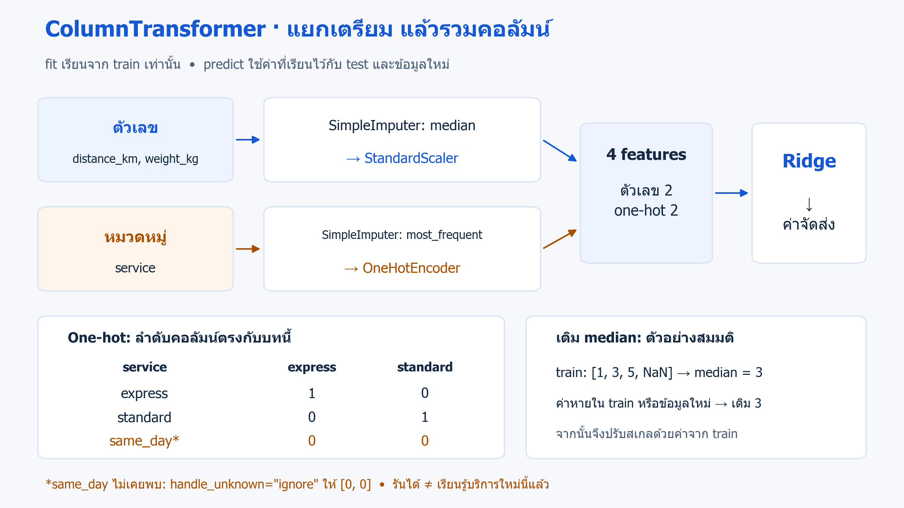
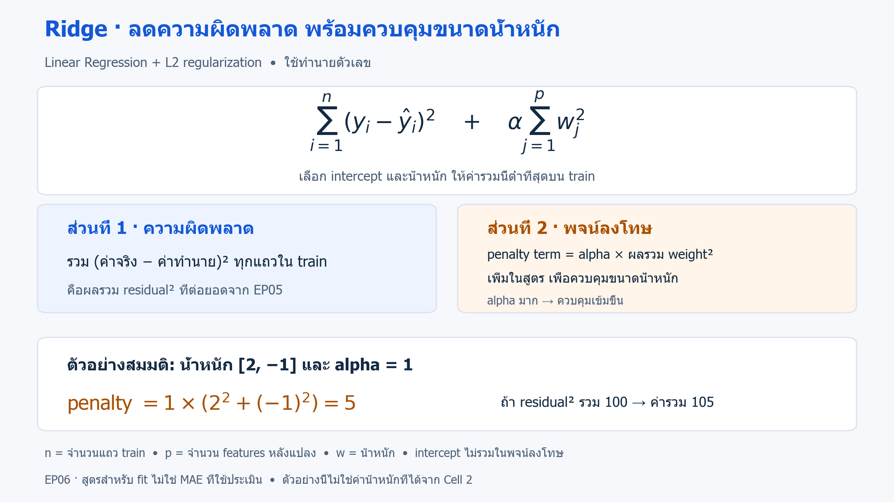

# 06 · Ridge Regression กับการเตรียมตัวเลข หมวดหมู่ และค่าที่หาย

[กลับสารบัญ](../../README.md) · [Notebook](lesson.ipynb) · [Python](lesson.py)

บทนี้เตรียมตารางที่มีตัวเลข หมวดหมู่ และค่าหายด้วย **ColumnTransformer** แล้วเรียน **Ridge Regression** เพื่อทำนายค่าบริการส่งสินค้าจำลอง

**ใช้สิ่งที่เรียนแล้ว:** pandas, Pipeline/StandardScaler จาก[บท 03](../03-first-classifier/README.md) และ regression/MAE จาก[บท 05](../05-linear-regression/README.md)

## เตรียมข้อมูลคนละชนิดให้โมเดลใช้ร่วมกัน

**Feature Engineering — การสร้างหรือปรับรูปแบบ feature** คือการสร้างหรือแปลงข้อมูลนำเข้าให้โมเดลใช้ได้เหมาะสม เช่น สร้างระยะทางจากพิกัด หรือเปลี่ยนประเภทบริการเป็นตัวเลข บทนี้เน้นเตรียมคอลัมน์ที่มีอยู่ให้โมเดลรับได้

**ColumnTransformer** เลือกคอลัมน์ ส่งแต่ละกลุ่มไปเตรียมด้วยวิธีที่เหมาะ แล้วต่อผลเป็น feature ชุดเดียว จึงเป็นเครื่องมือเตรียมข้อมูล ไม่ใช่โมเดลทำนาย



*ภาพรวมตรงกับขั้นตอนใน Cell 2; ตัวอย่าง median ด้านล่างเป็นข้อมูลสมมติ ส่วนลำดับ express/standard ตรงกับ encoder ในบทนี้* · [เปิดภาพ SVG](../../assets/figures/06-feature-engineering-preprocessing.svg)

### SimpleImputer: เติมค่าหายจาก train

- **ตัวเลข:** `strategy="median"` ใช้มัธยฐานของคอลัมน์ เช่น train มี `[1, 3, 5, NaN]` จะเรียนค่า 3 ไว้เติมช่องว่าง ทั้งใน train และข้อมูลใหม่
- **หมวดหมู่:** `strategy="most_frequent"` ใช้ค่าที่พบบ่อย เช่น `[express, express, standard]` จะเรียนค่า express ไว้เติมช่องว่าง

**แบ่ง train/test ก่อน fit ตัวเติมค่า** เพื่อไม่ให้ข้อมูล test มาช่วยกำหนดค่าที่ใช้ฝึก โมเดลในบทนี้จึงรวมการเตรียมข้อมูลไว้ใน Pipeline

ข้อมูลจำลองจะมีค่าน้ำหนักหาย แต่ service ยังครบ ขั้นตอนเติม service เตรียมไว้รองรับช่องว่างที่เป็น `np.nan` ไม่ได้เปลี่ยนข้อความที่ไม่เคยพบให้เป็นค่าที่พบบ่อย

### One-hot encoding: เปลี่ยนหมวดหมู่เป็นคอลัมน์ 0/1

ใช้คอลัมน์แยกแทนการกำหนดรหัสที่ทำให้โมเดลตีความว่าประเภทบริการมีลำดับหรือระยะห่างเชิงตัวเลข โดยตรวจลำดับคอลัมน์จริงด้วย `get_feature_names_out()`

| service | service_express | service_standard |
|---|---:|---:|
| express | 1 | 0 |
| standard | 0 | 1 |
| same_day ที่ไม่เคยพบ | 0 | 0 |

แถวสุดท้ายเป็นผลของ `handle_unknown="ignore"` เมื่อ encoder เรียนเพียง express และ standard **ไม่มีคอลัมน์ same_day เพิ่มขึ้นระหว่าง predict** และโมเดลยังไม่เคยเรียนค่าบริการชนิดนี้

**จุดเด่นของ ColumnTransformer:** เตรียมตัวเลขและหมวดหมู่ด้วยวิธีต่างกันได้ภายใน Pipeline เดียว

**ข้อจำกัด:** ต้องเลือกคอลัมน์และวิธีเตรียมให้เหมาะเอง การเติม median ไม่ได้กู้ค่าน้ำหนักจริงกลับมา ส่วน one-hot อาจสร้างคอลัมน์จำนวนมากเมื่อมีหลายหมวดหมู่

## Ridge Regression คืออะไร และเพิ่มอะไรจาก Linear Regression

**Ridge Regression — การถดถอยแบบริดจ์** เป็นโมเดล Supervised Learning สำหรับทำนายตัวเลข โดยต่อยอด Linear Regression ด้วย **L2 regularization** เพื่อควบคุมขนาดสัมประสิทธิ์ (coefficient) หรือน้ำหนักที่โมเดลเรียนให้แต่ละ feature

**Ridge ทำหน้าที่ใดใน Pipeline นี้:**

- **ข้อมูลเข้า:** หลัง ColumnTransformer แปลงแล้ว ได้ตัวเลข 4 คอลัมน์ คือระยะทางและน้ำหนักที่ปรับสเกล กับคอลัมน์ 0/1 ของบริการ express และ standard
- **ตอน fit:** เรียนค่าน้ำหนัก 4 ค่าและ intercept จากข้อมูลเหล่านี้คู่กับค่าบริการใน y_train โดยควบคุมขนาดน้ำหนักด้วย L2
- **ตอน predict:** นำตัวเลขที่เตรียมแล้วมาคูณน้ำหนักและบวก intercept เพื่อคืนค่าบริการหนึ่งตัวเลขต่อรายการ โมเดลไม่ได้รู้สูตรที่ใช้สร้างข้อมูลจำลองใน Cell 1

ColumnTransformer เป็นผู้เตรียมข้อมูล ส่วน Ridge เป็นผู้ทำนายค่าบริการ การเปรียบเทียบกับ **DummyRegressor(strategy="median")** ใช้ดูว่าการเรียนจาก feature ช่วยลด MAE ได้มากกว่าการทายมัธยฐานของค่าบริการ train ทุกแถวหรือไม่

**พจน์ลงโทษ (penalty term)** คือส่วนที่บวกเพิ่มในค่าที่โมเดลพยายามทำให้ต่ำที่สุดระหว่างฝึก สำหรับ Ridge ส่วนนี้คือ `alpha × ผลรวมกำลังสองของน้ำหนัก` จึงช่วยให้โมเดลหาสมดุลระหว่างการทำนายให้ผิดพลาดน้อยกับการควบคุมขนาดน้ำหนัก



*ภาพอธิบายสิ่งที่ Ridge ลดระหว่าง fit; ตัวเลขในตัวอย่างไม่ใช่น้ำหนักที่ได้จาก Cell 2* · [เปิดภาพ SVG](../../assets/figures/06-feature-engineering-ridge.svg)

อ่านสูตรเป็นสองส่วน: **ผลรวม residual² บน train + พจน์ลงโทษ** โดย `y` คือค่าจริง, `ŷ` คือค่าทำนาย, `w` คือน้ำหนัก, `n` คือจำนวนแถว และ `p` คือจำนวน feature หลังแปลง ส่วน intercept ไม่รวมในพจน์ลงโทษของ Ridge

เช่น น้ำหนัก `[2, -1]` และ `alpha=1` ให้พจน์ลงโทษ `1 × (2² + (-1)²) = 5` ถ้าผลรวม residual² เท่ากับ 100 ค่ารวมที่ใช้ฝึกจะเป็น `100 + 5 = 105` ซึ่งเป็นคนละค่ากับ MAE ที่ใช้ประเมินผล

- **จุดเด่น:** ช่วยควบคุมน้ำหนักเมื่อ feature ให้ข้อมูลซ้ำกัน และอาจลด overfitting หรือการเรียนรายละเอียดของ train มากจนใช้กับข้อมูลใหม่ได้ไม่ดี
- **ข้อจำกัด:** การควบคุมน้ำหนักเข้มเกินไปอาจทำให้เรียนรูปแบบได้น้อยลง น้ำหนักยิ่งเล็กจึงไม่ได้แปลว่าโมเดลยิ่งดีเสมอ และโมเดลยังใช้ความสัมพันธ์เชิงเส้นใน feature ที่ป้อนเข้าไป

`alpha` กำหนดความสำคัญของพจน์ลงโทษเมื่อเทียบกับส่วนความผิดพลาด ยิ่งมาก ยิ่งเน้นควบคุมขนาดน้ำหนัก เราปรับสเกลคอลัมน์ตัวเลขก่อนใช้ Ridge เพราะขนาด coefficient ขึ้นกับหน่วยของ feature

บทนี้กำหนด `alpha=1.0` ล่วงหน้าเพื่อเน้นการเตรียมข้อมูล หากจะเลือกค่า alpha ให้ใช้ validation หรือ Cross-validation (CV) ตามแนวทาง[บท 04](../04-validation-and-metrics/README.md) แล้วเก็บ test ไว้ประเมินครั้งสุดท้าย

## ลงมือทำ

สร้าง Notebook ใหม่แล้วรัน **Cell 1–3 ตามลำดับ** หรือเปิด [Notebook ของบทนี้](lesson.ipynb) ใช้ kernel เดิมที่มี scikit-learn 1.7.1 ได้เลย

ภาพด้านบนฝังไว้ใน README และ notebook แล้ว ส่วนโค้ดบทนี้แสดงตารางและคำทำนาย จึงไม่มีไฟล์กราฟให้บันทึก

<!-- CODE:CELLS -->

<!-- CODE:START -->
### Cell 1 — สร้างตารางตัวเลข หมวดหมู่ และค่าหาย

```python
import numpy as np
import pandas as pd
from sklearn.compose import ColumnTransformer
from sklearn.dummy import DummyRegressor
from sklearn.impute import SimpleImputer
from sklearn.linear_model import Ridge
from sklearn.metrics import mean_absolute_error
from sklearn.model_selection import train_test_split
from sklearn.pipeline import make_pipeline
from sklearn.preprocessing import OneHotEncoder, StandardScaler

rng = np.random.default_rng(42)
n = 400
distance = rng.uniform(1, 100, n)
weight = rng.uniform(0.2, 8, n)
service = rng.choice(["standard", "express"], n)
y = 30 + 2 * distance + 5 * weight + 40 * (service == "express") + rng.normal(0, 8, n)
X = pd.DataFrame({"distance_km": distance, "weight_kg": weight, "service": service})
X.loc[rng.choice(n, 30, replace=False), "weight_kg"] = np.nan
X_train, X_test, y_train, y_test = train_test_split(
    X, y, test_size=0.25, random_state=42
)
print("Train/Test rows:", len(X_train), len(X_test))
print("Missing values (train):", X_train.isna().sum().to_dict())
print("First three training rows:\n", X_train.iloc[:3].round(3).to_string(index=False))
```

**อ่านโค้ด**

- `y = 30 + ...` สร้างค่าบริการจำลองจากระยะทาง น้ำหนัก ประเภทบริการ และ noise ไม่ใช่อัตราค่าจัดส่งจริง และไม่ได้ส่งสูตรนี้ให้โมเดล
- `40 * (service == "express")` เพิ่มค่าบริการ 40 เฉพาะ express โดย True/False ทำหน้าที่เป็น 1/0
- `pd.DataFrame(...)` สร้าง X ที่มีชื่อคอลัมน์ เพื่อให้ ColumnTransformer เลือกแต่ละกลุ่มไปแปลงได้
- `rng.choice(n, 30, replace=False)` เลือก 30 แถวไม่ซ้ำ แล้วใส่ `np.nan` ในน้ำหนัก สร้าง y ก่อนทำค่าหายเพื่อจำลองว่ามีคำตอบแล้ว แต่บันทึก feature ไม่ครบ
- `test_size=0.25` กัน 100 แถวไว้ทดสอบ อีก 300 แถวใช้ฝึก โดยยังไม่คำนวณค่าทดแทนหรือ fit ตัวแปลงใด
- ผลท้าย cell แสดงจำนวนแถว ค่าหายของ train และข้อมูล 3 แถวก่อนแปลง เพื่อเทียบกับ Cell 2

### Cell 2 — เตรียมแต่ละชนิดข้อมูลแล้วฝึก Ridge

```python
numeric = make_pipeline(SimpleImputer(strategy="median"), StandardScaler())
categorical = make_pipeline(
    SimpleImputer(strategy="most_frequent"),
    OneHotEncoder(handle_unknown="ignore", sparse_output=False),
)
preprocess = ColumnTransformer([
    ("numeric", numeric, ["distance_km", "weight_kg"]),
    ("categorical", categorical, ["service"]),
])
model = make_pipeline(preprocess, Ridge(alpha=1.0))
model.fit(X_train, y_train)
baseline = DummyRegressor(strategy="median").fit(X_train, y_train)
print(f"Baseline MAE: {mean_absolute_error(y_test, baseline.predict(X_test)):.3f}")
print(f"Test MAE (synthetic cost units): {mean_absolute_error(y_test, model.predict(X_test)):.3f}")
feature_names = preprocess.get_feature_names_out()
print("Transformed columns:", feature_names)
preview = preprocess.transform(X_train.iloc[:3])
print("First three transformed rows:\n",
      pd.DataFrame(preview, columns=feature_names).round(3).to_string(index=False))
```

**อ่านโค้ด**

- `numeric` เติม median ก่อนปรับสเกล ส่วน `categorical` เติมค่าที่พบบ่อยก่อนแยกหมวดหมู่เป็น one-hot
- `sparse_output=False` ให้ encoder คืนอาร์เรย์ปกติ เพื่อแสดงตารางตัวอย่างได้ตรงไปตรงมา เหมาะกับสองหมวดหมู่ในบทนี้; ถ้ามีหมวดหมู่จำนวนมากควรพิจารณารูปแบบ sparse เพื่อประหยัดหน่วยความจำ
- รายการใน `ColumnTransformer` มีสามส่วน: ชื่อขั้นตอน, ตัวแปลง และรายชื่อคอลัมน์ ชื่อ `numeric` และ `categorical` จะปรากฏเป็นคำนำหน้าในชื่อ feature หลังแปลง
- `model.fit(X_train, y_train)` เรียนค่าทดแทน สเกล หมวดหมู่ และน้ำหนัก Ridge จาก train ส่วน `model.predict(X_test)` ใช้ค่าที่เรียนไว้ ไม่ fit test ใหม่
- `get_feature_names_out()` ให้ชื่อ 4 คอลัมน์ตามลำดับจริง: ตัวเลข 2 คอลัมน์ และ service ที่แยกเป็น express/standard อีก 2 คอลัมน์
- `preprocess.transform(X_train.iloc[:3])` แปลงสามแถวเดิมใน Cell 1 โดยไม่ fit ซ้ำ ตัวเลขอาจติดลบหลัง scale; คอลัมน์ one-hot ยังคงเป็น 0/1 เพราะไม่ผ่าน StandardScaler
- `DummyRegressor(strategy="median")` ทายมัธยฐานของ y_train ทุกแถว เป็น baseline สำหรับเทียบ MAE ไม่ใช่ median ของน้ำหนักที่ใช้เติม feature

### Cell 3 — ลองข้อมูลใหม่ที่มีหมวดหมู่ไม่เคยพบ

```python
new_order = pd.DataFrame({
    "distance_km": [20.0],
    "weight_kg": [np.nan],
    "service": ["same_day"],
})
new_features = pd.DataFrame(
    preprocess.transform(new_order), columns=feature_names
)
print("New order after preprocessing:\n", new_features.round(3).to_string(index=False))
print("Unseen-category prediction:", model.predict(new_order).round(2))
```

**อ่านโค้ด**

- `new_order` มีชื่อคอลัมน์ตรงกับตอนฝึก แต่ใส่น้ำหนักเป็น `np.nan` และบริการเป็น `same_day`
- `preprocess.transform(new_order)` แสดงผลหลังเตรียมข้อมูล: น้ำหนักถูกเติมด้วย median จาก train แล้ว scale ส่วน service_express และ service_standard เป็น 0 ทั้งคู่
- ค่าศูนย์ทั้งคู่หมายถึงหมวดหมู่ที่ encoder ไม่เคยพบในตัวอย่างนี้ ไม่ได้หมายถึงบริการฟรี และไม่มีการเรียนค่าน้ำหนักของ same_day ขึ้นมาใหม่
- `model.predict(new_order)` รับตารางดิบ แล้วเตรียมข้อมูลด้วย Pipeline เดิมก่อนทำนาย ไม่ต้องส่ง `new_features` เข้าไปอีก
- `round(2)` ปัดเฉพาะการแสดงคำทำนาย การรันผ่านยังไม่ยืนยันว่าคำทำนายสำหรับบริการใหม่น่าเชื่อถือ
<!-- CODE:END -->

## อ่านผล

เมื่อใช้ข้อมูลและค่าตั้งต้นตามบทนี้กับ scikit-learn 1.7.1 จะได้:

| ผลที่ตรวจ | ค่าที่ได้ |
|---|---|
| แถว train / test | 300 / 100 |
| ค่าน้ำหนักที่หายใน train | 23 จาก 30 ค่าหายทั้งหมด |
| Baseline MAE | 53.511 |
| Ridge Test MAE | 6.494 |
| คำทำนายสำหรับ same_day | 109.89 |

MAE ของ Ridge ต่ำกว่า baseline บน test ชุดนี้ โดยหน่วยเป็นค่าบริการจำลอง ไม่ใช่อัตราค่าจัดส่งจริง และไม่ควรเทียบกับ MAE ของบท 05 ซึ่งใช้ข้อมูลคนละชุด

หลังแปลงจะมี 4 features โดย express เป็น `[1, 0]`, standard เป็น `[0, 1]` และ same_day เป็น `[0, 0]` เฉพาะสองคอลัมน์ service

คำทำนาย 109.89 แสดงว่า Pipeline รับข้อมูลนี้ได้ แต่ยังไม่มีคำตอบจริงของบริการ same_day สำหรับตรวจความแม่นยำ ควรตรวจจับหมวดหมู่ใหม่และวางวิธีรับมือก่อนใช้งานจริง

<details>
<summary>ฝึกต่อพร้อมแนวคำตอบ</summary>

**ลองทำ:** เพิ่มคอลัมน์จำนวนชิ้น แล้วออกแบบการรับ service ที่ไม่เคยเห็น

**แนวคำตอบ:**

- เพิ่มชื่อคอลัมน์จำนวนชิ้นในรายการ numeric ของ ColumnTransformer
- ตรวจ service ที่ไม่เคยเห็น แล้วกำหนดว่าจะให้ผู้ใช้แก้ข้อมูลหรือใช้วิธีสำรอง การป้องกัน error ด้วย encoder เพียงอย่างเดียวยังไม่พอ

</details>

## อ้างอิง

- [Handbook: Feature Engineering](https://jakevdp.github.io/PythonDataScienceHandbook/05.04-feature-engineering.html)
- [Pipelines and composite estimators](https://scikit-learn.org/1.7/modules/compose.html)
- [SimpleImputer](https://scikit-learn.org/1.7/modules/generated/sklearn.impute.SimpleImputer.html)
- [OneHotEncoder](https://scikit-learn.org/1.7/modules/generated/sklearn.preprocessing.OneHotEncoder.html)
- [ColumnTransformer](https://scikit-learn.org/1.7/modules/generated/sklearn.compose.ColumnTransformer.html)
- [Ridge Regression](https://scikit-learn.org/1.7/modules/generated/sklearn.linear_model.Ridge.html)
- [Ridge: penalty term และผลของ alpha](https://scikit-learn.org/1.7/auto_examples/linear_model/plot_ridge_coeffs.html)
- [ตัวอย่างศัพท์ภาษาไทย: การถดถอยที่ปรับด้วยฟังก์ชันการลงโทษ — วารสารวิทยาศาสตร์และเทคโนโลยี](https://li01.tci-thaijo.org/index.php/tstj/article/download/181573/165385)
