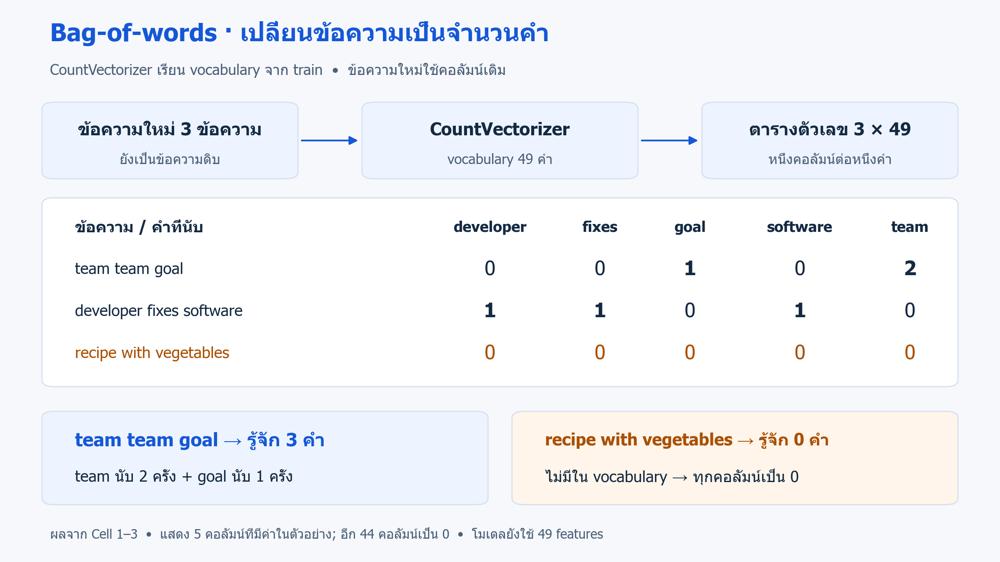
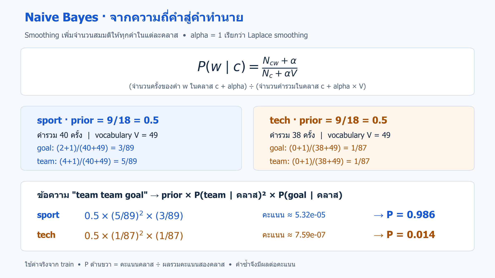

# 07 · จำแนกข้อความด้วย Multinomial Naive Bayes

[กลับสารบัญ](../../README.md) · [Notebook](lesson.ipynb) · [Python](lesson.py)

เปลี่ยนข้อความเป็นจำนวนคำ แล้วจำแนกว่าเป็น **กีฬา (sport)** หรือ **เทคโนโลยี (tech)** ด้วย Multinomial Naive Bayes

**ใช้สิ่งที่เรียนแล้ว:** Pipeline, train/test และ classification report จากบท 03–06 บทนี้เพิ่มวิธีแปลงข้อความและหลักการของ Naive Bayes

ข้อความฝึกในบทนี้แต่งขึ้น 24 ข้อความ แบ่งเป็น train 18 ข้อความ (sport และ tech อย่างละ 9) และ test 6 ข้อความ ผลจำแนกเป็นชื่อ **sport หรือ tech หนึ่งค่าต่อข้อความ** ก่อนนำไปเทียบคำตอบจริง

## จากข้อความเป็นตัวเลข

**CountVectorizer** เป็นเครื่องมือเตรียมข้อมูล: เรียนรายการคำจาก train เรียกว่า **vocabulary** แล้วแทนแต่ละข้อความด้วยจำนวนครั้งที่พบแต่ละคำ วิธีนี้เรียกว่า **Bag-of-words** เพราะนับคำโดยไม่เก็บลำดับคำ

ตัวอย่างเล็ก: ถ้ามีคอลัมน์ `goal, team, wins` ข้อความ `team team goal` จะได้ `[1, 2, 0]` คือ goal 1 ครั้ง, team 2 ครั้ง และไม่พบ wins ส่วน `goal team team` ก็ได้ค่าเดียวกัน



*ตัวอย่างจากชุดข้อความของบทนี้: train ให้ vocabulary 49 คำ ตารางแสดงเฉพาะคำที่พบในข้อความใหม่สามข้อความ ไม่ใช่ตารางคะแนน test* · [เปิดภาพ SVG](../../assets/figures/07-naive-bayes-text-counts.svg)

ค่าเริ่มต้นของ `CountVectorizer` เปลี่ยนตัวอักษรเป็นตัวเล็ก และเลือก token หรือหน่วยคำที่ยาวอย่างน้อย 2 อักขระ เช่น `Team` กลายเป็น `team` ส่วน `a` ไม่ถูกนับ สำหรับภาษาไทยที่ไม่ได้เว้นวรรคทุกคำ ต้องเลือกวิธีตัดคำหรือใช้ส่วนย่อยของตัวอักษรเพิ่มเติม

## Naive Bayes จำแนกข้อความอย่างไร

**Naive Bayes** เป็นกลุ่มอัลกอริทึม **Supervised Learning สำหรับ Classification (การจำแนกประเภท)** ใช้กฎของ Bayes ปรับความน่าจะเป็นของคลาสเมื่อเห็นข้อมูลใหม่ บทนี้ใช้รุ่น **Multinomial Naive Bayes** ผ่าน `MultinomialNB` ซึ่งเหมาะกับ feature แบบจำนวนครั้งที่ไม่ติดลบ

**ขั้นตอนสำคัญ:**

1. นับว่าข้อความใน train เป็นกีฬาและเทคโนโลยีอย่างละกี่ข้อความ แล้วหารด้วยจำนวนข้อความทั้งหมด ได้ **prior** หรือความน่าจะเป็นของแต่ละคลาสก่อนอ่านข้อความใหม่ บทนี้แต่ละคลาสมี 9 จาก 18 ข้อความ จึงได้ 9/18 = 0.5 เท่ากัน
2. เรียนความถี่ของแต่ละคำภายในคลาส เช่น `goal` พบใน sport แต่ไม่พบใน tech ของ train ชุดนี้
3. เมื่อรับข้อความใหม่ ให้คำนวณคะแนนแยกสำหรับ sport และ tech โดยนำ prior คูณกับความน่าจะเป็นของคำที่รู้จักและพบในข้อความ หากคำซ้ำก็คูณความน่าจะเป็นของคำนั้นซ้ำตามจำนวนครั้ง แล้วเลือกคลาสที่มีคะแนนสูงกว่า

คำว่า **naive** หมายถึงการสมมติว่า เมื่อรู้คลาสของข้อความแล้ว สามารถคิดหลักฐานจากแต่ละคำแยกกันได้ เช่น เมื่อสมมติว่าข้อความเป็นกีฬา โมเดลใช้ความน่าจะเป็นของ goal และ team แยกกัน แม้ในภาษาจริงสองคำนี้อาจเกี่ยวข้องกัน

- **จุดเด่น:** ฝึกและทำนายได้เร็ว เหมาะเป็นโมเดลเริ่มต้นสำหรับงานจำแนกข้อความ
- **ข้อจำกัด:** การนับคำแบบนี้ไม่เก็บลำดับคำ และความน่าจะเป็นจากโมเดลอาจไม่ตรงกับอัตราที่ทายถูกจริง

## Smoothing: ทำไมต้องมี alpha

หากคำหนึ่งอยู่ในรายการคำที่รู้จัก แต่ไม่เคยพบในข้อความ tech เลย การคำนวณจากจำนวนครั้งตรง ๆ จะให้ความน่าจะเป็นของคำนั้นใน tech เป็นศูนย์ เมื่อคูณกับหลักฐานจากคำอื่น คะแนนของ tech ก็เป็นศูนย์ตามไปด้วย

**Additive smoothing** แก้โดยสมมติว่าแต่ละคำถูกนับเพิ่มอีก `alpha` ครั้งในแต่ละคลาสก่อนคำนวณความน่าจะเป็น เช่น `alpha=1` ทำให้คำที่เคยนับได้ 0 กลายเป็น 1 ในสูตร วิธีกรณีนี้เรียกว่า **Laplace smoothing** การเพิ่มนี้ทำเฉพาะตอนคำนวณ ไม่ได้เพิ่มข้อความฝึก



*ตัวอย่างคำ goal ใน train และการทำนายข้อความ team team goal; คะแนนก่อนปรับให้รวมเป็น 1 ยังไม่ใช่ความน่าจะเป็นของคลาส* · [เปิดภาพ SVG](../../assets/figures/07-naive-bayes-text-smoothing.svg)

อ่านสูตร: **(จำนวนครั้งของคำนั้นในคลาส + alpha) ÷ (จำนวนคำทั้งหมดในคลาส + alpha × ขนาด vocabulary)** โดยจำนวนคำทั้งหมดนับคำซ้ำด้วย

ตัวอย่าง `goal` ใน tech: พบ 0 ครั้ง, จำนวนคำรวมใน tech เท่ากับ 38, vocabulary มี 49 คำ จึงได้ `(0 + 1) / (38 + 49) = 1/87 ≈ 0.0115` เป็นความน่าจะเป็นของคำภายในคลาส ไม่ใช่ความน่าจะเป็นที่ข้อความเป็น tech

**แยกสองกรณีให้ชัด:** smoothing ช่วยคำที่มีอยู่ใน vocabulary แต่ไม่พบในคลาสหนึ่ง ส่วนคำที่ไม่มีใน vocabulary เลย เช่น `vegetables` ในบทนี้ จะถูกตัวนับคำข้าม

`alpha` ของบทนี้ควบคุม smoothing **คนละความหมายกับ alpha ของ Ridge ในบท 06** เมื่อเพิ่มมากขึ้น ความน่าจะเป็นของคำภายในแต่ละคลาสจะใกล้กันขึ้น บทนี้กำหนด 1.0 ไว้เรียนหลักการ หากจะเลือกค่าให้ใช้ validation/CV โดยเก็บ test ไว้ประเมินท้ายสุด

## ลงมือทำ

สร้าง Notebook ใหม่แล้วรัน **Cell 1–3 ตามลำดับ** หรือเปิด [Notebook ของบทนี้](lesson.ipynb) ใช้ kernel เดิมที่ติดตั้ง scikit-learn แล้ว ไม่ต้องติดตั้งเพิ่ม

การทดลองชุดเล็กนี้ใช้ฝึกขั้นตอนและอ่านผล ไม่ใช่ชุดประเมินระบบจำแนกข้อความจริง

<!-- CODE:CELLS -->

<!-- CODE:START -->
### Cell 1 — เตรียมข้อความและคำตอบ

```python
import numpy as np
import pandas as pd
from IPython.display import display
from sklearn.feature_extraction.text import CountVectorizer
from sklearn.metrics import classification_report
from sklearn.model_selection import train_test_split
from sklearn.naive_bayes import MultinomialNB
from sklearn.pipeline import make_pipeline

texts = [
    "team wins the football match", "player scores a goal", "coach trains the team",
    "football fans celebrate victory", "the match ends in a draw", "goal keeper saves the team",
    "basketball team wins tonight", "player joins the football club", "coach plans match tactics",
    "fans watch the final game", "the club signs a player", "training helps the team win",
    "software update fixes a bug", "python code runs on computer", "developer tests the software",
    "new computer chip released", "database stores application data", "the code has a bug",
    "software developer writes tests", "computer program processes data", "python library update released",
    "database server runs software", "chip powers the new computer", "developer fixes python code",
]
y = np.array(["sport"] * 12 + ["tech"] * 12)
X_train, X_test, y_train, y_test = train_test_split(
    texts, y, test_size=0.25, stratify=y, random_state=42
)
print("Train:", len(X_train), "| Test:", len(X_test))
```

**อ่านโค้ด**

- `texts` เก็บข้อความดิบ 24 ข้อความ: 12 ข้อความแรกเป็นกีฬา และ 12 ข้อความหลังเป็นเทคโนโลยี ส่วน `y` สร้างคำตอบให้ตรงกับลำดับนั้น
- `train_test_split` แบ่งข้อความพร้อมคำตอบก่อนเรียน vocabulary: train 18 ข้อความ (คลาสละ 9) และ test 6 ข้อความ (คลาสละ 3) โดย `stratify=y` รักษาสัดส่วนคลาส
- `random_state=42` ทำให้รันซ้ำแล้วได้ชุดแบ่งเดิม ส่วน `display` ใช้แสดงตารางใน Jupyter แม้มีคำสั่งอื่นตามท้าย cell

**ผลที่ได้:** `Train: 18 | Test: 6`

### Cell 2 — ฝึก Pipeline และประเมินกับ test

```python
model = make_pipeline(CountVectorizer(), MultinomialNB(alpha=1.0))
model.fit(X_train, y_train)

y_pred = model.predict(X_test)
display(pd.DataFrame({"text": X_test, "actual": y_test, "prediction": y_pred}))
print(classification_report(y_test, y_pred, zero_division=0))

vectorizer = model.named_steps["countvectorizer"]
words = vectorizer.get_feature_names_out()
print("Vocabulary size:", len(words))
```

**อ่านโค้ด**

- `make_pipeline(CountVectorizer(), MultinomialNB(alpha=1.0))` ต่อ **ตัวนับคำ → โมเดลจำแนกประเภท** โดย `alpha=1.0` เพิ่มจำนวนสมมติ 1 ให้ทุกคำในแต่ละคลาสตอนคำนวณความน่าจะเป็น
- `fit(X_train, y_train)` สร้างรายการคำที่รู้จักจากข้อความ train นับแต่ละคำ แล้วใช้จำนวนคำพร้อมคำตอบ sport/tech ฝึก Naive Bayes ส่วน `predict(X_test)` นับคำจากรายการเดิมและใช้โมเดลเดิมทำนาย
- `classification_report` อ่านเหมือนบท 04; `zero_division=0` ให้ค่า 0 แทนกรณีที่ตัวหารของ metric เป็นศูนย์ ไม่ได้เปลี่ยนคำทำนาย
- `model.named_steps["countvectorizer"]` หยิบตัวนับคำที่ฝึกแล้วออกมาตรวจ และ `get_feature_names_out()` คืนชื่อคำตามลำดับคอลัมน์

**ผลที่ได้:** vocabulary มี 49 คำ และทาย test ถูกทั้ง 6 ข้อความ จึงได้ accuracy 1.00 ผลนี้เป็นเพียงชุดตัวอย่างเล็กที่แต่งขึ้น ไม่ใช่หลักฐานว่าระบบจริงจะถูก 100%

**อ่านผลก่อนคะแนน:** ตารางแสดงข้อความ test ทั้ง 6 ข้อความพร้อม `actual` (คลาสจริง) และ `prediction` (คลาสที่ทาย) จึงนับแถวที่ตรงกันได้ก่อนอ่าน classification report ซึ่งคำนวณจากคำตอบชุดเดียวกัน

### Cell 3 — ดูจำนวนคำและทำนายข้อความใหม่

```python
examples = ["team team goal", "developer fixes software", "recipe with vegetables"]
vectors = vectorizer.transform(examples)
print("Feature matrix shape:", vectors.shape)

used_columns = np.asarray(vectors.sum(axis=0)).ravel() > 0
counts = pd.DataFrame(
    vectors[:, used_columns].toarray(),
    index=examples,
    columns=words[used_columns],
)
display(counts)

results = pd.DataFrame({
    "text": examples,
    "prediction": model.predict(examples),
    "known_tokens": np.asarray(vectors.sum(axis=1)).ravel(),
})
probabilities = pd.DataFrame(
    model.predict_proba(examples),
    columns=model.classes_,
)
display(pd.concat([results, probabilities], axis=1).round(3))
```

**อ่านโค้ด**

- `vectorizer.transform(examples)` นับคำด้วย vocabulary เดิม ได้ sparse matrix ขนาด `(3, 49)`: 3 ข้อความ × 49 คำ โดย sparse matrix เก็บข้อมูลแบบประหยัดพื้นที่เมื่อส่วนใหญ่เป็นศูนย์
- `vectors.sum(axis=0)` รวมตามคอลัมน์; `np.asarray(...).ravel() > 0` จัดเป็น array หนึ่งมิติแล้วเลือกคำที่ปรากฏอย่างน้อยหนึ่งครั้งใน 3 ตัวอย่าง ได้ 5 คอลัมน์สำหรับแสดงผล
- `vectors[:, used_columns].toarray()` แปลงเฉพาะตารางเล็กเป็น array แล้วใช้ชื่อข้อความและคำกำกับแถว/คอลัมน์ การเลือกนี้ใช้เพื่อแสดงผลเท่านั้น โมเดลยังรับ 49 features
- `vectors.sum(axis=1)` รวมตามแถว ได้ `known_tokens` หรือจำนวนคำที่รู้จักต่อข้อความ **นับคำซ้ำด้วย**: `[3, 3, 0]`
- `predict` คืนชื่อคลาส ส่วน `predict_proba` คืนความน่าจะเป็นตามโมเดล ใช้ `model.classes_` ตั้งชื่อคอลัมน์ให้ถูกลำดับ: `sport, tech`
- `pd.concat(..., axis=1)` ต่อผลสองตารางตามแนวนอน และ `round(3)` ปัดเลขเพื่อแสดงผล ไม่ได้เปลี่ยนโมเดล
<!-- CODE:END -->

## อ่านผล

ตารางจำนวนคำแสดง 5 คอลัมน์ที่พบในตัวอย่าง ส่วนคอลัมน์อื่นอีก 44 คำเป็นศูนย์:

| ข้อความ | developer | fixes | goal | software | team |
|---|---:|---:|---:|---:|---:|
| team team goal | 0 | 0 | 1 | 0 | 2 |
| developer fixes software | 1 | 1 | 0 | 1 | 0 |
| recipe with vegetables | 0 | 0 | 0 | 0 | 0 |

ผลด้วยข้อมูลและค่าตั้งต้นของบทนี้ (ปัดทศนิยม 3 ตำแหน่ง):

| ข้อความ | คำทำนาย | known_tokens | sport | tech |
|---|---|---:|---:|---:|
| team team goal | sport | 3 | 0.986 | 0.014 |
| developer fixes software | tech | 3 | 0.055 | 0.945 |
| recipe with vegetables | sport | 0 | 0.500 | 0.500 |

**แถวอาหารสำคัญที่สุด:** ไม่มีคำที่รู้จักเลย โมเดลจึงใช้เพียง prior ในบทนี้ทั้งสองคลาสเท่ากัน และ `predict` เลือก sport ซึ่งเป็นคลาสแรกใน `model.classes_` เมื่อคะแนนเสมอ ไม่ได้หมายความว่าโมเดลเข้าใจว่าข้อความอาหารเป็นกีฬา

โมเดลมีให้เลือกเพียง sport/tech และไม่ได้ปฏิเสธข้อความนอกเรื่องให้อัตโนมัติ ส่วนค่า tech 0.945 ในแถวที่สองเป็นความน่าจะเป็นตามโมเดล **ไม่ได้รับประกันว่าจะทายถูกจริง 94.5%**

## แบบฝึกท้ายบท

**ลองทำ:** เปลี่ยนข้อความแรกใน `examples` จาก `team team goal` เป็น `goal team team` แล้วรัน Cell 3 ใหม่ โดยไม่ฝึกโมเดลซ้ำ

<details>
<summary>ดูแนวคำตอบ</summary>

**แนวคำตอบ:** จำนวนคำและผลทำนายเหมือนเดิม เพราะ Bag-of-words ในบทนี้ไม่เก็บลำดับคำ

หากทดลองกับภาษาไทย ให้เตรียมข้อมูลที่มี label แล้วลอง `CountVectorizer(analyzer="char", ngram_range=(2, 4))` ซึ่งนับชุดตัวอักษรที่ติดกันยาว 2–4 ตัว ต้องฝึก Pipeline ใหม่และประเมินกับข้อความที่แยกจาก train รวมถึงกันข้อความใกล้ซ้ำไม่ให้ข้ามชุด

</details>

## อ้างอิง

- [scikit-learn: Naive Bayes — สมมติฐานและข้อจำกัดของความน่าจะเป็น](https://scikit-learn.org/1.7/modules/naive_bayes.html)
- [scikit-learn: MultinomialNB — alpha และ smoothing](https://scikit-learn.org/1.7/modules/generated/sklearn.naive_bayes.MultinomialNB.html)
- [scikit-learn: CountVectorizer — vocabulary และการนับคำ](https://scikit-learn.org/1.7/modules/generated/sklearn.feature_extraction.text.CountVectorizer.html)
- [scikit-learn: Text feature extraction — Bag-of-words](https://scikit-learn.org/1.7/modules/feature_extraction.html#text-feature-extraction)
- [Handbook: Naive Bayes — อ่านเพิ่มเติม](https://jakevdp.github.io/PythonDataScienceHandbook/05.05-naive-bayes.html)
