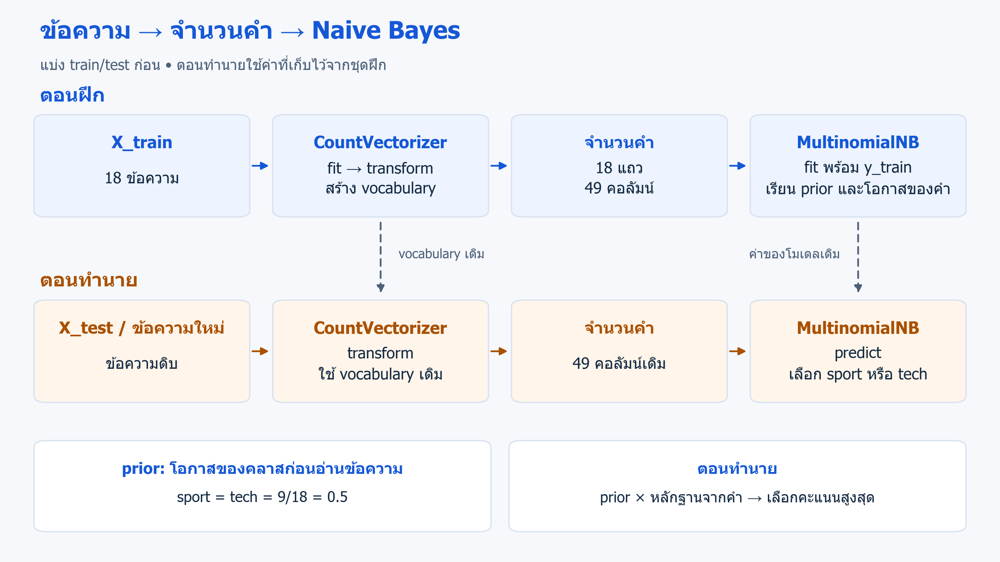
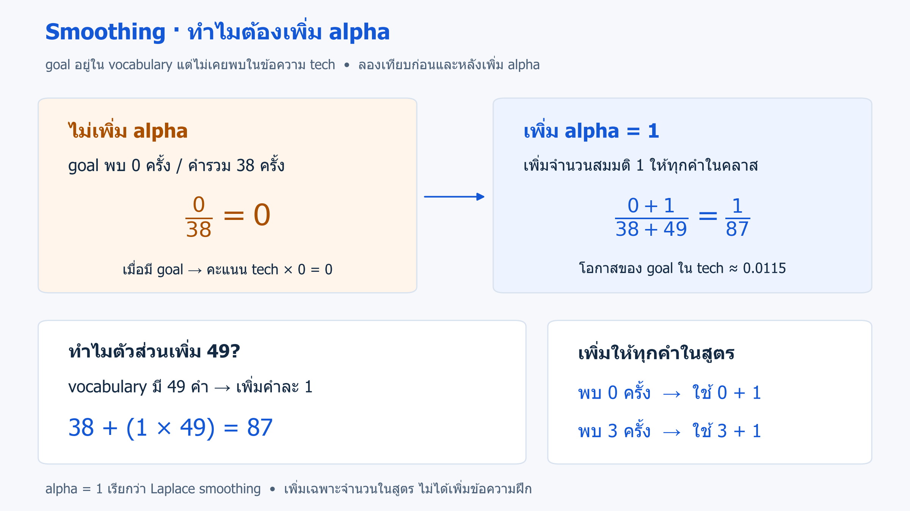
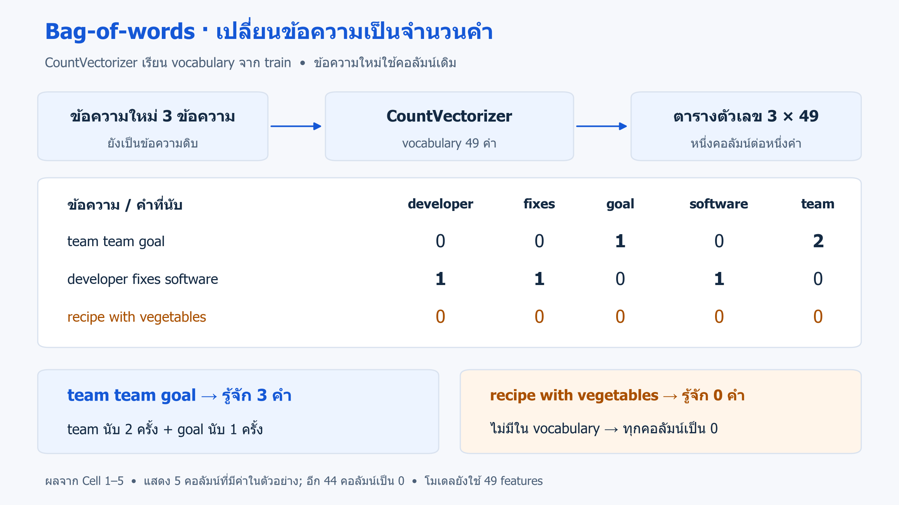
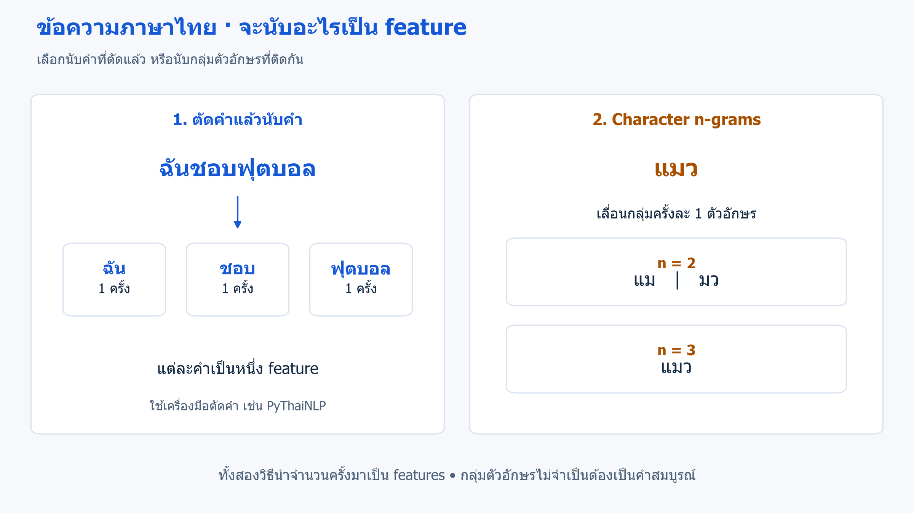

# 07 · จำแนกข้อความด้วย Multinomial Naive Bayes

[กลับสารบัญ](../../README.md) · [Notebook](lesson.ipynb) · [Python](lesson.py)

เปลี่ยนข้อความเป็นจำนวนคำ แล้วจำแนกว่าเป็น **กีฬา (sport)** หรือ **เทคโนโลยี (tech)** ด้วย Multinomial Naive Bayes

**ใช้สิ่งที่เรียนแล้ว:** Pipeline, train/test และ classification report จากบท 03–06 บทนี้เพิ่มวิธีแปลงข้อความและหลักการของ Naive Bayes

ข้อความฝึกในบทนี้แต่งขึ้น 24 ข้อความ แบ่งเป็น train 18 ข้อความ (sport และ tech อย่างละ 9) และ test 6 ข้อความ ผลจำแนกเป็นชื่อ **sport หรือ tech หนึ่งค่าต่อข้อความ** ก่อนนำไปเทียบกับประเภทข้อความที่กำกับไว้

## ต่อจาก EP6: Feature Engineering สำหรับข้อความ

ใน [EP6](../06-feature-engineering/README.md) เราเตรียมข้อมูลให้ Ridge ใช้ได้ เช่น เปลี่ยนประเภทบริการเป็นคอลัมน์ one-hot ส่วน EP7 เปลี่ยนข้อความเป็น **คอลัมน์จำนวนครั้งของแต่ละคำ** เพื่อให้ Naive Bayes ใช้จำแนกประเภทข้อความ

การแปลงข้อความเป็น features เป็นส่วนหนึ่งของ **Feature Engineering** โดยเรียกงานนี้ให้เฉพาะเจาะจงว่า **Feature Extraction — การสกัดคุณลักษณะ** คือดึงข้อมูลจากข้อความออกมาเป็น features ตัวเลข ในบทนี้เลือกใช้จำนวนครั้งที่พบคำ

| สิ่งที่ใช้ | หน้าที่ในบทนี้ |
|---|---|
| **Bag-of-words** | แนวคิดแทนข้อความด้วยจำนวนครั้งของคำ โดยไม่เก็บลำดับคำ |
| **CountVectorizer** | เครื่องมือเตรียมข้อมูลที่สร้าง vocabulary และแปลงข้อความเป็นตารางจำนวนคำตามแนวคิด Bag-of-words |
| **Multinomial Naive Bayes** | โมเดลที่เรียนจากตารางจำนวนคำคู่กับ labels แล้วจำแนกข้อความเป็น sport หรือ tech |

**ลำดับการใช้งาน:** ข้อความ → CountVectorizer → ตารางจำนวนคำ (features) → Multinomial Naive Bayes → ประเภทข้อความที่ทำนาย

## จากข้อความเป็นตัวเลข

### Bag-of-words: ใส่คำลงถุง แล้วนับแต่ละคำ

**Bag-of-words** แปลตรงตัวได้ว่า **“ถุงคำ” หรือ “กระเป๋าคำ”** ให้นึกว่านำคำในข้อความมาใส่รวมในถุง แล้วดูว่า **มีคำอะไร และแต่ละคำปรากฏกี่ครั้ง** โดยไม่เก็บว่าคำไหนมาก่อนหรือหลัง

เช่น กำหนดรายการคำเป็น `goal, team, wins` แล้วนับคำในแต่ละข้อความ:

| ข้อความ | goal | team | wins |
|---|---:|---:|---:|
| team team goal | 1 | 2 | 0 |
| goal team team | 1 | 2 | 0 |
| team wins | 0 | 1 | 1 |

**อ่านแถวแรก:** พบ goal 1 ครั้ง, team 2 ครั้ง และไม่พบ wins จึงได้ `[1, 2, 0]` ตามลำดับคอลัมน์ ตัวเลขเหล่านี้คือ **features ที่จะส่งให้โมเดล** ส่วน label เช่น sport คือประเภทข้อความที่ใช้กำกับตอนฝึก

แถวที่สองสลับลำดับคำ แต่จำนวนคำเท่าเดิม จึงได้ตัวเลขเหมือนแถวแรก **Bag-of-words แบบนับคำทีละคำในบทนี้จึงแยกสองข้อความนี้ไม่ได้**

### CountVectorizer: เครื่องมือสร้างตารางจำนวนคำ

**Vocabulary คือรายการคำไม่ซ้ำที่ตัวนับคำเก็บไว้จากชุดฝึก** แต่ละคำเป็นหนึ่งคอลัมน์ ส่วนตัวเลขในตารางคือจำนวนครั้งที่พบคำนั้นในแต่ละข้อความ เช่น แม้ team ปรากฏสองครั้ง ก็ยังใช้คอลัมน์ team เพียงคอลัมน์เดียว โดยใส่ค่า 2

- **fit:** ตรวจข้อความใน train แล้วกำหนดว่าจะมีคอลัมน์คำอะไรบ้าง
- **transform:** นับคำในแต่ละข้อความลงคอลัมน์ที่กำหนดไว้ ได้หนึ่งแถวต่อหนึ่งข้อความ

เมื่อแปลง test หรือข้อความใหม่ จะใช้คอลัมน์เดิม โดย **CountVectorizer ข้ามคำที่ไม่มีใน vocabulary ให้อัตโนมัติตอน transform** ใช้ `CountVectorizer()` ได้เลย **ไม่ต้องตั้ง `handle_unknown="ignore"` และ CountVectorizer ไม่มีพารามิเตอร์ `handle_unknown`**

**ข้ามเฉพาะคำที่ไม่รู้จัก ยังนับคำอื่นในข้อความต่อ:** ถ้า vocabulary เรียงเป็น `goal, team, wins` ข้อความ `team vegetables` จะได้ `[0, 1, 0]` เพราะนับ team ได้ 1 ครั้ง ส่วน vegetables ถูกข้าม หากทุกคำไม่มีใน vocabulary เช่น `recipe with vegetables` จะได้ `[0, 0, 0]`

**เทียบกับ OneHotEncoder ใน [EP6](../06-feature-engineering/README.md):**

| เครื่องมือและการตั้งค่า | เมื่อพบคำหรือหมวดหมู่ที่ไม่เคยพบตอน fit |
|---|---|
| `CountVectorizer()` ใน EP7 | ข้ามคำที่ไม่มีใน vocabulary อัตโนมัติ และนับคำที่รู้จักในข้อความนั้นตามปกติ |
| `OneHotEncoder(handle_unknown="ignore")` ใน EP6 | เมื่อพบบริการใหม่ เช่น same_day จะให้เฉพาะคอลัมน์ one-hot ของ service เป็น 0 ทั้งหมด ส่วนคอลัมน์ตัวเลขยังแปลงตามปกติ |

สำหรับ OneHotEncoder ถ้าไม่กำหนด `handle_unknown` ค่าเริ่มต้นคือ `"error"` จึงเกิดข้อผิดพลาดเมื่อ transform พบหมวดหมู่ใหม่ ส่วน CountVectorizer ข้ามคำใหม่ได้โดยไม่ต้องตั้งค่านี้

ทั้งสองกรณีใช้คอลัมน์เดิม **ไม่มีคอลัมน์ใหม่เพิ่มระหว่าง transform** เราจึงแบ่ง train/test ก่อน fit ตัวเตรียมข้อมูล เพื่อให้รายการคำหรือหมวดหมู่ที่ใช้สร้างคอลัมน์มาจาก train เท่านั้น

ค่าเริ่มต้นของ `CountVectorizer` เปลี่ยนตัวอักษรเป็นตัวเล็ก และเลือก token หรือหน่วยคำที่ยาวอย่างน้อย 2 อักขระ เช่น `Team` กลายเป็น `team` ส่วน `a` ไม่ถูกนับ ตัวอย่างหลักของบทนี้ใช้ภาษาอังกฤษ; ตัวอย่างภาษาไทยอยู่ในหัวข้อเสริมท้ายบท

## Naive Bayes จำแนกข้อความอย่างไร

**Naive Bayes** เป็นกลุ่มอัลกอริทึม **Supervised Learning สำหรับ Classification (การจำแนกประเภท)** ใช้กฎของ Bayes ประเมินว่าข้อความน่าจะอยู่ในคลาสใดจากคำที่พบ บทนี้ใช้ **Multinomial Naive Bayes** ผ่าน `MultinomialNB` ซึ่งเหมาะกับข้อมูลการนับ เช่น จำนวนครั้งของแต่ละคำ

### คำอ่านและที่มาของชื่อ Multinomial Naive Bayes

**คำอ่านโดยประมาณ:** **มัล-ที-โน-มี-อัล นา-อีฟ เบย์ซ** โดยเน้นเสียง **โน** ใน Multinomial และ **อีฟ** ใน Naive; Naive มีอีกเสียงว่า **ไน-อีฟ** ตามพจนานุกรม

| ส่วนของชื่อ | ความหมายและที่มา |
|---|---|
| **Multinomial** | ในชื่อโมเดลหมายถึง **การแจกแจงแบบพหุนาม (multinomial distribution)** ซึ่งใช้จำลองจำนวนครั้งของผลลัพธ์หลายประเภท บทนี้ใช้กับจำนวนครั้งของแต่ละคำ เช่น team 2 ครั้ง และ goal 1 ครั้ง |
| **Naive** | แปลตามคำได้ว่า “ไร้เดียงสา” ในชื่อโมเดลสื่อถึง **สมมติฐานที่ทำให้การคำนวณง่ายขึ้น**: เมื่อกำหนดคลาสแล้ว คิดหลักฐานจากแต่ละคำแยกกัน เช่น เมื่อสมมติว่าเป็น sport ใช้ความน่าจะเป็นของ goal กับ team แยกกัน แม้คำสองคำนี้อาจเกี่ยวข้องกันในภาษาจริง |
| **Bayes** | มาจากนามสกุล **Thomas Bayes — โทมัส เบย์ซ** โมเดลใช้ **กฎของเบย์ (Bayes' theorem)** ประเมินความน่าจะเป็นของคลาสจากคำที่พบในข้อความ |

จึงอธิบายชื่อในบริบทบทเรียนได้ว่า **“โมเดลจำแนกข้อความด้วยกฎของเบย์ โดยใช้จำนวนคำและสมมติให้หลักฐานจากคำเป็นอิสระกันเมื่อกำหนดคลาส”**

ฟังคำอ่านและดูที่มาของคำ: [Multinomial](https://www.merriam-webster.com/dictionary/multinomial) · [Naive](https://www.merriam-webster.com/dictionary/naive) · [Bayes' theorem](https://www.merriam-webster.com/dictionary/Bayes%27%20theorem) ส่วนการใช้ multinomial กับจำนวนคำอธิบายไว้ใน [เอกสาร scikit-learn](https://scikit-learn.org/1.7/modules/naive_bayes.html#multinomial-naive-bayes)

### จากตารางจำนวนคำไปเป็นคำทำนาย

โมเดลรับ **features เป็นตารางจำนวนคำ** คู่กับ **class labels เป็น sport/tech** แล้วเรียนรู้ว่าคำแต่ละคำพบมากน้อยเพียงใดในแต่ละประเภท จำนวนครั้งที่ป้อนให้โมเดลต้องไม่ติดลบ จึงส่งจำนวนคำเข้าโมเดลได้เลยโดยไม่ใช้ StandardScaler



[เปิดภาพ SVG](../../assets/figures/07-naive-bayes-text-workflow.svg)

**ตอนฝึกโมเดลเรียนสองอย่าง:**

- **Prior — ความน่าจะเป็นของคลาสก่อนดูคำในข้อความที่จะทำนาย:** ใช้สัดส่วนข้อความใน train บทนี้มี sport 9 จาก 18 ข้อความ จึงได้ prior ของ sport เป็น `9/18 = 0.5` และ tech เป็น 0.5 เช่นกัน
- **ความน่าจะเป็นของคำภายในแต่ละคลาส:** นับคำแยกตาม sport/tech เพื่อดูว่า เมื่อเป็นข้อความประเภทนั้น มีโอกาสพบแต่ละคำมากน้อยเพียงใด

**ตอนทำนาย** เช่น `team team goal` โมเดลคำนวณคะแนนของ sport และ tech แยกกัน แต่ละคะแนนเริ่มจาก prior แล้วคูณความน่าจะเป็นของ team สองครั้งและ goal หนึ่งครั้ง จากนั้นเลือกคลาสที่ได้คะแนนสูงกว่า

Pipeline เรียงขั้นให้: **CountVectorizer สร้างตารางจำนวนคำก่อน → Naive Bayes ฝึกจากตารางนั้นพร้อม labels** ตอนทำนายใช้ vocabulary และค่าความน่าจะเป็นที่เก็บไว้จากชุดฝึก

- **จุดเด่น:** ฝึกและทำนายได้เร็ว เหมาะเป็นโมเดลเริ่มต้นสำหรับงานจำแนกข้อความ
- **ข้อจำกัด:** การนับคำแบบนี้ไม่เก็บลำดับคำ และความน่าจะเป็นจากโมเดลอาจไม่ตรงกับอัตราที่ทายถูกจริง

## Smoothing: ทำไมต้องมี alpha

**Smoothing อ่านว่า สมูททิง** ในบทนี้คือการเพิ่มจำนวนสมมติเล็กน้อยก่อนคำนวณความน่าจะเป็นของคำ เพื่อให้คำที่ยังไม่พบในคลาสหนึ่งมีโอกาสมากกว่าศูนย์

เช่น goal อยู่ใน vocabulary แต่ไม่เคยพบในข้อความ tech หากคำนวณจากจำนวนครั้งตรง ๆ จะได้ความน่าจะเป็นของ goal ใน tech เป็นศูนย์ เมื่อข้อความใหม่มี goal คะแนนของ tech ก็จะถูกคูณด้วยศูนย์ แม้คำอื่นอาจสนับสนุน tech อยู่

**Additive smoothing** จึงเพิ่มจำนวนสมมติ `alpha` ให้ **ทุกคำใน vocabulary ของแต่ละคลาส** เมื่อ `alpha=1` จำนวน 0 จะกลายเป็น 1 ในสูตร และจำนวน 3 จะกลายเป็น 4 เรียกว่า **Laplace smoothing** จำนวนสมมติเพิ่มเฉพาะในสูตร ไม่ได้เพิ่มข้อความฝึก

สูตรคือ **(จำนวนครั้งของคำนั้นในคลาส + alpha) ÷ (จำนวนคำทั้งหมดในคลาส + alpha × จำนวนคำไม่ซ้ำใน vocabulary)** โดยจำนวนคำทั้งหมดนับคำซ้ำด้วย ตัวส่วนต้องเพิ่มด้วย เพราะเราเพิ่มจำนวนสมมติให้ทุกคำ

**แทนค่าจากชุดฝึกของบทนี้:** นับคำในข้อความ tech รวมได้ 38 ครั้ง และ vocabulary จาก train ทั้งสองคลาสมีคำไม่ซ้ำ 49 คำ เมื่อเพิ่มคำละ 1 ตัวส่วนจึงเป็น `38 + (1 × 49) = 87` ส่วน goal ใน tech พบ 0 ครั้ง จึงได้ `(0 + 1) / 87 = 1/87 ≈ 0.0115`



[เปิดภาพ SVG](../../assets/figures/07-naive-bayes-text-smoothing.svg)

ค่า 0.0115 ใช้เป็นความน่าจะเป็นของ **คำ goal ภายในคลาส tech** ส่วนความน่าจะเป็นว่า **ข้อความเป็น tech** ต้องรวม prior กับทุกคำที่รู้จัก แล้วปรับคะแนนของ sport และ tech ให้รวมเป็น 1 ตามตัวอย่างด้านล่างของภาพ

**แยกสองกรณีให้ชัด:** smoothing ช่วยคำที่มีอยู่ใน vocabulary แต่ไม่พบในคลาสหนึ่ง ส่วนคำที่ไม่มีใน vocabulary เลย เช่น `vegetables` ในบทนี้ จะถูกตัวนับคำข้าม

`alpha` ของบทนี้ควบคุม smoothing **คนละความหมายกับ alpha ของ Ridge ในบท 06** เมื่อเพิ่มมากขึ้น ความน่าจะเป็นของคำภายในแต่ละคลาสจะใกล้กันขึ้น บทนี้กำหนด 1.0 ไว้เรียนหลักการ หากจะเลือกค่าให้ใช้ validation/CV โดยเก็บ test ไว้ประเมินท้ายสุด

## ลงมือทำ

สร้าง Notebook ใหม่แล้วรัน **Cell 1–3 ตามลำดับ** หรือเปิด [Notebook ของบทนี้](lesson.ipynb)

<!-- CODE:CELLS -->

<!-- CODE:START -->
### Cell 1 — เตรียมข้อความและประเภทที่กำกับไว้

```python
import numpy as np
import pandas as pd
from IPython.display import display
from sklearn.feature_extraction.text import CountVectorizer
from sklearn.metrics import classification_report
from sklearn.model_selection import train_test_split
from sklearn.naive_bayes import MultinomialNB
from sklearn.pipeline import make_pipeline

texts = [
    "team wins the football match", "player scores a goal", "coach trains the team",
    "football fans celebrate victory", "the match ends in a draw", "goal keeper saves the team",
    "basketball team wins tonight", "player joins the football club", "coach plans match tactics",
    "fans watch the final game", "the club signs a player", "training helps the team win",
    "software update fixes a bug", "python code runs on computer", "developer tests the software",
    "new computer chip released", "database stores application data", "the code has a bug",
    "software developer writes tests", "computer program processes data", "python library update released",
    "database server runs software", "chip powers the new computer", "developer fixes python code",
]
y = np.array(["sport"] * 12 + ["tech"] * 12)
X_train, X_test, y_train, y_test = train_test_split(
    texts, y, test_size=0.25, stratify=y, random_state=42
)
print("Train:", len(X_train), "| Test:", len(X_test))
```

**อ่านโค้ด**

- `texts` เก็บข้อความดิบ 24 ข้อความ: 12 ข้อความแรกเป็นกีฬา และ 12 ข้อความหลังเป็นเทคโนโลยี ส่วน `y` เก็บประเภทข้อความ (class labels) เป็น sport และ tech ให้ตรงกับลำดับข้อความ
- `train_test_split` แบ่งข้อความกับประเภทที่กำกับไว้เป็นคู่ ๆ ก่อนสร้างรายการคำ (vocabulary): train 18 ข้อความ (คลาสละ 9) และ test 6 ข้อความ (คลาสละ 3) โดย `stratify=y` รักษาสัดส่วนคลาส
- `random_state=42` ทำให้รันซ้ำแล้วได้ชุดแบ่งเดิม ส่วน `display` ใช้แสดงตารางใน Jupyter แม้มีคำสั่งอื่นตามท้าย cell

**ผลที่ได้:** `Train: 18 | Test: 6`

### Cell 2 — ฝึก Pipeline และประเมินกับ test

```python
model = make_pipeline(CountVectorizer(), MultinomialNB(alpha=1.0))
model.fit(X_train, y_train)

y_pred = model.predict(X_test)
display(pd.DataFrame({"text": X_test, "actual": y_test, "prediction": y_pred}))
print(classification_report(y_test, y_pred, zero_division=0))

vectorizer = model.named_steps["countvectorizer"]
words = vectorizer.get_feature_names_out()
print("Vocabulary size:", len(words))
```

**อ่านโค้ด**

- `make_pipeline(...)` ต่อ **CountVectorizer → MultinomialNB** ส่วน `alpha=1.0` เพิ่มจำนวนสมมติ 1 ให้ทุกคำในแต่ละคลาสตามวิธี smoothing
- `model.fit(X_train, y_train)` เริ่มจากให้ CountVectorizer **fit สร้าง vocabulary แล้ว transform ข้อความเป็นตารางจำนวนคำ** จากนั้นจึงให้ Naive Bayes **fit ตารางจำนวนคำคู่กับ labels ใน y_train** เพื่อเรียน prior และความน่าจะเป็นของคำในแต่ละคลาส
- `model.predict(X_test)` ให้ตัวนับคำใช้ vocabulary เดิมแปลงข้อความ test ก่อนให้โมเดลเลือก sport หรือ tech โดยไม่ fit ใหม่
- ตาราง `actual` กับ `prediction` ให้ดูว่าแต่ละข้อความทายตรงกับคลาสจริงหรือไม่ ก่อนอ่าน `classification_report` ตามบท 04; `zero_division=0` ให้ค่า 0 ในกรณีที่ตัวหารของ metric เป็นศูนย์
- `model.named_steps["countvectorizer"]` เข้าถึงตัวนับคำที่ fit แล้ว ส่วน `get_feature_names_out()` คืนชื่อคำตามลำดับคอลัมน์ เก็บใน `words` เพื่อใช้กำกับตารางใน Cell 3

**ผลที่ได้:** `Vocabulary size: 49` หมายถึงคำไม่ซ้ำ 49 คำ จึงมี 49 features ส่วน test ทายถูกทั้ง 6 ข้อความ ได้ accuracy `6/6 = 1.00` คะแนนนี้มาจากข้อความที่แต่งขึ้นเพียง 6 ข้อความ จึงยังไม่ยืนยันผลกับข้อความจริงที่หลากหลาย

### Cell 3 — ดูจำนวนคำและทำนายข้อความใหม่

```python
examples = ["team team goal", "developer fixes software", "recipe with vegetables"]
vectors = vectorizer.transform(examples)
print("Feature matrix shape:", vectors.shape)

used_columns = np.asarray(vectors.sum(axis=0)).ravel() > 0
counts = pd.DataFrame(
    vectors[:, used_columns].toarray(),
    index=examples,
    columns=words[used_columns],
)
display(counts)

results = pd.DataFrame({
    "text": examples,
    "prediction": model.predict(examples),
    "known_tokens": np.asarray(vectors.sum(axis=1)).ravel(),
})
probabilities = pd.DataFrame(
    model.predict_proba(examples),
    columns=model.classes_,
)
display(pd.concat([results, probabilities], axis=1).round(3))
```

**อ่านโค้ด**

- `examples` มีข้อความกีฬา เทคโนโลยี และอาหาร เพื่อดูทั้งกรณีที่พบคำใน vocabulary และกรณีที่ไม่พบเลย
- `vectorizer.transform(examples)` นับคำลงคอลัมน์เดิม ได้ **Feature matrix หรือตาราง features** ขนาด `(3, 49)`: 3 ข้อความ × 49 คำ ใช้รูปแบบ sparse matrix เพื่อประหยัดพื้นที่สำหรับตารางที่ส่วนใหญ่เป็นศูนย์
- `used_columns` เลือกเฉพาะคำที่พบในตัวอย่างมาแสดง: `sum(axis=0)` รวมจำนวนตามคอลัมน์ และ `np.asarray(...).ravel() > 0` ทำเป็นรายการ True/False หนึ่งมิติ คำที่มีผลรวมมากกว่า 0 ได้ True
- `vectors[:, used_columns].toarray()` เลือก 5 คอลัมน์นั้นแล้วแปลงเป็น array สำหรับแสดงตาราง โมเดลยังใช้ features ครบ 49 คอลัมน์ ไม่ได้ฝึกใหม่ด้วย 5 คอลัมน์
- `known_tokens` มาจาก `vectors.sum(axis=1)` ซึ่งรวมจำนวนคำต่อข้อความ **นับคำซ้ำด้วย** จึงได้ `[3, 3, 0]` เช่น team สองครั้งกับ goal หนึ่งครั้งรวมเป็น 3; ค่า 0 หมายถึงไม่มีคำใดตรงกับ vocabulary
- `model.predict(examples)` รับข้อความดิบแล้วให้ Pipeline นับคำก่อนเลือกคลาส ส่วน `predict_proba` ให้ความน่าจะเป็นของแต่ละคลาส ใช้ `model.classes_` กำกับคอลัมน์ sport, tech ให้ตรงกับลำดับผลลัพธ์
- `pd.concat(..., axis=1)` ต่อข้อความ คำทำนาย และความน่าจะเป็นให้อยู่ในตารางเดียว ส่วน `round(3)` ปัดเลขเฉพาะการแสดงผล
<!-- CODE:END -->

## อ่านผล

**อ่านตารางจำนวนคำจาก Cell 3:** vocabulary มี 49 คำ แต่ในข้อความใหม่สามข้อความพบเพียง 5 คำ จึงแสดงเฉพาะ 5 คอลัมน์ ส่วนอีก 44 คอลัมน์เป็นศูนย์



[เปิดภาพ SVG](../../assets/figures/07-naive-bayes-text-counts.svg)

ผลด้วยข้อมูลและค่าตั้งต้นของบทนี้ (ปัดทศนิยม 3 ตำแหน่ง):

| ข้อความ | คำทำนาย | known_tokens | sport | tech |
|---|---|---:|---:|---:|
| team team goal | sport | 3 | 0.986 | 0.014 |
| developer fixes software | tech | 3 | 0.055 | 0.945 |
| recipe with vegetables | sport | 0 | 0.500 | 0.500 |

**ทำไมข้อความอาหารจึงถูกทายเป็น sport?** คำ recipe, with และ vegetables ไม่มีใน vocabulary ทั้งหมด จึงได้จำนวนคำเป็นศูนย์ทุกคอลัมน์และ `known_tokens=0` โมเดลเหลือเพียง prior ซึ่งเป็น 0.5 เท่ากัน ในกรณีคะแนนเสมอนี้ `predict` เลือก sport ซึ่งเป็นคลาสแรกใน `model.classes_`

โมเดลมีให้เลือกเพียง sport/tech และไม่ได้ปฏิเสธข้อความนอกเรื่องให้อัตโนมัติ ส่วนค่า tech 0.945 ในแถวที่สองเป็นความน่าจะเป็นตามโมเดล **ไม่ได้รับประกันว่าจะทายถูกจริง 94.5%**

## เสริม: ถ้าจะใช้กับข้อความภาษาไทย

<details>
<summary>ดูตัวอย่างตัดคำและ character n-grams</summary>

ภาษาไทยมักเขียนคำติดกัน เช่น `ฉันชอบฟุตบอล` แต่ `CountVectorizer` ค่าเริ่มต้นไม่ได้แยกคำไทยตามความหมายให้ เราจึงเลือกวิธีเตรียมข้อความได้สองแนวทาง:

- **ตัดเป็นคำก่อนนับ:** แยก `ฉันชอบฟุตบอล` เป็น `ฉัน | ชอบ | ฟุตบอล` แล้วนับแต่ละคำเป็น feature ใช้เครื่องมือตัดคำ เช่น [PyThaiNLP](https://pythainlp.org/docs/5.1/api/tokenize.html#word-level) และตั้ง CountVectorizer ให้รับคำที่ตัดแล้ว
- **นับกลุ่มตัวอักษรที่ติดกัน หรือ character n-grams:** เช่น `แมว` เมื่อ n=2 ได้ `แม` กับ `มว`; เมื่อ n=3 ได้ `แมว` กลุ่มเหล่านี้เป็น features ได้แม้ไม่ใช่คำสมบูรณ์



[เปิดภาพ SVG](../../assets/figures/07-naive-bayes-text-thai-features.svg)

ตัวนับกลุ่มตัวอักษรกำหนดได้ด้วย `CountVectorizer(analyzer="char", ngram_range=(2, 4))` โดยนับกลุ่มขนาด 2, 3 และ 4 ตัวรวมกัน ตัวอย่าง `แมว` ไม่มีกลุ่มขนาด 4 เพราะมีเพียง 3 ตัวอักษร

เมื่อลองกับภาษาไทย ให้ใช้ข้อความไทยคู่กับ class labels แบ่ง train/test แล้วฝึก Pipeline ใหม่ เพื่อสร้าง vocabulary และเรียนความสัมพันธ์กับประเภทข้อความตามวิธีนับที่เลือก

</details>

## แบบฝึกท้ายบท

1. เปลี่ยนข้อความแรกใน `examples` จาก `team team goal` เป็น `goal team team` แล้วรัน Cell 3 ใหม่ โดยไม่ฝึกโมเดลซ้ำ จำนวนคำและผลทำนายเปลี่ยนหรือไม่?
2. ข้อความ `recipe with vegetables` ได้คำทำนาย sport ทั้งที่ `known_tokens=0` เราควรสรุปว่าโมเดลพบคำเกี่ยวกับกีฬาหรือไม่ เพราะอะไร?

<details>
<summary>ดูแนวคำตอบ</summary>

1. จำนวนคำและผลทำนายเหมือนเดิม เพราะ Bag-of-words แบบนับคำทีละคำในบทนี้ไม่เก็บลำดับคำ
2. ไม่ควรสรุปเช่นนั้น เพราะไม่มีคำใดตรงกับ vocabulary โมเดลใช้ prior ที่เท่ากัน แล้วเลือกคลาสแรกเมื่อคะแนนเสมอ คำทำนายนี้จึงไม่ได้มาจากการพบคำเกี่ยวกับกีฬา

</details>

## อ้างอิง

- [scikit-learn: Naive Bayes — สมมติฐานและข้อจำกัดของความน่าจะเป็น](https://scikit-learn.org/1.7/modules/naive_bayes.html)
- [scikit-learn: MultinomialNB — alpha และ smoothing](https://scikit-learn.org/1.7/modules/generated/sklearn.naive_bayes.MultinomialNB.html)
- [scikit-learn: CountVectorizer — vocabulary, analyzer และ ngram_range](https://scikit-learn.org/1.7/modules/generated/sklearn.feature_extraction.text.CountVectorizer.html)
- [scikit-learn: OneHotEncoder — handle_unknown และหมวดหมู่ที่ไม่เคยพบ](https://scikit-learn.org/1.7/modules/generated/sklearn.preprocessing.OneHotEncoder.html)
- [PyThaiNLP: เครื่องมือตัดคำภาษาไทย](https://pythainlp.org/docs/5.1/api/tokenize.html#word-level)
- [scikit-learn: Text feature extraction — Bag-of-words](https://scikit-learn.org/1.7/modules/feature_extraction.html#text-feature-extraction)
- [Handbook: Naive Bayes — อ่านเพิ่มเติม](https://jakevdp.github.io/PythonDataScienceHandbook/05.05-naive-bayes.html)
