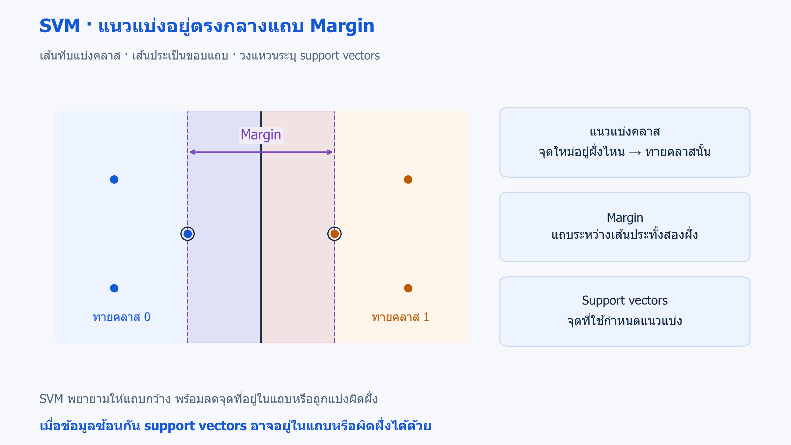
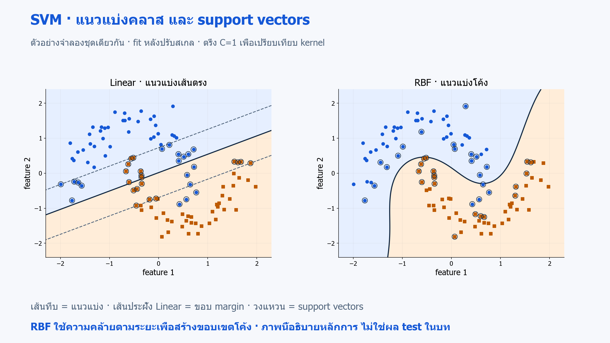
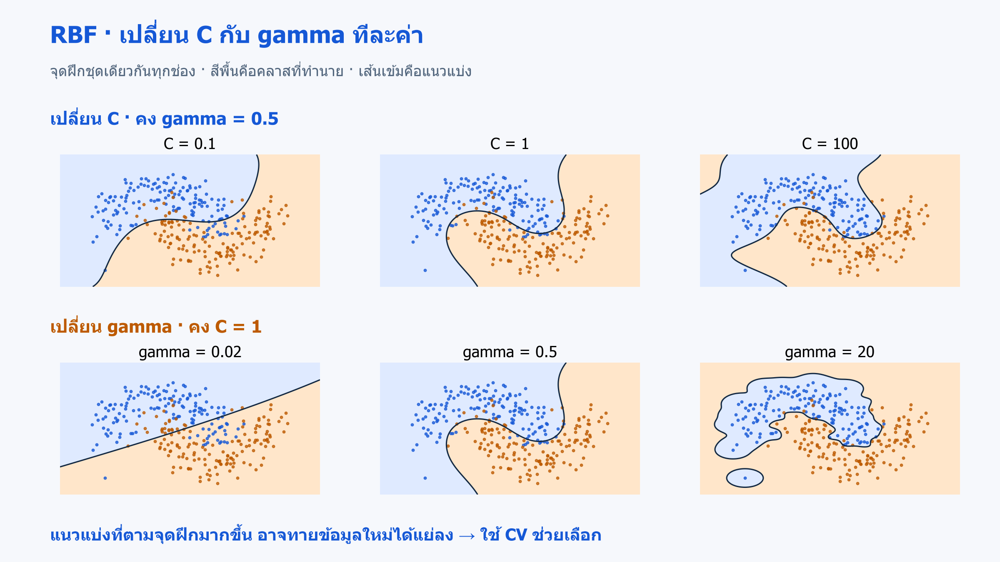
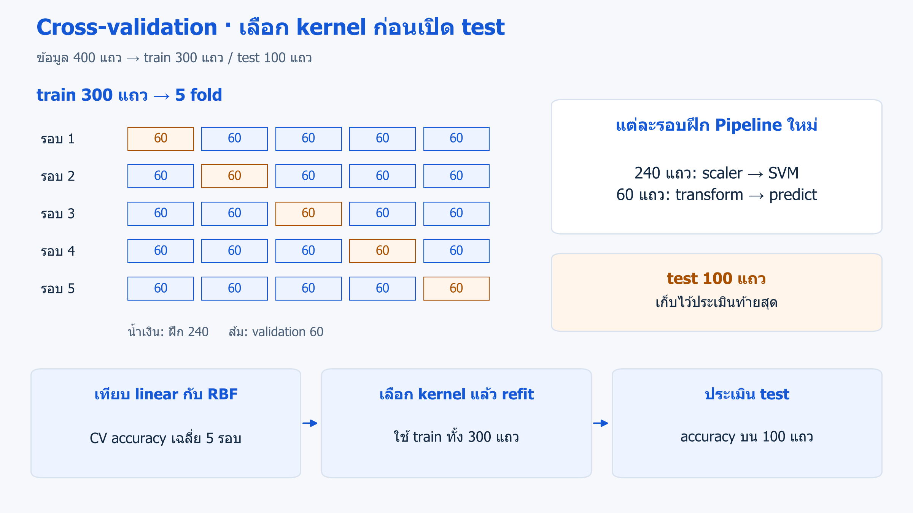
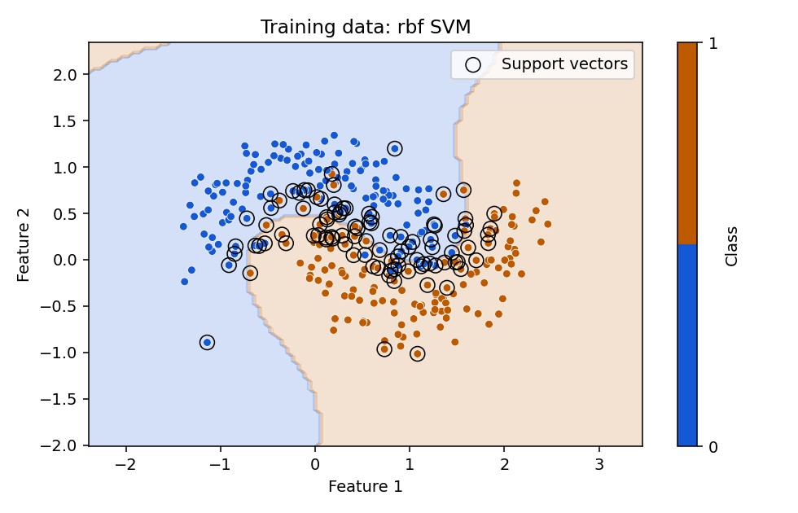

# 08 · Support Vector Machines และขอบเขตไม่เป็นเส้นตรง

[กลับสารบัญ](../../README.md) · [Notebook](lesson.ipynb) · [Python](lesson.py)

บทนี้ใช้ **SVM จำแนกจุดเป็นคลาส 0 หรือ 1 จากพิกัดสองค่า** เปรียบเทียบแนวแบ่งแบบเส้นตรงกับแบบโค้ง แล้วเลือกด้วยคะแนน Cross-validation ก่อนประเมินบนชุดทดสอบ

**ใช้สิ่งที่เรียนแล้ว:** train/test, StandardScaler, Pipeline และ Accuracy จากบท 03–06 ส่วนใหม่คือหลักการ SVM, kernel และการใช้ CV เปรียบเทียบโมเดล

## SVM คืออะไร

**SVM — Support Vector Machine** อ่านว่า **ซัพพอร์ต เวกเตอร์ แมชชีน** เป็นวิธีเรียนรู้แบบมีผู้สอน (Supervised Learning) โดยรับ features คู่กับ labels เพื่อฝึกโมเดล

| รุ่น | งานที่ใช้ |
|---|---|
| **SVC — Support Vector Classification** | จำแนกคลาส เช่น 0 หรือ 1 และรองรับมากกว่าสองคลาสได้ |
| **SVR — Support Vector Regression** | ทำนายตัวเลขต่อเนื่อง เช่น ราคา |

บทนี้ใช้ **SVC** กับจุดรูปพระจันทร์เสี้ยวสองชุด แต่ละแถวมีสอง features เป็นพิกัดบนกราฟ ส่วน label บอกว่าจุดนั้นอยู่คลาส 0 หรือ 1

## Margin และ Support vectors: SVM เลือกแนวแบ่งอย่างไร

**Decision boundary — แนวแบ่งคลาส** แบ่งพื้นที่ว่าโมเดลจะทายเป็นคลาสใด เช่น พื้นที่ฝั่งซ้ายทาย 0 และฝั่งขวาทาย 1

SVM พยายามหาแนวแบ่งที่มี **Margin — แถบรอบแนวแบ่ง** กว้าง ขณะเดียวกันก็ลดการที่จุดฝึกอยู่ใกล้แนวแบ่งเกินไปหรือถูกแบ่งผิดฝั่ง



[เปิดภาพ SVG](../../assets/figures/08-support-vector-machines-margin.svg)

**Support vectors** คือจุดฝึกที่โมเดลใช้กำหนดแนวแบ่ง ในตัวอย่างที่แยกได้ชัด จุดเหล่านี้อยู่บนขอบ margin เมื่อข้อมูลปะปนกัน support vectors อาจอยู่ในแถบ margin หรือผิดฝั่งด้วย จึงไม่ใช่เฉพาะจุดที่ทายผิด

**ทำไมต้องยอมให้บางจุดอยู่ในแถบหรือผิดฝั่ง?** ข้อมูลจริงอาจซ้อนกันหรือมี noise การบังคับให้ตามทุกจุดฝึกอาจทำให้ทายข้อมูลใหม่ได้ไม่ดี เราใช้ค่า **C** ควบคุมความสำคัญของการลดการละเมิด margin เหล่านี้

## Kernel: จากแนวแบ่งตรงเป็นแนวแบ่งโค้ง

**Kernel อ่านว่า เคอร์เนล** เป็นวิธีคำนวณความสัมพันธ์ระหว่างจุดที่ SVM ใช้สร้างแนวแบ่ง

- **Linear kernel:** ได้แนวแบ่งเส้นตรงเมื่อแสดงบนกราฟสอง features
- **RBF — Radial Basis Function:** ใช้ความคล้ายที่ลดลงตามระยะห่าง จุดใกล้กันมีความคล้ายมากกว่า จึงสร้างแนวแบ่งโค้งได้บนกราฟเดิม



**อ่านภาพ:** เส้นทึบคือแนวแบ่ง เส้นประฝั่ง Linear คือขอบ margin ส่วนสีพื้นบอกคลาสที่โมเดลจะทำนาย · [เปิดภาพ SVG](../../assets/figures/08-support-vector-machines-model.svg)

RBF รวมผลความคล้ายกับ support vectors เพื่อทำนาย ไม่ใช่การหาเพื่อนบ้านแล้วโหวตแบบ KNN และไม่ได้รับประกันว่าจะดีกว่า Linear ทุกชุดข้อมูล

**จุดเด่น:** เลือก kernel ให้รองรับรูปแบบข้อมูลที่ต่างกันได้

**ข้อจำกัด:** ต้องปรับสเกลและเลือก C/gamma ให้เหมาะ การฝึก SVC แบบ kernel อาจช้าเมื่อมีข้อมูลจำนวนมาก

## C และ gamma เปลี่ยนแนวแบ่งอย่างไร

- **C อ่านว่า ซี:** ค่ามากให้น้ำหนักกับการลดจุดที่ละเมิด margin มากขึ้น โมเดลจึงอาจตามรายละเอียดของชุดฝึกมากขึ้น; ค่าน้อยยอมให้ละเมิด margin ได้มากขึ้นเพื่อควบคุมความซับซ้อน
- **gamma อ่านว่า แกมมา:** สำหรับ RBF ค่าน้อยทำให้ความคล้ายลดลงช้าเมื่อห่างออกไป ส่วนค่ามากทำให้ความคล้ายลดลงเร็ว จึงมีอิทธิพลในบริเวณใกล้จุดมากกว่า



[เปิดภาพ SVG](../../assets/figures/08-support-vector-machines-parameters.svg)

**ดูความเปลี่ยนแปลงของแนวแบ่ง ไม่เลือกจากกราฟที่ตามจุดฝึกได้ดีที่สุดเพียงอย่างเดียว** ถ้าตามรายละเอียดของ train มากเกินไป อาจเกิด overfitting จึงต้องเปรียบเทียบด้วยข้อมูลที่ไม่ได้ใช้ fit ในรอบนั้น

ใช้ StandardScaler ก่อน SVM เพราะขนาดของ features มีผลต่อระยะและความคล้าย โดยให้ scaler อยู่ใน Pipeline เช่นเดียวกับบทก่อน

## Cross-validation (CV): เลือก kernel ก่อนใช้ Test

แบ่ง 400 แถวเป็น **train 300 แถว** กับ **test 100 แถว** จากนั้นใช้เฉพาะ train เปรียบเทียบ Linear กับ RBF

**Fold อ่านว่า โฟลด์** คือหนึ่งส่วนของข้อมูลที่แบ่งไว้สำหรับ CV บทนี้แบ่ง train เป็นห้าส่วน ส่วนละ 60 แถว แล้วสลับใช้สี่ส่วนฝึกและหนึ่งส่วนตรวจผล:



[เปิดภาพ SVG](../../assets/figures/08-support-vector-machines-cross-validation.svg)

แต่ละ kernel จึงได้ **Accuracy ห้าค่า** แล้วนำมาเฉลี่ยเพื่อเปรียบเทียบกัน โดยใช้ fold ชุดเดียวกันทั้งสอง kernel

**ในแต่ละรอบ:** scaler fit/transform เฉพาะ 240 แถวก่อนส่งให้ SVC fit ส่วน validation 60 แถวใช้ transform และ predict ด้วยค่าที่ฝึกไว้ เมื่อเลือก kernel แล้วจึงฝึก Pipeline ใหม่ด้วย train ทั้ง 300 แถว และใช้ test ประเมินครั้งสุดท้าย

## ลงมือทำ

สร้าง Notebook ใหม่แล้วรัน **Cell 1–4 ตามลำดับ** หรือเปิด [Notebook ของบทนี้](lesson.ipynb)

<!-- CODE:CELLS -->

<!-- CODE:START -->
### Cell 1 — สร้างข้อมูลและแยกชุดทดสอบ

```python
from pathlib import Path

import matplotlib.pyplot as plt
import numpy as np
from matplotlib.colors import ListedColormap
from sklearn.datasets import make_moons
from sklearn.inspection import DecisionBoundaryDisplay
from sklearn.metrics import accuracy_score
from sklearn.model_selection import StratifiedKFold, cross_val_score, train_test_split
from sklearn.pipeline import make_pipeline
from sklearn.preprocessing import StandardScaler
from sklearn.svm import SVC

X, y = make_moons(n_samples=400, noise=0.25, random_state=42)
X_train, X_test, y_train, y_test = train_test_split(
    X, y, test_size=0.25, stratify=y, random_state=42
)
print("Train:", X_train.shape, "Test:", X_test.shape)
print("Training labels:", np.unique(y_train))
```

**อ่านโค้ด**

- `make_moons` สร้างจุดรูปโค้งสองชุด: `X` เก็บพิกัดสองค่า ส่วน `y` เป็น label 0 หรือ 1 ที่กำกับแต่ละจุด
- `noise=0.25` เพิ่มความกระจายให้จุดไม่เรียงเป็นเส้นโค้งพอดี; ค่า 0.25 เป็นขนาดความกระจาย ไม่ใช่จำนวนจุดที่ทายผิด 25%
- `test_size=0.25` กันข้อมูล 100 จาก 400 แถวไว้ทดสอบ เหลือ 300 แถวสำหรับฝึกและทำ CV ส่วน `stratify=y` รักษาสัดส่วนคลาส

**ผลที่ได้:** `Train: (300, 2) Test: (100, 2)` และ labels `[0 1]` หมายถึงแต่ละจุดมีสอง features และมีสองคลาส

### Cell 2 — เปรียบเทียบ Linear กับ RBF ด้วย CV

```python
cv = StratifiedKFold(n_splits=5, shuffle=True, random_state=42)
models = {
    "linear": make_pipeline(StandardScaler(), SVC(kernel="linear", C=1.0)),
    "rbf": make_pipeline(
        StandardScaler(), SVC(kernel="rbf", C=1.0, gamma="scale")
    ),
}

scores = {}
for name, candidate in models.items():
    values = cross_val_score(
        candidate, X_train, y_train, cv=cv, scoring="accuracy"
    )
    scores[name] = values.mean()
    print(f"{name} fold accuracy:", np.round(values, 3))
    print(f"{name} CV accuracy: {values.mean():.3f} +/- {values.std():.3f}")
```

**อ่านโค้ด**

- `models` เก็บ Pipeline สองตัว ใช้ `StandardScaler` ก่อน SVC ทั้งคู่ ต่างกันที่ kernel: `linear` หรือ `rbf`
- `StratifiedKFold` แบ่งชุดฝึกเป็นห้าส่วน ส่วนละ 60 แถว และรักษาสัดส่วนคลาส แต่ละรอบใช้ 240 แถวฝึก อีก 60 แถวตรวจผล
- `cross_val_score` ฝึก **สำเนา Pipeline ใหม่ในแต่ละรอบ** แล้วคืน accuracy ห้าค่า จึงยังต้อง fit Pipeline ตัวที่จะใช้งานจริงหลังเลือก kernel
- `scores[name]` เก็บค่าเฉลี่ยของแต่ละ kernel ส่วน `std()` แสดงว่าคะแนนแตกต่างกันระหว่างห้ารอบมากเพียงใด ค่า `+/-` นี้ไม่ใช่ช่วงความเชื่อมั่น

**การตั้งค่า:** ใช้ `C=1.0` ทั้งคู่ ฝั่ง RBF ใช้ `gamma="scale"` ให้คำนวณ gamma จาก features ที่เข้า SVC **หลังปรับสเกลในแต่ละรอบ** สำหรับข้อมูลสองคอลัมน์นี้ได้ประมาณ 0.5 เรากำลังเลือกจากสองชุดการตั้งค่านี้ ยังไม่ได้ค้นหา C/gamma ที่ดีที่สุด

### Cell 3 — ฝึกโมเดลที่เลือกแล้วประเมินบน Test

```python
chosen = max(scores, key=scores.get)
model = models[chosen]
model.fit(X_train, y_train)

y_pred = model.predict(X_test)
print("Selected kernel:", chosen)
print(f"Test accuracy: {accuracy_score(y_test, y_pred):.3f}")
print(f"Correct predictions: {(y_pred == y_test).sum()}/{len(y_test)}")
```

**อ่านโค้ด**

- `max(scores, key=scores.get)` เลือก **ชื่อ kernel** ที่มี CV accuracy เฉลี่ยสูงสุด เช่น `"rbf"`; ไม่ได้เลือกจาก test
- `model.fit(X_train, y_train)` ฝึก Pipeline ใหม่ด้วยชุดฝึกครบ 300 แถว: scaler fit/transform ก่อน แล้ว SVC fit จาก features ที่ปรับสเกลแล้ว
- `model.predict(X_test)` ให้ scaler transform ด้วยค่าเดิมก่อน SVC ทำนาย จึงไม่มีการ fit จาก test
- `accuracy_score` เปรียบเทียบคำทำนายกับ `y_test` ส่วนบรรทัดสุดท้ายแสดงจำนวนที่ทายถูกจาก test 100 แถว

### Cell 4 — อ่านแนวแบ่งคลาสและ Support vectors

```python
colors = ListedColormap(["#1558D6", "#BD5A00"])
fig, ax = plt.subplots(figsize=(7, 4.5))
DecisionBoundaryDisplay.from_estimator(
    model, X_train, response_method="predict", cmap=colors, alpha=0.18, ax=ax
)
points = ax.scatter(
    X_train[:, 0], X_train[:, 1], c=y_train, cmap=colors,
    edgecolors="white", linewidths=0.4, s=25
)

support_idx = model.named_steps["svc"].support_
support_points = X_train[support_idx]
ax.scatter(
    support_points[:, 0], support_points[:, 1], s=85,
    facecolors="none", edgecolors="black", linewidths=0.8,
    label="Support vectors"
)
ax.set(xlabel="Feature 1", ylabel="Feature 2", title=f"Training data: {chosen} SVM")
ax.legend(loc="upper right")
fig.colorbar(points, ax=ax, ticks=[0, 1], label="Class")
fig.tight_layout()

out = Path("outputs/08-support-vector-machines")
out.mkdir(parents=True, exist_ok=True)
fig.savefig(out / "boundary.png", dpi=140)
plt.show()
plt.close(fig)
print("Saved:", (out / "boundary.png").resolve())
```

**อ่านโค้ด**

- `DecisionBoundaryDisplay.from_estimator` ให้ Pipeline ทำนายจุดทั่วพื้นที่กราฟ แล้วระบายพื้นตามคลาสที่ได้ จึงเห็นบริเวณที่จะทายเป็น 0 หรือ 1
- สีของจุดมาจาก label จริง `y_train` ถ้าสีจุดต่างจากสีพื้นรอบจุด แสดงว่าโมเดลทายจุดฝึกนั้นผิด
- `model.named_steps["svc"]` เข้าถึง SVC ภายใน Pipeline; `support_` คือ **ตำแหน่งแถวของ support vectors ในข้อมูลที่ใช้ fit** จึงนำไปเลือกพิกัดเดิมจาก `X_train` แล้ววงแหวนได้ตรงกับแกนกราฟ
- พื้นที่สีเป็นผลจำแนกคลาส ไม่ใช่ระดับความมั่นใจ ส่วนวงแหวนบอก support vectors ไม่ได้หมายความว่าจุดนั้นทายผิดทุกจุด
- ไฟล์ `boundary.png` บันทึกใน `outputs/08-support-vector-machines` ใต้โฟลเดอร์ที่ Notebook ทำงาน บรรทัด `Saved:` แสดงตำแหน่งเต็ม หากเปิด Notebook ใน `practics` ไฟล์จะอยู่ที่ `practics/outputs/08-support-vector-machines/boundary.png`
<!-- CODE:END -->

## อ่านผล

ผลเมื่อรันด้วยค่าที่กำหนดในบท:

```text
linear CV accuracy: 0.803 +/- 0.046
rbf CV accuracy: 0.907 +/- 0.043
Selected kernel: rbf
Test accuracy: 0.950
Correct predictions: 95/100
```

อ่าน CV accuracy เพื่อเปรียบเทียบสอง kernel ก่อน แล้วอ่าน Test accuracy เพื่อประเมิน Pipeline ที่เลือกกับข้อมูล 100 แถวที่กันไว้

กราฟแสดง **จุดฝึกและพื้นที่ที่โมเดลทำนายเป็นแต่ละคลาส** พร้อมวงแหวน support vectors จึงใช้ดูรูปร่างแนวแบ่ง ส่วนผลกับข้อมูลที่ไม่ได้ใช้เลือกโมเดลให้ดูคะแนน test



## แบบฝึกท้ายบท

**1. ทำไมไม่เลือก kernel จาก Test accuracy ของทั้งสองแบบ?**

<details>
<summary>ดูเฉลย</summary>

เพราะ test จะเข้ามามีส่วนในการเลือกโมเดล ทำให้ไม่ใช่ชุดที่เก็บไว้ประเมินหลังตัดสินใจเสร็จ ใช้ CV ภายใน train เลือก kernel แล้วจึงประเมิน test ของวิธีที่เลือก

</details>

**2. Scaler ควร fit จาก train 300 แถวก่อนเริ่ม CV หรือไม่?**

<details>
<summary>ดูเฉลย</summary>

ไม่ควร เพราะ scaler จะเห็น validation fold ล่วงหน้า ให้ scaler อยู่ใน Pipeline เพื่อ fit เฉพาะส่วนฝึก 240 แถวของแต่ละรอบ หลังเลือก kernel แล้วจึง fit Pipeline ใหม่จาก train ทั้ง 300 แถวได้

</details>

**3. จุดที่มีวงแหวนต้องเป็นจุดที่โมเดลทายผิดใช่หรือไม่?**

<details>
<summary>ดูเฉลย</summary>

ไม่ใช่ วงแหวนหมายถึง support vectors ที่ใช้กำหนดแนวแบ่ง ซึ่งอาจทายถูกได้ เช่น จุดบนขอบ margin หากต้องการดูว่าทายผิด ให้เทียบสีของจุดกับสีพื้นรอบจุด

</details>

การค้นหลายค่าด้วย GridSearchCV จะเรียนใน [บท 10](../10-tuning-and-learning-curves/README.md) และนำมาเลือก C กับ gamma ของ SVM ใน [บท 16](../16-digits-project/README.md)

## อ้างอิง

- [scikit-learn: Support Vector Machines](https://scikit-learn.org/1.7/modules/svm.html)
- [scikit-learn: ผลของ C และ gamma สำหรับ RBF](https://scikit-learn.org/1.7/auto_examples/svm/plot_rbf_parameters.html)
- [scikit-learn: cross_val_score](https://scikit-learn.org/1.7/modules/generated/sklearn.model_selection.cross_val_score.html)
- [scikit-learn: SVC](https://scikit-learn.org/1.7/modules/generated/sklearn.svm.SVC.html)
