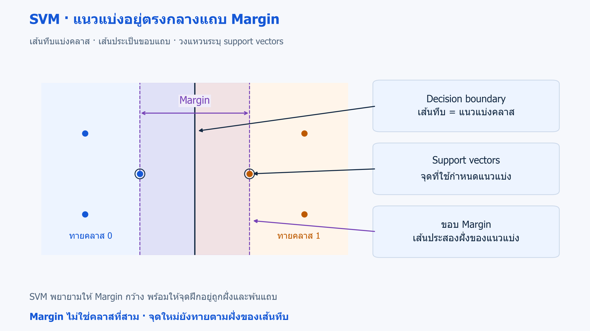
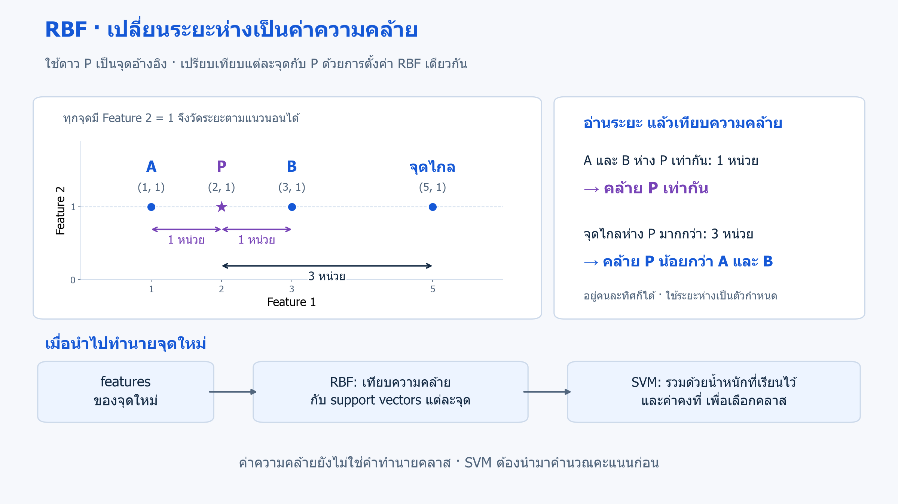
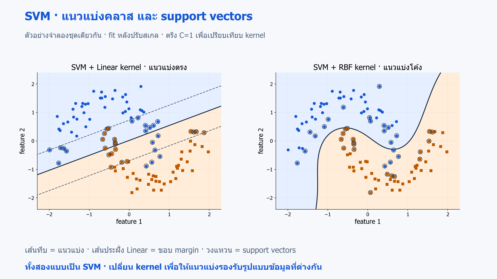
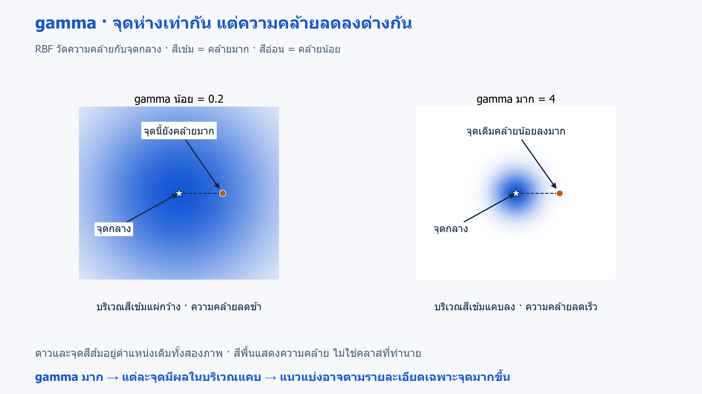
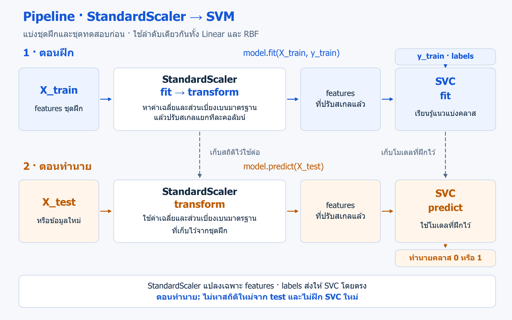

# 08 · Support Vector Machines: Linear, RBF และ Cross-validation

[กลับสารบัญ](../../README.md) · [Notebook](lesson.ipynb) · [Python](lesson.py)

บทนี้ใช้ **SVM สำหรับจำแนกคลาส โดยเปรียบเทียบ Linear kernel กับ RBF kernel** เพื่อทำนายว่าจุดอยู่คลาส 0 หรือ 1

ใช้คะแนน Cross-validation เลือก kernel แล้วจึงประเมินโมเดลที่เลือกบนชุดทดสอบ

**ใช้สิ่งที่เรียนแล้ว:** train/test, StandardScaler, Pipeline และ Accuracy จากบท 03–06<br>ส่วนใหม่คือหลักการ SVM, kernel และการใช้ CV เปรียบเทียบโมเดล

## SVM คืออะไร

**SVM — Support Vector Machine** อ่านว่า **ซัพพอร์ต เวกเตอร์ แมชชีน** เป็นโมเดล **Machine Learning แบบ Supervised Learning หรือการเรียนรู้แบบมีผู้สอน**

โมเดลเรียนรู้จาก features คู่กับ labels แล้วนำสิ่งที่เรียนรู้ไปทำนายข้อมูลใหม่

สำหรับงานจำแนกคลาส SVM เรียนรู้แนวแบ่งระหว่างคลาส แล้วใช้แนวแบ่งนั้นทำนายข้อมูลใหม่

SVM ใช้ได้ทั้งงานจำแนกคลาสและงานทำนายตัวเลข โดยเลือกประเภทตามงาน:

| ประเภทตามงาน | งานที่ใช้ | ตัวอย่าง kernel ที่เลือกใช้ได้ |
|---|---|---|
| **SVC — Support Vector Classification** | **Classification: จำแนกคลาส** เช่น 0 หรือ 1 และรองรับมากกว่าสองคลาสได้ | Linear หรือ RBF |
| **SVR — Support Vector Regression** | **Regression: ทำนายตัวเลขต่อเนื่อง** เช่น ค่าบริการขนส่ง | Linear หรือ RBF |

**เลือก SVC หรือ SVR ตามประเภทงาน แล้วจึงเลือก kernel ซึ่งเป็นฟังก์ชันคำนวณที่ใช้ภายในโมเดล**

ทั้ง SVC และ SVR เลือกใช้ Linear kernel หรือ RBF kernel ได้ และยังมี kernel ชนิดอื่นด้วย

บทนี้ใช้ **SVC สำหรับจำแนกคลาส** จึงเรียนรู้แนวแบ่งระหว่างคลาส 0 กับคลาส 1 ส่วน **SVR เรียนรู้ฟังก์ชันทำนายตัวเลข** ไม่ได้สร้างแนวแบ่งคลาส

## ข้อมูลในบท: จุดสองกลุ่มรูปพระจันทร์เสี้ยว

เราใช้ `make_moons` สร้าง **จุดข้อมูลที่เรียงตัวคล้ายพระจันทร์เสี้ยวสองกลุ่ม**

กลุ่มหนึ่งโค้งด้านบน อีกกลุ่มโค้งด้านล่างและวางเยื้องกันดังภาพ

**หนึ่งจุดคือข้อมูลหนึ่งแถว** โดยมี:

- **Features:** พิกัดแนวนอนและแนวตั้ง รวมสองค่า
- **Label:** คลาสจริงของข้อมูลแถวนั้น คือ 0 หรือ 1 โดยใช้ **สีของจุด** แสดงคลาสจริง


[เปิดภาพ SVG](../../assets/figures/08-support-vector-machines-moons-data.svg)

## Margin และ Support vectors: SVM เลือกแนวแบ่งอย่างไร

### จุดฝึกหกจุด: features คู่กับ label

เริ่มจาก **Linear SVC กับจุดฝึกหกจุดที่แยกสองคลาสได้ชัดเจน** เพื่อดูว่าโมเดลเลือกแนวแบ่งอย่างไร

| Feature 1: พิกัดแนวนอน | Feature 2: พิกัดแนวตั้ง | Label: คลาสจริง |
|---:|---:|---:|
| −2 | −1 | 0 |
| −2 | 1 | 0 |
| −1 | 0 | 0 |
| 1 | 0 | 1 |
| 2 | −1 | 1 |
| 2 | 1 | 1 |

**ตอนฝึก:** โมเดลรับพิกัดทั้งสองค่า คู่กับ label จริงของแต่ละแถว

**ตอนวาดกราฟ:** นำแนวแบ่งแต่ละแบบไปทำนายพิกัดทั่วกราฟ แล้วระบายสีพื้นตามผลทำนาย<br>จากนั้นวางจุดฝึกทับลงไป โดยใช้สีจุดตาม label จริง: คลาส 0 สีน้ำเงิน; คลาส 1 สีส้ม

จึงอ่านได้ว่า **สีจุดคือคำตอบจริง ส่วนสีพื้นคือคำตอบที่แนวแบ่งนั้นทำนาย** พิกัดที่สร้างขึ้นเพื่อระบายสีพื้นใช้แสดงผล ไม่ได้นำไปฝึกเพิ่ม

### ทายถูกเหมือนกัน แต่เว้นระยะต่างกัน

ลองเปรียบเทียบเส้นแนวตั้งสองตำแหน่ง: **พิกัด 0.6 เป็นเส้นที่สมมติไว้เปรียบเทียบ** ส่วน **พิกัด 0 เป็นแนวแบ่งที่ Linear SVC ฝึกได้จากข้อมูลหกจุดนี้**


[เปิดภาพ SVG](../../assets/figures/08-support-vector-machines-boundary-choice.svg)

ที่แนวแบ่ง **0.6** ระยะถึงจุดสีส้มคำนวณจาก `1 − 0.6 = 0.4` หน่วย; เมื่อแนวแบ่งอยู่ที่ **0** ระยะถึงจุดฝึกที่ใกล้ที่สุดเป็น **1 หน่วย**

**เกณฑ์คือเพิ่มระยะถึงจุดฝึกที่ใกล้ที่สุด** ขณะเดียวกันต้องแยกคลาสได้ถูกต้อง<br>บางจุดอาจอยู่ใกล้แนวแบ่งขึ้น เช่น จุดน้ำเงินมีระยะลดจาก 1.6 เหลือ 1 หน่วย แต่ระยะของฝั่งที่ชิดที่สุดเพิ่มขึ้น

### fit ของ Linear SVC หาน้ำหนักและค่าคงที่

**`fit` ของ Linear SVC หาค่าน้ำหนักและค่าคงที่ในสมการคะแนน** ซึ่งกำหนดตำแหน่งและทิศทางของแนวแบ่ง:

`f(x₁, x₂) = w₁x₁ + w₂x₂ + b`

โดย `x₁` และ `x₂` คือ Feature 1 และ Feature 2; `w₁` และ `w₂` คือน้ำหนักของแต่ละ feature; ส่วน `b` คือค่าคงที่

**ผลที่ฝึกได้สำหรับจุดหกจุดนี้:** `w₁ = 1`, `w₂ = 0` และ `b = 0` จึงได้ `f(x₁, x₂) = x₁`

แนวแบ่งอยู่ที่ **คะแนนเท่ากับ 0** จึงได้ `x₁ = 0` หรือเส้นแนวตั้งที่ Feature 1 เท่ากับ 0<br>น้ำหนัก `w₂ = 0` หมายถึงสมการคะแนนนี้ไม่ใช้ Feature 2 ส่วนค่าข้อมูลในคอลัมน์ Feature 2 ยังคงเดิม

<details>
<summary>คำนวณ w₁, w₂ และ b ทีละขั้น: ตรวจครบหกจุดก่อนเลือก w₂ = 0</summary>

**1. กำหนดสิ่งที่ต้องหาและเงื่อนไข**

เริ่มจาก `w₁`, `w₂` และ `b` ที่ยังไม่ทราบค่า โดยใช้สมการ `f(x₁, x₂) = w₁x₁ + w₂x₂ + b`

คำนวณกรณี **Hard-margin SVM** ซึ่งต้องแยกจุดฝึกทุกจุดให้ถูก และให้จุดอยู่บนขอบหรืออยู่นอกแถบ margin:

- จุดคลาส 0 ต้องได้คะแนน **ไม่เกิน −1**
- จุดคลาส 1 ต้องได้คะแนน **ไม่น้อยกว่า +1**
- เลือกน้ำหนักให้ **`w₁² + w₂²` เล็กที่สุด** ภายใต้เงื่อนไขของจุดฝึกทุกจุด

−1 และ +1 เป็นเกณฑ์คะแนน ส่วน 0 และ 1 ในตารางข้อมูลเป็นชื่อคลาส<br>สูตรเป้าหมายใช้ `½ × (w₁² + w₂²)`; การคูณด้วย ½ ไม่เปลี่ยนว่าค่าน้ำหนักชุดใดทำให้ผลลัพธ์ต่ำที่สุด และไม่มี `b²` รวมในเป้าหมายนี้

**2. แทนสองจุดที่ Feature 2 เป็น 0 เพื่อหาเงื่อนไขของ w₁ และ b**

จุด `(-1, 0)` เป็นคลาส 0:

`w₁(−1) + w₂(0) + b ≤ −1` จึงเหลือ `−w₁ + b ≤ −1`

คูณทั้งสองข้างด้วย −1 เพื่อให้ `w₁` มีเครื่องหมายบวก โดยต้องกลับเครื่องหมายอสมการด้วย:

`w₁ − b ≥ 1`

จุด `(1, 0)` เป็นคลาส 1:

`w₁(1) + w₂(0) + b ≥ 1` จึงเหลือ `w₁ + b ≥ 1`

บวกสองอสมการเพื่อให้ `−b` กับ `+b` หักล้างกัน:

`(w₁ − b) + (w₁ + b) ≥ 1 + 1` → `2w₁ ≥ 2` → **`w₁ ≥ 1`**

สองจุดนี้ยังไม่ได้กำหนดค่า `w₂` เพราะเทอม `w₂ × 0` เป็น 0 ไม่ว่า `w₂` จะมีค่าเท่าไร

**3. ลอง w₁ ที่เล็กที่สุด แล้วหา b**

เมื่อ `w₁ ≥ 1` ค่าต่ำที่สุดของ `w₁²` คือ 1 ซึ่งเกิดเมื่อ **`w₁ = 1`**<br>ลองใช้ค่านี้ แล้วตรวจว่ามี `b` และ `w₂` ที่ทำให้จุดที่เหลือผ่านเงื่อนไขได้หรือไม่

แทน `w₁ = 1` ในสองอสมการเดิม:

- `1 − b ≥ 1` → `−b ≥ 0` → **`b ≤ 0`**
- `1 + b ≥ 1` → **`b ≥ 0`**

ค่าเดียวที่ผ่านทั้งสองเงื่อนไขคือ **`b = 0`** จึงเหลือสมการ `f(x₁, x₂) = x₁ + w₂x₂`

**4. ตรวจอีกสี่จุด เพื่อหาช่วงค่าที่ w₂ ใช้ได้**

| จุดฝึก | คลาสจริง | แทนค่าในเงื่อนไขคะแนน | เงื่อนไขของ w₂ |
|---|---:|---|---|
| `(-2, -1)` | 0 | `−2 − w₂ ≤ −1` | `w₂ ≥ −1` |
| `(-2, 1)` | 0 | `−2 + w₂ ≤ −1` | `w₂ ≤ 1` |
| `(2, -1)` | 1 | `2 − w₂ ≥ 1` | `w₂ ≤ 1` |
| `(2, 1)` | 1 | `2 + w₂ ≥ 1` | `w₂ ≥ −1` |

เช่น แถวแรกบวก 2 ทั้งสองข้าง ได้ `−w₂ ≤ 1` แล้วคูณด้วย −1 พร้อมกลับเครื่องหมาย จึงได้ `w₂ ≥ −1`

เมื่อรวมทุกเงื่อนไข จะได้ **`−1 ≤ w₂ ≤ 1`**<br>จึงมีหลายค่าที่ใช้ได้ เช่น −0.5, 0 และ 0.5 ซึ่งล้วนทำให้จุดฝึกทุกจุดผ่านเงื่อนไข

**5. เลือก w₂ ที่ทำให้ผลรวมกำลังสองต่ำที่สุด**

เมื่อ `w₁ = 1` ผลรวมกำลังสองคือ `1 + w₂²`:

| ค่า w₂ ที่ผ่านเงื่อนไข | ผลรวมกำลังสอง |
|---:|---|
| −0.5 | `1 + (−0.5)² = 1.25` |
| **0** | **`1 + 0² = 1`** |
| 0.5 | `1 + 0.5² = 1.25` |

จึงเลือก **`w₂ = 0` เพราะผ่านเงื่อนไขของทุกจุด และให้ผลรวมต่ำที่สุด**<br>ไม่ได้สรุปจากการที่สองจุดแรกมี Feature 2 เป็น 0

นี่เป็นค่าต่ำที่สุดของปัญหาทั้งหมดด้วย: ทุกคำตอบที่ผ่านเงื่อนไขต้องมี `w₁² ≥ 1` และ `w₂² ≥ 0` ผลรวมจึงต่ำกว่า 1 ไม่ได้

**6. ตรวจคะแนนครบทุกจุด และหาตำแหน่งแนวแบ่ง**

แทน `w₁ = 1`, `w₂ = 0`, `b = 0` ได้ `f(x₁, x₂) = 1x₁ + 0x₂ + 0 = x₁`

| จุดฝึก | คลาสจริง | คะแนน | ผ่านเงื่อนไข |
|---|---:|---:|---|
| `(-2, -1)` | 0 | −2 | ไม่เกิน −1 |
| `(-2, 1)` | 0 | −2 | ไม่เกิน −1 |
| `(-1, 0)` | 0 | −1 | ไม่เกิน −1 |
| `(1, 0)` | 1 | +1 | ไม่น้อยกว่า +1 |
| `(2, -1)` | 1 | +2 | ไม่น้อยกว่า +1 |
| `(2, 1)` | 1 | +2 | ไม่น้อยกว่า +1 |

เช่น จุด `(-2, 1)` มี Feature 2 เท่ากับ 1 แต่คะแนนเป็น `1(−2) + 0(1) + 0 = −2` จึงผ่านเงื่อนไขคลาส 0

แนวแบ่งคือบริเวณที่ `f(x₁, x₂) = 0` จึงได้ **`x₁ = 0`** โดยไม่จำกัดค่า `x₂` เป็นเส้นแนวตั้งที่ Feature 1 เท่ากับ 0

การคำนวณนี้ให้คำตอบเดียวกับ `SVC(kernel="linear", C=100)` ที่ใช้สร้างภาพหกจุดนี้<br>เวลาเรียก `fit` โปรแกรมใช้ตัวแก้ปัญหาเชิงตัวเลขของ LIBSVM ส่วนขั้นตอนข้างต้นแสดงเหตุผลของคำตอบด้วยการแทนค่าจากข้อมูล

ศึกษาต่อ: [scikit-learn — สมการ SVC และการคำนวณภายใน](https://scikit-learn.org/1.7/modules/svm.html#mathematical-formulation)

</details>

### Margin: ระยะถึงจุดฝึก กับแถบคะแนน

หลังได้สมการคะแนนแล้ว จึงแยกสิ่งที่วัดบนกราฟเป็นสองอย่าง:

- **ระยะถึงจุดฝึกที่ใกล้ที่สุด:** วัดจากแนวแบ่งไปถึงจุดฝึก ในทิศตั้งฉากกับแนวแบ่ง
- **ความกว้างแถบคะแนน −1 ถึง +1:** วัดระหว่างเส้นประสองฝั่ง โดยเส้นทึบตรงกลางมีคะแนน 0



[เปิดภาพ SVG](../../assets/figures/08-support-vector-machines-margin.svg)

**ลูกศรเขียววัดถึงจุดฝึก: 1 หน่วยต่อฝั่ง; ลูกศรม่วงวัดทั้งแถบ: 2 หน่วย**<br>ในคำตอบของตัวอย่างนี้ จุดฝึกที่ใกล้ที่สุดแตะเส้นคะแนน −1 และ +1 พอดี

พิกัดกับคะแนนมีตัวเลขตรงกัน เพราะ `f(x₁, x₂) = x₁` พอดี<br>**คะแนน −1, 0 และ +1 เป็นคะแนนตัดสินใจ ส่วน label 0 กับ 1 เป็นชื่อคลาส** คะแนนต่างกัน 2 ไม่ได้แปลว่าระยะบนกราฟต้องเท่ากับ 2 หน่วยเสมอ

กรณีที่กำหนดให้จุดฝึกทุกจุดอยู่ถูกฝั่ง และอยู่บนขอบหรืออยู่นอกแถบ เรียกว่า **Hard-margin SVM**

### Support vectors: จุดฝึกที่ใช้กำหนดแนวแบ่ง

**วงแหวนระบุ support vectors** หรือจุดฝึกที่โมเดลใช้กำหนดแนวแบ่ง ในภาพนี้คือ `(-1, 0)` กับ `(1, 0)`<br>ส่วนการดูว่าทายถูกหรือผิด ให้เทียบสีจุดกับสีพื้น: สีตรงกันคือทายถูก; สีต่างกันคือทายผิด

เมื่อข้อมูลปะปนกัน **SVC แบบ Soft-margin** ยอมให้บางจุดอยู่ในแถบหรือผิดฝั่งได้ โดยใช้ค่า **C** ควบคุมการแลกเปลี่ยนระหว่างความกว้างแถบกับการละเมิด margin<br>support vectors บางจุดจึงอาจอยู่ในแถบ หรือเป็นจุดที่โมเดลทายผิดได้ด้วย

จุดใหม่ที่อยู่ในแถบ margin ยังทำนายเป็น 0 หรือ 1 ตามฝั่งของแนวแบ่ง

<details>
<summary>เพิ่มเติม: ทำไมคูณคะแนนด้วย 2 แล้วระยะถึงจุดฝึกไม่เปลี่ยน</summary>

นำคะแนนที่ฝึกได้มาคูณ 2 จะได้ `g(x) = 2 × f(x) = 2 × Feature 1`<br>จุดฝึกและสเกลพิกัดยังเหมือนเดิม การคูณนี้เปลี่ยนเฉพาะสเกลคะแนน โดยไม่ได้ฝึกโมเดลใหม่


[เปิดภาพ SVG](../../assets/figures/08-support-vector-machines-margin-scaling.svg)

แนวแบ่งยังอยู่ที่พิกัด 0 เพราะคะแนนเดิมเป็น 0 และเมื่อคูณ 2 ก็ยังเป็น 0<br>**ระยะถึงจุดฝึกจึงไม่เปลี่ยน** แต่เส้นคะแนนคงที่ −1 กับ +1 ขยับเข้าหากัน ทำให้แถบคะแนนแคบลง

หากต้องการวาดขอบที่ **พิกัดเดิม −1 และ +1** ด้วยสมการใหม่ `g(x)` ต้องใช้ **คะแนน −2 และ +2**; ความกว้างบนกราฟจึงยังเป็น 2 หน่วย

การฝึกหาแนวแบ่งสามารถเปลี่ยนตำแหน่งหรือทิศทางของเส้นได้ ส่วนการคูณทั้งน้ำหนักและค่าคงที่ด้วยจำนวนบวกเดียวกันคงแนวแบ่งเดิมไว้

</details>

<details>
<summary>ศึกษาต่อ: สูตรระยะ และเหตุผลที่ลดผลรวมกำลังสองของน้ำหนัก</summary>

สำหรับ Linear SVM ที่มีสมการคะแนน `f(x₁, x₂) = w₁x₁ + w₂x₂ + b` ให้ `‖w‖ = √(w₁² + w₂²)` หรือขนาดของเวกเตอร์น้ำหนัก<br>ขนาดคะแนนหมายถึงค่าสัมบูรณ์ เช่น คะแนน −2 มีขนาดเท่ากับ 2

| สิ่งที่วัด | สูตร | เมื่อ `f(x) = x₁` | เมื่อ `g(x) = 2x₁` |
|---|---|---|---|
| ระยะจากจุดฝึก `(1, 0)` ถึงแนวแบ่ง | ขนาดคะแนนของจุด ÷ `‖w‖` | `1 / 1 = 1` | `2 / 2 = 1` |
| ความกว้างแถบคะแนน −1 ถึง +1 | `2 / ‖w‖` | `2 / 1 = 2` | `2 / 2 = 1` |

เมื่อคูณสมการคะแนนด้วย 2 คะแนนของจุดและขนาดเวกเตอร์น้ำหนักเพิ่มเป็นสองเท่าพร้อมกัน ระยะถึงจุดฝึกจึงเท่าเดิม<br>แต่สูตรความกว้างแถบใช้เกณฑ์คะแนน −1 กับ +1 คงที่ ตัวเศษจึงยังเป็น 2

ในการหาคำตอบของ **Hard-margin SVM** เรากำหนดให้จุดฝึกอยู่ถูกฝั่งและมีขนาดคะแนนอย่างน้อย 1<br>เมื่อได้คำตอบที่เหมาะที่สุด จุดใกล้แนวแบ่งที่สุดจะมีขนาดคะแนนเท่ากับ 1 ทำให้ระยะถึงจุดนั้นเป็น `1 / ‖w‖`

การลด `w₁² + w₂²` ภายใต้เงื่อนไขของจุดฝึก จึงเท่ากับการทำให้ระยะนี้มากที่สุด<br>ลดน้ำหนักอย่างเดียวไม่ได้ เพราะยังต้องผ่านเงื่อนไขคะแนนของจุดฝึกด้วย

สูตรนี้ใช้กับแนวแบ่ง **Linear** และวัดในพิกัดที่ส่งเข้าโมเดล หากผ่าน StandardScaler แล้ว ระยะจะอยู่ในสเกลหลังแปลง

ศึกษาต่อ: [Stanford CS229 — Functional margin, Geometric margin และการกำหนดสเกลคะแนน](https://cs229.stanford.edu/notes2020spring/cs229-notes3.pdf#page=14)

</details>


<a id="kernel-จากแนวแบ่งตรงเป็นแนวแบ่งโค้ง"></a>

## Kernel กับแนวแบ่งคลาส: ต่างกันอย่างไร

- **Kernel อ่านว่า เคอร์เนล:** ฟังก์ชันที่รับ features ของข้อมูลสองจุด แล้วคำนวณค่าความสัมพันธ์ให้โมเดลใช้ระหว่างฝึกและทำนาย
- **แนวแบ่งคลาส — Decision boundary:** ผลที่ SVC เรียนรู้จากข้อมูลฝึก<br>บนกราฟของบทนี้คือเส้นที่แยกบริเวณทำนายคลาส 0 ออกจากบริเวณทำนายคลาส 1

**Linear และ RBF เป็นชื่อชนิดของ kernel**

ลำดับคือ **เลือก kernel และกำหนดค่าของโมเดล → ฝึก SVC ด้วย features คู่กับ labels → ได้แนวแบ่งคลาส**

รูปร่างและตำแหน่งของแนวแบ่งจึงขึ้นกับทั้งข้อมูลฝึกและการตั้งค่า

เช่น `SVC(kernel="rbf")` เลือกให้โมเดลใช้ RBF kernel แต่ยังไม่มีแนวแบ่งคลาส จนกว่าจะเรียก `fit` ด้วยข้อมูลฝึก

| การตั้งค่า SVC | ฟังก์ชันคำนวณที่เลือก | แนวแบ่งหลังฝึกบนกราฟสอง features ของบทนี้ |
|---|---|---|
| `kernel="linear"` | Linear kernel | เป็นเส้นตรง |
| `kernel="rbf"` | RBF kernel | สามารถเป็นเส้นโค้งได้ |

คำว่า **“SVM แบบ RBF”** จึงย่อมาจาก **“SVM ที่ใช้ RBF kernel”**

ส่วนเส้นที่เห็นในกราฟเรียกว่า **แนวแบ่งคลาส**

**RBF** อ่านว่า **อาร์ บี เอฟ**; ย่อมาจาก **Radial Basis Function**

ชื่อเต็มอ่านว่า **เรเดียล เบซิส ฟังก์ชัน**

### RBF: เปลี่ยนระยะห่างเป็นค่าความคล้าย

RBF ที่ใช้ใน `SVC` เปรียบเทียบ features ของจุดสองจุดจากระยะห่าง แล้วให้ **ค่าความคล้าย**: จุดใกล้กันได้ค่าสูงกว่าจุดที่อยู่ไกลกัน เมื่อใช้การตั้งค่า RBF เดียวกัน

เริ่มจากดาว **P ที่พิกัด (2, 1)** เป็นจุดที่ใช้เทียบกับจุดอื่น ลูกศรในกราฟแสดงระยะจากแต่ละจุดถึง P:



[เปิดภาพ SVG](../../assets/figures/08-support-vector-machines-rbf-similarity.svg)

**อ่านภาพ:** A กับ B อยู่คนละฝั่งของ P แต่ห่าง P เท่ากันที่ **1 หน่วย** จึงได้ค่าความคล้ายกับ P เท่ากัน<br>ส่วนจุดทางขวาสุดห่าง P **3 หน่วย** จึงได้ค่าความคล้ายกับ P น้อยกว่า A และ B

คำว่า **Radial** สื่อถึงการใช้ระยะห่างจากจุดที่นำมาเทียบ จึงได้ค่าเท่ากันเมื่อระยะเท่ากัน แม้จะอยู่คนละทิศ

### SVC นำค่าความคล้ายไปทำนายคลาสอย่างไร

เมื่อทำนายจุดใหม่, **SVC ที่ใช้ RBF kernel** คำนวณความคล้ายระหว่างจุดใหม่กับ support vectors แต่ละจุด

จากนั้น SVC นำค่าความคล้ายมาคูณน้ำหนัก รวมผล แล้วบวกค่าคงที่ เพื่อคำนวณคะแนนตัดสินใจเลือกคลาส<br>**น้ำหนักและค่าคงที่เหล่านี้เรียนรู้ตอนฝึก SVC หรือขั้น `fit` ของ SVC**

ส่วน **`fit` ของ StandardScaler** หาค่าเฉลี่ยและส่วนเบี่ยงเบนมาตรฐานจาก features ของชุดฝึก เพื่อใช้ปรับสเกลก่อนส่งข้อมูลเข้า SVC

การรวมผลจาก support vectors หลายจุดช่วยให้ SVC ที่ใช้ RBF kernel สร้างแนวแบ่งโค้งได้ เปรียบเทียบกับ SVC ที่ใช้ Linear kernel บนข้อมูลชุดเดียวกัน:



สีพื้นบอกคลาสที่โมเดลจะทำนายในบริเวณนั้น · [เปิดภาพ SVG](../../assets/figures/08-support-vector-machines-model.svg)

**เทียบกับ KNN ในบท 03:** KNN เลือกเพื่อนบ้านใกล้ที่สุดตามจำนวน k แล้วโหวตคลาส<br>ส่วน SVM ที่ใช้ RBF ใช้น้ำหนักที่เรียนรู้มารวมค่าความคล้ายกับ support vectors เพื่อคำนวณคะแนนเลือกคลาส

**RBF ดีกว่า Linear เสมอไหม?** SVM ที่ใช้ RBF ไม่ได้รับประกันว่าจะทำนายได้ดีกว่า SVM ที่ใช้ Linear ทุกชุดข้อมูล

บทนี้จึงใช้คะแนน CV เปรียบเทียบทั้งสองการตั้งค่า

**จุดเด่น:** เลือก kernel ให้รองรับรูปแบบข้อมูลที่ต่างกันได้

**ข้อจำกัด:** ต้องปรับสเกลและเลือก C ให้เหมาะ ส่วน RBF ต้องเลือก gamma ด้วย การฝึก SVC แบบ kernel อาจช้าเมื่อมีข้อมูลจำนวนมาก

<details>
<summary>ศึกษาต่อ: สูตร RBF และ Kernel trick</summary>

RBF ที่ใช้ใน `SVC(kernel="rbf")` เป็นแบบ **Gaussian RBF** โดย gamma ควบคุมความเร็วที่ค่าความคล้ายลดลงเมื่อระยะห่างเพิ่มขึ้น

สำหรับการทดลองในบทนี้ ให้เข้าใจหน้าที่ของ RBF ผลของ gamma และการเลือกค่าด้วย CV ก่อน ส่วนการพิสูจน์สูตรและคณิตศาสตร์ของ Kernel trick อ่านเพิ่มเติมได้ตามความสนใจ:

1. [สูตร RBF kernel](https://scikit-learn.org/1.7/modules/metrics.html#rbf-kernel) — ดูว่าระยะห่างกับ gamma ใช้คำนวณความคล้ายอย่างไร
2. [ภาพผลของ C และ gamma](https://scikit-learn.org/1.7/auto_examples/svm/plot_rbf_parameters.html) — เปรียบเทียบแนวแบ่งเมื่อเปลี่ยนค่าทีละแบบ
3. [สมการ SVC และ Kernel trick](https://scikit-learn.org/1.7/modules/svm.html#mathematical-formulation) — ศึกษาว่า kernel ช่วยคำนวณในพื้นที่ features อีกแบบได้อย่างไร และ support vectors ร่วมกันกำหนดคะแนนทำนายอย่างไร

</details>

## C และ gamma เปลี่ยนแนวแบ่งอย่างไร

**C และ gamma เป็น Hyperparameters — ไฮเปอร์พารามิเตอร์** คือค่าที่เรากำหนดก่อน `fit` เพื่อควบคุมวิธีที่โมเดลเรียนรู้

จากนั้นโมเดลจึงฝึกหาแนวแบ่งภายใต้ค่าที่กำหนด เราสามารถลองหลายค่าแล้วใช้ CV ช่วยเลือกได้

### C: ให้ความสำคัญกับจุดที่อยู่ใน Margin หรือผิดฝั่งมากแค่ไหน

**C อ่านว่า ซี** ใน SVC ใช้ได้ทั้ง Linear kernel และ RBF kernel โดยควบคุมความสำคัญของการลด **การละเมิด margin** ระหว่างฝึก

การละเมิด margin หมายถึงจุดฝึกอยู่ภายในแถบคะแนน −1 ถึง +1 หรืออยู่ฝั่งที่ไม่ตรงกับ label จริง

- **C น้อย:** ให้น้ำหนักกับการเว้น margin กว้างมากขึ้น จึงยอมให้บางจุดอยู่ในแถบหรือผิดฝั่งได้มากขึ้น
- **C มาก:** ให้น้ำหนักกับการลดการละเมิด margin มากขึ้น จึงอาจเลือกแนวแบ่งที่มี margin แคบลง


[เปิดภาพ SVG](../../assets/figures/08-support-vector-machines-c-effect.svg)

ภาพนี้ **ฝึกโมเดลใหม่เมื่อเปลี่ยน C** จึงเปลี่ยนได้ทั้งแนวแบ่งและความกว้างแถบคะแนน ต่างจากการคูณคะแนนของโมเดลที่ฝึกแล้วด้วย 2 ในตัวอย่างก่อนหน้า

### gamma: ความคล้ายลดลงเร็วแค่ไหนเมื่อจุดห่างกัน

**gamma อ่านว่า แกมมา** ควบคุมความเร็วที่ค่าความคล้ายของ RBF ลดลงเมื่อจุดอยู่ห่างกันมากขึ้น: **gamma น้อย ความคล้ายลดช้า; gamma มาก ความคล้ายลดเร็ว**



[เปิดภาพ SVG](../../assets/figures/08-support-vector-machines-gamma-effect.svg)

<details>
<summary>ดูผลต่อแนวแบ่ง RBF เมื่อเปลี่ยน C และ gamma ทีละค่า</summary>

เปลี่ยนค่าทีละตัวโดยใช้ข้อมูลชุดเดิมทุกช่อง เพื่อดูผลของ C และ gamma แยกกัน


[เปิดภาพ SVG](../../assets/figures/08-support-vector-machines-parameters.svg)

</details>

**แนวแบ่งที่ทายจุดฝึกได้ดี อาจทายข้อมูลใหม่ได้ไม่ดี**

หากโมเดลเรียนรายละเอียดเฉพาะชุดฝึกมากเกินไป จะเรียกว่า overfitting

เราจึงใช้คะแนน validation ใน CV ช่วยเลือก kernel แทนการเลือกจากภาพบนชุดฝึกเพียงอย่างเดียว

## Pipeline: ปรับสเกลก่อนส่งข้อมูลให้ SVM

ใช้ **StandardScaler ก่อน SVM** เพราะขนาดของ features มีผลต่อระยะและความคล้าย, คอลัมน์ที่มีค่ากระจายกว้างอาจมีอิทธิพลมากกว่าคอลัมน์อื่น

เราจึงรวม StandardScaler กับ SVC ไว้ใน Pipeline เพื่อให้ข้อมูลผ่านการปรับสเกลทั้งตอนฝึกและตอนทำนาย



[เปิดภาพ SVG](../../assets/figures/08-support-vector-machines-pipeline.svg)

**อ่านภาพ:** แถวบนเป็นการฝึก — scaler หาค่าเฉลี่ยและส่วนเบี่ยงเบนมาตรฐานจากชุดฝึก แล้วแปลง features ก่อนส่งให้ SVC ฝึกคู่กับ labels<br>แถวล่างเป็นการทำนาย — scaler ใช้สถิติที่เก็บจากชุดฝึกแปลงข้อมูลใหม่ ก่อนให้ SVC ทำนาย โดย labels ไม่ผ่าน scaler

## Cross-validation (CV): เลือก kernel ก่อนใช้ Test

### ทำไมจึงตรวจผลมากกว่าหนึ่งรอบ

ในบท 04 เราใช้ validation ชุดเดียวเลือกโมเดล แต่คะแนนอาจเปลี่ยนเมื่อเลือกแถวสำหรับฝึกและ validation ต่างกัน

**Cross-validation หรือ CV คือการประเมินโมเดลด้วยการแบ่งข้อมูลเป็นส่วนฝึกและส่วน validation หลายรอบ** ทำให้เปรียบเทียบโมเดลจากหลายคะแนน แทนการพึ่งการแบ่งเพียงครั้งเดียว

### 5-fold CV ทำงานอย่างไร

- **Fold อ่านว่า โฟลด์:** หนึ่งส่วนของข้อมูลที่แบ่งไว้สำหรับ CV
- **Validation:** ข้อมูลที่ใช้ตรวจผลของโมเดลที่ฝึกในรอบนั้น

จากข้อมูล 400 แถว บทนี้กัน test ไว้ 100 แถว จึงเหลือ **train 300 แถวสำหรับทำ CV**

แบ่ง train เป็นห้า fold เท่า ๆ กัน ได้ fold ละ `300 ÷ 5 = 60` แถว

**แต่ละรอบใช้สี่ fold ฝึก รวม 240 แถว และใช้ fold ที่เหลือเป็น validation 60 แถว** ส่วน test 100 แถวยังเก็บแยกไว้:


[เปิดภาพ SVG](../../assets/figures/08-support-vector-machines-cross-validation.svg)

ในการทำ 5-fold CV ของบทนี้ แต่ละแถวใน train จะถูกใช้เป็น validation หนึ่งรอบ และเป็นข้อมูลฝึกในอีกสี่รอบ โดย **แต่ละรอบเริ่มฝึก Pipeline ใหม่** จึงไม่ฝึกต่อจากโมเดลของรอบก่อนหน้า

ในแต่ละรอบ scaler คำนวณค่าเฉลี่ยและส่วนเบี่ยงเบนมาตรฐานจากส่วนฝึก 240 แถว แล้วนำสถิติจากส่วนฝึกไปแปลง validation 60 แถว โดยไม่คำนวณสถิติใหม่จาก validation

ใช้ **StratifiedKFold** เพื่อรักษาสัดส่วนคลาส, ในข้อมูลนี้ validation แต่ละรอบมีคลาส 0 จำนวน 30 แถว และคลาส 1 จำนวน 30 แถว

ทั้งสอง kernel ใช้ตำแหน่งแถวชุดเดียวกันในแต่ละรอบ เพื่อให้เปรียบเทียบจากข้อมูลเดียวกัน

### คะแนนแต่ละ Fold มาจากไหน และเลือกอย่างไร

แต่ละรอบคำนวณ **Accuracy = จำนวนที่ทายถูก ÷ จำนวนแถวใน validation** จากนั้นเฉลี่ยห้าคะแนนของ Linear และเฉลี่ยห้าคะแนนของ RBF แล้วเลือก kernel ที่มีค่าเฉลี่ยสูงกว่า:


[เปิดภาพ SVG](../../assets/figures/08-support-vector-machines-cv-scores.svg)

### ทำ CV แล้ว ทำไมยังต้องใช้ Test

คะแนน CV ถูกใช้ตัดสินใจเลือก kernel แล้ว จึงเก็บ **test 100 แถวที่ไม่เคยใช้เลือกโมเดล** ไว้ประเมินครั้งสุดท้าย

ผล CV ของบทนี้เลือก RBF จึงฝึก Pipeline ที่ใช้ RBF ด้วย train ทั้ง 300 แถว แล้วทำนาย test โดยไม่นำคะแนน test กลับไปเลือก kernel หรือปรับ C/gamma

<details>
<summary>ต้องใช้ 5 fold เสมอไหม และต้องฝึกกี่ครั้ง?</summary>

- 5 เป็นจำนวน fold ที่กำหนดสำหรับการทดลองนี้ ไม่ใช่ค่าบังคับของ SVM<br>การเพิ่มจำนวน fold ทำให้ต้องฝึกหลายครั้งขึ้น และไม่ได้รับประกันว่าจะเลือกโมเดลได้ดีกว่าเสมอ
- สอง kernel × ห้า fold = **ฝึก Pipeline 10 ครั้งเพื่อเปรียบเทียบ** แล้วฝึกแบบที่เลือกด้วย train ทั้งหมดอีกหนึ่งครั้ง รวมเป็น 11 ครั้ง
- โมเดลจากแต่ละ fold ใช้เก็บคะแนนเพื่อเลือกการตั้งค่า ไม่ได้นำมาโหวตร่วมกัน
- CV ใช้ได้กับโมเดลอื่นด้วย และใช้เปรียบเทียบ C/gamma หลายค่าได้ เมื่อเรียน GridSearchCV ในบท 10

</details>

<details>
<summary>CV สำหรับข้อมูลเวลาและข้อมูลหลายแถวต่อคน ต้องแบ่งอย่างไร?</summary>

วิธีแบ่งส่วนฝึกกับ validation **ในแต่ละรอบของ CV** ต้องตรงกับสิ่งที่จะทำนายเมื่อใช้งานจริง:

- **ทำนายอนาคต:** ใช้ข้อมูลช่วงอดีตฝึก แล้วตรวจผลกับช่วงเวลาถัดมา เพื่อไม่ให้ข้อมูลอนาคตเข้าไปช่วยฝึกโมเดลที่ใช้ทำนายอดีต
- **ทำนายคนที่ไม่เคยพบ:** เก็บทุกแถวของคนเดียวกันไว้ฝั่งเดียว ภายในรอบเดียวกัน คนหนึ่งต้องอยู่ในส่วนฝึกหรือ validation เท่านั้น<br>รอบถัดไปเปลี่ยนกลุ่มคนที่ใช้ validation ได้ โดยย้ายข้อมูลของแต่ละคนไปด้วยกันทั้งกลุ่ม

หลักเดียวกันนี้ใช้กับการกัน **test ชุดสุดท้าย** ด้วย จึงไม่ใช้การสุ่มแถวแบบในบทนี้กับทุกโจทย์

อ่านตัวอย่างการแบ่งตามคนและเวลาต่อใน [บท 17](../17-time-and-groups/README.md)

</details>

## ลงมือทำ

สร้าง Notebook ใหม่แล้วรัน **Cell 1–6 ตามลำดับ** หรือเปิด [Notebook ของบทนี้](lesson.ipynb)

ลำดับการทดลอง: **แบ่งข้อมูล → สร้าง Pipeline สองแบบ → ดูการแบ่ง Fold → ฝึกและอ่านคะแนน CV → ฝึกแบบที่เลือกและทดสอบ → วาดแนวแบ่ง**

<!-- CODE:CELLS -->

<!-- CODE:START -->
### Cell 1 — สร้างข้อมูลและแยกชุดทดสอบ

```python
from pathlib import Path

import matplotlib.pyplot as plt
import numpy as np
import pandas as pd
from matplotlib.colors import ListedColormap
from sklearn.datasets import make_moons
from sklearn.inspection import DecisionBoundaryDisplay
from sklearn.metrics import accuracy_score
from sklearn.model_selection import StratifiedKFold, cross_val_score, train_test_split
from sklearn.pipeline import make_pipeline
from sklearn.preprocessing import StandardScaler
from sklearn.svm import SVC

X, y = make_moons(n_samples=400, noise=0.25, random_state=42)
X_train, X_test, y_train, y_test = train_test_split(X, y, test_size=0.25, stratify=y, random_state=42)
print("Train:", X_train.shape, "Test:", X_test.shape)
print("Training labels:", np.unique(y_train))
```

<details>
<summary>ดูผลลัพธ์ Cell 1</summary>

```text
Train: (300, 2) Test: (100, 2)
Training labels: [0 1]
```

มีข้อมูลฝึก 300 แถวและข้อมูลทดสอบ 100 แถว แต่ละแถวมีสอง features ส่วน labels มีสองคลาสคือ 0 และ 1

</details>

**อ่านโค้ด**

**1. สร้างข้อมูล:** `make_moons(n_samples=400, ...)` สร้างข้อมูลรูปพระจันทร์เสี้ยวสองกลุ่ม รวม 400 จุด แล้วคืนผลสองส่วนให้ตัวแปร:

- `X` เก็บ **features**: พิกัดสองค่าต่อจุด จึงมีขนาด `(400, 2)`
- `y` เก็บ **labels**: คลาสจริง 0 หรือ 1 จำนวน 400 ค่า โดยเรียงตรงกับแถวใน `X`

`noise=0.25` เพิ่มค่ารบกวนสุ่มให้พิกัดของแต่ละจุด โดย 0.25 คือส่วนเบี่ยงเบนมาตรฐานของค่ารบกวน

เมื่อเพิ่ม noise จุดจะกระจายออกจากแนวโค้งมากขึ้น

**2. แบ่งข้อมูล:** `train_test_split(X, y, ...)` แบ่งแถวพร้อมจับคู่ features กับ label ให้ตรงกัน:

- `X_train`, `y_train`: ชุดฝึก 300 แถว
- `X_test`, `y_test`: ชุดทดสอบ 100 แถว

`test_size=0.25` กัน 25% ของ 400 แถวไว้ทดสอบ ส่วน `stratify=y` รักษาสัดส่วนคลาสในการแบ่ง

### Cell 2 — สร้าง Pipeline ของ SVM สองแบบ

```python
models = {
    "linear": make_pipeline(StandardScaler(), SVC(kernel="linear", C=1.0)),
    "rbf": make_pipeline(StandardScaler(), SVC(kernel="rbf", C=1.0, gamma="scale")),
}
print("Prepared kernels:", list(models))
```

<details>
<summary>ดูผลลัพธ์ Cell 2</summary>

```text
Prepared kernels: ['linear', 'rbf']
```

เตรียม Pipeline ไว้สองแบบแล้ว ขั้นนี้ยังไม่ได้ฝึกโมเดล จึงยังไม่มีแนวแบ่งคลาสหรือคะแนน Accuracy

</details>

**อ่านโค้ด**

- `models` เก็บ Pipeline สองตัว แต่ละตัวเตรียมให้ข้อมูลผ่าน `StandardScaler` ก่อน `SVC` โดยตัวหนึ่งใช้ `kernel="linear"` อีกตัวใช้ `kernel="rbf"`<br>ขั้นตอนเหล่านี้จะทำงานเมื่อเรียก `fit` หรือ `predict`
- `kernel="linear"` กับ `kernel="rbf"` เลือกชนิดของฟังก์ชันคำนวณ ส่วนแนวแบ่งคลาสจะเกิดจากการฝึก SVC เมื่อเรียก `fit` ของ Pipeline
- `C=1.0` เป็นค่าที่กำหนดไว้ให้ทั้งสองแบบ<br>ฝั่ง RBF เพิ่ม `gamma="scale"` เพื่อให้ SVC คำนวณ gamma เมื่อเริ่ม fit โดยใช้ features **หลังผ่าน StandardScaler**

<details>
<summary>gamma="scale" คำนวณอย่างไร และต่างจาก StandardScaler อย่างไร?</summary>

- **StandardScaler:** แปลงค่า features
- **gamma="scale":** ให้ SVC คำนวณค่า gamma จากข้อมูลที่ได้รับหลังผ่าน StandardScaler

`gamma="scale"` เป็นการคำนวณค่า gamma ตามสูตร ไม่ได้ปรับสเกล features ซ้ำหรือค้นหาค่า gamma ด้วย CV

SVC ใช้สูตร `gamma = 1 / (จำนวน features × ความแปรปรวนของข้อมูลที่เข้า SVC)`

ข้อมูลบทนี้มีสองคอลัมน์ที่ไม่ใช่ค่าคงที่, หลัง StandardScaler แปลงชุดฝึก, แต่ละคอลัมน์มีค่าเฉลี่ยประมาณ 0 และความแปรปรวนประมาณ 1 จึงได้ `gamma ≈ 1 / (2 × 1) = 0.5` ในแต่ละรอบที่ fit

</details>

### Cell 3 — ดูการแบ่งข้อมูลสำหรับ 5-fold CV

```python
cv = StratifiedKFold(n_splits=5, shuffle=True, random_state=42)
folds = list(cv.split(X_train, y_train))

for fold_no, (fit_idx, valid_idx) in enumerate(folds, start=1):
    print(f"Fold {fold_no}: fit={len(fit_idx)} rows, validation={len(valid_idx)} rows")
```

<details>
<summary>ดูผลลัพธ์ Cell 3</summary>

```text
Fold 1: fit=240 rows, validation=60 rows
Fold 2: fit=240 rows, validation=60 rows
Fold 3: fit=240 rows, validation=60 rows
Fold 4: fit=240 rows, validation=60 rows
Fold 5: fit=240 rows, validation=60 rows
```

แต่ละรอบมีจำนวนแถวเท่ากัน แต่สลับส่วนที่ใช้เป็น validation ตามภาพ 5-fold CV

</details>

**อ่านโค้ด**

- `StratifiedKFold(n_splits=5)` กำหนดให้แบ่งชุดฝึกเป็นห้า fold โดยรักษาสัดส่วนคลาส<br>ส่วน `shuffle=True` สุ่มตำแหน่งแถวก่อนจัด fold และ `random_state=42` ทำให้แบ่งข้อมูลชุดเดิมได้เหมือนเดิมเมื่อรันซ้ำ
- `cv.split(X_train, y_train)` คืนคู่ **ตำแหน่งแถวสำหรับฝึก** กับ **ตำแหน่งแถวสำหรับ validation** ในแต่ละรอบ ไม่ได้คืนโมเดลหรือคะแนน
- `list(...)` เก็บคู่ตำแหน่งครบห้ารอบไว้ใน `folds` เพื่อให้ Linear และ RBF ใช้การแบ่งชุดเดียวกัน
- `fit_idx` และ `valid_idx` เป็นตำแหน่งแถวภายใน `X_train` กับ `y_train` ส่วน test 100 แถวยังไม่ถูกนำมาใช้<br>ขั้นนี้ยังไม่ได้ฝึกโมเดล

### Cell 4 — ฝึกด้วย CV และอ่านคะแนนทีละ Fold

```python
fold_scores = {}
for name, candidate in models.items():
    fold_scores[name] = cross_val_score(candidate, X_train, y_train, cv=folds, scoring="accuracy")

fold_table = pd.DataFrame(fold_scores, index=range(1, len(folds) + 1))
fold_table.index.name = "Fold"
print("Validation accuracy by fold:")
print(fold_table.round(3).to_string())

scores = {}
for name, values in fold_scores.items():
    scores[name] = values.mean()
    print(f"{name} CV accuracy: {values.mean():.3f} +/- {values.std():.3f}")
```

<details>
<summary>ดูผลลัพธ์ Cell 4</summary>

```text
Validation accuracy by fold:
      linear    rbf
Fold
1      0.717  0.900
2      0.800  0.833
3      0.850  0.950
4      0.833  0.950
5      0.817  0.900
linear CV accuracy: 0.803 +/- 0.046
rbf CV accuracy: 0.907 +/- 0.043
```

RBF ได้ค่าเฉลี่ย CV ประมาณ 0.907 สูงกว่า Linear ที่ประมาณ 0.803 คะแนนเหล่านี้คำนวณจาก validation ในแต่ละ fold

</details>

**อ่านโค้ด**

- `cross_val_score` รับ Pipeline ที่จะเปรียบเทียบ และใช้ `cv=folds` แบ่งตามตำแหน่งที่เตรียมไว้<br>แต่ละรอบฝึก **สำเนา Pipeline ใหม่** บน 240 แถว แล้วทำนาย validation 60 แถวก่อนคำนวณ Accuracy
- `scoring="accuracy"` กำหนดตัวชี้วัด; ผลที่คืนคือคะแนน validation ห้าค่า เก็บใน `fold_scores[name]` ตามชื่อ kernel
- `fold_table` วางคะแนนรอบเดียวกันไว้แถวเดียวกัน เช่น แถว Fold 1 เปรียบเทียบ Linear กับ RBF บน validation 60 แถวชุดเดียวกัน
- `values.mean()` เฉลี่ยคะแนน validation ทั้งห้ารอบและเก็บใน `scores[name]`<br>ส่วน `values.std()` คือส่วนเบี่ยงเบนมาตรฐานของห้าคะแนน<br>ค่ายิ่งมาก คะแนนแต่ละรอบยิ่งต่างกันมากขึ้น<br>ตัวเลขหลัง `+/-` จึงบอกการกระจายของคะแนน ไม่ใช่ช่วงความเชื่อมั่น

**ทำไมยังต้อง fit อีก:** `cross_val_score` ฝึกสำเนา Pipeline เพื่อเก็บคะแนน แต่ไม่ได้ส่ง Pipeline ที่ฝึกแล้วกลับมาแทนตัวเดิมใน `models`<br>ดังนั้น Pipeline ใน `models` จึงยังไม่ได้ fit

เมื่อเลือกการตั้งค่าแล้ว จึงฝึก Pipeline ที่จะใช้งานจริงด้วย train ครบ 300 แถว

**ทำไมใช้ Accuracy:** ข้อมูลนี้มีจำนวนแถวของคลาส 0 และ 1 เท่ากัน จึงเริ่มเปรียบเทียบจากสัดส่วนที่ทายถูกได้<br>หากคลาสไม่สมดุล หรือการทายผิดแต่ละแบบมีผลต่างกัน ให้พิจารณา Precision, Recall และ F1 ที่เรียนในบท 04 ด้วย

เรากำลังเลือกจากสองชุดการตั้งค่าที่เตรียมไว้ใน `models` ยังไม่ได้ค้นหา C/gamma หลายค่า

### Cell 5 — ฝึกโมเดลที่เลือกแล้วประเมินบน Test

```python
chosen = max(scores, key=scores.get)
model = models[chosen]
model.fit(X_train, y_train)

y_pred = model.predict(X_test)
print("Selected kernel:", chosen)
print(f"Test accuracy: {accuracy_score(y_test, y_pred):.3f}")
print(f"Correct predictions: {(y_pred == y_test).sum()}/{len(y_test)}")
```

<details>
<summary>ดูผลลัพธ์ Cell 5</summary>

```text
Selected kernel: rbf
Test accuracy: 0.950
Correct predictions: 95/100
```

เลือก RBF จากค่าเฉลี่ย CV แล้วฝึกใหม่ด้วย train ทั้ง 300 แถว ผลบน test คือทายถูก 95 จาก 100 แถว

</details>

**อ่านโค้ด**

- `max(scores, key=scores.get)` เลือก **ชื่อ kernel** ที่มี CV accuracy เฉลี่ยสูงสุด เช่น `"rbf"`; ไม่ได้เลือกจาก test
- `model.fit(X_train, y_train)` ฝึก Pipeline ที่เลือกด้วยชุดฝึกครบ 300 แถว โดย scaler หาสถิติและแปลง features จาก 300 แถวนี้ก่อน แล้ว SVC จึงฝึกจาก features ที่แปลงแล้วคู่กับ `y_train`
- `model.predict(X_test)` ให้ scaler แปลง test ด้วยค่าเฉลี่ยและส่วนเบี่ยงเบนมาตรฐานที่เก็บจาก train 300 แถว แล้ว SVC จึงทำนาย โดยไม่ fit ทั้ง scaler และ SVC ใหม่จาก test
- `accuracy_score` เปรียบเทียบคำทำนายกับ `y_test` ส่วนบรรทัดสุดท้ายแสดงจำนวนที่ทายถูกจาก test 100 แถว

### Cell 6 — อ่านแนวแบ่งคลาสและ Support vectors

```python
colors = ListedColormap(["#1558D6", "#BD5A00"])
fig, ax = plt.subplots(figsize=(7, 4.5))
DecisionBoundaryDisplay.from_estimator(
    model, X_train, response_method="predict", grid_resolution=250,
    cmap=colors, alpha=0.18, ax=ax
)
DecisionBoundaryDisplay.from_estimator(
    model, X_train, response_method="decision_function", grid_resolution=250,
    plot_method="contour", levels=[0], colors="black", linewidths=1.5, ax=ax
)
points = ax.scatter(
    X_train[:, 0], X_train[:, 1], c=y_train, cmap=colors,
    edgecolors="white", linewidths=0.4, s=25
)

support_idx = model.named_steps["svc"].support_
support_points = X_train[support_idx]
ax.scatter(
    support_points[:, 0], support_points[:, 1], s=85,
    facecolors="none", edgecolors="black", linewidths=0.8, label="Support vectors"
)
ax.set(xlabel="Feature 1", ylabel="Feature 2", title=f"Training data: {chosen} SVM")
ax.legend(loc="upper right")
fig.colorbar(points, ax=ax, ticks=[0, 1], label="Class")
fig.tight_layout()

out = Path("outputs/08-support-vector-machines")
out.mkdir(parents=True, exist_ok=True)
fig.savefig(out / "boundary.png", dpi=140)
plt.show()
plt.close(fig)
print("Saved:", (out / "boundary.png").resolve())
```

<details>
<summary>ดูผลลัพธ์ Cell 6</summary>


```text
Saved: <โฟลเดอร์ที่ Notebook ทำงาน>/outputs/08-support-vector-machines/boundary.png
```

ส่วน `<โฟลเดอร์ที่ Notebook ทำงาน>` จะแสดงเป็นเส้นทางจริงในเครื่องที่รัน

</details>

**อ่านโค้ด**

- `DecisionBoundaryDisplay.from_estimator` ครั้งแรกใช้ `response_method="predict"` ให้ Pipeline ทำนายจุดทั่วพื้นที่กราฟ แล้วระบายพื้นตามคลาสที่ได้
- การเรียกด้วย `response_method="decision_function"` ใช้คะแนนตัดสินใจวาดแนวแบ่ง<br>สำหรับสองคลาสในบทนี้ คะแนนติดลบทำนายคลาส 0 ส่วนคะแนนบวกทำนายคลาส 1<br>`levels=[0]` วาดเส้นทึบที่คะแนนเท่ากับศูนย์ ซึ่งเป็นรอยแบ่งระหว่างสองคลาส<br>คะแนนตัดสินใจนี้ไม่ใช่ความน่าจะเป็น
- สีของจุดมาจาก label จริง `y_train` ส่วนสีพื้นมาจากคลาสที่โมเดลทำนาย ไม่ใช่ระดับความมั่นใจ
- `model.named_steps["svc"]` เข้าถึง SVC ภายใน Pipeline; `support_` คือ **ตำแหน่งแถวของ support vectors ในข้อมูลที่ใช้ fit** จึงนำไปเลือกพิกัดเดิมจาก `X_train` แล้ววาดวงแหวนเพื่อระบุจุดฝึกที่ใช้กำหนดแนวแบ่ง
- **อ่านผลทำนายจากสี:** เทียบสีจุดกับสีพื้นรอบจุด<br>สีตรงกัน → โมเดลทายถูก / สีต่างกัน → โมเดลทายผิด
- ไฟล์ `boundary.png` บันทึกใน `outputs/08-support-vector-machines` ใต้โฟลเดอร์ที่ Notebook ทำงาน<br>บรรทัด `Saved:` แสดงตำแหน่งเต็ม<br>หากเปิด Notebook ใน `practics` ไฟล์จะอยู่ที่ `practics/outputs/08-support-vector-machines/boundary.png`
<!-- CODE:END -->

## อ่านผล

**CV accuracy ใช้เลือก kernel; Test accuracy ใช้ประเมินโมเดลที่เลือกแล้ว**

ส่วนกราฟใน Cell 6 ใช้ข้อมูลฝึก จึงช่วยดูแนวแบ่งและ support vectors ไม่ได้แสดงผลทำนายบน test

## แบบฝึกท้ายบท

**1. ทำไมไม่เลือก kernel จาก Test accuracy ของทั้งสองแบบ?**

<details>
<summary>ดูเฉลย</summary>

เพราะคะแนน test จะถูกใช้ตัดสินใจเลือกโมเดล ทำให้ test ไม่ใช่ข้อมูลที่กันไว้ประเมินครั้งสุดท้ายอีกต่อไป

ให้ใช้ CV ภายใน train เลือก kernel แล้วจึงประเมินโมเดลที่เลือกบน test

</details>

**2. Scaler ควร fit จาก train 300 แถวก่อนเริ่ม CV หรือไม่?**

<details>
<summary>ดูเฉลย</summary>

ไม่ควร เพราะ validation จะมีส่วนกำหนดค่าเฉลี่ยและส่วนเบี่ยงเบนมาตรฐานที่ใช้ฝึก

ให้ scaler อยู่ใน Pipeline เพื่อ fit เฉพาะส่วนฝึก 240 แถวของแต่ละรอบ หลังเลือก kernel แล้วจึง fit Pipeline ด้วย train ทั้ง 300 แถวได้

</details>

**3. วงแหวนกับสีในกราฟบอกข้อมูลต่างกันอย่างไร?**

<details>
<summary>ดูเฉลย</summary>

วงแหวนระบุ support vectors หรือจุดฝึกที่โมเดลใช้กำหนดแนวแบ่ง

ส่วนผลทำนายให้เทียบสีจุดกับสีพื้นรอบจุด: สีตรงกันแสดงว่าโมเดลทายถูก; สีต่างกันแสดงว่าโมเดลทายผิด<br>เช่น จุดสีน้ำเงินบนพื้นสีน้ำเงินคือทายถูก แต่จุดสีน้ำเงินบนพื้นสีส้มคือทายผิด

</details>

การค้นหลายค่าด้วย GridSearchCV จะเรียนใน [บท 10](../10-tuning-and-learning-curves/README.md) และนำมาเลือก C กับ gamma ของ SVM ใน [บท 16](../16-digits-project/README.md)

## อ้างอิง

- [scikit-learn: make_moons และความหมายของ noise](https://scikit-learn.org/1.7/modules/generated/sklearn.datasets.make_moons.html)
- [scikit-learn: Support Vector Machines](https://scikit-learn.org/1.7/modules/svm.html)
- [scikit-learn: ผลของ C และ gamma สำหรับ RBF](https://scikit-learn.org/1.7/auto_examples/svm/plot_rbf_parameters.html)
- [scikit-learn: cross_val_score](https://scikit-learn.org/1.7/modules/generated/sklearn.model_selection.cross_val_score.html)
- [scikit-learn: Cross-validation และการเก็บ test ไว้ประเมิน](https://scikit-learn.org/1.7/modules/cross_validation.html)
- [scikit-learn: StratifiedKFold](https://scikit-learn.org/1.7/modules/generated/sklearn.model_selection.StratifiedKFold.html)
- [scikit-learn: SVC](https://scikit-learn.org/1.7/modules/generated/sklearn.svm.SVC.html)
- [scikit-learn: SVR และตัวเลือก kernel สำหรับงาน Regression](https://scikit-learn.org/1.7/modules/generated/sklearn.svm.SVR.html)
- [scikit-learn: StandardScaler](https://scikit-learn.org/1.7/modules/generated/sklearn.preprocessing.StandardScaler.html)
- [scikit-learn: Pipeline และลำดับ fit/transform/predict](https://scikit-learn.org/1.7/modules/generated/sklearn.pipeline.Pipeline.html)
- [scikit-learn: DecisionBoundaryDisplay](https://scikit-learn.org/1.7/modules/generated/sklearn.inspection.DecisionBoundaryDisplay.html)
