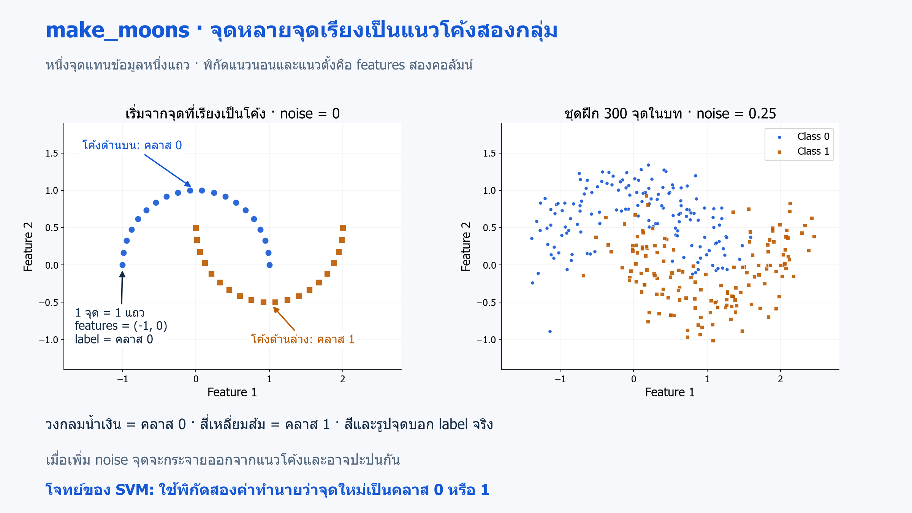
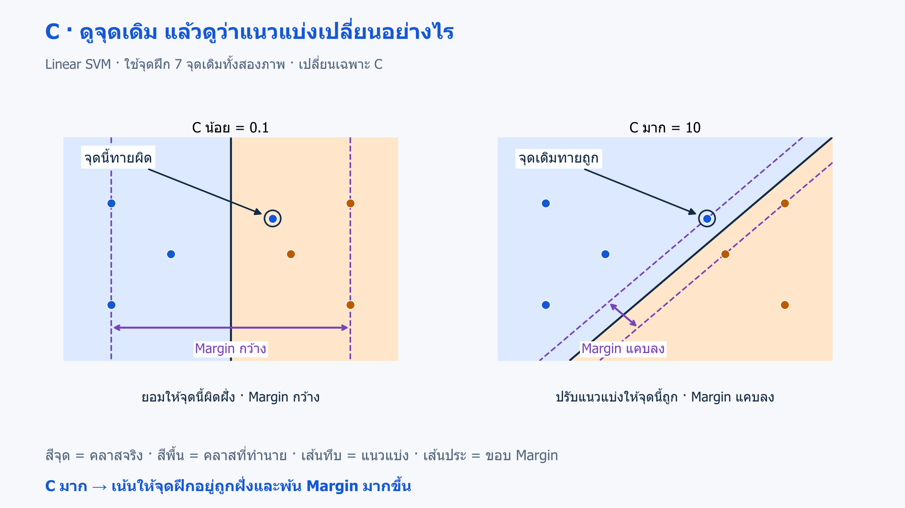
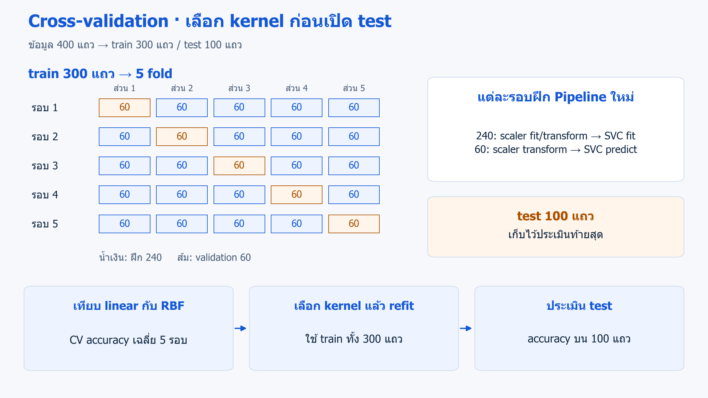
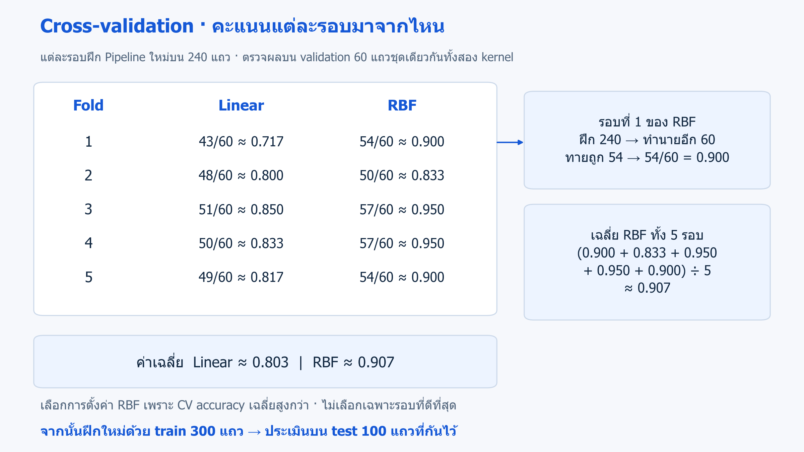

# 08 · Support Vector Machines และขอบเขตไม่เป็นเส้นตรง

[กลับสารบัญ](../../README.md) · [Notebook](lesson.ipynb) · [Python](lesson.py)

บทนี้ใช้ **SVM ซึ่งเป็นโมเดล Machine Learning สำหรับจำแนกจุดเป็นคลาส 0 หรือ 1 จากพิกัดสองค่า** เปรียบเทียบแนวแบ่งแบบเส้นตรงกับแบบโค้ง แล้วเลือกด้วยคะแนน Cross-validation ก่อนประเมินบนชุดทดสอบ

**ใช้สิ่งที่เรียนแล้ว:** train/test, StandardScaler, Pipeline และ Accuracy จากบท 03–06 ส่วนใหม่คือหลักการ SVM, kernel และการใช้ CV เปรียบเทียบโมเดล

## SVM คืออะไร

**SVM — Support Vector Machine** อ่านว่า **ซัพพอร์ต เวกเตอร์ แมชชีน** เป็นโมเดล **Machine Learning แบบ Supervised Learning หรือการเรียนรู้แบบมีผู้สอน** โมเดลเรียนรู้จาก features คู่กับ labels แล้วนำสิ่งที่เรียนรู้ไปทำนายข้อมูลใหม่

สำหรับงานจำแนกคลาส SVM เรียนรู้แนวแบ่งระหว่างคลาส เช่น แยกจุดคลาส 0 ออกจากคลาส 1 เมื่อมีจุดใหม่เข้ามา โมเดลจึงทำนายจากฝั่งของแนวแบ่งที่จุดนั้นอยู่

| รุ่น | งานที่ใช้ |
|---|---|
| **SVC — Support Vector Classification** | จำแนกคลาส เช่น 0 หรือ 1 และรองรับมากกว่าสองคลาสได้ |
| **SVR — Support Vector Regression** | ทำนายตัวเลขต่อเนื่อง เช่น ราคา |

บทนี้ใช้ **SVC** เพื่อเรียนรู้แนวแบ่งระหว่างคลาส 0 กับคลาส 1

## ข้อมูลในบท: จุดสองกลุ่มที่เรียงตัวเป็นแนวโค้ง

เราใช้ `make_moons` สร้าง **ข้อมูลจำลองที่จุดหลายจุดเรียงตัวเป็นแนวโค้งครึ่งวงกลมสองกลุ่ม** กลุ่มหนึ่งโค้งด้านบน อีกกลุ่มโค้งด้านล่างและวางเยื้องกัน

**หนึ่งจุดคือข้อมูลหนึ่งแถว** พิกัดแนวนอนและแนวตั้งคือ features สองคอลัมน์ใน `X` ส่วน `y` เก็บ label ว่าจุดนั้นอยู่คลาส 0 หรือ 1 สีในกราฟใช้แสดง label จริงของแต่ละจุด



**อ่านภาพ:** ซ้ายเป็นตัวอย่างที่ยังไม่เพิ่มความกระจาย จึงเห็นแนวโค้งชัด ขวาคือชุดฝึก 300 จุดของบทที่ใช้ `noise=0.25` จุดจึงกระจายออกจากแนวโค้งและบางส่วนปะปนกัน · [เปิดภาพ SVG](../../assets/figures/08-support-vector-machines-moons-data.svg)

ใช้ข้อมูลรูปแบบนี้เพื่อเปรียบเทียบแนวแบ่งเส้นตรงกับแนวแบ่งโค้ง โดยโจทย์คือ **เมื่อมีพิกัดของจุดใหม่ ให้โมเดลทำนายว่าจุดนั้นเป็นคลาส 0 หรือ 1**

## Margin และ Support vectors: SVM เลือกแนวแบ่งอย่างไร

**Decision boundary — แนวแบ่งคลาส** คือ **เส้นทึบสีดำในภาพประกอบ** ที่แบ่งพื้นที่ว่าโมเดลจะทายเป็นคลาสใด ส่วนเส้นประเป็นขอบของ margin

SVM พยายามหาแนวแบ่งที่มี **Margin — แถบรอบแนวแบ่ง** กว้าง ขณะเดียวกันก็ลดการที่จุดฝึกอยู่ใกล้แนวแบ่งเกินไปหรือถูกแบ่งผิดฝั่ง


[เปิดภาพ SVG](../../assets/figures/08-support-vector-machines-margin.svg)

**เส้นประสองเส้นเป็นขอบ Margin** ส่วนแถบระหว่างเส้นประยังแบ่งเป็นสองคลาสตามเส้นทึบตรงกลาง จุดใหม่ที่อยู่ในแถบนี้จึงยังทำนายเป็น 0 หรือ 1 ได้ ไม่ได้มีคลาสที่สามเพิ่มขึ้น

**Support vectors** คือจุดฝึกที่โมเดลใช้กำหนดแนวแบ่ง ในตัวอย่างที่แยกได้ชัด จุดเหล่านี้อยู่บนขอบ margin เมื่อข้อมูลปะปนกัน support vectors อาจอยู่ในแถบ margin หรือผิดฝั่งด้วย จึงไม่ใช่เฉพาะจุดที่ทายผิด

**ทำไมต้องยอมให้บางจุดอยู่ในแถบหรือผิดฝั่ง?** จุดต่างคลาสอาจอยู่ปะปนกัน การปรับแนวแบ่งเพื่อให้ทุกจุดฝึกทายถูกจึงอาจทำให้ทายข้อมูลใหม่ได้แย่ลง เราใช้ค่า **C** ควบคุมความสำคัญของการลดการละเมิด margin เหล่านี้

## Kernel: จากแนวแบ่งตรงเป็นแนวแบ่งโค้ง

**Kernel อ่านว่า เคอร์เนล** เป็นวิธีคำนวณความสัมพันธ์ระหว่างจุดที่ SVM ใช้สร้างแนวแบ่ง

**SVM ใช้ได้ทั้ง Linear และ RBF kernel** บทนี้จึงเปรียบเทียบ SVM สองการตั้งค่า โดยใช้ `SVC` เหมือนกันทั้งคู่

- **Linear kernel:** ได้แนวแบ่งเส้นตรงเมื่อแสดงบนกราฟสอง features
- **RBF — Radial Basis Function:** ใน `SVC(kernel="rbf")` ใช้แบบ Gaussian เพื่อคำนวณความคล้ายที่ลดลงตามระยะห่าง ช่วยให้ SVM สร้างแนวแบ่งโค้งได้บนกราฟเดิม

RBF อ่านว่า **อาร์ บี เอฟ** ส่วน Radial Basis Function อ่านว่า **เรเดียล เบซิส ฟังก์ชัน**

**RBF คืออะไร?** เป็นฟังก์ชันที่ให้ค่าตามระยะห่างจากจุดอ้างอิง คำว่า **Radial** สื่อถึงระยะจากจุดกลาง สำหรับแบบ Gaussian ที่ใช้ในบทนี้ จุดใกล้กันให้ความคล้ายสูง ส่วนจุดไกลกันให้ความคล้ายต่ำ

**ตัวอย่าง:** สมมติมีจุดอ้างอิงอยู่ตรงกลาง จุด A อยู่ทางซ้ายและจุด B อยู่ทางขวา โดยทั้งคู่ห่างจากจุดกลางเท่ากัน RBF จะให้ความคล้ายกับจุดกลางเท่ากันเมื่อใช้ gamma เดียวกัน เพราะพิจารณาระยะห่าง ไม่ได้พิจารณาว่าอยู่ทิศไหน


**อ่านภาพ:** เส้นทึบคือแนวแบ่ง เส้นประฝั่ง Linear คือขอบ margin ส่วนสีพื้นบอกคลาสที่โมเดลจะทำนาย · [เปิดภาพ SVG](../../assets/figures/08-support-vector-machines-model.svg)

**แยกหน้าที่:** RBF คำนวณความคล้าย ส่วน SVM รวมความคล้ายกับ support vectors โดยใช้น้ำหนักที่เรียนรู้ระหว่าง `fit` เพื่อทำนาย จึงไม่ใช่การหาเพื่อนบ้านแล้วโหวตแบบ KNN และไม่ได้รับประกันว่าจะดีกว่า Linear ทุกชุดข้อมูล

**จุดเด่น:** เลือก kernel ให้รองรับรูปแบบข้อมูลที่ต่างกันได้

**ข้อจำกัด:** ต้องปรับสเกลและเลือก C ให้เหมาะ ส่วน RBF ต้องเลือก gamma ด้วย การฝึก SVC แบบ kernel อาจช้าเมื่อมีข้อมูลจำนวนมาก

<details>
<summary>ศึกษาต่อ: สูตร RBF และ Kernel trick</summary>

สำหรับการทดลองในบทนี้ ให้เข้าใจหน้าที่ของ RBF ผลของ gamma และการเลือกค่าด้วย CV ก่อน ส่วนการพิสูจน์สูตรและคณิตศาสตร์ของ Kernel trick อ่านเพิ่มเติมได้ตามความสนใจ:

1. [สูตร RBF kernel](https://scikit-learn.org/1.7/modules/metrics.html#rbf-kernel) — ดูว่าระยะห่างกับ gamma ใช้คำนวณความคล้ายอย่างไร
2. [ภาพผลของ C และ gamma](https://scikit-learn.org/1.7/auto_examples/svm/plot_rbf_parameters.html) — เปรียบเทียบแนวแบ่งเมื่อเปลี่ยนค่าทีละแบบ
3. [สมการ SVC และ Kernel trick](https://scikit-learn.org/1.7/modules/svm.html#mathematical-formulation) — ศึกษาว่า kernel ช่วยคำนวณในพื้นที่ features อีกแบบได้อย่างไร และ support vectors ร่วมกันกำหนดคะแนนทำนายอย่างไร

</details>

## C และ gamma เปลี่ยนแนวแบ่งอย่างไร

**C และ gamma เป็น Hyperparameters — ไฮเปอร์พารามิเตอร์** คือค่าที่เรากำหนดก่อน `fit` เพื่อควบคุมวิธีที่โมเดลเรียนรู้ จากนั้นโมเดลจึงฝึกหาแนวแบ่งภายใต้ค่าที่กำหนด เราสามารถลองหลายค่าแล้วใช้ CV ช่วยเลือกได้

C ใช้ได้ทั้ง Linear และ RBF ส่วน gamma ใช้ควบคุมความคล้ายของ RBF ในบทนี้

### C: ให้ความสำคัญกับจุดที่อยู่ใน Margin หรือผิดฝั่งมากแค่ไหน

**C อ่านว่า ซี** ใช้ได้ทั้ง Linear และ RBF จุดฝึกอาจทายถูกแต่อยู่ใกล้แนวแบ่งจนเข้าไปในแถบ margin หรืออาจอยู่ผิดฝั่งจนทายผิดก็ได้ SVM พยายามลดทั้งสองกรณี พร้อมรักษา margin ให้กว้าง

- **C น้อย:** ยอมให้จุดฝึกบางจุดอยู่ใน margin หรือผิดฝั่งได้มากขึ้น เพื่อให้ margin กว้าง
- **C มาก:** ให้ความสำคัญกับการลดปัญหาของจุดฝึกเหล่านี้มากขึ้น จึงอาจยอมให้ margin แคบลง



**อ่านภาพจากจุดที่ลูกศรชี้:** เมื่อ C น้อย จุดสีน้ำเงินนั้นอยู่ฝั่งที่ทาย 1 เมื่อเพิ่ม C แนวแบ่งเอียงจนจุดเดิมอยู่ฝั่งที่ทาย 0 ได้ถูกต้อง แต่ margin แคบลง ตัวอย่างนี้แสดงสิ่งที่โมเดลยอมแลก ไม่ได้แปลว่า C มากจะดีกับข้อมูลใหม่เสมอ · [เปิดภาพ SVG](../../assets/figures/08-support-vector-machines-c-effect.svg)

### gamma: ความคล้ายลดลงเร็วแค่ไหนเมื่อจุดห่างกัน

**gamma อ่านว่า แกมมา** เป็นค่าที่ใช้กับ RBF ในบทนี้ ลองยึดจุดหนึ่งไว้ แล้วดูว่าจุดอื่นที่ห่างออกไปยังคล้ายจุดนั้นมากเพียงใด

- **gamma น้อย:** ความคล้ายลดลงช้า บริเวณที่ยังคล้ายจุดกลางจึงแผ่กว้าง
- **gamma มาก:** ความคล้ายลดลงเร็ว บริเวณที่ยังคล้ายมากจึงอยู่ใกล้จุดกลาง


**สีเข้มหมายถึงคล้ายจุดกลางมาก** SVM นำความคล้ายกับ support vectors หลายจุดมารวมกันเพื่อทำนาย เมื่อ gamma มาก แต่ละจุดมีผลในบริเวณแคบ แนวแบ่งจึงอาจโค้งตามรายละเอียดเฉพาะจุดมากขึ้น ภาพนี้แสดงความคล้าย ส่วนกราฟแนวแบ่งคลาสอยู่ในส่วนขยายด้านล่าง · [เปิดภาพ SVG](../../assets/figures/08-support-vector-machines-gamma-effect.svg)

**จำหน้าที่แยกกัน:** C ควบคุมว่าโมเดลจะพยายามให้จุดฝึกอยู่ถูกฝั่งและพ้น margin มากแค่ไหน ส่วน gamma ควบคุมความคล้ายตามระยะห่างของ RBF ทั้งสองค่ากำหนดก่อน `fit`

<details>
<summary>ดูผลต่อแนวแบ่ง RBF เมื่อเปลี่ยน C และ gamma ทีละค่า</summary>

แถวบนเปลี่ยนเฉพาะ C โดยคง gamma ไว้ ส่วนแถวล่างเปลี่ยนเฉพาะ gamma โดยคง C ไว้ จึงเห็นผลของแต่ละค่าแยกกัน

ลูกศรแถวบนชี้จุดสีน้ำเงินจุดเดียวกันที่ทายผิดเมื่อ C = 0.1 และทายถูกเมื่อ C = 100 ส่วนลูกศรขวาล่างชี้แนวแบ่งที่ล้อมจุดเพียงจุดเดียวเมื่อ gamma = 20 เป็นตัวอย่างของการตามรายละเอียดเฉพาะจุดมากขึ้น


[เปิดภาพ SVG](../../assets/figures/08-support-vector-machines-parameters.svg)

</details>

**ดูความเปลี่ยนแปลงของแนวแบ่ง ไม่เลือกจากกราฟที่ตามจุดฝึกได้ดีที่สุดเพียงอย่างเดียว** ถ้าตามรายละเอียดของ train มากเกินไป อาจเกิด overfitting จึงต้องเปรียบเทียบด้วยข้อมูลที่ไม่ได้ใช้ fit ในรอบนั้น

ใช้ StandardScaler ก่อน SVM เพราะขนาดของ features มีผลต่อระยะและความคล้าย โดยให้ scaler อยู่ใน Pipeline เช่นเดียวกับบทก่อน

## Cross-validation (CV): เลือก kernel ก่อนใช้ Test

### ทำไมจึงตรวจผลมากกว่าหนึ่งรอบ

ในบท 04 เราใช้ validation ชุดเดียวเลือกโมเดล แต่คะแนนอาจเปลี่ยนเมื่อเลือกแถวสำหรับฝึกและ validation ต่างกัน **Cross-validation หรือ CV จึงสลับใช้ข้อมูลเป็นส่วนฝึกและส่วนตรวจผลหลายรอบ** เพื่อเปรียบเทียบโมเดลจากหลายคะแนน แทนการพึ่งการแบ่งเพียงครั้งเดียว

### 5-fold CV ทำงานอย่างไร

เริ่มจากแบ่ง 400 แถวเป็น **train 300 แถว** กับ **test 100 แถว** แล้วเก็บ test ไว้ก่อน ใช้เฉพาะ train เปรียบเทียบ SVM แบบ Linear กับ RBF

**Fold อ่านว่า โฟลด์** คือหนึ่งส่วนของข้อมูลที่แบ่งไว้สำหรับ CV ส่วน **validation** คือข้อมูลที่ใช้ตรวจผลของโมเดลที่ฝึกในรอบนั้น บทนี้แบ่ง train เป็นห้าส่วน ส่วนละ 60 แถว แล้วสลับใช้สี่ส่วนฝึกและหนึ่งส่วนตรวจผล:



[เปิดภาพ SVG](../../assets/figures/08-support-vector-machines-cross-validation.svg)

**อ่านภาพทีละรอบ:** รอบแรกกันส่วนที่ 1 ไว้ตรวจผล แล้วฝึกจากส่วนที่ 2–5 รอบถัดไปกันส่วนที่ 2 แล้วฝึกจากส่วนที่เหลือ ทำจนครบห้ารอบ แต่ละแถวจึงถูกใช้เป็น validation หนึ่งครั้ง

**ทุกครั้งเริ่มฝึก Pipeline ใหม่:** scaler fit/transform เฉพาะ 240 แถวก่อนส่งให้ SVC fit ส่วน validation 60 แถวใช้ transform และ predict ด้วยค่าที่ฝึกไว้ การฝึกของรอบก่อนหน้าไม่ถูกนำมาฝึกต่อในรอบถัดไป

ใช้ **StratifiedKFold** เพื่อรักษาสัดส่วนคลาส ในข้อมูลนี้ validation แต่ละรอบมีคลาส 0 จำนวน 30 แถว และคลาส 1 จำนวน 30 แถว ทั้งสอง kernel ใช้ตำแหน่งแถวชุดเดียวกันในแต่ละรอบ เพื่อให้เปรียบเทียบจากข้อมูลเดียวกัน

### คะแนนแต่ละ Fold มาจากไหน และเลือกอย่างไร

แต่ละรอบนำคำทำนายของ validation 60 แถวเทียบกับ labels จริง จึงได้ Accuracy หนึ่งค่า เช่น RBF ในรอบแรกทายถูก 54 จาก 60 แถว ได้ `54 / 60 = 0.900` เมื่อทำครบห้ารอบจะได้ห้าคะแนน:



[เปิดภาพ SVG](../../assets/figures/08-support-vector-machines-cv-scores.svg)

**เลือกจากค่าเฉลี่ยทั้งห้ารอบ** ไม่เลือกเฉพาะรอบที่คะแนนสูงที่สุด ผลนี้ Linear ได้ประมาณ 0.803 และ RBF ได้ประมาณ 0.907 จึงเลือกการตั้งค่า RBF ที่เตรียมไว้ ส่วน `std` บอกการกระจายของคะแนนระหว่างรอบ ค่ายิ่งมากแปลว่าคะแนนแต่ละรอบต่างกันมากขึ้น

### ทำ CV แล้ว ทำไมยังต้องใช้ Test

คะแนน CV ถูกใช้ตัดสินใจเลือก kernel แล้ว จึงเก็บ **test 100 แถวที่ไม่เคยใช้เลือกโมเดล** ไว้ประเมินครั้งสุดท้าย หลังเลือก RBF ให้ฝึก Pipeline ใหม่ด้วย train ทั้ง 300 แถว แล้วจึงทำนาย test

เราไม่ได้เลือกโมเดลจาก fold ที่คะแนนสูงที่สุด และไม่ได้เอาโมเดลทั้งห้ารอบมาโหวตกัน แต่เลือก **การตั้งค่า** แล้วฝึกโมเดลสำหรับใช้งานขึ้นใหม่

<details>
<summary>ต้องใช้ 5 fold เสมอไหม และต้องฝึกกี่ครั้ง?</summary>

- 5 เป็นจำนวน fold ที่กำหนดสำหรับการทดลองนี้ ไม่ใช่ค่าบังคับของ SVM การเพิ่มจำนวน fold ทำให้ต้องฝึกหลายครั้งขึ้น และไม่ได้รับประกันว่าจะเลือกโมเดลได้ดีกว่าเสมอ
- สอง kernel × ห้า fold = **ฝึก Pipeline 10 ครั้งเพื่อเปรียบเทียบ** แล้วฝึกแบบที่เลือกด้วย train ทั้งหมดอีกหนึ่งครั้ง รวมเป็น 11 ครั้ง
- CV ใช้ได้กับโมเดลอื่นด้วย และใช้เปรียบเทียบ C/gamma หลายค่าได้ เมื่อเรียน GridSearchCV ในบท 10
- ข้อมูลที่มีลำดับเวลาหรือหลายแถวจากบุคคลเดียวกัน ต้องแบ่งตามลำดับเวลาหรือเก็บทุกแถวของคนเดียวกันไว้ฝั่งเดียว อ่านต่อใน [บท 17](../17-time-and-groups/README.md)

</details>

## ลงมือทำ

สร้าง Notebook ใหม่แล้วรัน **Cell 1–6 ตามลำดับ** หรือเปิด [Notebook ของบทนี้](lesson.ipynb)

ลำดับการทดลอง: **แบ่งข้อมูล → สร้าง Pipeline สองแบบ → ดูการแบ่ง Fold → ฝึกและอ่านคะแนน CV → ฝึกแบบที่เลือกและทดสอบ → วาดแนวแบ่ง**

<!-- CODE:CELLS -->

<!-- CODE:START -->
### Cell 1 — สร้างข้อมูลและแยกชุดทดสอบ

```python
from pathlib import Path

import matplotlib.pyplot as plt
import numpy as np
import pandas as pd
from matplotlib.colors import ListedColormap
from sklearn.datasets import make_moons
from sklearn.inspection import DecisionBoundaryDisplay
from sklearn.metrics import accuracy_score
from sklearn.model_selection import StratifiedKFold, cross_val_score, train_test_split
from sklearn.pipeline import make_pipeline
from sklearn.preprocessing import StandardScaler
from sklearn.svm import SVC

X, y = make_moons(n_samples=400, noise=0.25, random_state=42)
X_train, X_test, y_train, y_test = train_test_split(
    X, y, test_size=0.25, stratify=y, random_state=42
)
print("Train:", X_train.shape, "Test:", X_test.shape)
print("Training labels:", np.unique(y_train))
```

<details>
<summary>ดูผลลัพธ์ Cell 1</summary>

```text
Train: (300, 2) Test: (100, 2)
Training labels: [0 1]
```

มีข้อมูลฝึก 300 แถวและข้อมูลทดสอบ 100 แถว แต่ละแถวมีสอง features ส่วน labels มีสองคลาสคือ 0 และ 1

</details>

**อ่านโค้ด**

- `make_moons` สร้างข้อมูลจำลองที่จุดหลายจุดเรียงตัวเป็นแนวโค้งสองกลุ่ม หนึ่งจุดแทนหนึ่งแถว: `X` เก็บพิกัดแนวนอนและแนวตั้ง ส่วน `y` เก็บ label 0 หรือ 1 ของจุดนั้น
- `noise=0.25` เพิ่มความกระจายให้จุดไม่เรียงเป็นเส้นโค้งพอดี; ค่า 0.25 เป็นขนาดความกระจาย ไม่ใช่จำนวนจุดที่ทายผิด 25%
- `test_size=0.25` กันข้อมูล 100 จาก 400 แถวไว้ทดสอบ เหลือ 300 แถวสำหรับฝึกและทำ CV ส่วน `stratify=y` รักษาสัดส่วนคลาส

### Cell 2 — สร้าง Pipeline ของ SVM สองแบบ

```python
models = {
    "linear": make_pipeline(StandardScaler(), SVC(kernel="linear", C=1.0)),
    "rbf": make_pipeline(
        StandardScaler(), SVC(kernel="rbf", C=1.0, gamma="scale")
    ),
}
print("Prepared kernels:", list(models))
```

<details>
<summary>ดูผลลัพธ์ Cell 2</summary>

```text
Prepared kernels: ['linear', 'rbf']
```

เตรียม Pipeline ไว้สองแบบแล้ว ขั้นนี้ยังไม่ได้ฝึกโมเดล จึงยังไม่มีคะแนน Accuracy

</details>

**อ่านโค้ด**

- `models` เก็บ Pipeline สองตัว ทั้งคู่เป็น SVM สำหรับจำแนกคลาส โดยใช้ `StandardScaler` ก่อน `SVC`; ตัวหนึ่งใช้ `kernel="linear"` อีกตัวใช้ `kernel="rbf"`
- `C=1.0` เป็นค่าที่กำหนดไว้ให้ทั้งสองแบบ ฝั่ง RBF เพิ่ม `gamma="scale"` เพื่อให้ SVC คำนวณ gamma จาก features **หลังผ่าน StandardScaler** เมื่อเริ่ม fit
- `Prepared kernels` แสดงชื่อสองแบบที่เตรียมไว้เปรียบเทียบ

<details>
<summary>gamma="scale" คำนวณอย่างไร และต่างจาก StandardScaler อย่างไร?</summary>

**StandardScaler แปลงค่า features** ส่วน **gamma="scale" กำหนดความเร็วที่ความคล้ายของ RBF ลดลงตามระยะ** SVC ไม่ได้ปรับสเกลข้อมูลให้อีกครั้ง

SVC ใช้สูตร `gamma = 1 / (จำนวน features × ความแปรปรวนของข้อมูลที่เข้า SVC)`

ข้อมูลบทนี้มีสองคอลัมน์ที่ไม่ใช่ค่าคงที่ หลัง StandardScaler แปลงชุดฝึก แต่ละคอลัมน์มีค่าเฉลี่ยประมาณ 0 และความแปรปรวนประมาณ 1 จึงได้ `gamma ≈ 1 / (2 × 1) = 0.5` ในแต่ละรอบที่ fit

</details>

### Cell 3 — ดูการแบ่งข้อมูลสำหรับ 5-fold CV

```python
cv = StratifiedKFold(n_splits=5, shuffle=True, random_state=42)
folds = list(cv.split(X_train, y_train))

for fold_no, (fit_idx, valid_idx) in enumerate(folds, start=1):
    print(
        f"Fold {fold_no}: fit={len(fit_idx)} rows, "
        f"validation={len(valid_idx)} rows"
    )
```

<details>
<summary>ดูผลลัพธ์ Cell 3</summary>

```text
Fold 1: fit=240 rows, validation=60 rows
Fold 2: fit=240 rows, validation=60 rows
Fold 3: fit=240 rows, validation=60 rows
Fold 4: fit=240 rows, validation=60 rows
Fold 5: fit=240 rows, validation=60 rows
```

แต่ละรอบมีจำนวนแถวเท่ากัน แต่สลับส่วนที่ใช้เป็น validation ตามภาพ 5-fold CV

</details>

**อ่านโค้ด**

- `StratifiedKFold(n_splits=5)` กำหนดการแบ่งเป็นห้าส่วนโดยรักษาสัดส่วนคลาส; `shuffle=True` สลับแถวก่อนจัดส่วน และ `random_state=42` ทำให้ได้การแบ่งเดิมเมื่อรันซ้ำ
- `cv.split(X_train, y_train)` คืนคู่ **ตำแหน่งแถวสำหรับฝึก** กับ **ตำแหน่งแถวสำหรับ validation** ในแต่ละรอบ ไม่ได้คืนโมเดลหรือคะแนน
- `list(...)` เก็บคู่ตำแหน่งครบห้ารอบไว้ใน `folds` เพื่อให้ Linear และ RBF ใช้การแบ่งชุดเดียวกัน
- `fit_idx` และ `valid_idx` เป็นตำแหน่งแถวภายใน `X_train` กับ `y_train` ส่วน test 100 แถวยังไม่ถูกนำมาใช้ ขั้นนี้ยังไม่ได้ฝึกโมเดล

### Cell 4 — ฝึกด้วย CV และอ่านคะแนนทีละ Fold

```python
fold_scores = {}
for name, candidate in models.items():
    fold_scores[name] = cross_val_score(
        candidate, X_train, y_train, cv=folds, scoring="accuracy"
    )

fold_table = pd.DataFrame(fold_scores, index=range(1, len(folds) + 1))
fold_table.index.name = "Fold"
print("Validation accuracy by fold:")
print(fold_table.round(3).to_string())

scores = {}
for name, values in fold_scores.items():
    scores[name] = values.mean()
    print(f"{name} CV accuracy: {values.mean():.3f} +/- {values.std():.3f}")
```

<details>
<summary>ดูผลลัพธ์ Cell 4</summary>

```text
Validation accuracy by fold:
      linear    rbf
Fold
1      0.717  0.900
2      0.800  0.833
3      0.850  0.950
4      0.833  0.950
5      0.817  0.900
linear CV accuracy: 0.803 +/- 0.046
rbf CV accuracy: 0.907 +/- 0.043
```

RBF ได้ค่าเฉลี่ย CV ประมาณ 0.907 สูงกว่า Linear ที่ประมาณ 0.803 คะแนนเหล่านี้คำนวณจาก validation ในแต่ละ fold

</details>

**อ่านโค้ด**

- `cross_val_score` รับ Pipeline ที่จะเปรียบเทียบ และใช้ `cv=folds` แบ่งตามตำแหน่งที่เตรียมไว้ แต่ละรอบฝึก **สำเนา Pipeline ใหม่** บน 240 แถว แล้วทำนาย validation 60 แถวก่อนคำนวณ Accuracy
- `scoring="accuracy"` กำหนดตัวชี้วัด; ผลที่คืนคือคะแนน validation ห้าค่า เก็บใน `fold_scores[name]` ตามชื่อ kernel
- `fold_table` วางคะแนนรอบเดียวกันไว้แถวเดียวกัน เช่น แถว Fold 1 เปรียบเทียบ Linear กับ RBF บน validation 60 แถวชุดเดียวกัน
- `values.mean()` เฉลี่ยห้าคะแนนและเก็บใน `scores[name]` ส่วน `values.std()` แสดงการกระจายระหว่างรอบ เช่น RBF ได้ค่าเฉลี่ยประมาณ 0.907 และ std ประมาณ 0.043 ค่า `+/-` นี้ไม่ใช่ช่วงความเชื่อมั่น

**ทำไมยังต้อง fit อีก:** CV ฝึกสำเนาเพื่อเก็บคะแนน Pipeline ต้นฉบับใน `models` ยังไม่ได้ fit เมื่อเลือกการตั้งค่าแล้วจึงฝึกตัวที่จะใช้งานจริงด้วย train ครบ 300 แถว

**ทำไมใช้ Accuracy:** ข้อมูลนี้มีจำนวนคลาส 0 และ 1 เท่ากัน จึงเริ่มเปรียบเทียบจากสัดส่วนที่ทายถูกได้ หากคลาสไม่สมดุลหรือการทายผิดแต่ละแบบมีผลต่างกัน ให้พิจารณา Precision, Recall และ F1 ที่เรียนในบท 04 ด้วย

เรากำลังเลือกจากสองชุดการตั้งค่าที่เตรียมไว้ใน `models` ยังไม่ได้ค้นหา C/gamma หลายค่า

### Cell 5 — ฝึกโมเดลที่เลือกแล้วประเมินบน Test

```python
chosen = max(scores, key=scores.get)
model = models[chosen]
model.fit(X_train, y_train)

y_pred = model.predict(X_test)
print("Selected kernel:", chosen)
print(f"Test accuracy: {accuracy_score(y_test, y_pred):.3f}")
print(f"Correct predictions: {(y_pred == y_test).sum()}/{len(y_test)}")
```

<details>
<summary>ดูผลลัพธ์ Cell 5</summary>

```text
Selected kernel: rbf
Test accuracy: 0.950
Correct predictions: 95/100
```

เลือก RBF จากค่าเฉลี่ย CV แล้วฝึกใหม่ด้วย train ทั้ง 300 แถว ผลบน test คือทายถูก 95 จาก 100 แถว

</details>

**อ่านโค้ด**

- `max(scores, key=scores.get)` เลือก **ชื่อ kernel** ที่มี CV accuracy เฉลี่ยสูงสุด เช่น `"rbf"`; ไม่ได้เลือกจาก test
- `model.fit(X_train, y_train)` ฝึก Pipeline ใหม่ด้วยชุดฝึกครบ 300 แถว: scaler fit/transform ก่อน แล้ว SVC fit จาก features ที่ปรับสเกลแล้ว
- `model.predict(X_test)` ให้ scaler transform ด้วยค่าเดิมก่อน SVC ทำนาย จึงไม่มีการ fit จาก test
- `accuracy_score` เปรียบเทียบคำทำนายกับ `y_test` ส่วนบรรทัดสุดท้ายแสดงจำนวนที่ทายถูกจาก test 100 แถว

### Cell 6 — อ่านแนวแบ่งคลาสและ Support vectors

```python
colors = ListedColormap(["#1558D6", "#BD5A00"])
fig, ax = plt.subplots(figsize=(7, 4.5))
DecisionBoundaryDisplay.from_estimator(
    model, X_train, response_method="predict", grid_resolution=250,
    cmap=colors, alpha=0.18, ax=ax
)
DecisionBoundaryDisplay.from_estimator(
    model, X_train, response_method="decision_function", grid_resolution=250,
    plot_method="contour", levels=[0], colors="black", linewidths=1.5, ax=ax
)
points = ax.scatter(
    X_train[:, 0], X_train[:, 1], c=y_train, cmap=colors,
    edgecolors="white", linewidths=0.4, s=25
)

support_idx = model.named_steps["svc"].support_
support_points = X_train[support_idx]
ax.scatter(
    support_points[:, 0], support_points[:, 1], s=85,
    facecolors="none", edgecolors="black", linewidths=0.8,
    label="Support vectors"
)
ax.set(xlabel="Feature 1", ylabel="Feature 2", title=f"Training data: {chosen} SVM")
ax.legend(loc="upper right")
fig.colorbar(points, ax=ax, ticks=[0, 1], label="Class")
fig.tight_layout()

out = Path("outputs/08-support-vector-machines")
out.mkdir(parents=True, exist_ok=True)
fig.savefig(out / "boundary.png", dpi=140)
plt.show()
plt.close(fig)
print("Saved:", (out / "boundary.png").resolve())
```

<details>
<summary>ดูผลลัพธ์ Cell 6</summary>


```text
Saved: <โฟลเดอร์ที่ Notebook ทำงาน>/outputs/08-support-vector-machines/boundary.png
```

ส่วน `<โฟลเดอร์ที่ Notebook ทำงาน>` จะแสดงเป็นเส้นทางจริงในเครื่องที่รัน

</details>

**อ่านโค้ด**

- `DecisionBoundaryDisplay.from_estimator` ครั้งแรกใช้ `response_method="predict"` ให้ Pipeline ทำนายจุดทั่วพื้นที่กราฟ แล้วระบายพื้นตามคลาสที่ได้
- ครั้งที่สองใช้ `decision_function` ซึ่งคืนคะแนนตัดสินใจ สำหรับสองคลาสในบทนี้ ค่าติดลบอยู่ฝั่งคลาส 0 ค่าบวกอยู่ฝั่งคลาส 1; `levels=[0]` จึงวาดเส้นทึบตรงรอยแบ่งที่คะแนนเป็นศูนย์ คะแนนนี้ไม่ใช่ความน่าจะเป็น
- สีของจุดมาจาก label จริง `y_train` ถ้าสีจุดต่างจากสีพื้นรอบจุด แสดงว่าโมเดลทายจุดฝึกนั้นผิด
- `model.named_steps["svc"]` เข้าถึง SVC ภายใน Pipeline; `support_` คือ **ตำแหน่งแถวของ support vectors ในข้อมูลที่ใช้ fit** จึงนำไปเลือกพิกัดเดิมจาก `X_train` แล้ววงแหวนได้ตรงกับแกนกราฟ
- พื้นที่สีเป็นผลจำแนกคลาส ไม่ใช่ระดับความมั่นใจ ส่วนวงแหวนบอก support vectors ไม่ได้หมายความว่าจุดนั้นทายผิดทุกจุด
- ไฟล์ `boundary.png` บันทึกใน `outputs/08-support-vector-machines` ใต้โฟลเดอร์ที่ Notebook ทำงาน บรรทัด `Saved:` แสดงตำแหน่งเต็ม หากเปิด Notebook ใน `practics` ไฟล์จะอยู่ที่ `practics/outputs/08-support-vector-machines/boundary.png`
<!-- CODE:END -->

## อ่านผล

อ่าน CV accuracy เพื่อเปรียบเทียบสอง kernel ก่อน แล้วอ่าน Test accuracy เพื่อประเมิน Pipeline ที่เลือกกับข้อมูล 100 แถวที่กันไว้

กราฟแสดง **จุดฝึกและพื้นที่ที่โมเดลทำนายเป็นแต่ละคลาส** พร้อมวงแหวน support vectors จึงใช้ดูรูปร่างแนวแบ่ง ส่วนผลกับข้อมูลที่ไม่ได้ใช้เลือกโมเดลให้ดูคะแนน test

## แบบฝึกท้ายบท

**1. ทำไมไม่เลือก kernel จาก Test accuracy ของทั้งสองแบบ?**

<details>
<summary>ดูเฉลย</summary>

เพราะ test จะเข้ามามีส่วนในการเลือกโมเดล ทำให้ไม่ใช่ชุดที่เก็บไว้ประเมินหลังตัดสินใจเสร็จ ใช้ CV ภายใน train เลือก kernel แล้วจึงประเมิน test ของวิธีที่เลือก

</details>

**2. Scaler ควร fit จาก train 300 แถวก่อนเริ่ม CV หรือไม่?**

<details>
<summary>ดูเฉลย</summary>

ไม่ควร เพราะ scaler จะเห็น validation fold ล่วงหน้า ให้ scaler อยู่ใน Pipeline เพื่อ fit เฉพาะส่วนฝึก 240 แถวของแต่ละรอบ หลังเลือก kernel แล้วจึง fit Pipeline ใหม่จาก train ทั้ง 300 แถวได้

</details>

**3. จุดที่มีวงแหวนต้องเป็นจุดที่โมเดลทายผิดใช่หรือไม่?**

<details>
<summary>ดูเฉลย</summary>

ไม่ใช่ วงแหวนหมายถึง support vectors ที่ใช้กำหนดแนวแบ่ง ซึ่งอาจทายถูกได้ เช่น จุดบนขอบ margin หากต้องการดูว่าทายผิด ให้เทียบสีของจุดกับสีพื้นรอบจุด

</details>

การค้นหลายค่าด้วย GridSearchCV จะเรียนใน [บท 10](../10-tuning-and-learning-curves/README.md) และนำมาเลือก C กับ gamma ของ SVM ใน [บท 16](../16-digits-project/README.md)

## อ้างอิง

- [scikit-learn: make_moons และความหมายของ noise](https://scikit-learn.org/1.7/modules/generated/sklearn.datasets.make_moons.html)
- [scikit-learn: Support Vector Machines](https://scikit-learn.org/1.7/modules/svm.html)
- [scikit-learn: ผลของ C และ gamma สำหรับ RBF](https://scikit-learn.org/1.7/auto_examples/svm/plot_rbf_parameters.html)
- [scikit-learn: cross_val_score](https://scikit-learn.org/1.7/modules/generated/sklearn.model_selection.cross_val_score.html)
- [scikit-learn: Cross-validation และการเก็บ test ไว้ประเมิน](https://scikit-learn.org/1.7/modules/cross_validation.html)
- [scikit-learn: StratifiedKFold](https://scikit-learn.org/1.7/modules/generated/sklearn.model_selection.StratifiedKFold.html)
- [scikit-learn: SVC](https://scikit-learn.org/1.7/modules/generated/sklearn.svm.SVC.html)
- [scikit-learn: DecisionBoundaryDisplay](https://scikit-learn.org/1.7/modules/generated/sklearn.inspection.DecisionBoundaryDisplay.html)
