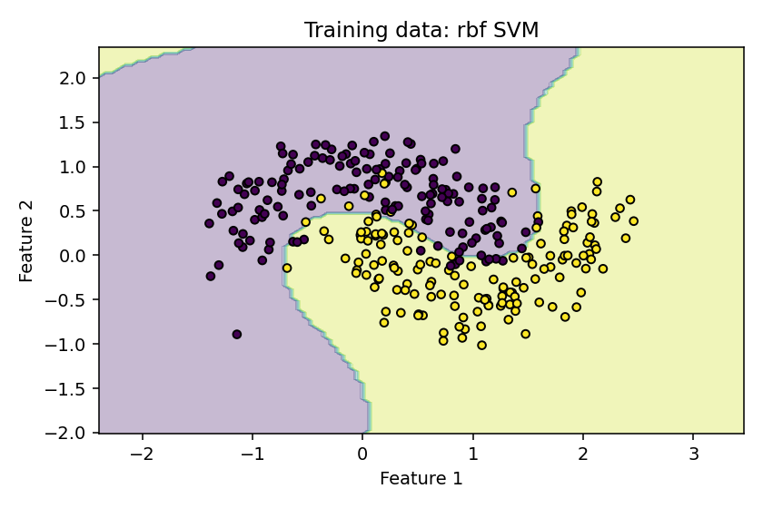

# 08 · Support Vector Machines และขอบเขตไม่เป็นเส้นตรง

[กลับสารบัญ](../../README.md) · [Notebook](lesson.ipynb) · [Python](lesson.py)

บทนี้เปรียบเทียบ **SVM แบบเส้นตรงกับ RBF** และใช้ cross-validation เลือกวิธีจากชุดฝึก

**ใช้สิ่งที่เรียนแล้ว:** train/test, scaling และ Pipeline จากบท 03–04

## ใจความใหม่

### SVM คืออะไร

**SVM ย่อมาจาก Support Vector Machine** เป็นวิธีเรียนรู้ที่ใช้ได้ทั้ง Classification และ Regression แบบ Supervised Learning

บทนี้ใช้ **SVC — Support Vector Classification** เพื่อจำแนกสองคลาส ส่วนรุ่นสำหรับทำนายตัวเลขเรียกว่า **SVR — Support Vector Regression**

**หลักการของ SVM สำหรับ Classification:** หาแนวแบ่งคลาสที่มีระยะเว้นกว้าง พร้อมยอมให้บางจุดละเมิดระยะเว้นได้ตามค่าการลงโทษ `C`

- **Margin:** ระยะเว้นระหว่างแนวแบ่งกับขอบเขตสองฝั่ง
- **Support vectors:** ตัวอย่างในชุดฝึกที่มีบทบาทกำหนดแนวแบ่ง ตัวอย่างอื่นจึงไม่ได้มีบทบาทโดยตรงเท่ากันทุกจุด
- **Kernel:** ฟังก์ชันคำนวณความคล้ายที่ช่วยให้เรียนขอบเขตซับซ้อนได้ โดยไม่ต้องสร้าง feature ในพื้นที่ใหม่ออกมาทั้งหมด

**ตัวอย่างในบท:** ข้อมูลรูปพระจันทร์เสี้ยวสองชุดมีขอบเขตโค้ง เส้นตรงจึงอาจแบ่งได้ไม่ดี เราจะเปรียบเทียบกับ **RBF — Radial Basis Function** ซึ่งเป็น kernel ที่ใช้ความคล้ายตามระยะทาง

- **จุดเด่น:** ใช้ kernel รองรับขอบเขตที่ไม่เป็นเส้นตรง และใช้ได้ดีกับหลายงานที่มี feature จำนวนมากเมื่อเลือกการตั้งค่าเหมาะสม
- **ข้อจำกัด:** ไวต่อสเกลและการตั้งค่า C/gamma การฝึก SVC แบบ kernel อาจช้าเมื่อจำนวนตัวอย่างมาก

### การตั้งค่าที่ใช้ในบท

| การตั้งค่า | ความหมาย |
|---|---|
| `kernel="linear"` | ให้เส้นแบ่งตรงในข้อมูลสองมิติ |
| `kernel="rbf"` | ใช้ความคล้ายตามระยะทาง สร้างขอบเขตโค้งได้ |
| `C` | ยิ่งมาก ยิ่งลงโทษการละเมิด margin แต่ไม่รับประกันผลกับข้อมูลใหม่ |
| `gamma` ของ RBF | ยิ่งมาก อิทธิพลของแต่ละจุดยิ่งอยู่ใกล้ตัว |

บทนี้ตรึง C=1 และ gamma ค่าเริ่มต้นไว้ แล้วเปรียบเทียบเฉพาะ kernel

## Cross-validation (CV)

กัน test 100 แถวไว้ก่อน แล้วนำ train 300 แถวมาทำ CV:

1. แบ่งเป็น 5 ส่วน เรียกว่า **fold** โดย `StratifiedKFold` ช่วยรักษาสัดส่วนคลาส
2. แต่ละรอบฝึก 240 แถว และตรวจด้วยอีก 60 แถว
3. หมุนส่วนที่ใช้ตรวจให้ครบ 5 รอบ แล้วหาคะแนนเฉลี่ย

`cross_val_score` ฝึก Pipeline ใหม่ทุกรอบ ดังนั้น scaler จะเรียนเฉพาะ 240 แถวที่ใช้ฝึกในรอบนั้น

เลือก kernel จากคะแนน CV เฉลี่ย แล้ว fit บน train ทั้ง 300 แถว ก่อนประเมิน test

**ค่า ± ที่พิมพ์:** ส่วนเบี่ยงเบนมาตรฐานของคะแนนระหว่าง fold ไม่ใช่ช่วงความเชื่อมั่น (confidence interval)

## ลงมือทำ

สร้าง Notebook ใหม่แล้วรัน **Cell 1–2 ตามลำดับ** หรือเปิด [Notebook ของบทนี้](lesson.ipynb) ใช้ kernel เดิมได้เลย อ่านคำอธิบายใต้โค้ดแต่ละช่วงประกอบผลที่ได้

<!-- CODE:CELLS -->

<!-- CODE:START -->
### Cell 1 — เลือก kernel จากคะแนน CV

```python
from pathlib import Path

import matplotlib.pyplot as plt
import numpy as np
from sklearn.datasets import make_moons
from sklearn.inspection import DecisionBoundaryDisplay
from sklearn.metrics import accuracy_score
from sklearn.model_selection import StratifiedKFold, cross_val_score, train_test_split
from sklearn.pipeline import make_pipeline
from sklearn.preprocessing import StandardScaler
from sklearn.svm import SVC

X, y = make_moons(n_samples=400, noise=0.25, random_state=42)
X_train, X_test, y_train, y_test = train_test_split(
    X, y, stratify=y, random_state=42
)
cv = StratifiedKFold(n_splits=5, shuffle=True, random_state=42)
models = {kernel: make_pipeline(StandardScaler(), SVC(kernel=kernel, C=1.0))
          for kernel in ("linear", "rbf")}
scores = {}
for name, model in models.items():
    values = cross_val_score(model, X_train, y_train, cv=cv, scoring="accuracy")
    scores[name] = values.mean()
    print(f"{name} CV accuracy: {values.mean():.3f} +/- {values.std():.3f}")
chosen = max(scores, key=scores.get)
model = models[chosen].fit(X_train, y_train)
print("Selected:", chosen)
print(f"Test accuracy: {accuracy_score(y_test, model.predict(X_test)):.3f}")
```

**อ่านโค้ด**

- `make_moons(n_samples=400, noise=0.25, ...)` สร้างข้อมูลสองคลาสรูปโค้ง แล้วแบ่งเป็น train 300 แถวและ test 100 แถว
- `StratifiedKFold(n_splits=5, shuffle=True, ...)` กำหนดการแบ่ง train เป็นห้าส่วน โดยสลับแถวและรักษาสัดส่วนคลาส
- dictionary `models` สร้าง Pipeline สองตัวจากค่า kernel `linear` และ `rbf` โดยใช้ scaler และ C แบบเดียวกัน
- `cross_val_score(..., cv=cv, scoring="accuracy")` คืนคะแนนห้าค่า ใช้ `mean()` สรุปคะแนนเฉลี่ย และ `std()` ดูการกระจายระหว่าง fold
- `max(scores, key=scores.get)` เลือกชื่อ kernel ที่มีค่าเฉลี่ยสูงสุด แล้ว `fit(X_train, y_train)` ฝึกตัวที่เลือกบน train ทั้งหมดก่อนวัด test

### Cell 2 — วาดขอบเขตของโมเดลที่เลือก

```python
fig, ax = plt.subplots(figsize=(6, 4))
DecisionBoundaryDisplay.from_estimator(model, X_train, response_method="predict", alpha=0.3, ax=ax)
ax.scatter(X_train[:, 0], X_train[:, 1], c=y_train, edgecolors="k", s=20)
ax.set(xlabel="Feature 1", ylabel="Feature 2", title=f"Training data: {chosen} SVM")
fig.tight_layout()
out = Path("outputs/08-support-vector-machines")
out.mkdir(parents=True, exist_ok=True)
fig.savefig(out / "boundary.png", dpi=140)
plt.show()
plt.close(fig)
```

**อ่านโค้ด**

- `DecisionBoundaryDisplay.from_estimator` สร้างจุดบนพื้นที่กราฟ แล้วให้โมเดลที่ฝึกแล้วทำนายเพื่อระบายบริเวณของแต่ละคลาส
- `response_method="predict"` ใช้ผลทำนายคลาส และส่ง Pipeline ทั้งชุดเข้าไป จึงใช้ scaler เดิมด้วย
- `X_train[:, 0]` และ `X_train[:, 1]` เป็นพิกัดจุดฝึก ส่วน `c=y_train` ใส่สีตามคำตอบจริง
- ภาพใช้ train เพื่ออธิบายรูปร่างขอบเขต ส่วนคะแนน test อ่านจาก Cell ก่อนหน้า
<!-- CODE:END -->

## อ่านผล

ผลแสดง CV accuracy ของ linear และ RBF ตามด้วยชื่อวิธีที่เลือกและ test accuracy

**กราฟ:** แสดงขอบเขตการตัดสินใจบน train เพื่อดูรูปร่างแนวแบ่ง

ไฟล์ภาพ: `outputs/08-support-vector-machines/boundary.png`



<details>
<summary>ฝึกต่อพร้อมแนวคำตอบ</summary>

**ลองคิด:** scaler ควรเรียนจาก train 300 แถวก่อนทำ CV หรือไม่?

**เฉลย:** ไม่ควร เพราะ scaler จะเห็นข้อมูลของ validation fold ล่วงหน้า

ให้ scaler อยู่ใน Pipeline ที่ fit ใหม่ด้วย 240 แถวของแต่ละรอบ ส่วนการค้นหลายค่า C และ gamma จะเรียนในบท 10

</details>

## อ้างอิง

- [Handbook: SVM](https://jakevdp.github.io/PythonDataScienceHandbook/05.07-support-vector-machines.html)
- [scikit-learn: SVM](https://scikit-learn.org/1.7/modules/svm.html)
