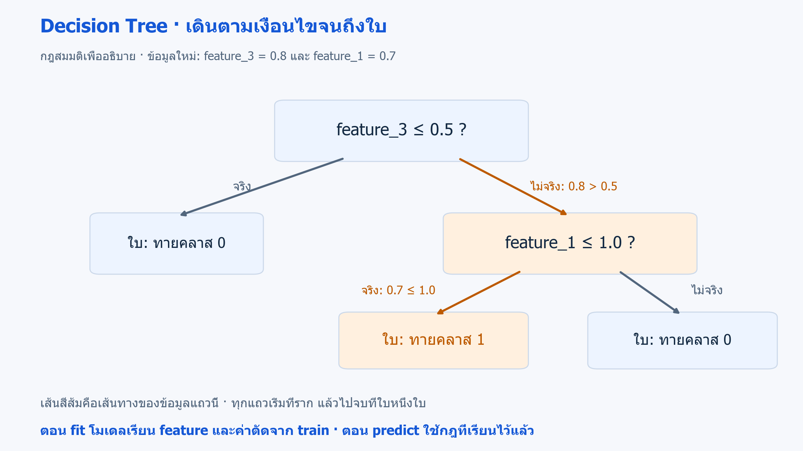
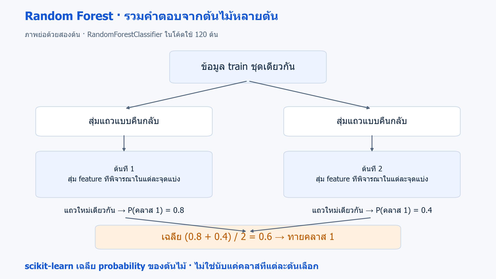

# 09 · Decision Trees, Random Forests และ overfitting

[กลับสารบัญ](../../README.md) · [Notebook](lesson.ipynb) · [Python](lesson.py)

บทนี้เทียบ **Decision Tree กับ Random Forest** และดูว่าโมเดลจำข้อมูลฝึกมากเกินไปหรือไม่

**ใช้สิ่งที่เรียนแล้ว:** metric และ CV จากบท 04/08 ไม่ทวนขั้นตอนแบ่ง fold

## ใจความใหม่

### Decision Tree คืออะไร

**Decision Tree — ต้นไม้ตัดสินใจ** เป็นโมเดล Supervised Learning ที่ใช้ได้ทั้ง Classification และ Regression บทนี้ใช้รุ่นจำแนกประเภท

**หลักการ:** เลือก feature และค่าตัดที่ช่วยแยกคำตอบใน train ให้ปะปนน้อยลง แล้วแบ่งต่อเป็นกิ่งจนถึง **leaf** หรือใบที่ใช้ทำนาย ข้อมูลที่เข้ามาจะเดินตามเงื่อนไขจากรากไปถึงใบ

**ตัวอย่างเงื่อนไข:** `feature_3 ≤ 0.5` ให้ไปทางซ้าย นอกนั้นไปทางขวา ตัวเลขนี้เป็นกฎสมมติให้เห็นวิธีเดินต้นไม้ ส่วนค่าตัดจริงเรียนจาก train



**อ่านภาพ:** ตามเส้นสีส้มจากราก: 0.8 มากกว่า 0.5 จึงไปขวา แล้ว 0.7 ไม่เกิน 1.0 จึงไปซ้ายจนถึงใบที่ทายคลาส 1 เป็นกฎสมมติสำหรับฝึกอ่านต้นไม้ · [เปิดภาพ SVG](../../assets/figures/09-trees-and-forests-tree.svg)

- **จุดเด่น:** ต้นไม้ขนาดเล็กอ่านเส้นทางการตัดสินใจได้ และจับความสัมพันธ์ที่ไม่เป็นเส้นตรงได้
- **ข้อจำกัด:** ต้นไม้ลึกอาจจำข้อมูลฝึกมากเกินไป และข้อมูลเปลี่ยนเพียงเล็กน้อยอาจทำให้ต้นไม้เปลี่ยนมาก

- `max_depth` จำกัดความลึกของต้นไม้
- `min_samples_leaf` กำหนดจำนวนตัวอย่างขั้นต่ำในแต่ละใบ

การแบ่งตามคอลัมน์แบบนี้ไม่จำเป็นต้อง scale

### Random Forest คืออะไร

**Random Forest — ป่าสุ่ม** เป็นโมเดล Supervised Learning ที่รวม Decision Tree หลายต้น เรียกว่า **Ensemble Learning** ใช้ได้ทั้ง Classification และ Regression

**หลักการในโค้ดนี้:** แต่ละต้นเรียนจากแถวที่สุ่มแบบคืนกลับ และพิจารณา feature ที่สุ่มมาในแต่ละจุดแบ่ง ต้นไม้จึงมีความแตกต่างกันก่อนนำผลมารวม

**สุ่มแบบคืนกลับ** หมายถึงแถวเดิมอาจถูกเลือกซ้ำในข้อมูลฝึกของต้นหนึ่ง และบางแถวอาจไม่ถูกเลือกในต้นนั้น

รุ่น classifier ของ scikit-learn เฉลี่ย probability จากต้นไม้แล้วเลือกคลาส ค่า `n_estimators=120` หมายถึงใช้ต้นไม้ 120 ต้น

**ตัวอย่างการรวมผล:** ถ้าสองต้นให้ probability ของคลาส 1 เป็น 0.8 และ 0.4 ค่าเฉลี่ยคือ 0.6 ในงานสองคลาสนี้จึงเลือกคลาส 1



**อ่านภาพ:** แต่ละต้นเรียนจากข้อมูลที่สุ่มต่างกัน แล้วทำนายแถวใหม่เดียวกัน ก่อนเฉลี่ย probability ภาพย่อเหลือสองต้นเพื่อให้เห็นการรวมผล ส่วนโค้ดใช้ 120 ต้น · [เปิดภาพ SVG](../../assets/figures/09-trees-and-forests-ensemble.svg)

- **จุดเด่น:** การรวมต้นไม้ที่ต่างกันช่วยลดความแปรปรวน และรองรับความสัมพันธ์ระหว่าง feature ที่ซับซ้อนได้
- **ข้อจำกัด:** ใช้เวลาและหน่วยความจำมากกว่าต้นเดียว อธิบายทั้งป่าได้ยากกว่า และยังเกิด overfitting ได้

### อ่านสัญญาณ overfitting

| คะแนนที่เห็น | สิ่งที่อาจเกิดขึ้น |
|---|---|
| train สูง แต่ CV ต่ำกว่าอย่างชัดเจน | **Overfitting:** จำรายละเอียดที่ไม่ช่วยกับข้อมูลใหม่ |
| train และ CV ต่ำทั้งคู่ | **Underfitting:** จับรูปแบบได้ไม่พอ หรือ feature ให้ข้อมูลไม่พอ |

ใช้โจทย์และ baseline ประกอบการตีความคะแนนด้วย

**`test_score` ใน `cross_validate`:** หมายถึงคะแนนของ validation fold ไม่ใช่คะแนน final test

**Permutation importance:** สลับค่าของ feature ทีละคอลัมน์ แล้วดูว่าคะแนนลดลงเท่าไร

ตัวอย่าง: accuracy drop=0.05 หมายถึงลดลง 5 จุดเปอร์เซ็นต์ ค่านี้ไม่ใช่ผลเชิงสาเหตุ และ feature ที่ใช้แทนกันได้อาจดูสำคัญน้อย

บทนี้ใช้ importance บน test เพื่อรายงานเท่านั้น หากจะใช้เลือก feature ต้องใช้ validation และกัน final test สำหรับกระบวนการใหม่

## ลงมือทำ

สร้าง Notebook ใหม่แล้วรัน **Cell 1–2 ตามลำดับ** หรือเปิด [Notebook ของบทนี้](lesson.ipynb) ใช้ kernel เดิมได้เลย อ่านคำอธิบายใต้โค้ดแต่ละช่วงประกอบผลที่ได้

<!-- CODE:CELLS -->

<!-- CODE:START -->
### Cell 1 — เทียบต้นไม้และป่าด้วย CV

```python
import numpy as np
from sklearn.datasets import make_classification
from sklearn.ensemble import RandomForestClassifier
from sklearn.inspection import permutation_importance
from sklearn.metrics import accuracy_score
from sklearn.model_selection import StratifiedKFold, cross_validate, train_test_split
from sklearn.tree import DecisionTreeClassifier

X, y = make_classification(
    n_samples=800, n_features=10, n_informative=4, n_redundant=2,
    flip_y=0.08, random_state=42,
)
X_train, X_test, y_train, y_test = train_test_split(X, y, stratify=y, random_state=42)
cv = StratifiedKFold(5, shuffle=True, random_state=42)
models = {
    "shallow_tree": DecisionTreeClassifier(max_depth=3, random_state=42),
    "deep_tree": DecisionTreeClassifier(random_state=42),
    "forest": RandomForestClassifier(n_estimators=120, min_samples_leaf=2, random_state=42, n_jobs=1),
}
scores = {}
for name, model in models.items():
    result = cross_validate(model, X_train, y_train, cv=cv, scoring="accuracy", return_train_score=True)
    scores[name] = result["test_score"].mean()
    print(f"{name}: train={result['train_score'].mean():.3f}, CV={scores[name]:.3f}")
```

**อ่านโค้ด**

- `make_classification` สร้าง 10 feature โดย 4 ตัวใช้สร้างสัญญาณ และ 2 ตัวเป็นค่าผสมจาก informative features ส่วน `flip_y=0.08` เติมความผิดพลาดของ label
- `models` เก็บต้นไม้จำกัดความลึก 3 ชั้น ต้นไม้ไม่กำหนดเพดานความลึก และ Random Forest 120 ต้น
- `cross_validate(..., return_train_score=True)` คืนทั้งคะแนนบนข้อมูลที่ใช้ฝึกและ validation ของแต่ละ fold
- `result["train_score"]` ใช้ดูผลบนชุดฝึก ส่วน `result["test_score"]` ในคำสั่งนี้หมายถึง validation fold ไม่ใช่ final test
- `scores[name]` เก็บค่าเฉลี่ย CV เพื่อให้ทุกโมเดลเลือกด้วยเกณฑ์เดียวกัน ส่วน `n_jobs=1` จำกัดการทำงานให้ใช้หนึ่งงานพร้อมกัน

### Cell 2 — ตรวจ feature ของโมเดลที่เลือก

```python
chosen = max(scores, key=scores.get)
model = models[chosen].fit(X_train, y_train)
print("Selected:", chosen, "test accuracy:", round(accuracy_score(y_test, model.predict(X_test)), 3))
importance = permutation_importance(model, X_test, y_test, scoring="accuracy", n_repeats=8, random_state=42)
order = np.argsort(importance.importances_mean)[::-1][:5]
for i in order:
    print(f"feature_{i}: accuracy drop={importance.importances_mean[i]:.3f} +/- {importance.importances_std[i]:.3f}")
```

**อ่านโค้ด**

- เลือกโมเดลจาก `scores` แล้ว fit บน train ทั้งหมดก่อนประเมิน test ตามวิธีในบท 08
- `permutation_importance(..., n_repeats=8)` สลับค่าของ feature แต่ละตัวซ้ำแปดครั้ง แล้ววัดว่า accuracy ลดลงเท่าไร
- `importances_mean` และ `importances_std` คือค่าเฉลี่ยและส่วนเบี่ยงเบนมาตรฐานของคะแนนที่ลดลงจากการสลับ
- `np.argsort(...)[::-1][:5]` เรียง index ของ feature จาก importance มากไปน้อย แล้วเลือกห้าอันดับแรก
- ผลนี้ใช้รายงานโมเดลที่เลือกแล้ว หากจะนำไปเลือก feature ต้องทำขั้นตอนนั้นบน validation
<!-- CODE:END -->

## อ่านผล

เทียบคะแนน train และ CV ของต้นไม้ตื้น ต้นไม้ลึก และ Random Forest จากนั้นอ่าน test accuracy กับ importance ของโมเดลที่เลือก

**Importance ใกล้ศูนย์:** ยังสรุปไม่ได้ว่า feature นั้นไร้ประโยชน์ในทุกโมเดล

<details>
<summary>ฝึกต่อพร้อมแนวคำตอบ</summary>

**ลองทำ:** วางแผนเทียบ `min_samples_leaf=1, 5, 20` ด้วย CV

**แนวคำตอบ:** การเพิ่มจำนวนตัวอย่างขั้นต่ำในใบอาจลด overfitting แต่ถ้ามากเกินไป โมเดลอาจจับรูปแบบได้ไม่พอ

การเพิ่มจำนวนต้นไม้อย่างเดียวไม่แก้ปัญหา feature ที่ไม่มีข้อมูลหรือ leakage

</details>

## อ้างอิง

- [Handbook: Decision Trees and Random Forests](https://jakevdp.github.io/PythonDataScienceHandbook/05.08-random-forests.html)
- [scikit-learn: Decision Trees](https://scikit-learn.org/1.7/modules/tree.html)
- [scikit-learn: Ensembles](https://scikit-learn.org/1.7/modules/ensemble.html)
- [Permutation importance](https://scikit-learn.org/1.7/modules/permutation_importance.html)
