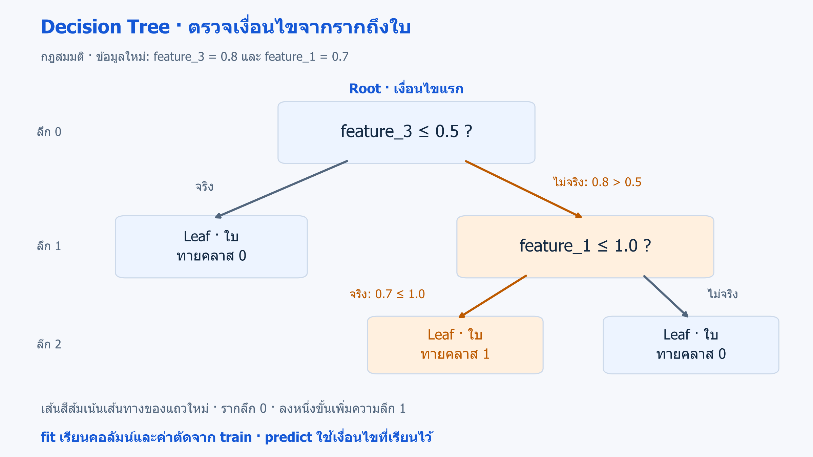
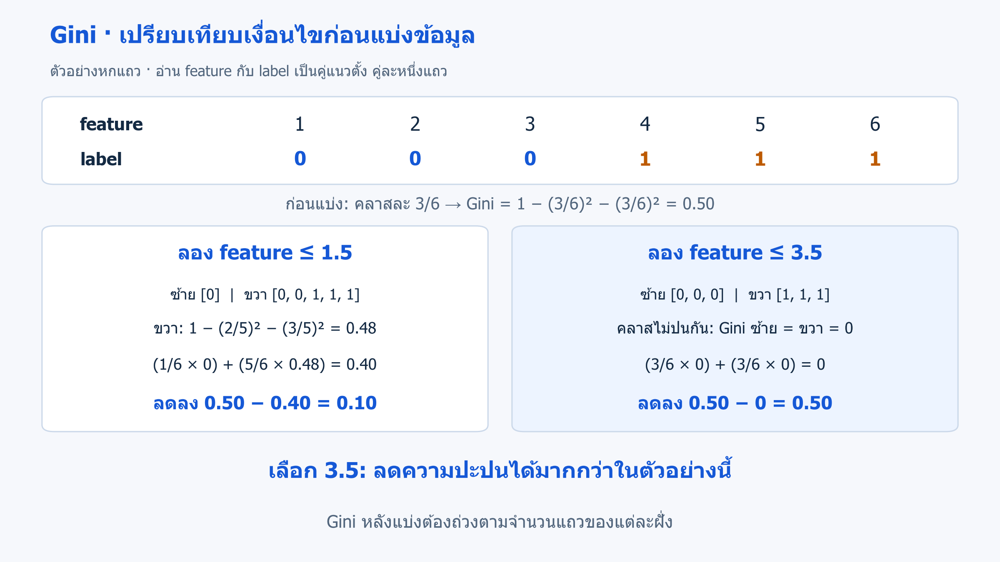
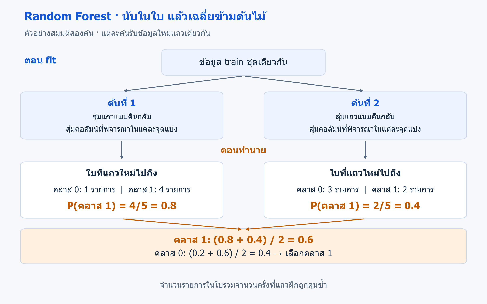
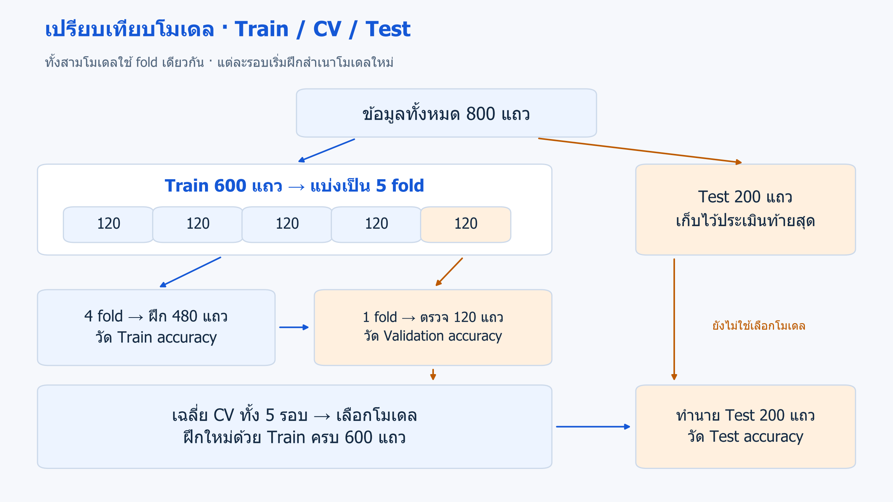
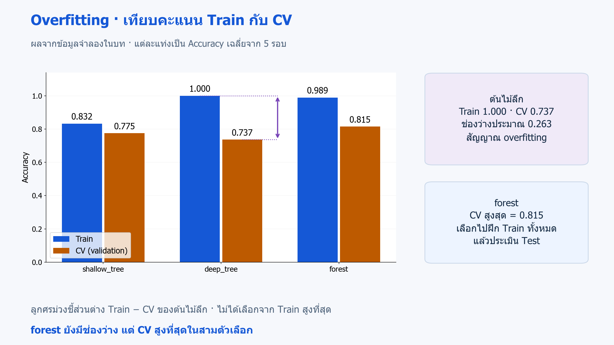
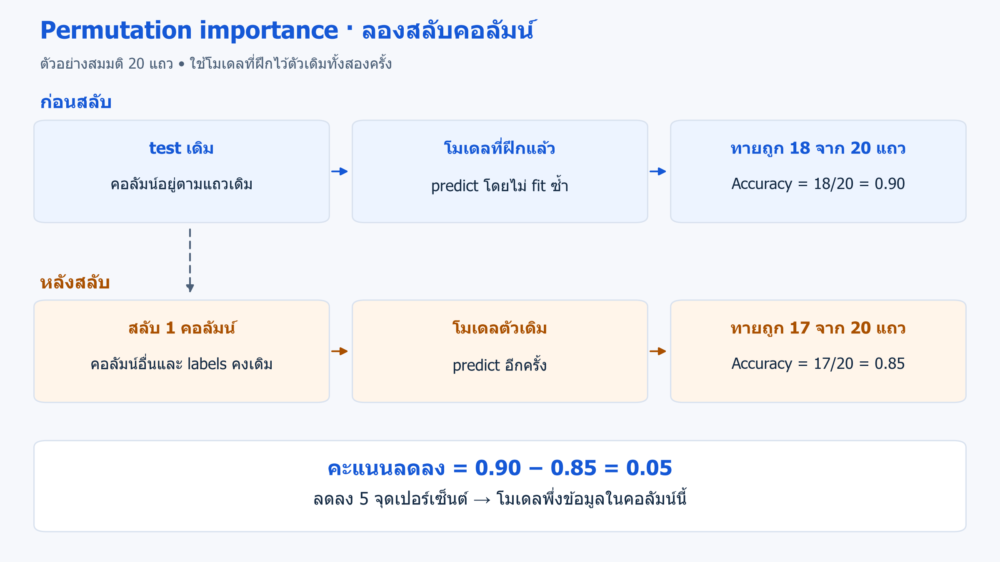
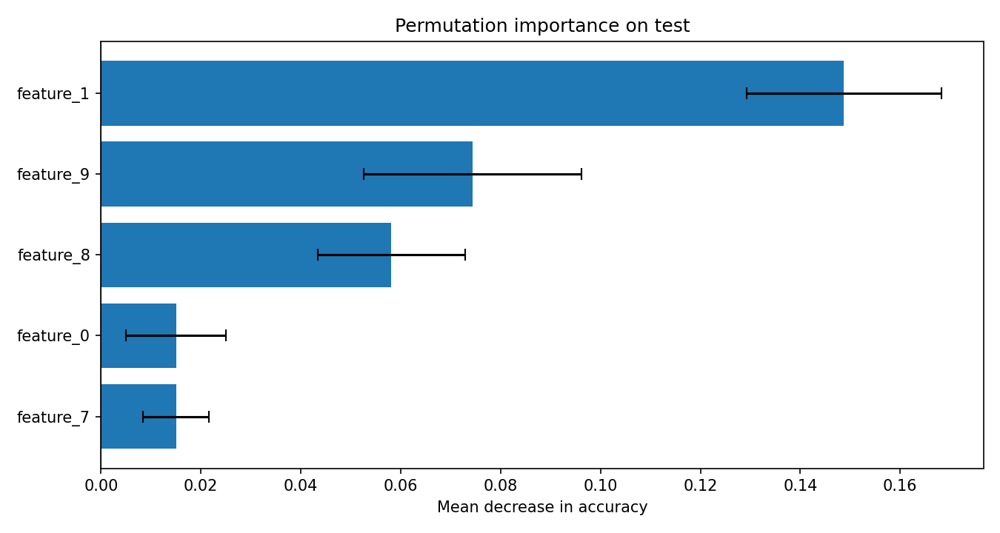

# 09 · Decision Trees, Random Forests และ overfitting

[กลับสารบัญ](../../README.md) · [Notebook](lesson.ipynb) · [Python](lesson.py)

บทนี้ใช้ **Decision Tree และ Random Forest จำแนกคลาส 0 หรือ 1** แล้วเปรียบเทียบคะแนน train กับ Cross-validation เพื่อดูสัญญาณ overfitting ก่อนประเมินโมเดลที่เลือกบน test

**ใช้สิ่งที่เรียนแล้ว:** train/test, Accuracy และ CV จาก [บท 08](../08-support-vector-machines/README.md)<br>ส่วนใหม่คือวิธีเลือกเงื่อนไขของต้นไม้ การรวมต้นไม้หลายต้น และการตรวจว่าโมเดลพึ่ง features ใด

## โมเดลในบทนี้ใช้ทำงานอะไร

**Decision Tree — ต้นไม้ตัดสินใจ** อ่านว่า **ดิซิชัน ทรี** และ **Random Forest — ป่าสุ่ม** อ่านว่า **แรนดอม ฟอเรสต์** เป็นโมเดล Machine Learning แบบ **Supervised Learning** ที่เรียนรู้จาก features คู่กับ labels

ทั้งสองโมเดลเลือกประเภทตามงานได้:

| ประเภทตามงาน | Decision Tree | Random Forest |
|---|---|---|
| **Classification — จำแนกคลาส** เช่น สายพันธุ์ดอกไม้ | `DecisionTreeClassifier` | `RandomForestClassifier` |
| **Regression — ทำนายตัวเลข** เช่น ค่าบริการขนส่ง | `DecisionTreeRegressor` | `RandomForestRegressor` |

บทนี้ใช้ **Classifier** ทั้งสองแบบ เพื่อจำแนกสองคลาส; ตัว Classifier รองรับมากกว่าสองคลาสได้ด้วย

## ข้อมูลในบท: หนึ่งแถวมี Features 10 ค่า

ใช้ `make_classification` สร้างข้อมูลจำลอง 800 แถว โดยหนึ่งแถวประกอบด้วย:

- **Features:** ตัวเลข 10 คอลัมน์ เรียกตามตำแหน่งว่า `feature_0` ถึง `feature_9`
- **Label:** คลาสจริงของแถวนั้น คือ 0 หรือ 1

ชื่อคอลัมน์เป็นเพียงชื่อสำหรับทดลอง ไม่มีหน่วยหรือความหมายทางธุรกิจ เช่น อายุหรือรายได้<br>เราแบ่งเป็น train 600 แถวสำหรับฝึกและทำ CV ส่วน test 200 แถวเก็บไว้ประเมินหลังเลือกโมเดล

## Decision Tree: ตรวจเงื่อนไขจนถึงใบ

ต้นไม้เรียนรู้ **คอลัมน์และค่าตัด** จากชุดฝึก เช่น `feature_3 ≤ 0.5` แล้วใช้เงื่อนไขแบ่งข้อมูลเป็นสองฝั่ง

- **Node — จุดในต้นไม้:** จุดที่มีเงื่อนไขจะส่งข้อมูลไปซ้ายเมื่อเงื่อนไขเป็นจริง; ไปขวาเมื่อไม่จริง
- **Root — ราก:** จุดตรวจเงื่อนไขแรกด้านบน
- **Leaf — ใบ:** จุดสิ้นสุดที่ใช้ให้คำทำนาย

**ตัวอย่างสมมติ:** ข้อมูลใหม่มี `feature_3 = 0.8` และ `feature_1 = 0.7`, เมื่อนำไปใช้กับต้นไม้ด้านล่าง จะเดินไปถึงใบที่ทายคลาส 1



[เปิดภาพ SVG](../../assets/figures/09-trees-and-forests-tree.svg)

**สีส้มเน้นเส้นทางของข้อมูลแถวนี้** ไม่ได้บอกว่าทายผิด<br>เมื่อถึงใบ โมเดลเลือกคลาสที่มีสัดส่วนมากที่สุดในข้อมูลฝึกที่มาถึงใบนั้น

### ต้นไม้เลือกคอลัมน์และค่าตัดอย่างไร

ในบทนี้ใช้ **Gini impurity — ค่าวัดความปะปนของคลาส** อ่านว่า **จินี อิมเพียวริตี**

- Gini เท่ากับ **0** เมื่อข้อมูลในจุดนั้นเป็นคลาสเดียวกันทั้งหมด
- สำหรับสองคลาส ถ้ามีจำนวนเท่ากัน จะได้ Gini **0.5**
- ตอนฝึก ต้นไม้ลองเงื่อนไขแบ่งข้อมูล แล้วเลือกเงื่อนไขที่ลด Gini ได้มากที่สุด ณ จุดที่กำลังแบ่ง โดยถ่วงตามจำนวนข้อมูลแต่ละฝั่ง

ภาพต่อไปใช้ข้อมูลสมมติหกแถว โดยอ่าน feature กับ label เป็นคู่แนวตั้ง คู่ละหนึ่งแถว<br>ค่าตัด 1.5 อยู่กึ่งกลางระหว่าง 1 กับ 2<br>ส่วนค่าตัด 3.5 อยู่กึ่งกลางระหว่าง 3 กับ 4:



[เปิดภาพ SVG](../../assets/figures/09-trees-and-forests-gini.svg)

<details>
<summary>ดูสูตรและแทนค่า Gini ทีละขั้น</summary>

สำหรับสองคลาส ใช้ `Gini = 1 − p₀² − p₁²` โดย `p₀` และ `p₁` คือสัดส่วนของแต่ละคลาสในกลุ่มที่กำลังตรวจ

1. **ก่อนแบ่ง:** มีคลาสละ 3 จาก 6 แถว จึงได้ `1 − (3/6)² − (3/6)² = 0.5`
2. **แบ่งที่ 1.5:** ซ้ายมีคลาส 0 เพียงแถวเดียว จึงได้ Gini = 0<br>ขวามีคลาส 0 สองแถวกับคลาส 1 สามแถว จึงได้ `1 − (2/5)² − (3/5)² = 0.48`
3. **รวมผลหลังแบ่งที่ 1.5:** ซ้ายมี 1/6 ของข้อมูล, ขวามี 5/6 จึงถ่วงจำนวนแถวเป็น `(1/6 × 0) + (5/6 × 0.48) = 0.4`<br>ลดจากเดิมได้ `0.5 − 0.4 = 0.1`
4. **แบ่งที่ 3.5:** ซ้ายเป็นคลาส 0 ทั้งสามแถว, ขวาเป็นคลาส 1 ทั้งสามแถว<br>ทั้งสองฝั่งได้ Gini = 0<br>รวมเป็น `(3/6 × 0) + (3/6 × 0) = 0` จึงลดได้ `0.5 − 0 = 0.5`

ดังนั้นค่าตัด **3.5** ลดความปะปนได้มากกว่าในตัวอย่างนี้<br>ต้นไม้เลือกเงื่อนไขทีละจุด ไม่ได้ลองต้นไม้ทุกโครงสร้างเพื่อหาแบบที่ดีที่สุดทั้งต้น

</details>

**Gini ใช้เลือกเงื่อนไขระหว่างฝึก ส่วน Accuracy ใช้ประเมินว่าทายถูกกี่แถว** เป็นคนละหน้าที่

**จุดเด่น:** ต้นไม้ขนาดเล็กอ่านเส้นทางตัดสินใจได้ และรองรับความสัมพันธ์ที่ไม่เป็นเส้นตรง<br>**ข้อจำกัด:** ต้นไม้ลึกอาจเรียนรายละเอียดเฉพาะชุดฝึกมากเกินไป และข้อมูลเปลี่ยนเล็กน้อยอาจทำให้กฎเปลี่ยนมาก

## Random Forest: รวมผลจากต้นไม้หลายต้น

การใช้โมเดลหลายตัวร่วมกันเรียกว่า **Ensemble Learning — การเรียนรู้แบบรวมหลายโมเดล**

Random Forest ทำให้ต้นไม้ต่างกันด้วยการสุ่มสองส่วน:

1. **สุ่มแถวแบบคืนกลับก่อนฝึกแต่ละต้น:** แถวเดิมอาจถูกเลือกซ้ำ และบางแถวอาจไม่ถูกเลือกในต้นนั้น
2. **สุ่มคอลัมน์ที่พิจารณาในแต่ละจุดแบ่ง:** แล้วเลือกคอลัมน์และค่าตัดที่ดีที่สุดจากตัวเลือกที่สุ่มมา ไม่ได้สุ่มคำตอบให้ข้อมูลใหม่

สำหรับ `RandomForestClassifier` ของ scikit-learn, ต้นไม้แต่ละต้นให้ความน่าจะเป็นของคลาส แล้ว forest **เฉลี่ยความน่าจะเป็นก่อนเลือกคลาสที่ได้ค่าสูงสุด**

**ตัวเลขมาจากไหน:** เมื่อแถวใหม่เดินไปถึงใบ จะใช้สัดส่วนคลาสของข้อมูลฝึกในใบนั้น

ภาพนี้ย่อเหลือสองต้น เพื่อให้เห็นการนับและการเฉลี่ย:



[เปิดภาพ SVG](../../assets/figures/09-trees-and-forests-ensemble.svg)

**จุดเด่น:** การเฉลี่ยผลจากต้นไม้ที่ต่างกันช่วยลดความผันผวนของคำทำนายเมื่อเทียบกับการพึ่งต้นเดียว<br>**ข้อจำกัด:** ใช้เวลาและหน่วยความจำมากกว่า อธิบายกฎทั้งหมดร่วมกันยากกว่า และยังเกิด overfitting ได้

### Hyperparameters: ค่าที่เรากำหนดก่อนฝึก

ค่าต่อไปนี้ควบคุมวิธีสร้างต้นไม้ ส่วนคอลัมน์และค่าตัดในแต่ละจุดจะเรียนรู้ระหว่าง `fit`

| ค่า | ควบคุมอะไร | เมื่อเพิ่มค่า |
|---|---|---|
| `max_depth` | ความลึกสูงสุด; รากอยู่ที่ระดับ 0 | อนุญาตให้ตรวจเงื่อนไขต่อกันมากขึ้น และอาจ overfit |
| `min_samples_leaf` | จำนวนแถวขั้นต่ำที่ต้องเหลือในแต่ละใบ | จำกัดการสร้างใบเล็ก ๆ; มากเกินไปอาจเรียนรูปแบบได้ไม่พอ |
| `n_estimators` | จำนวนต้นไม้ใน Random Forest | ใช้ต้นไม้ร่วมกันมากขึ้น แต่เพิ่มเวลาและหน่วยความจำ ไม่ได้ทำให้แต่ละต้นลึกขึ้น |
| `max_features` | จำนวนคอลัมน์ที่สุ่มมาพิจารณาในแต่ละจุดแบ่งของ forest | มีคอลัมน์ให้เลือกมากขึ้น; ต้นไม้อาจคล้ายกันมากขึ้น |

`bootstrap=True` เปิดการสุ่มแถวแบบคืนกลับ ส่วน `criterion="gini"` เลือกเกณฑ์วัดความปะปนของคลาส

### ทำไมบทนี้ไม่มี StandardScaler และ Pipeline

ต่างจาก SVM ใน EP8, ต้นไม้ใช้เงื่อนไขของแต่ละคอลัมน์ เช่น `น้ำหนัก ≤ 5` ไม่ได้คำนวณระยะทางรวมระหว่าง features

ถ้าเปลี่ยนกิโลกรัมเป็นกรัม เงื่อนไขเดียวกันจะเป็น `น้ำหนัก ≤ 5000` แต่แถวที่อยู่แต่ละฝั่งยังเหมือนเดิม จึงไม่จำเป็นต้องใช้ StandardScaler สำหรับ Decision Tree และ Random Forest ในบทนี้

ข้อมูลจำลองเป็นตัวเลขครบทุกคอลัมน์ เราจึงส่งเข้าโมเดลโดยตรง<br>หากมีขั้นเตรียมข้อมูล เช่น เติมค่าหายหรือแปลงข้อความเป็นตัวเลข ยังใช้ Pipeline จัดลำดับเหมือนบทก่อน ๆ ได้

## Train, CV และ Test ใช้ตอบคนละคำถาม

- **Train accuracy:** โมเดลทายข้อมูลที่ใช้ฝึกตัวเองได้ดีแค่ไหน
- **CV accuracy:** โมเดลทายส่วน validation ที่ไม่ได้ใช้ฝึกในรอบนั้นได้ดีแค่ไหน<br>ใช้เปรียบเทียบและเลือกโมเดล
- **Test accuracy:** หลังเลือกโมเดลแล้ว ทดสอบกับชุดที่กันไว้เพื่อประเมินครั้งสุดท้าย



[เปิดภาพ SVG](../../assets/figures/09-trees-and-forests-validation-flow.svg)

ทั้งสามโมเดลใช้ fold เดียวกัน และแต่ละรอบเริ่มฝึกสำเนาโมเดลใหม่ ตามวิธีใน EP8

### อ่านสัญญาณ Overfitting

| คะแนนที่เห็น | สิ่งที่ควรพิจารณา |
|---|---|
| train สูง แต่ CV ต่ำกว่าอย่างชัดเจน | **Overfitting:** โมเดลเข้ากับชุดฝึกมาก แต่ใช้กับข้อมูลที่ไม่ได้ฝึกได้แย่กว่า |
| train และ CV ต่ำทั้งคู่ | อาจ **Underfit:** เรียนรูปแบบได้ไม่พอ หรือ features อาจให้ข้อมูลไม่พอ |

ต้องดูว่าคะแนนเพียงพอต่อโจทย์หรือไม่ด้วย

ช่องว่างน้อยอย่างเดียวไม่ได้แปลว่าโมเดลดี เพราะคะแนนทั้งคู่อาจต่ำ

ภาพต่อไปใช้คะแนนจากการทดลองของบท โดยแต่ละแท่งเป็นค่าเฉลี่ยห้ารอบ:



[เปิดภาพ SVG](../../assets/figures/09-trees-and-forests-cv-comparison.svg)

เลือกจาก **CV accuracy สูงสุด** แล้วฝึกโมเดลที่เลือกด้วย train ทั้งหมด จึงค่อยเปิดผล test

## Permutation importance: โมเดลพึ่งคอลัมน์ใด

**Permutation importance** อ่านว่า **เพอร์มิวเทชัน อิมพอร์ตันซ์** คือการวัดว่าคะแนนลดลงเท่าไรเมื่อสุ่มสลับค่าภายในคอลัมน์หนึ่ง

การสลับทำให้ค่าของคอลัมน์นั้นไม่จับคู่กับแถวเดิม ส่วนคอลัมน์อื่นและ label ยังอยู่ตามเดิม

จากนั้นใช้โมเดลเดิมทำนายอีกครั้ง โดยไม่ฝึกใหม่

**ตัวอย่างสมมติ:** ก่อนสลับทายถูก 18 จาก 20 แถว; หลังสลับทายถูก 17 จาก 20 แถว จึงได้ Accuracy 0.90 กับ 0.85 ตามลำดับ



[เปิดภาพ SVG](../../assets/figures/09-trees-and-forests-permutation-importance.svg)

- **ลดลงมาก:** โมเดลพึ่งข้อมูลจากคอลัมน์นั้นมากในการทำนายชุดที่ตรวจ
- **ใกล้ศูนย์:** การสลับแทบไม่เปลี่ยนคะแนน อาจมีคอลัมน์อื่นให้ข้อมูลแทนได้
- **ติดลบ:** หลังสลับคะแนนกลับสูงขึ้น อาจเกิดจากความแปรปรวนในการสุ่มหรือคอลัมน์นั้นรบกวนการทำนาย

Importance อธิบายการพึ่งพาข้อมูลของ **โมเดลและชุดข้อมูลที่ตรวจ** ไม่ได้พิสูจน์เหตุและผล

**บทนี้ใช้ CV เลือกโมเดลก่อน** แล้วจึงคำนวณ Permutation importance ตามลำดับนี้:

1. **เลือกโมเดลด้วย CV บนชุดฝึก:** เปรียบเทียบต้นไม้ตื้น ต้นไม้ลึก และ Random Forest จากคะแนน CV เฉลี่ย
2. **ประเมินโมเดลที่เลือกบน test:** ฝึกโมเดลที่เลือกด้วยชุดฝึกทั้งหมด แล้ววัด Accuracy บน test
3. **คำนวณ Permutation importance บน test:** ใช้โมเดลเดิมตรวจว่าพึ่งพาแต่ละ feature มากน้อยเพียงใด เพื่อรายงานผล โดยไม่นำผลจาก test กลับไปเลือก features หรือปรับโมเดล

**หากต้องการใช้ importance เลือก features หรือปรับโมเดล:** ให้ใช้เฉพาะข้อมูลฝั่ง train ผ่าน validation/CV เพื่อช่วยตัดสินใจ แล้วเก็บ test ที่ยังไม่เคยใช้ตัดสินใจไว้ประเมินผลสุดท้าย

คำว่า **validation** อาจเป็นชุดที่แยกไว้จาก train หรือ validation fold ใน CV ก็ได้

หากดูผลจาก test แล้วนำไปตัดคอลัมน์หรือปรับโมเดล ข้อมูล test ก็มีส่วนในการพัฒนาโมเดลแล้ว

คะแนนบน test ชุดเดิมจึงอาจดูดีเกินกว่าผลกับข้อมูลใหม่

## ลงมือทำ

สร้าง Notebook ใหม่แล้วรัน **Cell 1–6 ตามลำดับ** หรือเปิด [Notebook ของบทนี้](lesson.ipynb) แต่ละ cell มีผลลัพธ์ให้เปิดเทียบด้านล่าง

<!-- CODE:CELLS -->

<!-- CODE:START -->
### Cell 1 — เตรียมข้อมูลและกันชุดทดสอบ

```python
from pathlib import Path

import matplotlib.pyplot as plt
import numpy as np
import pandas as pd
from sklearn.datasets import make_classification
from sklearn.ensemble import RandomForestClassifier
from sklearn.inspection import permutation_importance
from sklearn.metrics import accuracy_score
from sklearn.model_selection import StratifiedKFold, cross_validate, train_test_split
from sklearn.tree import DecisionTreeClassifier

X, y = make_classification(
    n_samples=800, n_features=10, n_informative=4, n_redundant=2,
    flip_y=0.08, random_state=42,
)
X_train, X_test, y_train, y_test = train_test_split(
    X, y, test_size=0.25, stratify=y, random_state=42
)
print("Train:", X_train.shape, "Test:", X_test.shape)
print("Train counts [class 0, class 1]:", np.bincount(y_train))
```

<details>
<summary>ดูผลลัพธ์ Cell 1</summary>

```text
Train: (600, 10) Test: (200, 10)
Train counts [class 0, class 1]: [303 297]
```

มีชุดฝึก 600 แถวและชุดทดสอบ 200 แถว แต่ละแถวมี features 10 ค่า

</details>

**อ่านโค้ด**

- `make_classification` สร้างโจทย์จำแนกคลาสจำลอง: 4 คอลัมน์ใช้สร้างความแตกต่างระหว่างคลาส, 2 คอลัมน์เป็นค่าผสมเชิงเส้นจากสี่คอลัมน์นั้น และอีก 4 คอลัมน์เป็นค่าสุ่มที่ไม่ใช้สร้างคลาส
- คำสั่งสลับลำดับคอลัมน์ให้ด้วย จึงไม่ควรสรุปว่า `feature_0` ถึง `feature_3` เป็นสี่คอลัมน์แรกที่ใช้สร้างคลาส
- `flip_y=0.08` เลือกบางแถวมาสุ่ม label ใหม่ เพื่อจำลอง labels ที่คลาดเคลื่อน<br>สัดส่วนที่เปลี่ยนคลาสจริงอาจต่ำกว่า 8% เพราะสุ่มแล้วอาจได้คลาสเดิม
- `test_size=0.25` กัน 200 แถวไว้ทดสอบ; อีก 600 แถวใช้ทำ CV และฝึกโมเดลที่เลือก

### Cell 2 — เตรียมต้นไม้ตื้น ต้นไม้ลึก และ Random Forest

```python
models = {
    "shallow_tree": DecisionTreeClassifier(
        criterion="gini", max_depth=3, random_state=42
    ),
    "deep_tree": DecisionTreeClassifier(
        criterion="gini", max_depth=None, random_state=42
    ),
    "forest": RandomForestClassifier(
        n_estimators=120, criterion="gini", min_samples_leaf=2,
        max_features="sqrt", bootstrap=True, random_state=42, n_jobs=1,
    ),
}
print("Prepared models:", list(models))
```

<details>
<summary>ดูผลลัพธ์ Cell 2</summary>

```text
Prepared models: ['shallow_tree', 'deep_tree', 'forest']
```

ขั้นนี้สร้างตัวเลือกสามแบบ ยังไม่ได้ fit จึงยังไม่มีคะแนนประเมิน

</details>

**อ่านโค้ด**

- `criterion="gini"` ให้ต้นไม้เลือกเงื่อนไขด้วย Gini ตามตัวอย่างก่อนเริ่มโค้ด
- `max_depth=3` ให้เดินจากรากถึงใบได้ไม่เกินสามขั้น<br>ส่วน `None` ไม่กำหนดเพดานความลึก แต่ยังหยุดได้เมื่อแบ่งต่อไม่ได้หรือคลาสในจุดนั้นเหมือนกันหมด
- `n_estimators=120` คือจำนวนต้นไม้ใน forest; `min_samples_leaf=2` กำหนดจำนวนแถวขั้นต่ำในแต่ละใบ
- `bootstrap=True` สุ่มแถวแบบคืนกลับก่อนฝึกแต่ละต้น<br>ส่วน `max_features="sqrt"` กำหนดจำนวนคอลัมน์ที่สุ่มมาพิจารณาในแต่ละจุดแบ่ง<br>เมื่อมี 10 features จะเริ่มพิจารณา `int(sqrt(10)) = 3` คอลัมน์ แล้วเลือกเงื่อนไขที่ดีที่สุดจากคอลัมน์เหล่านั้น
- `random_state=42` ช่วยให้ทดลองซ้ำได้; `n_jobs=1` ให้ forest ประมวลผลทีละงาน

<details>
<summary>จำนวน features และจำนวนแถวใน Random Forest</summary>

หากคอลัมน์ที่สุ่มมายังหาเงื่อนไขแบ่งที่ใช้ได้ไม่พบ scikit-learn อาจตรวจเพิ่มเกิน `max_features` ได้

`min_samples_leaf` ตรวจจำนวนแถวฝึกที่ต่างกันในใบ<br>ส่วนการนับสัดส่วนคลาสและ Gini คำนึงถึงจำนวนครั้งที่แต่ละแถวถูกสุ่มซ้ำด้วย

ในบทนี้ไม่ได้กำหนด `class_weight` หรือ `sample_weight` เพิ่ม

</details>

### Cell 3 — เตรียม CV ห้ารอบบนชุดฝึก

```python
cv = StratifiedKFold(n_splits=5, shuffle=True, random_state=42)
folds = list(cv.split(X_train, y_train))
for fold, (fit_idx, valid_idx) in enumerate(folds, start=1):
    print(f"Fold {fold}: fit={len(fit_idx)} rows, validation={len(valid_idx)} rows")
```

<details>
<summary>ดูผลลัพธ์ Cell 3</summary>

```text
Fold 1: fit=480 rows, validation=120 rows
Fold 2: fit=480 rows, validation=120 rows
Fold 3: fit=480 rows, validation=120 rows
Fold 4: fit=480 rows, validation=120 rows
Fold 5: fit=480 rows, validation=120 rows
```

แต่ละรอบใช้ 480 แถวฝึก และอีก 120 แถวตรวจผล ส่วน test 200 แถวยังแยกไว้

</details>

**อ่านโค้ด**

- ใช้ `StratifiedKFold` เหมือน EP8 เพื่อรักษาสัดส่วนคลาสในแต่ละ fold
- `folds` เก็บตำแหน่งแถวไว้ให้ทั้งสามโมเดลใช้การแบ่งเดียวกัน จึงเปรียบเทียบจากข้อมูลชุดเดียวกันในแต่ละรอบ

### Cell 4 — เปรียบเทียบคะแนน Train กับ CV

```python
scores = {}
cv_by_fold = {}
rows = []
for name, candidate in models.items():
    result = cross_validate(
        candidate, X_train, y_train, cv=folds,
        scoring="accuracy", return_train_score=True,
    )
    train_mean = result["train_score"].mean()
    cv_mean = result["test_score"].mean()
    scores[name] = cv_mean
    cv_by_fold[name] = result["test_score"]
    rows.append({
        "model": name, "train_accuracy": train_mean,
        "cv_accuracy": cv_mean, "cv_std": result["test_score"].std(),
        "train_cv_gap": train_mean - cv_mean,
    })

fold_table = pd.DataFrame(cv_by_fold, index=range(1, 6))
fold_table.index.name = "Fold"
summary = pd.DataFrame(rows).set_index("model")
print("Validation accuracy by fold:")
print(fold_table.round(3).to_string())
print("\nMean scores and train-CV gap:")
print(summary.round(3).to_string())
```

<details>
<summary>ดูผลลัพธ์ Cell 4</summary>

```text
Validation accuracy by fold:
      shallow_tree  deep_tree  forest
Fold
1            0.792      0.750   0.792
2            0.775      0.717   0.875
3            0.733      0.742   0.800
4            0.817      0.783   0.817
5            0.758      0.692   0.792

Mean scores and train-CV gap:
              train_accuracy  cv_accuracy  cv_std  train_cv_gap
model
shallow_tree           0.832        0.775   0.028         0.057
deep_tree              1.000        0.737   0.031         0.263
forest                 0.989        0.815   0.031         0.174
```

ต้นไม้ลึกได้ train 1.000 แต่ CV ประมาณ 0.737 จึงมีสัญญาณ overfitting ชัดเจน ส่วน forest ได้ CV สูงสุดในสามตัวเลือก

</details>

**อ่านโค้ด**

- EP8 ใช้ `cross_val_score` เพื่อเก็บคะแนน validation; บทนี้ใช้ `cross_validate(..., return_train_score=True)` เพื่อเก็บคะแนน train เพิ่มด้วย
- แต่ละรอบฝึก **สำเนาโมเดลใหม่** บน 480 แถว แล้ววัดทั้ง train 480 แถวและ validation 120 แถว
- `result["test_score"]` เป็นชื่อ key ของ scikit-learn; ในคำสั่งนี้หมายถึง **คะแนน validation ของแต่ละ fold** ไม่ใช่คะแนนจาก `X_test`
- `train_cv_gap` คือค่าเฉลี่ย train ลบค่าเฉลี่ย CV; ช่องว่างมากเป็นสัญญาณให้ตรวจ overfitting แต่การเลือกโมเดลใช้ **CV accuracy สูงสุด** ไม่ใช่ช่องว่างน้อยที่สุด
- `cv_std` บอกการกระจายของคะแนน validation ห้ารอบ ไม่ใช่ช่วงความเชื่อมั่น

### Cell 5 — ฝึกโมเดลที่เลือกและประเมินบน Test

```python
chosen = max(scores, key=scores.get)
model = models[chosen]
model.fit(X_train, y_train)
pred = model.predict(X_test)
print("Selected:", chosen)
print(f"Test accuracy: {accuracy_score(y_test, pred):.3f}")
print(f"Correct predictions: {(pred == y_test).sum()}/{len(y_test)}")
```

<details>
<summary>ดูผลลัพธ์ Cell 5</summary>

```text
Selected: forest
Test accuracy: 0.820
Correct predictions: 164/200
```

</details>

**อ่านโค้ด**

- `max(scores, key=scores.get)` เลือกชื่อโมเดลจาก CV โดยยังไม่ใช้ผลจาก test
- CV ฝึกสำเนาสำหรับตรวจคะแนน ตัวโมเดลใน `models` จึงยังไม่ได้ fit; เมื่อเลือกแล้วต้องฝึกด้วย train ครบ 600 แถว
- `predict(X_test)` ทำนาย 200 แถวที่กันไว้ แล้วใช้ `y_test` ตรวจว่าทายถูกกี่แถว

### Cell 6 — ตรวจการพึ่งพา Features ด้วย Permutation importance

```python
importance = permutation_importance(
    model, X_test, y_test, scoring="accuracy", n_repeats=8, random_state=42,
)
order = np.argsort(importance.importances_mean)[::-1][:5]
for i in order:
    print(
        f"feature_{i}: accuracy drop={importance.importances_mean[i]:.3f}"
        f" +/- {importance.importances_std[i]:.3f}"
    )

fig, ax = plt.subplots(figsize=(9, 4.8))
ax.barh(
    [f"feature_{i}" for i in order], importance.importances_mean[order],
    xerr=importance.importances_std[order], color="tab:blue", capsize=4,
)
ax.invert_yaxis()
ax.axvline(0, color="black", linewidth=1)
ax.set(xlabel="Mean decrease in accuracy", title="Permutation importance on test")
fig.tight_layout()
out = Path("outputs/09-trees-and-forests")
out.mkdir(parents=True, exist_ok=True)
fig.savefig(out / "permutation-importance.png", dpi=150)
plt.show()
print("Saved:", (out / "permutation-importance.png").resolve())
```

<details>
<summary>ดูผลลัพธ์ Cell 6</summary>

```text
feature_1: accuracy drop=0.149 +/- 0.019
feature_9: accuracy drop=0.074 +/- 0.022
feature_8: accuracy drop=0.058 +/- 0.015
feature_0: accuracy drop=0.015 +/- 0.010
feature_7: accuracy drop=0.015 +/- 0.007
Saved: <โฟลเดอร์ที่ Notebook ทำงาน>/outputs/09-trees-and-forests/permutation-importance.png
```



`feature_1` มีค่าเฉลี่ย accuracy drop ประมาณ 0.149 หรือ **14.9 จุดเปอร์เซ็นต์** จึงเป็นคอลัมน์ที่โมเดลนี้พึ่งพามากที่สุดจากผลที่ตรวจ

</details>

**อ่านโค้ด**

- `permutation_importance` ใช้โมเดลที่ฝึกแล้ว สลับค่าทีละคอลัมน์แล้วทำนายใหม่ โดยคอลัมน์อื่นและ labels อยู่ตามแถวเดิม **ไม่มีการ fit ซ้ำ**
- `n_repeats=8` ทำแปดรอบต่อคอลัมน์; `importances_mean` เฉลี่ยผลต่าง `accuracy ก่อนสลับ − accuracy หลังสลับ`
- `importances_std` คือส่วนเบี่ยงเบนมาตรฐานของผลต่างแปดรอบ แสดงด้วยเส้นแนวนอนสีดำที่ปลายแท่ง<br>ความยาวแท่งบอกค่าเฉลี่ย ส่วนเส้นดำบอกการกระจาย ไม่ใช่ช่วงความเชื่อมั่น
- `np.argsort(...)[::-1][:5]` เรียงตำแหน่งคอลัมน์ตาม importance จากมากไปน้อย แล้วเลือกห้าคอลัมน์แรก
- `Saved:` แสดงตำแหน่งเต็มของภาพ<br>หากเปิด Notebook ใน `practics` จะบันทึกที่ `practics/outputs/09-trees-and-forests/permutation-importance.png`
<!-- CODE:END -->

## แบบฝึกท้ายบท

**1. ต้นไม้ได้ train accuracy เท่ากับ 1.000 ควรเลือกทันทีหรือไม่?**

<details>
<summary>ดูเฉลย</summary>

ยังเลือกไม่ได้ ต้องดู CV บนข้อมูลที่ไม่ได้ใช้ fit ในแต่ละรอบด้วย ต้นไม้ลึกในบทได้ CV ต่ำกว่า forest แม้ train จะทายถูกทั้งหมด

</details>

**2. ถ้าเพิ่ม `n_estimators` จาก 120 เป็น 200 ต้นไม้แต่ละต้นจะลึกขึ้นหรือไม่?**

<details>
<summary>ดูเฉลย</summary>

ไม่ได้เพิ่มความลึกโดยตรง ค่านี้เพิ่มจำนวนต้นไม้ ส่วนความลึกควบคุมด้วย `max_depth` และเงื่อนไขหยุดอื่น ๆ เช่น `min_samples_leaf`

</details>

**3. วางแผนเทียบ `min_samples_leaf=1, 5, 20` โดยไม่ใช้ test เลือกค่า**

<details>
<summary>ดูแนวคำตอบ</summary>

สร้างตัวเลือกโดยคงค่าอื่นเหมือนกัน แล้วใช้ fold เดิมบน train เปรียบเทียบ CV accuracy เฉลี่ย

เมื่อเพิ่มขั้นต่ำของใบ อาจลด overfitting; ถ้ามากเกินไป อาจเรียนรูปแบบได้ไม่พอ<br>หากตรวจ test ของบทนี้ไปแล้ว ให้ทดลองต่อโดยใช้ CV และไม่อ้างคะแนน test เดิมเป็นการประเมินชุดที่ยังไม่เคยใช้

</details>

**4. คอลัมน์ที่ importance ใกล้ศูนย์ลบทิ้งได้ทันทีหรือไม่?**

<details>
<summary>ดูเฉลย</summary>

ยังสรุปไม่ได้ เพราะอาจมีคอลัมน์อื่นให้ข้อมูลแทนกันได้ หากต้องการตัดคอลัมน์ ให้ตรวจผลของชุด features ใหม่ด้วย validation หรือ CV

</details>

## อ้างอิง

- [scikit-learn: Decision Trees และเกณฑ์ Gini](https://scikit-learn.org/1.7/modules/tree.html)
- [scikit-learn: DecisionTreeClassifier](https://scikit-learn.org/1.7/modules/generated/sklearn.tree.DecisionTreeClassifier.html)
- [scikit-learn: RandomForestClassifier และการเฉลี่ยความน่าจะเป็น](https://scikit-learn.org/1.7/modules/generated/sklearn.ensemble.RandomForestClassifier.html)
- [scikit-learn: Random Forests และการสุ่ม](https://scikit-learn.org/1.7/modules/ensemble.html#forest)
- [scikit-learn: make_classification](https://scikit-learn.org/1.7/modules/generated/sklearn.datasets.make_classification.html)
- [scikit-learn: cross_validate และ return_train_score](https://scikit-learn.org/1.7/modules/generated/sklearn.model_selection.cross_validate.html)
- [scikit-learn: Permutation importance และข้อจำกัด](https://scikit-learn.org/1.7/modules/permutation_importance.html)
