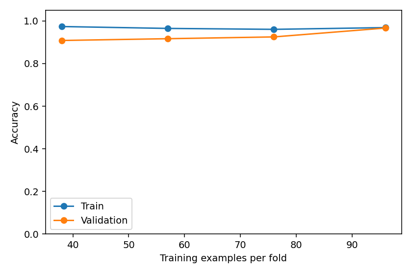

# 10 · เลือก hyperparameter ด้วย CV และ learning curve

[กลับสารบัญ](../../README.md) · [Notebook](lesson.ipynb) · [Python](lesson.py)

เวลาเรียนและทดลองโดยประมาณ: 50–70 นาที  
สิ่งที่จะทำได้: ใช้ GridSearchCV อ่านพารามิเตอร์แบบ step__name และตีความ learning curve อย่างระมัดระวังได้

## ก่อนเริ่มบทนี้

ใช้ KNN/Pipeline จากบท 03 และ 5-fold CV จากบท 08 บทนี้ให้เครื่องลองค่าที่กำหนดอย่างเป็นระบบ แทนการแก้ค่าทีละครั้งแล้วมองคะแนน test

## แยกสิ่งที่เรียนกับสิ่งที่เลือก

Parameter เป็นค่าที่โมเดลเรียน เช่น coefficient ของเส้นตรง ส่วน hyperparameter เป็นการตั้งค่าของวิธีเรียน เช่นจำนวนเพื่อนบ้าน k หรือความลึกสูงสุดของต้นไม้ เราต้องเลือกค่าหลังด้วยข้อมูลที่ไม่ได้ใช้ fit ในรอบนั้น

Grid search ลองทุกชุดค่าที่ระบุ ในบทนี้มี k สามค่าและ weights สองค่า รวม 6 ชุด แต่ละชุดใช้ 5-fold CV จึงมี 30 การฝึกเพื่อเปรียบเทียบและอีกการฝึกเมื่อ refit ชุดที่ชนะ พารามิเตอร์ `knn__n_neighbors` หมายถึง n_neighbors ของ step ชื่อ knn

Scaler ต้องอยู่ภายใน Pipeline ที่ส่งเข้า search เพื่อไม่ให้ validation fold มีอิทธิพลต่อสถิติของ scaler คะแนน best CV ถูกใช้เลือกค่าจึงอาจมองโลกดีเกินไป โดยเฉพาะเมื่อค้นหลายแบบ ต้องมี final test หรือใช้ nested CV หากต้องประเมินกระบวนการเลือกโมเดล

## เมื่อเพิ่มข้อมูลแล้วเกิดอะไรขึ้น

Learning curve เปรียบเทียบคะแนน train กับ validation เมื่อเพิ่มจำนวนข้อมูลฝึก ถ้าสองเส้นต่ำและใกล้กัน ให้ตรวจความสามารถของโมเดลและ feature; ถ้า train สูงกว่า validation มาก ให้พิจารณาการลดความซับซ้อนหรือเพิ่มข้อมูล

กราฟเป็นเครื่องมือวินิจฉัย ไม่ใช่คำรับรองว่าข้อมูลเพิ่มจะช่วยเสมอ บทนี้ใช้ hyperparameter ที่เลือกจาก train มาสร้างกราฟ จึงไม่ถือว่าคะแนนกราฟเป็นการประเมินอิสระอีกชุดหนึ่ง

## อ่านตารางการค้นหาก่อนดูผู้ชนะ

KNN มี `weights="uniform"` ให้เพื่อนบ้านทุกตัวลงคะแนนเท่ากัน และ `weights="distance"` ให้น้ำหนักเพื่อนบ้านที่ใกล้มากกว่า เมื่อลองคู่กับ k=3, 5, 9 จะมีหกทางเลือก `GridSearchCV` fit Pipeline ใหม่ให้แต่ละคู่และแต่ละ fold แล้วเฉลี่ยคะแนน validation

ในตารางผล `mean_test_score` หมายถึงค่าเฉลี่ย **validation ใน CV** ส่วน `std_test_score` คือการกระจายระหว่าง fold ไม่ใช่คะแนน final test ความต่างเล็กน้อยบน Iris ไม่ได้ยืนยันว่าคู่หนึ่งดีกว่าเสมอในงานอื่น

`best_params_` เก็บคู่ที่เลือก `best_score_` เก็บคะแนน CV ของคู่นั้น และ `best_estimator_` เป็น Pipeline ที่ refit ด้วย train ทั้งชุดโดยปริยาย จึงใช้ `search.predict(X_test)` ได้โดยไม่ต้อง fit เองซ้ำ

## แกนของ learning curve บอกอะไร

ข้อมูล train มี 120 แถว แต่ละ CV fold ฝึกได้มากสุด 96 แถว แกนนอนจึงไม่ได้จบที่ 120 เส้นแต่ละจุดเฉลี่ยจากหลาย fold เมื่อเลือกสัดส่วนข้อมูลฝึก 0.4, 0.6, 0.8 และ 1.0

| ลักษณะที่เห็น | สิ่งที่ควรตรวจต่อ |
|---|---|
| train และ validation ต่ำใกล้กัน | feature ให้ข้อมูลพอหรือไม่ โมเดลเรียบง่ายเกินไปหรือไม่ |
| train สูง แต่ validation ต่ำกว่า | overfitting, ขนาดข้อมูล และการจำกัดความซับซ้อน |
| validation สูงขึ้นเมื่อเพิ่มข้อมูล | อาจได้ประโยชน์จากข้อมูลเพิ่มที่เหมาะกับการใช้งาน |

กราฟไม่ได้สร้างข้อมูลใหม่จริงนอกชุดที่มี และไม่พิสูจน์ว่ายิ่งเพิ่มข้อมูลยิ่งดีเสมอ คำว่า **nested CV** ที่กล่าวถึงข้างต้นเป็นวิธีขั้นสูงที่แยกรอบเลือกค่ากับรอบประเมินกระบวนการออกจากกัน รอบแรกใช้ train/CV/test ให้ถูกก่อน

## คัดลอกโค้ดไปรัน

สร้างไฟล์ `.ipynb` ใหม่ คัดลอกโค้ดด้านล่างทั้งชุดลง Code cell แล้วกด **Shift+Enter** ใช้โปรแกรมเดิมที่เรียน Matplotlib ได้เลย ดู [วิธีเริ่มเรียน](../../docs/start-here.md) หากต้องการทำตามทีละขั้น

<!-- CODE:START -->
```python
"""ปรับ hyperparameter ใน CV และดูว่าข้อมูลเพิ่มช่วยหรือไม่"""
# %% GridSearchCV รับ Pipeline ทั้งเส้น
from pathlib import Path

import matplotlib.pyplot as plt
import pandas as pd
from sklearn.datasets import load_iris
from sklearn.metrics import accuracy_score
from sklearn.model_selection import GridSearchCV, StratifiedKFold, learning_curve, train_test_split
from sklearn.neighbors import KNeighborsClassifier
from sklearn.pipeline import Pipeline
from sklearn.preprocessing import StandardScaler

X, y = load_iris(return_X_y=True)
X_train, X_test, y_train, y_test = train_test_split(X, y, test_size=0.2, stratify=y, random_state=42)
cv = StratifiedKFold(5, shuffle=True, random_state=42)
pipeline = Pipeline([("scale", StandardScaler()), ("knn", KNeighborsClassifier())])
search = GridSearchCV(
    pipeline, {"knn__n_neighbors": [3, 5, 9], "knn__weights": ["uniform", "distance"]},
    scoring="accuracy", cv=cv, n_jobs=1,
)
search.fit(X_train, y_train)
results = pd.DataFrame(search.cv_results_)
print(results[["param_knn__n_neighbors", "param_knn__weights",
               "mean_test_score", "std_test_score", "rank_test_score"]]
      .sort_values("rank_test_score").round(3).to_string(index=False))
print("Best parameters:", search.best_params_)
print(f"Best CV accuracy: {search.best_score_:.3f}")

# %% ใช้ learning curve เพื่อวินิจฉัยบน train เท่านั้น
sizes, train_scores, valid_scores = learning_curve(
    search.best_estimator_, X_train, y_train, cv=cv, scoring="accuracy",
    train_sizes=[0.4, 0.6, 0.8, 1.0], shuffle=True, random_state=42,
)
fig, ax = plt.subplots(figsize=(6, 4))
ax.plot(sizes, train_scores.mean(axis=1), "o-", label="Train")
ax.plot(sizes, valid_scores.mean(axis=1), "o-", label="Validation")
ax.set(xlabel="Training examples per fold", ylabel="Accuracy", ylim=(0, 1.05))
ax.legend()
fig.tight_layout()
out = Path("outputs/10-tuning-and-learning-curves")
out.mkdir(parents=True, exist_ok=True)
fig.savefig(out / "learning-curve.png", dpi=140)
plt.show()
plt.close(fig)
print(f"Final test accuracy: {accuracy_score(y_test, search.predict(X_test)):.3f}")
```
<!-- CODE:END -->

## อ่านผลที่ได้

ได้ best parameters, best CV accuracy, learning-curve.png และ test accuracy หลังเลือกค่าแล้ว ค่าทศนิยมอาจต่างเล็กน้อยตามแพลตฟอร์ม

## ภาพตัวอย่างจากการรัน



ภาพนี้สร้างจากโค้ดและ seed ในบท เพื่อช่วยอ่านผลก่อนทดลองด้วยตัวเอง

## แบบฝึกหัด

คำนวณจำนวนการ fit ถ้าเพิ่ม k เป็น 5 ค่า weights 2 ค่าและใช้ 4 folds แล้วอธิบายว่าทำไมไม่ควรเพิ่ม grid ไปเรื่อย ๆ จน test สูง

<details>
<summary>แนวคำตอบ — ลองทำก่อนเปิดอ่าน</summary>

มี 5 × 2 × 4 = 40 fits สำหรับ CV และ refit อีก 1 ครั้ง การเลือกซ้ำจาก test ทำให้ปรับเข้าหาความบังเอิญใน test แทนการวัด generalization

</details>

## อ่านต่อ

- [Handbook: Hyperparameters and Model Validation](https://jakevdp.github.io/PythonDataScienceHandbook/05.03-hyperparameters-and-model-validation.html)
- [Tuning hyperparameters](https://scikit-learn.org/1.7/modules/grid_search.html)
- [Validation and learning curves](https://scikit-learn.org/1.7/modules/learning_curve.html)

