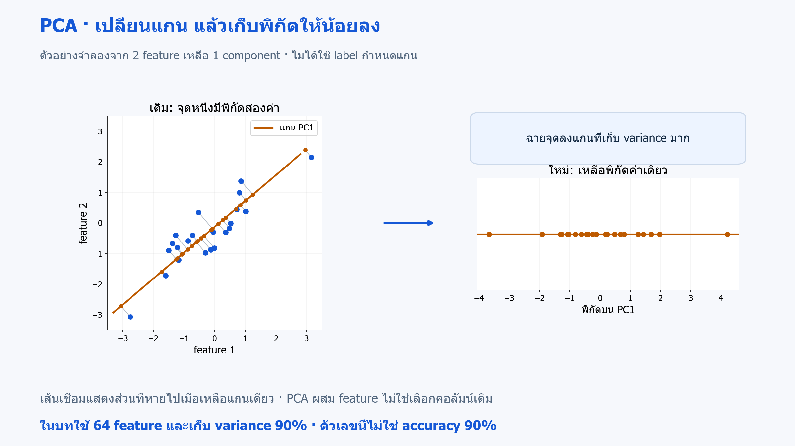
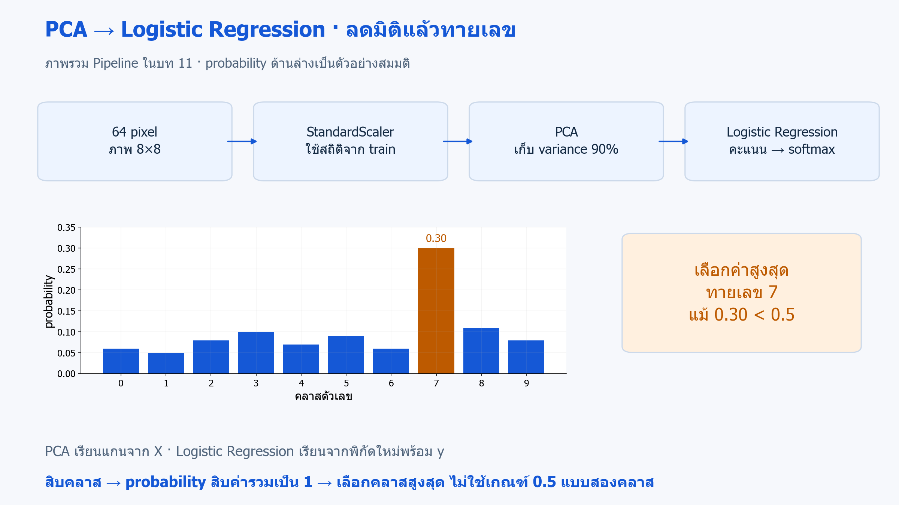
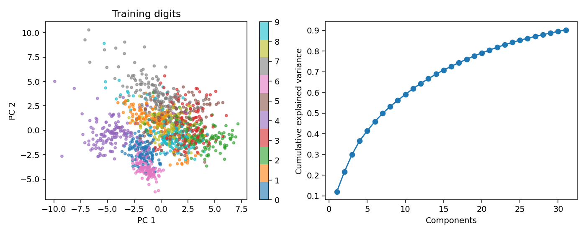

# 11 · PCA และ Logistic Regression: ลดมิติก่อนจำแนกภาพตัวเลข

[กลับสารบัญ](../../README.md) · [Notebook](lesson.ipynb) · [Python](lesson.py)

บทนี้ใช้ **PCA** ลดจำนวน feature ก่อนจำแนกภาพตัวเลข 8×8

**ใช้สิ่งที่เรียนแล้ว:** variance จาก NumPy, scaling/Pipeline และการเลือกค่าด้วย CV

## ใจความใหม่

### PCA คืออะไร

**PCA ย่อมาจาก Principal Component Analysis — การวิเคราะห์องค์ประกอบหลัก** เป็นวิธี **Unsupervised Learning สำหรับลดมิติ** เรียนจาก X โดยไม่ใช้ label y

PCA สร้างแกนใหม่ที่ผสม feature เดิม เพื่อเก็บความแปรปรวนให้มาก แกนใหม่นี้เรียกว่า **principal component** หรือองค์ประกอบหลัก

**หลักการทำงาน:**

1. จัดข้อมูลให้อยู่รอบค่าเฉลี่ย แล้วหาแกนแรกที่ข้อมูลกระจายมากที่สุด
2. หาแกนถัดไปที่ตั้งฉากกับแกนก่อนหน้าและเก็บความแปรปรวนที่เหลือให้มาก
3. เก็บบางแกน แล้วฉายข้อมูลลงบนแกนเหล่านั้นเพื่อให้แต่ละตัวอย่างมีพิกัดน้อยลง



**อ่านภาพ:** จุดน้ำเงินมีพิกัดเดิมสองค่า เมื่อฉายลงแกนสีส้มจะเหลือพิกัด PC1 ค่าเดียว เส้นเชื่อมแสดงส่วนที่ตัดออก; ภาพสมมติลด 2 มิติเหลือ 1 ส่วนโค้ดเริ่มจาก 64 feature · [เปิดภาพ SVG](../../assets/figures/11-principal-components-projection.svg)

ตัวอย่าง: ส่วนสูงกับความยาวแขนที่เพิ่มไปด้วยกันอาจสรุปได้ด้วยแกนหลักเดียว วิธีนี้จึงต่างจากการเลือกคอลัมน์เดิมบางคอลัมน์

- **จุดเด่น:** ลดจำนวน feature ที่ส่งต่อให้โมเดล และรวมข้อมูลที่สัมพันธ์กันไว้ในแกนจำนวนน้อยลงได้
- **ข้อจำกัด:** จับการเปลี่ยนรูปเชิงเส้น แกนใหม่อธิบายความหมายยากกว่าคอลัมน์เดิม และข้อมูลที่ตัดทิ้งอาจมีประโยชน์ต่อการทำนาย

PCA หาแกนจาก X โดยไม่ใช้ y ดังนั้น **เก็บ variance 90% ไม่ได้แปลว่า accuracy 90%** เพราะสิ่งที่กระจายมากอาจไม่ช่วยแยกคลาส

### PCA ใน Pipeline ของบทนี้

โค้ดใช้ `StandardScaler → PCA → LogisticRegression` โดยมีรายละเอียดดังนี้:

- **ข้อมูลเข้า:** ภาพ 8×8 มี 64 pixel จึงเริ่มด้วย 64 feature
- **`n_components=0.9`:** เลือกจำนวนแกนให้เก็บ variance สะสมตามเกณฑ์ 90% ของ train
- **การปรับสเกล:** PCA center ข้อมูล แต่ไม่ scale ให้เอง การใส่ scaler เป็นทางเลือกของตัวอย่างนี้
- **ข้อมูลใหม่:** ใช้ scaler และแกน PCA ที่ fit ไว้แล้ว ห้าม fit แกนใหม่บน test

**`explained_variance_ratio_`:** สัดส่วน variance ของแต่ละแกน เช่น 0.5, 0.3 และ 0.1 รวมกันเป็น 0.9

หากจะเปรียบเทียบหลายระดับของ variance ที่เก็บ ให้เลือกด้วย CV

## Logistic Regression: ผู้ทำนายหลังลดมิติ

**PCA** เรียนแกนใหม่จาก X และส่งคืนพิกัดที่มีมิติน้อยลง ส่วน **Logistic Regression** เรียนจากพิกัดเหล่านั้นพร้อม y เพื่อทายเลข 0–9 ทบทวนแนวคิดโมเดลใน [บท 04](../04-validation-and-metrics/README.md)

ต่างจากกรณีสองคลาสในบท 04 ตัวแก้ปัญหาเริ่มต้นที่ใช้กับสิบคลาสนี้เรียนแบบ **multinomial logistic regression**: คำนวณคะแนนให้แต่ละคลาส แล้วใช้ **softmax** แปลงเป็น probability สิบค่าที่รวมกันเป็น 1 และเลือกคลาสที่ได้ค่าสูงสุด จึงไม่ใช้เกณฑ์ 0.5 ตัดสินทุกคลาส

**ตัวอย่างสมมติ:** ถ้าความน่าจะเป็นสูงสุดคือเลข 7 ที่ 0.30 ก็เลือกเลข 7 แม้ค่านั้นยังไม่ถึง 0.5



**อ่านภาพ:** PCA คืนพิกัดใหม่ แล้ว Logistic Regression แปลงคะแนนเป็น probability สิบค่าด้วย softmax แท่งสูงสุดคือคำตอบที่เลือก; ตัวเลขในกราฟเป็นตัวอย่างสมมติ ไม่ใช่ผล test · [เปิดภาพ SVG](../../assets/figures/11-principal-components-classifier.svg)

PCA อาจลดข้อมูลรบกวนและจำนวน feature แต่ก็อาจตัดข้อมูลที่ช่วยแยกเลขออกไป ต้องอ่าน accuracy จาก Logistic Regression หลังแปลงข้อมูลด้วย ค่า variance ที่ PCA เก็บไว้ไม่ใช่คะแนนจำแนก

## ลงมือทำ

สร้าง Notebook ใหม่แล้วรัน **Cell 1–2 ตามลำดับ** หรือเปิด [Notebook ของบทนี้](lesson.ipynb) ใช้ kernel เดิมได้เลย อ่านคำอธิบายใต้โค้ดแต่ละช่วงประกอบผลที่ได้

<!-- CODE:CELLS -->

<!-- CODE:START -->
### Cell 1 — ฝึก Pipeline ที่มี PCA

```python
from pathlib import Path

import matplotlib.pyplot as plt
import numpy as np
from sklearn.datasets import load_digits
from sklearn.decomposition import PCA
from sklearn.linear_model import LogisticRegression
from sklearn.metrics import accuracy_score
from sklearn.model_selection import train_test_split
from sklearn.pipeline import Pipeline
from sklearn.preprocessing import StandardScaler

X, y = load_digits(return_X_y=True)
X_train, X_test, y_train, y_test = train_test_split(X, y, stratify=y, random_state=42)
model = Pipeline([
    ("scale", StandardScaler()),
    ("pca", PCA(n_components=0.9, svd_solver="full")),
    ("classifier", LogisticRegression(max_iter=2000)),
])
model.fit(X_train, y_train)
pca = model.named_steps["pca"]
print("Original features:", X.shape[1], "Retained components:", pca.n_components_)
print("Retained variance:", round(pca.explained_variance_ratio_.sum(), 3))
print(f"Test accuracy: {accuracy_score(y_test, model.predict(X_test)):.3f}")
```

**อ่านโค้ด**

- `load_digits(return_X_y=True)` คืนภาพที่คลี่เป็น 64 feature ต่อแถว พร้อม label ตัวเลข 0–9
- Pipeline ทำ `scale → pca → classifier` ตามลำดับ โดย `fit` เรียนทุกขั้นจาก train เท่านั้น
- `PCA(n_components=0.9, svd_solver="full")` เลือกจำนวนแกนตามเกณฑ์ variance 90% ไม่ใช่เลือก 0.9 แกน
- `model.named_steps["pca"]` ดึง PCA ที่ fit แล้วออกมาอ่านผล ส่วน `pca.n_components_` คือจำนวนแกนที่เลือกได้จริง
- `explained_variance_ratio_.sum()` รวมสัดส่วน variance ที่เก็บไว้ ขณะที่ accuracy คำนวณจากคำทำนายของ Pipeline ทั้งชุด
- `max_iter=2000` ตั้งเพดานรอบให้ตัวแก้ปัญหาของ Logistic Regression ไม่ใช่จำนวน component ของ PCA

### Cell 2 — อ่านพิกัดใหม่และ variance สะสม

```python
Z_train = model[:-1].transform(X_train)
fig, axes = plt.subplots(1, 2, figsize=(10, 4))
points = axes[0].scatter(Z_train[:, 0], Z_train[:, 1], c=y_train, cmap="tab10", s=9, alpha=0.6)
axes[0].set(xlabel="PC 1", ylabel="PC 2", title="Training digits")
fig.colorbar(points, ax=axes[0], ticks=range(10))
axes[1].plot(np.arange(1, pca.n_components_ + 1), np.cumsum(pca.explained_variance_ratio_), "o-")
axes[1].set(xlabel="Components", ylabel="Cumulative explained variance")
fig.tight_layout()
out = Path("outputs/11-principal-components")
out.mkdir(parents=True, exist_ok=True)
fig.savefig(out / "pca.png", dpi=140)
plt.show()
plt.close(fig)
```

**อ่านโค้ด**

- `model[:-1]` เลือกทุกขั้นก่อน classifier จึงเหลือ scaler กับ PCA
- `transform(X_train)` ใช้สถิติและแกนเดิมแปลงข้อมูลเป็น `Z_train` โดยไม่ fit ใหม่
- `Z_train[:, 0]` และ `Z_train[:, 1]` เลือกเพียงสอง component แรกมาวาด แต่ classifier ใช้ทุก component ที่เก็บไว้
- `np.cumsum(pca.explained_variance_ratio_)` หาผลรวมสะสมทีละแกน เพื่อดูว่าเพิ่มแกนแล้วเก็บ variance ได้เท่าไร
- `np.arange(1, pca.n_components_ + 1)` สร้างแกนนอนให้เริ่มนับ component จาก 1
<!-- CODE:END -->

## อ่านผล

จำนวน component เหลือน้อยกว่า 64 และ variance รวมผ่านเกณฑ์ 0.9

- **กราฟซ้าย:** แสดงเพียงสองแกนแรกจาก `model[:-1].transform(X_train)`
- **Classifier:** ใช้ทุกแกนที่เก็บไว้

จึงตัดสินความสามารถของทั้งระบบจากภาพสองมิติเพียงอย่างเดียวไม่ได้



## แบบฝึกท้ายบท

**ลองทำ:** เปรียบเทียบไม่มี PCA กับเก็บ variance 0.8, 0.9, 0.95

<details>
<summary>ดูแนวคำตอบ</summary>

**แนวคำตอบ:** ใช้ CV บน train เพื่อเปรียบเทียบสองกรณี:

- ไม่มี PCA: เปลี่ยนขั้น PCA เป็น `passthrough`
- มี PCA: ปรับ `pca__n_components` เป็นค่าที่ต้องการลอง

วัดทั้งคะแนนและเวลา เพราะการลดมิติไม่รับประกันว่าจะเร็วหรือแม่นขึ้น

</details>

## อ้างอิง

- [Logistic Regression แบบหลายคลาส](https://scikit-learn.org/1.7/modules/linear_model.html#multinomial-case)
- [Handbook: PCA](https://jakevdp.github.io/PythonDataScienceHandbook/05.09-principal-component-analysis.html)
- [scikit-learn: PCA](https://scikit-learn.org/1.7/modules/decomposition.html#pca)
