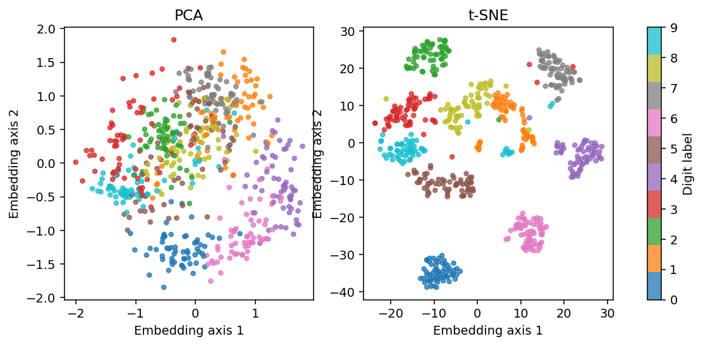

# 12 · Manifold Learning และการอ่านภาพ t-SNE

[กลับสารบัญ](../../README.md) · [Notebook](lesson.ipynb) · [Python](lesson.py)

บทนี้เปรียบเทียบภาพ **PCA กับ t-SNE** เพื่อสำรวจข้อมูลหลายมิติ

**ใช้สิ่งที่เรียนแล้ว:** PCA จากบท 11 และ scatter/colorbar จาก Matplotlib

## ใจความใหม่

- **Manifold:** โครงสร้างที่อธิบายได้ด้วยพิกัดน้อยกว่าจำนวน feature เช่น กระดาษสองมิติที่ม้วนอยู่ในพื้นที่สามมิติ
- **Embedding:** ตำแหน่งใหม่ที่ใช้แทนแต่ละตัวอย่าง
- **t-SNE:** จัดพิกัดโดยเน้นความสัมพันธ์ของเพื่อนบ้านใกล้กัน ส่วน PCA หาแกนเชิงเส้นเพื่อเก็บ variance

**Perplexity:** ควบคุมขอบเขตเพื่อนบ้านของ t-SNE โดยประมาณ ค่าต้องน้อยกว่าจำนวนตัวอย่าง และไม่ได้หมายถึงจำนวนกลุ่ม

โค้ดสุ่ม 600 ภาพมาแปลงเป็นพิกัด `(600, 2)` เพื่อสำรวจข้อมูล โดยไม่มีการวัด train/test accuracy

สีของจุดมาจาก label เดิมเพื่อช่วยอ่านภาพ แต่ไม่ได้ส่ง y เข้า `fit_transform`

| สิ่งที่เห็น | ตีความอย่างไร |
|---|---|
| จุดใกล้กัน | ตรวจความคล้ายในข้อมูลต้นฉบับประกอบ |
| ระยะระหว่างเกาะ ขนาดเกาะ ทิศแกน | ไม่อ่านเป็นระยะ ขนาดกลุ่ม หรือความหมายจริงโดยตรง |
| เกาะแยกชัด | ยังไม่พิสูจน์จำนวนคลาสจริงหรือความแม่นยำ |

**Trustworthiness:** วัดว่า embedding ทำให้เกิดเพื่อนบ้านใกล้ที่ผิดไปจากข้อมูลเดิมมากเพียงใด

ค่าสูงใกล้ 1 ดีกว่าตามเกณฑ์นี้ แต่ไม่ใช่ accuracy และไม่รับรองระยะไกลทั้งหมด

**ข้อจำกัดของโค้ด:** `TSNE` ใน scikit-learn ไม่มี `transform` สำหรับจุดใหม่แบบ PCA บทนี้จึงใช้สำรวจข้อมูล ไม่ใช่ทำนายภาพใหม่

## ลงมือทำ

สร้าง Notebook ใหม่แล้วรัน **Cell 1–2 ตามลำดับ** หรือเปิด [Notebook ของบทนี้](lesson.ipynb) ใช้ kernel เดิมได้เลย อ่านคำอธิบายใต้โค้ดแต่ละช่วงประกอบผลที่ได้

<!-- CODE:CELLS -->

<!-- CODE:START -->
### Cell 1 — เลือกภาพตัวอย่างและสร้าง embedding

```python
from pathlib import Path

import matplotlib.pyplot as plt
from sklearn.datasets import load_digits
from sklearn.decomposition import PCA
from sklearn.manifold import TSNE, trustworthiness
from sklearn.model_selection import train_test_split

X_all, y_all = load_digits(return_X_y=True)
X, _, y, _ = train_test_split(X_all, y_all, train_size=600, stratify=y_all, random_state=42)
X = X / 16.0  # ขอบเขต pixel 0..16 เป็นที่ทราบจากนิยามชุดข้อมูล
Z_pca = PCA(n_components=2).fit_transform(X)
Z_tsne = TSNE(
    n_components=2, perplexity=30, init="pca", learning_rate="auto",
    max_iter=750, random_state=42,
).fit_transform(X)
print(f"PCA neighborhood trustworthiness: {trustworthiness(X, Z_pca, n_neighbors=10):.3f}")
print(f"t-SNE neighborhood trustworthiness: {trustworthiness(X, Z_tsne, n_neighbors=10):.3f}")
```

**อ่านโค้ด**

- `train_test_split(..., train_size=600, stratify=y_all)` ใช้เลือกตัวอย่าง 600 ภาพโดยรักษาสัดส่วนตัวเลข ส่วน `_` รับค่าที่ไม่ใช้ต่อ ครั้งนี้ไม่ได้แบ่งเพื่อวัด test accuracy
- `X / 16.0` ปรับค่าพิกเซลจากช่วง 0–16 เป็น 0–1 โดยใช้ขอบเขตที่ทราบจากนิยามชุดข้อมูล
- `fit_transform(X)` เรียนพิกัดใหม่แล้วแปลงภาพชุดนี้ทันที ทั้ง PCA และ t-SNE คืนสองคอลัมน์ตาม `n_components=2`
- `perplexity=30` ตั้งขอบเขตเพื่อนบ้านโดยประมาณ ส่วน `init="pca"` ใช้พิกัด PCA เป็นจุดเริ่ม และ `max_iter=750` ตั้งจำนวนรอบสูงสุดของการปรับพิกัด
- `learning_rate="auto"` ให้ t-SNE เลือกขนาดก้าวตามวิธีของไลบรารี ส่วน `random_state=42` ช่วยให้ทำซ้ำได้
- `trustworthiness(X, Z, n_neighbors=10)` เทียบเพื่อนบ้านสิบตัวในข้อมูลเดิมกับพิกัดใหม่ โดยไม่ได้ใช้ y คำนวณ

### Cell 2 — เปรียบเทียบภาพสองวิธี

```python
fig, axes = plt.subplots(1, 2, figsize=(10, 4))
for ax, Z, title in zip(axes, (Z_pca, Z_tsne), ("PCA", "t-SNE")):
    points = ax.scatter(Z[:, 0], Z[:, 1], c=y, cmap="tab10", s=12, alpha=0.75)
    ax.set(title=title, xlabel="Embedding axis 1", ylabel="Embedding axis 2")
fig.colorbar(points, ax=axes.ravel().tolist(), ticks=range(10), label="Digit label")
out = Path("outputs/12-manifold-learning")
out.mkdir(parents=True, exist_ok=True)
fig.savefig(out / "embeddings.png", dpi=140, bbox_inches="tight")
plt.show()
plt.close(fig)
```

**อ่านโค้ด**

- `zip(axes, (Z_pca, Z_tsne), ("PCA", "t-SNE"))` จับคู่แต่ละช่องกราฟกับพิกัดและชื่อวิธีที่ตรงกัน
- `Z[:, 0]` และ `Z[:, 1]` คือแกน embedding ส่วน `c=y` ใส่สีจาก label เพื่อช่วยตรวจการปนกันของตัวเลข
- `axes.ravel().tolist()` รวมช่องกราฟเป็นรายการสำหรับวาง colorbar ร่วมกัน
- `bbox_inches="tight"` ช่วยให้การบันทึกภาพครอบคลุมองค์ประกอบรอบกราฟ เช่น colorbar

ตำแหน่งซ้าย/ขวาของกลุ่มใน t-SNE ไม่ใช่ลำดับหรือความหมายของตัวเลข
<!-- CODE:END -->

## อ่านผล

ได้ภาพ PCA และ t-SNE พร้อมค่า trustworthiness ของแต่ละวิธี

ผล t-SNE อาจเปลี่ยนตาม seed และ perplexity

ไฟล์ภาพ: `outputs/12-manifold-learning/embeddings.png`



<details>
<summary>ฝึกต่อพร้อมแนวคำตอบ</summary>

**ลองทำ:** เปลี่ยน perplexity เป็น 10 และ 50 โดยใช้ 600 ภาพชุดเดิม

**แนวคำตอบ:** เปรียบเทียบสมาชิกเพื่อนบ้านและการปนของ label แล้วตรวจข้อมูลต้นฉบับประกอบ

ไม่เลือกจากภาพเกาะที่ดูสวยที่สุด และไม่ตั้งชื่อกลุ่มจากตำแหน่งซ้ายหรือขวาเพียงอย่างเดียว

</details>

## อ้างอิง

- [Handbook: Manifold Learning](https://jakevdp.github.io/PythonDataScienceHandbook/05.10-manifold-learning.html)
- [scikit-learn: Manifold learning](https://scikit-learn.org/1.7/modules/manifold.html#t-sne)
