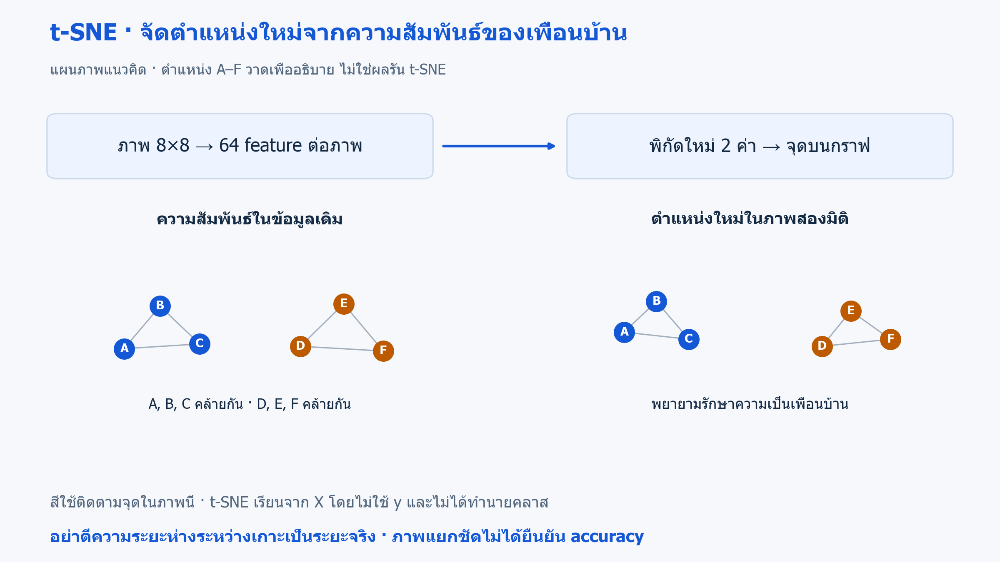

# 12 · PCA และ t-SNE: ลดมิติเพื่อสำรวจข้อมูล

[กลับสารบัญ](../../README.md) · [Notebook](lesson.ipynb) · [Python](lesson.py)

บทนี้เลือกภาพตัวเลข 600 ภาพ แต่ละภาพมี 64 feature แล้วใช้ **PCA กับ t-SNE** สร้างพิกัดสองค่าเพื่อวาด scatter plot ผลที่ได้เป็นตำแหน่งจุด ไม่ใช่คำทำนายเลข

**ใช้สิ่งที่เรียนแล้ว:** PCA จากบท 11 และ scatter/colorbar จาก Matplotlib

## วิธีที่ใช้เปรียบเทียบ: PCA และ t-SNE

**PCA** จาก [บท 11](../11-principal-components/README.md) สร้างแกนใหม่จากผลรวมของ feature เดิมและเลือกแกนที่ข้อมูลกระจายมาก ส่วน **t-SNE** พยายามให้ภาพที่คล้ายกันในข้อมูลเดิมยังเป็นเพื่อนบ้านใกล้กันเมื่อวาดกราฟ ทั้งสองวิธีรับ 64 feature ต่อภาพ แล้วคืนพิกัดสองค่า

ทั้งสองวิธีในบทนี้เรียนจากข้อมูลภาพใน `X` โดยไม่ใช้ `y` ส่วนเลขที่กำกับแต่ละภาพใน y (class labels) ใช้กำหนดสีของจุดหลังแปลงข้อมูลแล้ว ผลลัพธ์เป็นพิกัดสำหรับสำรวจ ไม่ใช่คำทำนายเลข 0–9

## ใจความใหม่

- **Manifold:** โครงสร้างที่อธิบายตำแหน่งภายในได้ด้วยพิกัดจำนวนน้อย เช่น กระดาษที่ม้วนอยู่ในพื้นที่สามมิติ แต่ยังบอกตำแหน่งบนแผ่นได้ด้วยสองพิกัด แนวคิดนี้ช่วยอธิบายว่าข้อมูลหลาย feature อาจมีโครงสร้างที่เรียบง่ายกว่าจำนวนคอลัมน์
- **Embedding:** พิกัดใหม่ที่ใช้แทนแต่ละตัวอย่าง บทนี้คือสองตัวเลขที่ใช้วางหนึ่งภาพลงเป็นหนึ่งจุดบนกราฟ
### t-SNE คืออะไร

**t-SNE ย่อมาจาก t-distributed Stochastic Neighbor Embedding** เป็นวิธีลดมิติแบบไม่เป็นเชิงเส้นในกลุ่ม **Unsupervised Learning** ใช้สำรวจข้อมูลเป็นภาพ โดยบทนี้ลดเหลือสองมิติ

**หลักการ:** คำนวณความคล้ายระหว่างตัวอย่างในข้อมูลเดิม แล้วปรับตำแหน่งในภาพสองมิติให้ความสัมพันธ์ของเพื่อนบ้านใกล้กันสอดคล้องกับข้อมูลเดิม ส่วน PCA หาแกนเชิงเส้นเพื่อเก็บ variance

**ตัวอย่างในบท:** ภาพตัวเลขหนึ่งภาพมีค่า pixel 64 ค่า t-SNE แทนภาพนั้นด้วยพิกัดสองค่า จึงวาดเป็นหนึ่งจุดใน scatter plot ได้ โดยไม่ได้ทำนายว่าภาพนั้นเป็นเลขอะไร



**อ่านภาพ:** A–C และ D–F เป็นตัวอย่างที่คล้ายกันในข้อมูลเดิม ภาพแสดงแนวคิดการรักษาเพื่อนบ้าน ไม่ใช่ตำแหน่งที่รัน t-SNE ได้จริง; เทียบกับ [ภาพการฉายแกน PCA](../../assets/figures/11-principal-components-projection.png) จากบท 11 · [เปิดภาพ SVG](../../assets/figures/12-manifold-learning-neighbors.svg)

- **จุดเด่น:** ช่วยสำรวจโครงสร้างของเพื่อนบ้านในข้อมูลหลายมิติ ซึ่งอาจมองไม่เห็นจากการเลือกสองคอลัมน์เดิม
- **ข้อจำกัด:** ภาพอาจเปลี่ยนตาม seed และการตั้งค่า ใช้เวลาเพิ่มเมื่อข้อมูลมาก และระยะไกลในภาพอาจไม่สะท้อนระยะในข้อมูลเดิม

### อ่านภาพและตรวจเพื่อนบ้าน

**Perplexity:** การตั้งค่าว่า t-SNE จะพิจารณาเพื่อนบ้านใกล้ ๆ ของแต่ละจุดกว้างเพียงใด ค่ามากขึ้นให้ความสำคัญกับเพื่อนบ้านจำนวนมากขึ้นโดยประมาณ เช่น ค่า 30 ไม่ได้บังคับว่ามีเพื่อนบ้านพอดี 30 จุดหรือมี 30 กลุ่ม และต้องตั้งค่าน้อยกว่าจำนวนตัวอย่าง

หนึ่งภาพจะกลายเป็นหนึ่งจุด เราจึงอ่านความสัมพันธ์ของจุดจากกราฟ โดยไม่มีการวัด train/test accuracy

สีของจุดบอกว่าแต่ละภาพเป็นเลขใดตามข้อมูลเดิม เพื่อช่วยอ่านกราฟ โดยไม่ได้ส่ง `y` เข้า `fit_transform`

| สิ่งที่เห็น | ตีความอย่างไร |
|---|---|
| จุดใกล้กัน | ตรวจความคล้ายในข้อมูลต้นฉบับประกอบ |
| ระยะระหว่างเกาะ ขนาดเกาะ ทิศแกน | ไม่อ่านเป็นระยะ ขนาดกลุ่ม หรือความหมายจริงโดยตรง |
| เกาะแยกชัด | ยังไม่พิสูจน์จำนวนคลาสจริงหรือความแม่นยำ |

**Trustworthiness:** ตรวจว่าจุดที่ดูใกล้กันในกราฟใหม่เคยใกล้กันในข้อมูลเดิมด้วยหรือไม่ หากจุดที่เดิมอยู่ไกลถูกดึงมาเป็นเพื่อนบ้านใกล้ คะแนนจะลดลง

ค่า **trustworthiness** ยิ่งใกล้ 1 ยิ่งแสดงว่าเพื่อนบ้านในกราฟใหม่สอดคล้องกับข้อมูลเดิมได้ดี คะแนน trustworthiness ไม่ใช่ accuracy ของการจำแนกประเภท และไม่ได้ยืนยันว่าระยะระหว่างจุดที่อยู่ไกลกันในกราฟถูกต้องทั้งหมด

**ข้อจำกัดของโค้ด:** `TSNE` ใน scikit-learn ไม่มี `transform` สำหรับจุดใหม่แบบ PCA บทนี้จึงใช้สำรวจข้อมูล ไม่ใช่ทำนายภาพใหม่

## ลงมือทำ

สร้าง Notebook ใหม่แล้วรัน **Cell 1–2 ตามลำดับ** หรือเปิด [Notebook ของบทนี้](lesson.ipynb) ใช้ kernel เดิมได้เลย อ่านคำอธิบายใต้โค้ดแต่ละช่วงประกอบผลที่ได้

<!-- CODE:CELLS -->

<!-- CODE:START -->
### Cell 1 — เลือกภาพตัวอย่างและสร้าง embedding

```python
from pathlib import Path

import matplotlib.pyplot as plt
from sklearn.datasets import load_digits
from sklearn.decomposition import PCA
from sklearn.manifold import TSNE, trustworthiness
from sklearn.model_selection import train_test_split

X_all, y_all = load_digits(return_X_y=True)
X, _, y, _ = train_test_split(X_all, y_all, train_size=600, stratify=y_all, random_state=42)
X = X / 16.0  # ขอบเขต pixel 0..16 เป็นที่ทราบจากนิยามชุดข้อมูล
Z_pca = PCA(n_components=2).fit_transform(X)
Z_tsne = TSNE(
    n_components=2, perplexity=30, init="pca", learning_rate="auto",
    max_iter=750, random_state=42,
).fit_transform(X)
print(f"PCA neighborhood trustworthiness: {trustworthiness(X, Z_pca, n_neighbors=10):.3f}")
print(f"t-SNE neighborhood trustworthiness: {trustworthiness(X, Z_tsne, n_neighbors=10):.3f}")
```

**อ่านโค้ด**

- `train_test_split(..., train_size=600, stratify=y_all)` ใช้เลือกตัวอย่าง 600 ภาพโดยรักษาสัดส่วนตัวเลข ส่วน `_` รับค่าที่ไม่ใช้ต่อ ครั้งนี้ไม่ได้แบ่งเพื่อวัด test accuracy
- `X / 16.0` ปรับค่าพิกเซลจากช่วง 0–16 เป็น 0–1 โดยใช้ขอบเขตที่ทราบจากนิยามชุดข้อมูล
- `fit_transform(X)` เรียนพิกัดใหม่แล้วแปลงภาพชุดนี้ทันที ทั้ง PCA และ t-SNE คืนสองคอลัมน์ตาม `n_components=2`
- `perplexity=30` กำหนดระดับการพิจารณาเพื่อนบ้านใกล้ ๆ ไม่ใช่จำนวนกลุ่ม ส่วน `init="pca"` ใช้พิกัดจาก PCA เป็นจุดเริ่ม และ `max_iter=750` ให้ปรับตำแหน่งได้สูงสุด 750 รอบ
- `learning_rate="auto"` ให้ t-SNE เลือกขนาดก้าวตามวิธีของไลบรารี ส่วน `random_state=42` ช่วยให้ทำซ้ำได้
- `trustworthiness(X, Z, n_neighbors=10)` เทียบเพื่อนบ้านสิบตัวในข้อมูลเดิมกับพิกัดใหม่ โดยไม่ได้ใช้ y คำนวณ

**รูปของผลลัพธ์:** `Z_pca` และ `Z_tsne` มีขนาด `(600, 2)` คือพิกัดสองค่าของ 600 ภาพ ค่า trustworthiness ที่พิมพ์ประเมินความสอดคล้องของเพื่อนบ้าน ไม่ใช่สัดส่วนภาพที่จำแนกถูก

### Cell 2 — เปรียบเทียบภาพสองวิธี

```python
fig, axes = plt.subplots(1, 2, figsize=(10, 4))
for ax, Z, title in zip(axes, (Z_pca, Z_tsne), ("PCA", "t-SNE")):
    points = ax.scatter(Z[:, 0], Z[:, 1], c=y, cmap="tab10", s=12, alpha=0.75)
    ax.set(title=title, xlabel="Embedding axis 1", ylabel="Embedding axis 2")
fig.colorbar(points, ax=axes.ravel().tolist(), ticks=range(10), label="Digit label")
out = Path("outputs/12-manifold-learning")
out.mkdir(parents=True, exist_ok=True)
fig.savefig(out / "embeddings.png", dpi=140, bbox_inches="tight")
plt.show()
plt.close(fig)
```

**อ่านโค้ด**

- `zip(axes, (Z_pca, Z_tsne), ("PCA", "t-SNE"))` จับคู่แต่ละช่องกราฟกับพิกัดและชื่อวิธีที่ตรงกัน
- `Z[:, 0]` และ `Z[:, 1]` คือแกน embedding ส่วน `c=y` กำหนดสีจากเลขที่กำกับแต่ละภาพ เพื่อดูว่าจุดของภาพเลขต่างชนิดปนกันหรือไม่
- `axes.ravel().tolist()` รวมช่องกราฟเป็นรายการสำหรับวาง colorbar ร่วมกัน
- `bbox_inches="tight"` ช่วยให้การบันทึกภาพครอบคลุมองค์ประกอบรอบกราฟ เช่น colorbar

ตำแหน่งซ้าย/ขวาของกลุ่มใน t-SNE ไม่ใช่ลำดับหรือความหมายของตัวเลข
<!-- CODE:END -->

## อ่านผล

ได้ภาพ PCA และ t-SNE พร้อมค่า trustworthiness ของแต่ละวิธี

ผล t-SNE อาจเปลี่ยนตาม seed และ perplexity

ไฟล์ภาพ: `outputs/12-manifold-learning/embeddings.png`


## แบบฝึกท้ายบท

**ลองทำ:** เปลี่ยน perplexity เป็น 10 และ 50 โดยใช้ 600 ภาพชุดเดิม

<details>
<summary>ดูแนวคำตอบ</summary>

**แนวคำตอบ:** เปรียบเทียบว่าจุดใดเป็นเพื่อนบ้านกัน และดูว่าภาพเลขต่างชนิดปนกันหรือไม่ แล้วตรวจภาพต้นฉบับประกอบ

ไม่เลือกจากภาพเกาะที่ดูสวยที่สุด และไม่ตั้งชื่อกลุ่มจากตำแหน่งซ้ายหรือขวาเพียงอย่างเดียว

</details>

## อ้างอิง

- [Handbook: Manifold Learning](https://jakevdp.github.io/PythonDataScienceHandbook/05.10-manifold-learning.html)
- [scikit-learn: Manifold learning](https://scikit-learn.org/1.7/modules/manifold.html#t-sne)
- [scikit-learn: เกณฑ์คำนวณ trustworthiness](https://scikit-learn.org/1.7/modules/generated/sklearn.manifold.trustworthiness.html)
