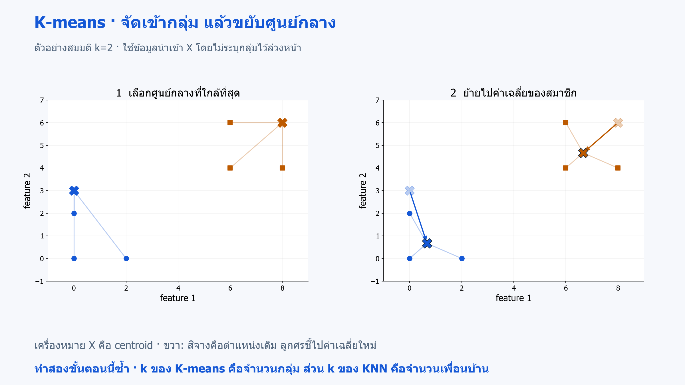
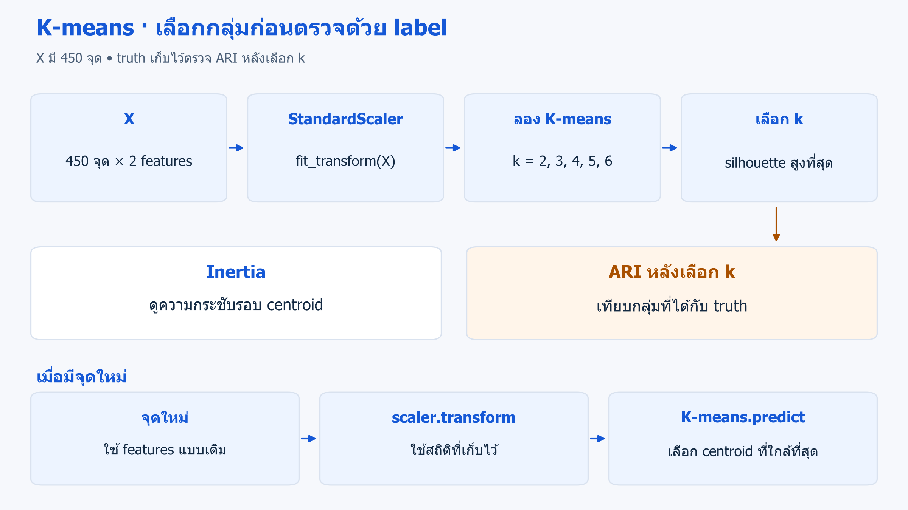
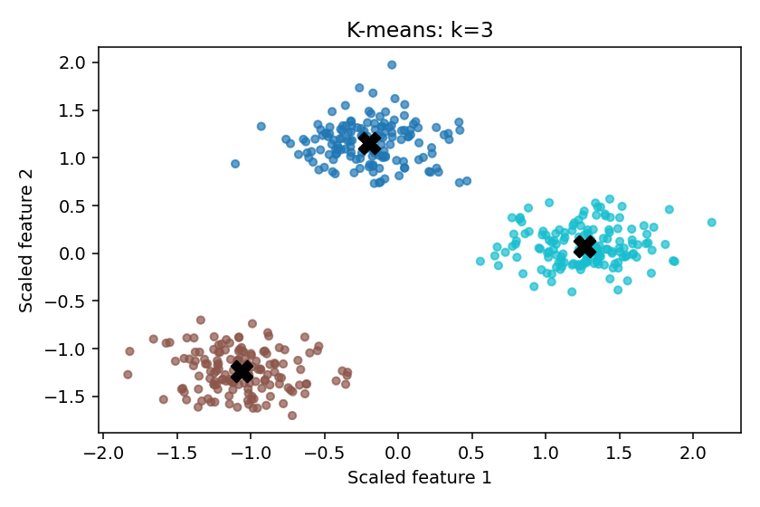

# 13 · K-means: ค้นกลุ่มโดยไม่มี label

[กลับสารบัญ](../../README.md) · [Notebook](lesson.ipynb) · [Python](lesson.py)

บทนี้ใช้ **K-means** รับจุดข้อมูลสองมิติ 450 จุด แล้วคืนหมายเลขกลุ่มให้แต่ละจุด โดยไม่ใช้ประเภทที่กำกับไว้ (class labels) ฝึกหรือเลือกจำนวนกลุ่ม หมายเลขที่ได้เป็นรหัสกลุ่มที่ K-means กำหนดขึ้น ไม่ใช่คลาสที่รู้ล่วงหน้า

**ใช้สิ่งที่เรียนแล้ว:** ระยะทางและ scaling จากบท 03

จำชื่อให้แยกกัน: **KNN** ใช้ k เพื่อนบ้านทายคลาสหรือตัวเลข ส่วน **K-means** ใช้ k ศูนย์กลางค้นกลุ่ม

## ใจความใหม่

### K-means คืออะไร

**K-means** เป็นอัลกอริทึม **Unsupervised Learning สำหรับ Clustering — การจัดกลุ่ม** ค้นกลุ่มจากความคล้ายกันของข้อมูลนำเข้า `X` โดยไม่ต้องระบุล่วงหน้าว่าแต่ละแถวอยู่กลุ่มใด

ชื่อ K-means สื่อถึงศูนย์กลาง `k` จุดที่คำนวณจากค่าเฉลี่ยของสมาชิก ตัวอย่างการใช้งานคือสำรวจลูกค้าที่มีพฤติกรรมใกล้กัน ก่อนนำแต่ละกลุ่มไปตีความทางธุรกิจ

**หลักการ:** กำหนดจำนวนกลุ่มและตำแหน่งศูนย์กลางเริ่มต้น แล้วทำซ้ำสองขั้นตอนจนตำแหน่งศูนย์กลางเปลี่ยนน้อยจนถึงเกณฑ์หยุด หรือครบจำนวนรอบที่กำหนด:

1. จัดแต่ละจุดเข้ากลุ่มของศูนย์กลางที่ใกล้ที่สุด
2. ย้ายศูนย์กลางไปยังค่าเฉลี่ยของสมาชิกในกลุ่ม



**อ่านภาพ:** ซ้ายเลือกกลุ่มจาก centroid เดิม ขวาขยับเครื่องหมาย X ไปค่าเฉลี่ยของสมาชิก แล้วจึงเริ่มจัดกลุ่มรอบใหม่ · [เปิดภาพ SVG](../../assets/figures/13-kmeans-clustering-steps.svg)

**Centroid:** ศูนย์กลางที่คำนวณจากค่าเฉลี่ยของสมาชิก ตัวอย่างสมมติในหนึ่งมิติ: กลุ่มที่มีค่า `[1, 2, 3]` จะมี centroid=(1+2+3)/3=2

**Inertia:** วัดระยะจากแต่ละจุดถึงศูนย์กลางของกลุ่มที่จุดนั้นอยู่ ยกกำลังสองระยะแต่ละค่า แล้วรวมทุกจุด ตัวอย่างกลุ่ม `[1, 2, 3]` มีศูนย์กลาง 2 จึงได้ `(1−2)² + (2−2)² + (3−2)² = 2`

### เลือกจำนวนกลุ่ม แล้วตรวจผล



[เปิดภาพ SVG](../../assets/figures/13-kmeans-clustering-selection.svg)

- **Silhouette:** สำหรับแต่ละจุด ให้เทียบระยะเฉลี่ยถึงสมาชิกอื่นในกลุ่มตนเองกับระยะเฉลี่ยถึงสมาชิกของกลุ่มอื่นที่ใกล้ที่สุด แล้วเฉลี่ยคะแนนของทุกจุด ค่ายิ่งใกล้ 1 ยิ่งแยกกลุ่มชัด ใกล้ 0 คือระยะสองแบบใกล้เคียงกัน และค่าติดลบบ่งชี้ว่าจุดอยู่ใกล้สมาชิกอีกกลุ่มมากกว่า ไม่ใช่การวัดระยะถึง centroid
- **ARI — Adjusted Rand Index:** เทียบการจับคู่สมาชิกกับ label ที่มีไว้ตรวจ ค่า 1 คือตรงกัน ค่า 0 ใกล้ระดับสุ่ม และติดลบได้
- **Inertia** มักลดเมื่อเพิ่ม k จึงเลือก k จาก inertia ต่ำสุดอย่างเดียวไม่ได้

**หมายเลขกลุ่ม:** เป็นเพียงชื่อที่โมเดลตั้ง เช่น สมาชิกชุดเดียวกันอาจได้รหัส 0 ในรอบหนึ่งและรหัส 2 ในอีกรอบ การแบ่งกลุ่มยังเหมือนเดิม จึงเทียบรหัสกับ label ด้วย accuracy ตรง ๆ ไม่ได้

- **จุดเด่น:** หลักการเรียบง่าย ใช้สำรวจข้อมูลที่ไม่มี label และสรุปแต่ละกลุ่มด้วย centroid เพื่อเทียบลักษณะได้
- **ข้อจำกัด:** ต้องเลือกจำนวนกลุ่ม ไวต่อสเกล จุดเริ่มต้น และ outlier เหมาะกับข้อมูลที่สมาชิกแต่ละกลุ่มอยู่รอบศูนย์กลาง มากกว่าข้อมูลที่สมาชิกเรียงเป็นแนวโค้งยาว

แม้ได้คะแนน silhouette สูง ก็ยังต้องตรวจว่ากลุ่มมีความหมายและเสถียรสำหรับงานจริงหรือไม่

## ลงมือทำ

สร้าง Notebook ใหม่แล้วรัน **Cell 1–2 ตามลำดับ** หรือเปิด [Notebook ของบทนี้](lesson.ipynb)

<!-- CODE:CELLS -->

<!-- CODE:START -->
### Cell 1 — ลองจำนวนกลุ่มและเลือกจาก silhouette

```python
from pathlib import Path

import matplotlib.pyplot as plt
from sklearn.cluster import KMeans
from sklearn.datasets import make_blobs
from sklearn.metrics import adjusted_rand_score, silhouette_score
from sklearn.preprocessing import StandardScaler

X, truth = make_blobs(n_samples=450, centers=3, cluster_std=1.4, random_state=42)
scale = StandardScaler()
Z = scale.fit_transform(X)
models, scores = {}, {}
for k in range(2, 7):
    model = KMeans(n_clusters=k, n_init=10, random_state=42).fit(Z)
    models[k] = model
    scores[k] = silhouette_score(Z, model.labels_)
    print(f"k={k}: inertia={model.inertia_:.1f}, silhouette={scores[k]:.3f}")
chosen = max(scores, key=scores.get)
model = models[chosen]
print("Selected k:", chosen)
print("ARI against hidden synthetic labels (after selection):", round(adjusted_rand_score(truth, model.labels_), 3))
print("New point cluster ID:", model.predict(scale.transform([[0.0, 0.0]]))[0])
```

<details>
<summary>ดูผลลัพธ์ Cell 1</summary>

```text
k=2: inertia=302.4, silhouette=0.653
k=3: inertia=53.9, silhouette=0.782
k=4: inertia=46.4, silhouette=0.640
k=5: inertia=39.4, silhouette=0.478
k=6: inertia=32.4, silhouette=0.347
Selected k: 3
ARI against hidden synthetic labels (after selection): 1.0
New point cluster ID: 2
```

เลือก k=3 จาก silhouette สูงสุด แล้วจึงใช้ truth ตรวจ ARI ส่วน cluster ID 2 ของจุดใหม่เป็นรหัสกลุ่ม ไม่ใช่คลาสที่มีชื่อว่าเลข 2

</details>

**อ่านโค้ด**

- `make_blobs(..., centers=3, ...)` สร้างจุดจำลองจากสามกลุ่ม เก็บพิกัดใน `X` และรหัสกลุ่มต้นกำเนิดใน `truth` ส่วน K-means รับเฉพาะพิกัดหลังปรับสเกล `Z` ตอน fit และค้นกลุ่มเอง เราใช้ `truth` ตรวจผลหลังเลือก k แล้ว
- `scale.fit_transform(X)` คำนวณค่าเฉลี่ยและส่วนเบี่ยงเบนมาตรฐานแยกแต่ละคอลัมน์จาก `X` แล้วใช้ปรับสเกลเป็น `Z` สำหรับสำรวจกลุ่ม
- `range(2, 7)` ลองจำนวนกลุ่มตั้งแต่ 2 ถึง 6 ส่วน `n_init=10` ให้แต่ละค่า k ลองตำแหน่งศูนย์กลางเริ่มต้นสิบชุด โดยแต่ละชุดมี k ศูนย์กลาง
- `model.labels_` คือหมายเลขกลุ่มของข้อมูลที่ใช้ fit ส่วน `model.inertia_` คือผลรวมระยะทางยกกำลังสองจากแต่ละจุดถึง centroid ของกลุ่มที่จุดนั้นอยู่
- `scores[k] = silhouette_score(...)` เก็บคะแนนเพื่อเลือก k ที่ได้คะแนนสูงสุดด้วย `max(scores, key=scores.get)` แล้วจึงใช้ `truth` คำนวณ ARI
- `scale.transform([[0.0, 0.0]])` ปรับสเกลจุดใหม่ด้วยค่าเฉลี่ยและส่วนเบี่ยงเบนมาตรฐานที่คำนวณไว้จาก `X` ก่อนเรียก `predict` ส่วน `[0]` เลือกหมายเลขกลุ่มของจุดใหม่

**แยกการตั้งค่าสองตัว:** `n_clusters=k` คือจำนวนกลุ่ม ส่วน `n_init=10` คือทดลองจัดศูนย์กลางเริ่มต้นสิบชุดสำหรับ k เดียวกัน แล้วเลือกผลที่มี inertia ต่ำสุด จึงไม่ได้หมายถึงสิบกลุ่ม

### Cell 2 — แสดงกลุ่มและศูนย์กลาง

```python
fig, ax = plt.subplots(figsize=(6, 4))
ax.scatter(Z[:, 0], Z[:, 1], c=model.labels_, cmap="tab10", s=18, alpha=0.7)
ax.scatter(model.cluster_centers_[:, 0], model.cluster_centers_[:, 1], c="black", marker="X", s=150)
ax.set(xlabel="Scaled feature 1", ylabel="Scaled feature 2", title=f"K-means: k={chosen}")
fig.tight_layout()
out = Path("outputs/13-kmeans-clustering")
out.mkdir(parents=True, exist_ok=True)
fig.savefig(out / "clusters.png", dpi=140)
plt.show()
plt.close(fig)
```

<details>
<summary>ดูผลลัพธ์ Cell 2</summary>



สีบอกกลุ่มที่ K-means กำหนด กากบาทดำคือศูนย์กลางกลุ่ม และทั้งสองแกนเป็นค่าหลัง StandardScaler

</details>

**อ่านโค้ด**

- `c=model.labels_` ระบายสีจุดตามกลุ่มที่ K-means หาได้ ไม่ได้ใช้ `truth` ระบายสี
- `model.cluster_centers_` เก็บพิกัด centroid ของแต่ละกลุ่มในสเกลเดียวกับ `Z`
- `[:, 0]` กับ `[:, 1]` เลือกสองแกนของ centroid แล้ว `marker="X"` วาดเป็นกากบาทดำ
<!-- CODE:END -->

## อ่านผล

- ดู inertia และ silhouette ของ k=2–6 พร้อมค่า k ที่เลือก
- กากบาทดำคือ centroid ในพิกัดที่ scale แล้ว
- `predict` ของจุดใหม่เลือกกลุ่มจาก centroid ที่ใกล้ที่สุด โดยปรับสเกลจุดใหม่ด้วยสถิติที่เรียนจาก X ก่อน แล้วเทียบกับ centroid ที่เก็บไว้โดยไม่ฝึก K-means ใหม่

## แบบฝึกท้ายบท

**ลองทำ:** ใช้ `make_moons(n_samples=450, noise=0.08, random_state=42)` แทน `make_blobs` เพื่อสร้างจุดที่เรียงตัวเป็นแนวโค้งสองกลุ่ม แล้วเปรียบเทียบสีที่ K-means กำหนดกับกลุ่มต้นกำเนิดใน `truth`

<details>
<summary>ดูแนวคำตอบ</summary>

**แนวคำตอบ:** K-means จัดจุดตามศูนย์กลางที่ใกล้ที่สุด จึงอาจแยกสมาชิกของแนวโค้งเดียวกันออกเป็นคนละกลุ่ม แทนที่จะได้หนึ่งกลุ่มต่อหนึ่งแนวโค้ง

หากทดลองใน Cell 1 ให้ import `make_moons` แล้วแทนบรรทัดสร้างข้อมูลด้วย `X, truth = make_moons(n_samples=450, noise=0.08, random_state=42)` ส่วนขั้นปรับสเกลและค้นกลุ่มใช้ต่อได้

[DBSCAN](https://scikit-learn.org/1.7/modules/clustering.html#dbscan) เป็นอีกวิธีที่จัดกลุ่มจากบริเวณที่มีจุดหนาแน่นต่อเนื่องกัน จึงรองรับกลุ่มรูปโค้งได้ แต่ยังต้องเลือกการตั้งค่าและสเกลให้เหมาะ

</details>

## อ้างอิง

- [Handbook: k-Means Clustering](https://jakevdp.github.io/PythonDataScienceHandbook/05.11-k-means.html)
- [scikit-learn: Silhouette และวิธีคำนวณระยะเฉลี่ย](https://scikit-learn.org/1.7/modules/generated/sklearn.metrics.silhouette_score.html)
- [scikit-learn: Clustering](https://scikit-learn.org/1.7/modules/clustering.html)
