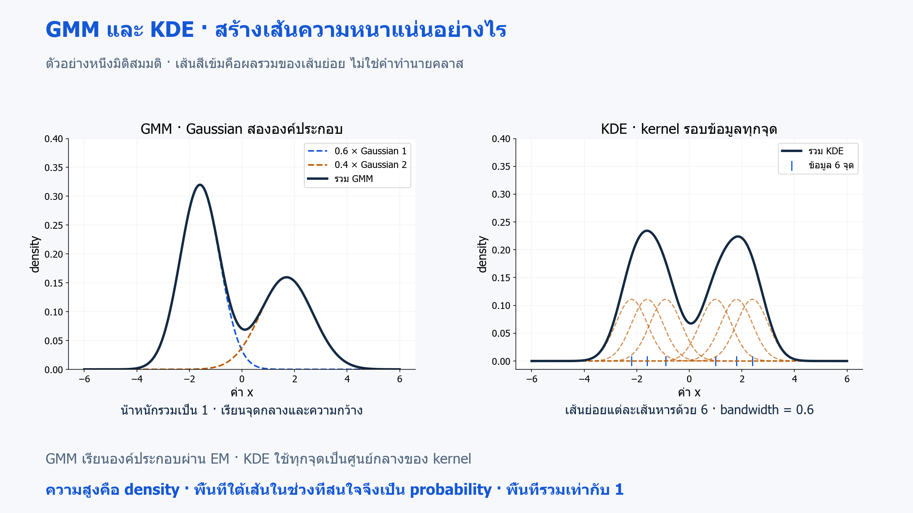
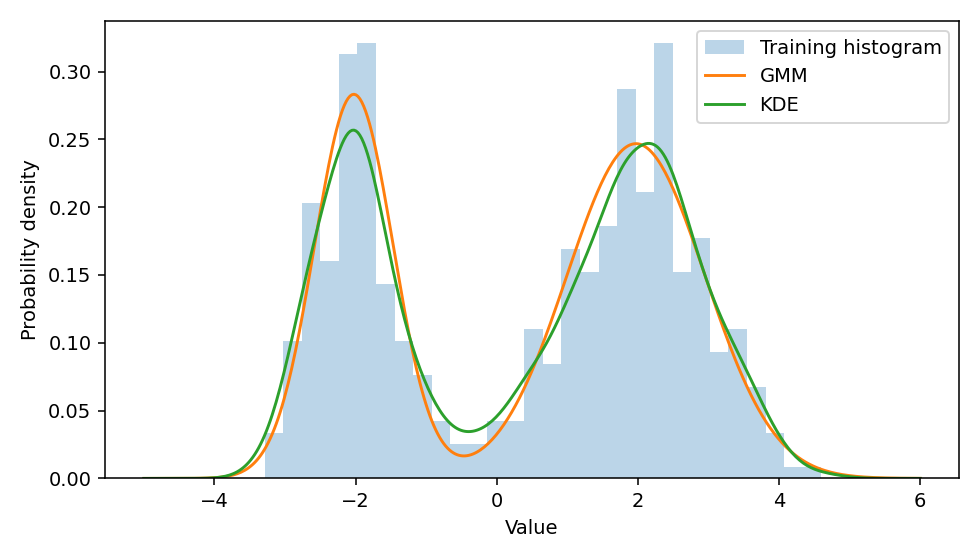

# 14 · Gaussian Mixtures และ Kernel Density Estimation

[กลับสารบัญ](../../README.md) · [Notebook](lesson.ipynb) · [Python](lesson.py)

บทนี้รับข้อมูลตัวเลขหนึ่งคอลัมน์ แล้วให้ **Gaussian Mixture Model (GMM)** และ **Kernel Density Estimation (KDE)** ประมาณว่าบริเวณใดมีข้อมูลหนาแน่น ผลหลักเป็นค่าความหนาแน่นสำหรับวาดเส้น ไม่ใช่คลาสที่ทำนายหรือเปอร์เซ็นต์ทายถูก

**ใช้สิ่งที่เรียนแล้ว:** clustering จากบท 13, CV จากบท 08–10 และ histogram แบบ density จาก Matplotlib

## วิธีประมาณความหนาแน่น

**GMM — Gaussian Mixture Model** และ **KDE — Kernel Density Estimation** เรียนรู้การกระจายจากข้อมูลนำเข้า `X` เพียงอย่างเดียว โดยไม่ต้องมีค่าหรือประเภทที่ต้องการทำนายกำกับไว้ จึงเป็นงานแบบ Unsupervised Learning

**GMM:** ใช้เส้นความหนาแน่นรูประฆังหลายเส้นมารวมกัน แต่ละเส้นเรียกว่า **Gaussian component หรือองค์ประกอบ Gaussian** โมเดลเรียนจุดกึ่งกลาง ความกว้าง และสัดส่วนของแต่ละองค์ประกอบจากข้อมูล

วิธีฝึกเรียกว่า **EM — Expectation-Maximization** ทำสลับกันสองขั้น: ประเมินว่าแต่ละจุดมีโอกาสมาจากองค์ประกอบใดเท่าไร แล้วใช้โอกาสเหล่านั้นเป็นน้ำหนักในการปรับจุดกึ่งกลาง ความกว้าง และสัดส่วนขององค์ประกอบ ทำซ้ำจนถึงเกณฑ์หยุด

**KDE:** วางเส้นรูประฆังรอบข้อมูลแต่ละจุด แล้วนำค่าจากทุกเส้นมาเฉลี่ยเป็นเส้นความหนาแน่นรวม ฟังก์ชันที่วางรอบแต่ละจุดเรียกว่า **kernel** บทนี้ใช้ Gaussian kernel และใช้ **bandwidth** กำหนดความกว้างของแต่ละเส้น

| วิธี | สร้างความหนาแน่นอย่างไร | สิ่งที่เลือกในบท |
|---|---|---|
| GMM | ผสม Gaussian รูประฆังหลาย component โดยเรียนจุดกลาง ความกว้าง และน้ำหนัก | จำนวน component ที่มี BIC ต่ำสุดบน train |
| KDE | วาง Gaussian kernel รอบแต่ละตัวอย่างแล้วรวมเป็นเส้น | bandwidth ที่ได้คะแนน CV ดีที่สุดบน train |

**จุดเด่นและข้อจำกัด**

| วิธี | จุดเด่น | ข้อจำกัด |
|---|---|---|
| GMM | สรุปการกระจายด้วยพารามิเตอร์ของแต่ละองค์ประกอบ และให้ความน่าจะเป็นสมาชิกได้ | ต้องเลือกจำนวนองค์ประกอบ ผลขึ้นกับจุดเริ่มต้นและความเหมาะสมของรูปแบบ Gaussian |
| KDE | สร้างเส้นความหนาแน่นยืดหยุ่นโดยไม่กำหนดจำนวนองค์ประกอบล่วงหน้า | bandwidth มีผลมาก ต้องเก็บตัวอย่าง และประมาณความหนาแน่นได้ยากขึ้นเมื่อมิติสูง |

**ตัวอย่าง:** ข้อมูลมีสองบริเวณที่หนาแน่น GMM อาจอธิบายด้วย Gaussian สององค์ประกอบ ส่วน KDE รวม kernel จากทุกจุด ทั้งสองวิธีอาจได้เส้นสองยอด แต่จำนวนยอดไม่ได้ยืนยันว่ามีประชากรจริงสองกลุ่ม



**อ่านภาพ:** เส้นเข้มเกิดจากการรวมเส้นประ ฝั่ง GMM มี Gaussian สององค์ประกอบ ส่วน KDE มี kernel หนึ่งเส้นต่อข้อมูลหนึ่งจุด ตัวเลขเป็นตัวอย่างสมมติ; ความสูงของเส้นคือ density ส่วนพื้นที่ใต้เส้นในช่วงหนึ่งคือ probability · [เปิดภาพ SVG](../../assets/figures/14-mixtures-and-density-models.svg)

### อ่านผลจาก GMM และ KDE

**Responsibility:** สำหรับจุดหนึ่ง โมเดล GMM ประเมินว่าจุดนั้นมีโอกาสมาจากองค์ประกอบแต่ละตัวเท่าไร จึงได้ความน่าจะเป็นหลายค่า รวมกันเป็น 1

ตัวอย่าง: `[0.2, 0.8]` หมายถึงโอกาสเป็นสมาชิก 20% และ 80% ตามลำดับ การให้สัดส่วนแบบนี้เรียกว่า **soft assignment**

ผลจาก `GMM.predict_proba` จึงบอกความเป็นสมาชิกได้หลายองค์ประกอบ ส่วน K-means เลือกกลุ่มเดียวให้แต่ละจุด หากต้องการเลือกองค์ประกอบเดียวจาก GMM ก็ใช้ `predict` ได้ แต่ชื่อองค์ประกอบยังไม่จำเป็นต้องตรงกับกลุ่มจริง

- **BIC — Bayesian Information Criterion:** ให้คะแนนจากสองด้าน คือโมเดลอธิบายข้อมูลได้ดีเพียงใด และใช้พารามิเตอร์มากเพียงใด การเพิ่มองค์ประกอบอาจอธิบาย train ได้ดีขึ้น แต่ต้องแลกกับส่วนที่เพิ่มคะแนนตามจำนวนพารามิเตอร์ บทนี้เลือก BIC ต่ำสุดเมื่อเทียบบน train ชุดเดียวกัน
- **Bandwidth:** กำหนดความกว้างของ kernel ที่วางรอบแต่ละจุด ค่าน้อยทำให้เส้นรวมมียอดย่อยตามจุดข้อมูลมาก ค่ามากทำให้เส้นรวมเรียบขึ้น และอาจกลบยอดที่เคยแยกกัน

## Density และ probability

**Density:** ความสูงของกราฟความหนาแน่น ซึ่งอาจมากกว่า 1 ได้ ต้องหาพื้นที่ใต้กราฟในช่วงที่สนใจจึงจะได้ probability ของช่วงนั้น

ตัวอย่างการกระจายสม่ำเสมอในช่วง 0–0.5:

- กราฟสูง 2 และมีพื้นที่รวม `0.5 × 2 = 1`
- โอกาสอยู่ในช่วง 0–0.1 เท่ากับ `0.1 × 2 = 0.2` หรือ 20%

จึงอ่านความสูงของกราฟเป็นเปอร์เซ็นต์ตรง ๆ ไม่ได้

**Log density:** นำค่าความหนาแน่นมาคำนวณลอการิทึมธรรมชาติ เช่น density = 0.1 จะได้ log density ประมาณ −2.30 แต่ density = 0.5 จะได้ประมาณ −0.69 ตัวเลขจึงติดลบได้ โดยไม่ใช่ความผิดพลาดติดลบ

เมื่อเปรียบเทียบโมเดลบน test ชุดเดียวกัน ค่า log density เฉลี่ยที่สูงกว่าหมายถึงโมเดลให้ความหนาแน่นกับจุดทดสอบเหล่านั้นมากกว่าโดยรวม เช่น −0.69 สูงกว่า −2.30 ต้องใช้ข้อมูล หน่วย และจำนวนมิติเดียวกันในการเทียบ

## ลงมือทำ

สร้าง Notebook ใหม่แล้วรัน **Cell 1–4 ตามลำดับ** หรือเปิด [Notebook ของบทนี้](lesson.ipynb) ใช้ kernel เดิมได้เลย อ่านคำอธิบายใต้โค้ดแต่ละช่วงประกอบผลที่ได้

<!-- CODE:CELLS -->

<!-- CODE:START -->
### Cell 1 — สร้างข้อมูลหนึ่งมิติ

```python
from pathlib import Path

import matplotlib.pyplot as plt
import numpy as np
from sklearn.mixture import GaussianMixture
from sklearn.model_selection import GridSearchCV, KFold, train_test_split
from sklearn.neighbors import KernelDensity

rng = np.random.default_rng(42)
X = np.concatenate([rng.normal(-2, 0.6, 250), rng.normal(2, 1.0, 350)]).reshape(-1, 1)
X_train, X_test = train_test_split(X, test_size=0.25, random_state=42)
```

**อ่านโค้ด**

- `rng.normal(-2, 0.6, 250)` และ `rng.normal(2, 1.0, 350)` สุ่มข้อมูลสองส่วนที่มีค่าเฉลี่ยและส่วนเบี่ยงเบนมาตรฐานต่างกัน
- `np.concatenate(...)` ต่อทั้งสองส่วนเป็น 600 ค่า แล้ว `reshape(-1, 1)` จัดเป็น 600 แถว หนึ่ง feature
- `train_test_split(..., test_size=0.25)` แยก train 450 แถวและ test 150 แถว บทนี้ไม่มี y เพราะกำลังประมาณการกระจายของ X

### Cell 2 — เลือก GMM ด้วย BIC

```python
mixtures = [GaussianMixture(n_components=k, n_init=5, random_state=42).fit(X_train) for k in range(1, 5)]
gmm = min(mixtures, key=lambda model: model.bic(X_train))
for model in mixtures:
    print(f"GMM k={model.n_components}: train BIC={model.bic(X_train):.1f}")
print("Responsibilities for x=0:", gmm.predict_proba([[0.0]]).round(3))
```

**อ่านโค้ด**

- list comprehension สร้างและ fit GMM ที่มี `n_components` ตั้งแต่ 1 ถึง 4 บน train ชุดเดียวกัน
- `n_init=5` ให้ GMM จำนวนองค์ประกอบเดียวกันลองเริ่มฝึกห้าครั้ง แล้วเก็บผลที่ได้ค่าเป้าหมายการฝึกสูงที่สุด เพื่อลดโอกาสได้ผลไม่ดีเพราะตำแหน่งเริ่มต้น
- `min(mixtures, key=lambda model: model.bic(X_train))` เลือก **ตัวโมเดล** ที่มี BIC ต่ำสุด โดย `lambda` ระบุค่าที่นำมาเทียบ
- `gmm.predict_proba([[0.0]])` คืน responsibility ของ x=0 ต่อแต่ละ component ผลในแถวนี้รวมกันเป็น 1 โดยประมาณ

### Cell 3 — เลือก KDE ด้วย CV

```python
kde_search = GridSearchCV(
    KernelDensity(kernel="gaussian"), {"bandwidth": [0.15, 0.3, 0.6, 1.0]},
    cv=KFold(5, shuffle=True, random_state=42),
)
kde_search.fit(X_train)
kde = kde_search.best_estimator_
print("KDE bandwidth:", kde.bandwidth)
print(f"GMM test mean log density: {gmm.score_samples(X_test).mean():.3f}")
print(f"KDE test mean log density: {kde.score_samples(X_test).mean():.3f}")
```

**อ่านโค้ด**

- `KernelDensity(kernel="gaussian")` เลือก kernel รูป Gaussian ส่วน dictionary `bandwidth` ระบุสี่ค่าที่ให้ GridSearchCV ทดลอง
- `KFold(5, shuffle=True, ...)` แบ่ง train ห้าส่วนเพื่อเลือก bandwidth โดยไม่ต้องมี label
- เมื่อไม่กำหนด `scoring` การค้นหาจะใช้ `KernelDensity.score` ซึ่งคืนผลรวม log density บน validation ของแต่ละ fold
- `best_estimator_` คือ KDE ที่เลือกและ refit บน train แล้ว
- `score_samples(X_test).mean()` เฉลี่ย log density ต่อแถวบน test เพื่อเปรียบเทียบ GMM กับ KDE

**อ่านคะแนน CV กับ test แยกกัน:** KDE ใช้ KFold เพราะไม่มี label ให้ stratify คะแนนค้นหาเป็นผลรวม log density ของ validation fold ที่มี 90 แถวเท่ากันทุกรอบ ส่วนสองบรรทัดท้ายเป็นค่าเฉลี่ยต่อแถวบน test 150 แถว จึงไม่ใช้ตัวเลขสองรูปแบบนี้เทียบกันตรง ๆ

### Cell 4 — วาดความหนาแน่นของสองโมเดล

```python
grid = np.linspace(-5, 6, 400).reshape(-1, 1)
fig, ax = plt.subplots(figsize=(7, 4))
ax.hist(X_train[:, 0], bins=30, density=True, alpha=0.3, label="Training histogram")
ax.plot(grid[:, 0], np.exp(gmm.score_samples(grid)), label="GMM")
ax.plot(grid[:, 0], np.exp(kde.score_samples(grid)), label="KDE")
ax.set(xlabel="Value", ylabel="Probability density")
ax.legend()
fig.tight_layout()
out = Path("outputs/14-mixtures-and-density")
out.mkdir(parents=True, exist_ok=True)
fig.savefig(out / "density.png", dpi=140)
plt.show()
plt.close(fig)
```

**อ่านโค้ด**

- `grid` เป็นตำแหน่ง x ที่ต้องการคำนวณความหนาแน่น จัดเป็นสองมิติตามรูปข้อมูลที่โมเดลรับ
- `score_samples(grid)` คืน log density จึงใช้ `np.exp(...)` แปลงเป็น density ก่อนวาดเส้น
- `hist(..., density=True)` ปรับ histogram ให้พื้นที่รวมเป็น 1 เพื่อเทียบกับเส้น density ได้
- กราฟใช้ train ส่วนผล test log density แสดงแยกใน Cell ก่อนหน้า
<!-- CODE:END -->

## อ่านผล

- **GMM:** ดู BIC ของ k=1–4 และ responsibilities ของแต่ละจุด ซึ่งรวมกันใกล้ 1
- **KDE:** ดู bandwidth ที่เลือก
- **กราฟ:** เทียบเส้น GMM และ KDE กับ histogram ของ train
- **ผล test:** รายงาน log density เฉลี่ยต่อหนึ่งตัวอย่าง



## แบบฝึกท้ายบท

**ลองคิด:** responsibilities รวมเป็น 1 แล้วความสูงกราฟ density ต้องเท่ากับ 1 ด้วยหรือไม่?

<details>
<summary>ดูเฉลย</summary>

**เฉลย:** ความสูงกราฟไม่จำเป็นต้องเท่ากับ 1 เพราะเป็นคนละค่ากัน:

- **Responsibilities:** probability ของการเป็นสมาชิกแต่ละ component จึงรวมกันเป็น 1
- **Density:** ต้องหาพื้นที่ใต้กราฟในช่วงที่สนใจจึงจะได้ probability

สำหรับตัวแปรต่อเนื่อง โอกาสของจุดที่ระบุค่าเดียวเป๊ะ ๆ เป็นศูนย์

</details>

## อ้างอิง

- [Handbook: Gaussian Mixture Models](https://jakevdp.github.io/PythonDataScienceHandbook/05.12-gaussian-mixtures.html)
- [Handbook: KDE](https://jakevdp.github.io/PythonDataScienceHandbook/05.13-kernel-density-estimation.html)
- [Gaussian mixtures](https://scikit-learn.org/1.7/modules/mixture.html)
- [Density estimation](https://scikit-learn.org/1.7/modules/density.html)
