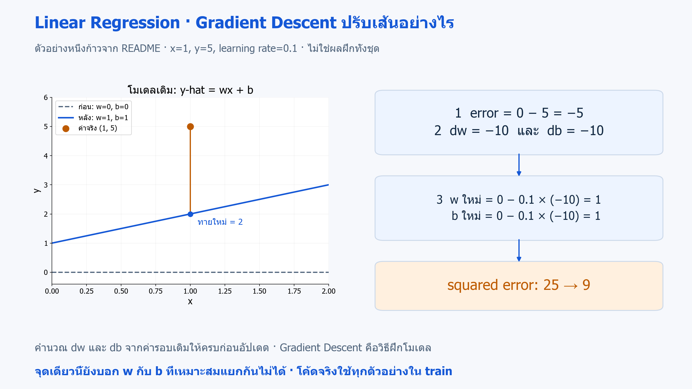
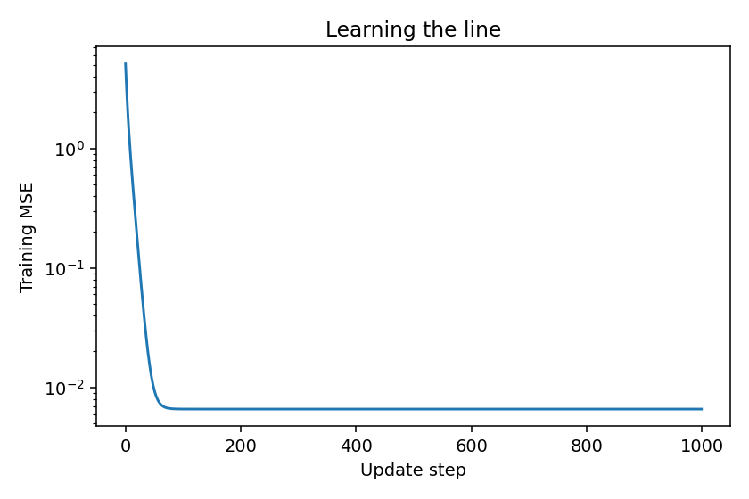

# 15 · ฝึก Linear Regression ด้วย Gradient Descent และ NumPy

[กลับสารบัญ](../../README.md) · [Notebook](lesson.ipynb) · [Python](lesson.py)

บทนี้เขียน **Gradient Descent** เพื่อเรียน w และ b ของเส้นตรงด้วย NumPy

**ใช้สิ่งที่เรียนแล้ว:** สมการเส้นตรงและ MAE จากบท 05; vectorization และการวาดกราฟใช้พื้นฐานเดิม

## โมเดลที่ฝึก: Linear Regression

โมเดลคือ **Linear Regression** จาก [บท 05](../05-linear-regression/README.md) ใช้สมการ `ŷ = wx + b` ทำนายคำตอบตัวเลขจาก x ส่วน **Gradient Descent เป็นวิธีหาค่า w และ b** ให้โมเดลนี้

โค้ดจึงมีทั้งเส้นตรงที่ฝึกด้วย NumPy และ `LinearRegression()` ของ scikit-learn สำหรับเทียบผลบน train เดียวกัน ทั้งสองเป็นโมเดลเชิงเส้น แต่ใช้วิธีหาพารามิเตอร์ต่างกัน ความสัมพันธ์ที่ไม่เหมาะกับเส้นตรงยังเป็นข้อจำกัด แม้ฝึกจน loss ลดลงแล้ว

## Gradient Descent คืออะไร

**Gradient Descent (GD)** เป็นอัลกอริทึม **Optimization** หรือการหาค่าพารามิเตอร์เพื่อลดฟังก์ชันเป้าหมาย ใช้เป็นวิธีฝึกโมเดลได้หลายชนิด บทนี้นำมาฝึก Linear Regression แบบ Supervised Learning

**หลักการ:** เริ่มจาก w และ b → คำนวณ loss และ gradient → ขยับพารามิเตอร์สวนทาง gradient → ทำซ้ำ การเลือกขนาดก้าวที่เหมาะช่วยให้เข้าใกล้ค่าที่ loss ต่ำลง

- **จุดเด่น:** นำแนวคิดเดียวกันไปใช้กับโมเดลอื่นที่คำนวณ gradient ได้ โดยไม่ต้องมีสูตรหาพารามิเตอร์คำตอบสำเร็จรูป
- **ข้อจำกัด:** ต้องเลือก learning rate และจำนวนรอบ สเกลมีผลต่อการเรียน และ loss ที่ลดลงบน train ยังไม่ยืนยันว่าจะทำนายข้อมูลใหม่ได้ดี

### ค่าที่ใช้คำนวณ

- **Loss:** ความผิดพลาดที่ต้องการลด บทนี้ใช้ **MSE — Mean Squared Error** หรือค่าเฉลี่ยความผิดพลาดกำลังสอง
- **Gradient:** บอกทิศและอัตราการเปลี่ยน loss เมื่อเปลี่ยนพารามิเตอร์
- **Learning rate:** กำหนดขนาดก้าวในการอัปเดตพารามิเตอร์ไปทิศตรงข้ามกับ gradient

กำหนด `error = wx + b − y` ซึ่งกลับเครื่องหมายจาก residual ในบท 05 แต่เมื่อยกกำลังสองจะได้ค่าเท่ากัน

| ค่าที่คำนวณ | สูตรใน NumPy |
|---|---|
| MSE | `np.mean(error ** 2)` |
| gradient ของ w | `dw = 2 * np.mean(error * x)` |
| gradient ของ b | `db = 2 * np.mean(error)` |
| อัปเดต | `w -= learning_rate * dw` และ `b -= learning_rate * db` |

ต้องคำนวณ dw และ db จาก w และ b รอบเดิมให้ครบก่อนเปลี่ยนค่า

**Batch gradient descent:** ใช้ทุกตัวอย่างในชุดฝึกคำนวณ gradient ต่อหนึ่งก้าว

**ตัวอย่างหนึ่งก้าว:** ให้ x=1, y=5 และ learning rate=0.1

1. เริ่ม w=b=0 จะได้ error=−5
2. คำนวณ dw=db=−10 แล้วอัปเดตได้ w=b=1
3. คำทำนายใหม่เป็น 2 ทำให้ squared error ลดจาก 25 เป็น 9



**อ่านภาพ:** เส้นประคือโมเดลก่อนอัปเดต เส้นน้ำเงินคือหลังอัปเดตหนึ่งก้าว จึงทายที่ x=1 ได้ 2 และเข้าใกล้ค่าจริง 5 ตัวอย่างนี้ตรงกับการคำนวณด้านบน ส่วนโค้ดฝึกจากหลายจุดใน train · [เปิดภาพ SVG](../../assets/figures/15-gradient-descent-update.svg)

ตัวอย่างจุดเดียวนี้ใช้ฝึกคำนวณ ยังแยกค่า w และ b ที่เหมาะสมไม่ได้

- **ก้าวเล็ก:** loss อาจลดช้า
- **ก้าวใหญ่เกินไป:** ค่าอาจแกว่งหรือล้น
- **สเกล x:** มีผลต่อขนาดก้าวที่เหมาะสม

โค้ดตรวจค่าที่ไม่ finite และหยุดเมื่อคำนวณล้มเหลว โดย `history` เก็บ MSE หลังแต่ละก้าว

เราเทียบ w และ b กับ least squares บน train เดียวกัน แล้ววัด test MAE เพื่อดูผลกับข้อมูลใหม่

`LinearRegression.fit` ไม่จำเป็นต้องใช้ gradient descent แบบที่เขียนในบทนี้

## ลงมือทำ

สร้าง Notebook ใหม่แล้วรัน **Cell 1–3 ตามลำดับ** หรือเปิด [Notebook ของบทนี้](lesson.ipynb) ใช้ kernel เดิมได้เลย อ่านคำอธิบายใต้โค้ดแต่ละช่วงประกอบผลที่ได้

<!-- CODE:CELLS -->

<!-- CODE:START -->
### Cell 1 — ประกาศฟังก์ชัน Gradient Descent

```python
import numpy as np


def fit_gradient_descent(x, y, learning_rate=0.1, steps=1000):
    x = np.asarray(x, dtype=np.float64)
    y = np.asarray(y, dtype=np.float64)
    if x.ndim != 1 or x.shape != y.shape or len(x) == 0:
        raise ValueError("x and y must be nonempty one-dimensional arrays of equal length")
    if not np.isfinite(x).all() or not np.isfinite(y).all():
        raise ValueError("x and y must be finite")
    if not np.isfinite(learning_rate) or learning_rate <= 0:
        raise ValueError("learning_rate must be finite and positive")
    if not isinstance(steps, (int, np.integer)) or steps < 1:
        raise ValueError("steps must be a positive integer")
    w, b = 0.0, 0.0
    history = []
    try:
        with np.errstate(over="raise", invalid="raise"):
            for _ in range(steps):
                error = w * x + b - y
                dw = 2.0 * np.mean(error * x)
                db = 2.0 * np.mean(error)
                # ใช้ gradient ทั้งคู่จาก w,b รอบเดิมก่อนเปลี่ยนค่า
                w -= learning_rate * dw
                b -= learning_rate * db
                loss = np.mean((w * x + b - y) ** 2)
                if not np.isfinite(loss):
                    raise FloatingPointError("Non-finite loss")
                history.append(loss)
    except FloatingPointError as error:
        raise FloatingPointError("Gradient descent diverged; reduce learning_rate or scale x") from error
    return w, b, np.asarray(history)
```

**อ่านโค้ด**

- `def fit_gradient_descent(...)` ประกาศฟังก์ชันไว้เรียกภายหลัง การรัน Cell นี้ยังไม่เริ่มฝึก
- `np.asarray(..., dtype=np.float64)` จัด x และ y เป็น array ตัวเลข จากนั้นเงื่อนไขตรวจ shape ค่าที่ไม่ finite และค่าตั้งต้นที่ใช้ไม่ได้ ก่อนเริ่มวนรอบ
- `w, b = 0.0, 0.0` เป็นจุดเริ่ม ส่วน `error = w * x + b - y` คำนวณคำทำนายลบค่าจริงจากทุกแถว
- `dw` และ `db` คำนวณ gradient จาก w และ b รอบเดียวกัน แล้วจึงอัปเดตด้วย `w -= learning_rate * dw` และ `b -= learning_rate * db`
- `history.append(loss)` เก็บ MSE **หลังอัปเดต** แต่ละรอบ เพื่อนำไปวาดกราฟ
- `np.errstate(over="raise", invalid="raise")` ให้หยุดเมื่อคำนวณล้นหรือใช้ค่าที่ผิด แล้วส่งข้อความแนะนำให้ลด learning rate หรือปรับสเกล
- `return w, b, np.asarray(history)` คืนพารามิเตอร์สองค่าและประวัติ loss ให้ผู้เรียก

### Cell 2 — ประกาศขั้นตอนทดลองและวาดกราฟ

```python
def main():
    from pathlib import Path
    import matplotlib.pyplot as plt
    from sklearn.linear_model import LinearRegression
    from sklearn.metrics import mean_absolute_error
    from sklearn.model_selection import train_test_split

    rng = np.random.default_rng(42)
    x = rng.uniform(-1, 1, 200)
    y = 3 * x + 2 + rng.normal(0, 0.08, len(x))
    x_train, x_test, y_train, y_test = train_test_split(x, y, random_state=42)
    w, b, history = fit_gradient_descent(x_train, y_train)
    reference = LinearRegression().fit(x_train.reshape(-1, 1), y_train)
    print(f"Gradient descent: w={w:.4f}, b={b:.4f}")
    print(f"Least squares: w={reference.coef_[0]:.4f}, b={reference.intercept_:.4f}")
    print(f"Test MAE: {mean_absolute_error(y_test, w * x_test + b):.4f}")
    fig, ax = plt.subplots(figsize=(6, 4))
    ax.semilogy(history)
    ax.set(xlabel="Update step", ylabel="Training MSE", title="Learning the line")
    fig.tight_layout()
    out = Path("outputs/15-gradient-descent")
    out.mkdir(parents=True, exist_ok=True)
    fig.savefig(out / "loss.png", dpi=140)
    plt.show()
    plt.close(fig)
```

**อ่านโค้ด**

- `main()` รวมขั้นตอนทดลองไว้ แต่ Cell นี้เพียงประกาศฟังก์ชัน ยังไม่เรียกทำงาน
- `y = 3 * x + 2 + ...` สร้างข้อมูลจากเส้นจริงที่รู้ w=3 และ b=2 แล้วเติม noise เล็กน้อย
- `w, b, history = fit_gradient_descent(...)` รับผลสามส่วนจากฟังก์ชันที่สร้างใน Cell 1
- `x_train.reshape(-1, 1)` จัด x เป็นหนึ่งคอลัมน์ให้ `LinearRegression` รับได้ เพื่อเทียบกับ least squares บนข้อมูลเดียวกัน
- `w * x_test + b` คือคำทำนายที่นำไปวัด test MAE
- `ax.semilogy(history)` วาด MSE โดยแกน y ใช้สเกล log เพื่อเห็นการลดลงหลายระดับได้ชัด

### Cell 3 — เรียกการทดลอง

```python
if __name__ == "__main__":
    main()
```

**อ่านโค้ด:** `if __name__ == "__main__":` เรียก `main()` เมื่อรันไฟล์นี้โดยตรงหรือรัน Cell นี้ใน notebook

หากไฟล์อื่น import ฟังก์ชันไปใช้ เงื่อนไขนี้จะไม่เรียกการทดลองซ้ำ เมื่อรันใน notebook ต้องรัน Cell 1–2 ก่อน เพื่อประกาศฟังก์ชันให้ครบ
<!-- CODE:END -->

## อ่านผล

ได้ w ใกล้ 3 และ b ใกล้ 2 ซึ่งใกล้เคียงกับผล least squares

กราฟ loss ลดลงก่อนเข้าใกล้ระดับ noise ให้ดู test MAE ควบคู่ เพราะ training loss ต่ำยังไม่รับรองผลกับข้อมูลใหม่

ไฟล์ภาพ: `outputs/15-gradient-descent/loss.png`



## แบบฝึกท้ายบท

**ลองทำ:** ทดลอง learning rate 0.001, 0.1, 2.0 บนข้อมูลเดิม

<details>
<summary>ดูแนวคำตอบ</summary>

**แนวคำตอบ:**

- หากก้าวเล็กและ loss ยังลดอยู่ การเพิ่มจำนวนรอบอาจช่วยได้
- หากค่า diverge ให้ลด learning rate หรือปรับสเกล การเพิ่มรอบอย่างเดียวไม่ช่วย และไม่ควรนำค่าที่ล้นไปทำนายต่อ

</details>

## อ้างอิง

- [Google MLCC: Gradient descent](https://developers.google.com/machine-learning/crash-course/linear-regression/gradient-descent)
- [Linear models](https://scikit-learn.org/1.7/modules/linear_model.html)
