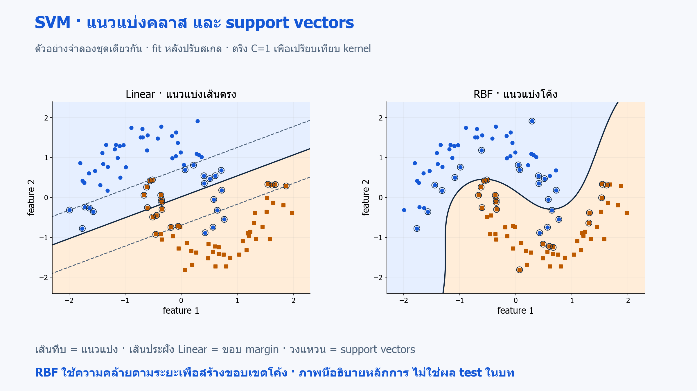
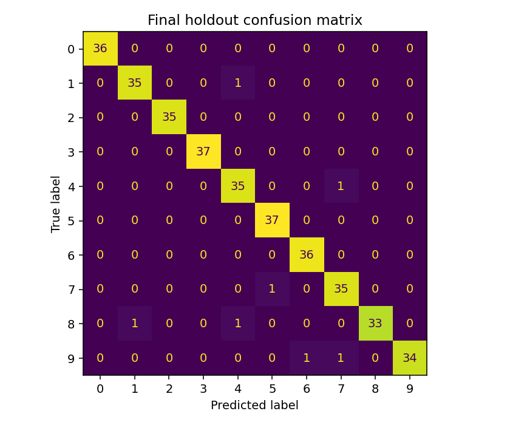

# 16 · โครงงาน SVM: จำแนกภาพตัวเลขและนำโมเดลกลับมาใช้

[กลับสารบัญ](../../README.md) · [Notebook](lesson.ipynb) · [Python](lesson.py)

โครงงานนี้ทำนายเลข 0–9 จาก **digits ขนาด 8×8** แล้วบันทึกโมเดลกลับมาใช้

**ใช้สิ่งที่เรียนแล้ว:** Pipeline, metrics, SVM และ GridSearchCV จากบท 03–10 เพื่อนำมารวมเป็นโครงงานเดียว

## โมเดลในโครงงาน: SVM แบบ RBF

**SVC — Support Vector Classification** คือโมเดล SVM สำหรับจำแนกประเภทจาก [บท 08](../08-support-vector-machines/README.md) รับค่า pixel 64 ค่า หลัง StandardScaler แล้วทายเลข 0–9 RBF kernel ช่วยให้สร้างขอบเขตที่ไม่เป็นเส้นตรงได้

สำหรับสิบคลาส SVC ฝึกตัวจำแนกทีละคู่ เช่น 0 กับ 1 และ 0 กับ 2 จนครบทุกคู่ แล้วรวมผลเพื่อตัดสินเลขหนึ่งตัว วิธีนี้เรียกว่า **one-versus-one** ผลจาก `predict` เป็นเลข 0–9 ไม่ใช่ความน่าจะเป็น

เราใช้ **macro F1** คือคำนวณ F1 แยกสำหรับเลข 0–9 แล้วเฉลี่ยสิบค่าโดยให้แต่ละเลขมีน้ำหนักเท่ากัน คะแนนนี้ใช้เลือก C และ gamma ด้วย CV ส่วน **GridSearchCV เป็นเครื่องมือทดลองการตั้งค่า และ SVC เป็นโมเดลที่ทายเลข**

SVM จับรูปแบบโค้งได้ แต่ผลขึ้นกับสเกลและ C/gamma จึงเทียบกับ **DummyClassifier** ที่ทายคลาสพบบ่อยตาม [บท 01](../01-ml-workflow/README.md) และประเมิน test หลังเลือกเสร็จ



**ทบทวนภาพจากบท 08:** ดูด้าน RBF เพื่อเชื่อมเรื่องแนวแบ่งโค้งและ support vectors ภาพมีสอง feature และสองคลาส ส่วนโครงงานใช้ 64 pixel กับสิบคลาส จึงไม่ได้มีแนวแบ่งสองมิติแบบภาพนี้โดยตรง · [เปิดภาพ SVG](../../assets/figures/08-support-vector-machines-model.svg)

## สิ่งที่เพิ่มในโครงงาน

| ขั้นตอน | สิ่งที่ตรวจ |
|---|---|
| ตรวจ input แล้วแบ่งข้อมูล | 64 pixel ต่อภาพ แบ่งเป็น train 1,437 ภาพ และ test 360 ภาพ |
| เลือก SVC จาก C/gamma สี่คู่ ด้วย 3-fold CV | ใช้ macro F1 ให้สิบคลาสมีน้ำหนักเท่ากัน พร้อมเทียบ baseline และรายงาน accuracy |
| ประเมิน test และบันทึกผล | metrics, split index, confusion matrix และตัวอย่างที่ทายผิด |
| บันทึกและโหลด Pipeline | คำทำนายก่อนและหลังบันทึกต้องตรงกัน แล้วลองอ่าน CSV มาทำนาย |

### บันทึกโมเดลเพื่อนำกลับมาใช้

**Model persistence** คือการบันทึกสถานะโมเดลที่ฝึกแล้วลงไฟล์ และโหลดกลับมาใช้ทำนายภายหลัง โดยไม่ต้องฝึกซ้ำทุกครั้ง

**หลักการในบทนี้:** ฝึกและเลือก Pipeline → บันทึกด้วย `joblib.dump` → โหลดด้วย `joblib.load` → เปรียบเทียบคำทำนายก่อนและหลังบันทึก

**Artifact:** ไฟล์ผลลัพธ์ที่ใช้ต่อ เช่น `model.joblib` โดยต้องเก็บทั้ง scaler ที่ fit แล้วและโมเดล

- **จุดเด่น:** ใช้ขั้นตอนเตรียมข้อมูลและโมเดลชุดเดิมซ้ำได้
- **ข้อจำกัด:** ต้องรักษารุ่นไลบรารีและรูปแบบ input ให้สอดคล้อง การบันทึกสำเร็จไม่ได้ยืนยันว่าเหมาะกับข้อมูลจากแหล่งใหม่

**การโหลดโมเดล:** joblib ใช้ pickle ซึ่งเรียกโค้ดขณะโหลดได้ จึงโหลดเฉพาะไฟล์ที่สร้างเองหรือเชื่อถือ และใช้รุ่นไลบรารีตรงกับตอนฝึก

**Input contract: ข้อมูลแบบใดที่โมเดลนี้รับได้** ต้องเตรียมภาพใหม่ให้ตรงตามเงื่อนไขต่อไปนี้:

- เป็น array รูปทรง `(n_samples, 64)` และมีอย่างน้อยหนึ่งแถว
- ทุกค่าต้องเป็นตัวเลขในช่วง 0–16 ไม่มี NaN หรือค่าบวก/ลบอนันต์
- เรียง pixel จากซ้ายไปขวาทีละแถว แล้วไล่จากบนลงล่าง
- ค่า 0 คือพื้นหลัง ส่วนค่าสูงคือเส้นตัวเลข

ภาพใหม่ต้องตรงทั้ง shape ความหมาย และช่วงค่า ชุด digits นี้ไม่ใช่ MNIST และยังไม่ใช่ระบบอ่านภาพถ่ายทั่วไป

## ลงมือทำ

สร้าง Notebook ใหม่แล้วรัน **Cell 1–4 ตามลำดับ** หรือเปิด [Notebook ของบทนี้](lesson.ipynb) ใช้ kernel เดิมได้เลย อ่านคำอธิบายใต้โค้ดแต่ละช่วงประกอบผลที่ได้

<!-- CODE:CELLS -->

<!-- CODE:START -->
### Cell 1 — นำเข้าเครื่องมือและตรวจรูปข้อมูล

```python
import json
import platform
from pathlib import Path

import joblib
import numpy as np
import sklearn
from sklearn.datasets import load_digits
from sklearn.dummy import DummyClassifier
from sklearn.metrics import accuracy_score, classification_report, f1_score
from sklearn.model_selection import GridSearchCV, StratifiedKFold, train_test_split
from sklearn.pipeline import Pipeline
from sklearn.preprocessing import StandardScaler
from sklearn.svm import SVC


def validate_pixels(values):
    array = np.asarray(values, dtype=np.float64)
    if array.ndim != 2 or array.shape[1] != 64 or len(array) == 0:
        raise ValueError("Expected shape (n_samples, 64) with at least one sample")
    if not np.isfinite(array).all() or np.any((array < 0) | (array > 16)):
        raise ValueError("Pixels must be finite and in the interval [0, 16]")
    return array
```

**อ่านโค้ด**

- `validate_pixels(values)` รับข้อมูลภาพ แล้ว `np.asarray(..., dtype=np.float64)` จัดให้เป็น array ตัวเลข
- `array.ndim != 2`, `array.shape[1] != 64` และ `len(array) == 0` ตรวจว่ามีอย่างน้อยหนึ่งภาพ โดยแต่ละภาพคลี่เป็น 64 ค่า
- `np.isfinite(array).all()` ให้ True เมื่อทุกค่าปราศจาก NaN และค่าบวก/ลบอนันต์ ส่วน `np.any((array < 0) | (array > 16))` ให้ True เมื่อมีอย่างน้อยหนึ่งค่าหลุดช่วง 0–16
- หากไม่ผ่านจะ `raise ValueError` เพื่อหยุดก่อนส่งข้อมูลผิดรูปเข้าโมเดล ถ้าผ่านจะคืน array ที่พร้อมใช้

Cell นี้ประกาศฟังก์ชัน ยังไม่มีการฝึกโมเดล

### Cell 2 — ประกาศฟังก์ชันสร้าง GridSearchCV

```python
def build_search():
    return GridSearchCV(
        Pipeline([("scale", StandardScaler()), ("svc", SVC())]),
        {"svc__C": [1.0, 10.0], "svc__gamma": ["scale", 0.01]},
        scoring="f1_macro", cv=StratifiedKFold(3, shuffle=True, random_state=42),
        n_jobs=1,
    )
```

**อ่านโค้ด**

- `build_search()` คืนตัวค้นหาโมเดลที่ยังไม่ได้ fit เพื่อให้เรียกสร้างใหม่ได้เมื่อเริ่มโครงงาน
- `("scale", StandardScaler())` และ `("svc", SVC())` ตั้งชื่อขั้นสำหรับใช้ใน Pipeline และพารามิเตอร์ค้นหา
- `svc__C` สองค่า × `svc__gamma` สองค่า รวมสี่ชุดตัวเลือก โดยชื่อก่อน `__` ต้องตรงกับชื่อขั้น `svc`
- `scoring="f1_macro"` ใช้ F1 ที่เฉลี่ยทุกคลาสเท่ากันเลือกโมเดล และ `StratifiedKFold(3, ...)` กำหนดสาม fold
- `n_jobs=1` จำกัดจำนวนงานที่ทำพร้อมกัน ส่วนการฝึกจริงจะเกิดเมื่อเรียก `.fit(...)` ใน main

**การตั้งค่าใน cell นี้:** `SVC()` ใช้ RBF เป็นค่าเริ่มต้น เราลอง `C` ที่ 1 และ 10 เพื่อเปลี่ยนความสำคัญของจุดฝึกที่อยู่ในแถบเว้นหรือผิดฝั่ง และลอง `gamma` ที่ `"scale"` กับ 0.01 เพื่อเปลี่ยนว่าความคล้ายจะลดเร็วเพียงใดเมื่อจุดห่างกัน ผลทำนายเป็นคลาส โดยยังไม่ได้เปิดการคำนวณ probability

### Cell 3 — ประกาศขั้นตอนฝึก บันทึก และตรวจผล

```python
def main():
    import matplotlib.pyplot as plt
    from sklearn.metrics import ConfusionMatrixDisplay

    data = load_digits()
    X = validate_pixels(data.data)
    train_idx, test_idx = train_test_split(
        np.arange(len(X)), test_size=0.2, stratify=data.target, random_state=42
    )
    X_train, X_test = X[train_idx], X[test_idx]
    y_train, y_test = data.target[train_idx], data.target[test_idx]
    baseline = DummyClassifier(strategy="most_frequent").fit(X_train, y_train)
    search = build_search().fit(X_train, y_train)
    pred = search.predict(X_test)
    report = {
        "dataset": "sklearn load_digits; 8x8 pixels; range 0..16",
        "split": "stratified random holdout 20%; seed 42; not a writer-group split",
        "train_rows": len(train_idx), "test_rows": len(test_idx),
        "baseline_accuracy": accuracy_score(y_test, baseline.predict(X_test)),
        "baseline_macro_f1": f1_score(y_test, baseline.predict(X_test), average="macro", zero_division=0),
        "best_params": search.best_params_, "cv_macro_f1": search.best_score_,
        "test_accuracy": accuracy_score(y_test, pred),
        "test_macro_f1": f1_score(y_test, pred, average="macro"),
        "classification_report": classification_report(y_test, pred, output_dict=True),
        "python": platform.python_version(), "sklearn": sklearn.__version__,
    }
    print(json.dumps(report, indent=2))
    out = Path("outputs/16-digits-project")
    out.mkdir(parents=True, exist_ok=True)
    joblib.dump(search.best_estimator_, out / "model.joblib")
    (out / "metrics.json").write_text(json.dumps(report, indent=2) + "\n", encoding="utf-8")
    np.savez(out / "split-indices.npz", train=train_idx, test=test_idx)
    np.savetxt(out / "example-input.csv", X_test[:3], delimiter=",")
    restored = joblib.load(out / "model.joblib")  # โหลดเฉพาะไฟล์ที่เพิ่งสร้างเอง
    np.testing.assert_array_equal(pred, restored.predict(X_test))
    csv_pixels = validate_pixels(np.loadtxt(out / "example-input.csv", delimiter=",", ndmin=2))
    print("Predictions from saved CSV:", restored.predict(csv_pixels).tolist())
    print("True labels for these examples:", y_test[:3].tolist())
    print("Confusion matrix uses all test images:", len(y_test))
    errors = np.flatnonzero(pred != y_test)
    print("Misclassified held-out examples:", len(errors))
    fig, ax = plt.subplots(figsize=(6, 5))
    ConfusionMatrixDisplay.from_predictions(y_test, pred, ax=ax, colorbar=False)
    ax.set_title("Final holdout confusion matrix")
    fig.tight_layout()
    fig.savefig(out / "confusion-matrix.png", dpi=140)
    plt.show()
    plt.close(fig)
    if len(errors):
        fig, axes = plt.subplots(1, min(6, len(errors)), figsize=(10, 2), squeeze=False)
        for ax, i in zip(axes[0], errors[:6]):
            ax.imshow(X_test[i].reshape(8, 8), cmap="gray_r", vmin=0, vmax=16)
            ax.set_title(f"true={y_test[i]}, pred={pred[i]}")
            ax.axis("off")
        fig.tight_layout()
        fig.savefig(out / "errors.png", dpi=140)
        plt.show()
        plt.close(fig)
```

**อ่านโค้ด: ฝึกและประเมิน**

- `validate_pixels(data.data)` ใช้เงื่อนไขเดียวกับตอนรับข้อมูลใหม่ ส่วนการแบ่ง `np.arange(len(X))` เก็บ index ไว้ให้ตรวจย้อนกลับได้ว่าแถวใดอยู่ชุดไหน
- `X[train_idx]` กับ `data.target[train_idx]` เลือกภาพและคำตอบด้วย index ชุดเดียวกัน เช่นเดียวกับฝั่ง test
- `build_search().fit(X_train, y_train)` สร้างตัวค้นหาแล้วฝึก ส่วน `search.predict(X_test)` ใช้ Pipeline ที่เลือกและ refit แล้ว
- `report` เก็บคะแนน วิธีแบ่ง รุ่น Python และ scikit-learn ส่วน `output_dict=True` ให้ classification report เป็น dictionary ที่เขียนเป็น JSON ได้

**อ่านโค้ด: บันทึกและนำกลับมาใช้**

- `joblib.dump(search.best_estimator_, ...)` บันทึก Pipeline ที่ fit แล้วทั้ง scaler และ SVC ส่วน `np.savez` เก็บ index ของชุดข้อมูล
- `joblib.load(...)` โหลดไฟล์ที่เพิ่งสร้าง แล้ว `np.testing.assert_array_equal` ตรวจว่าคำทำนายก่อนและหลังบันทึกตรงกัน
- `np.loadtxt(..., ndmin=2)` อ่าน CSV ให้ยังเป็นข้อมูลสองมิติแม้มีแถวเดียว แล้วตรวจด้วย `validate_pixels` ก่อนทำนาย
- `np.flatnonzero(pred != y_test)` หาตำแหน่งที่ทายผิดใน X_test ส่วน `reshape(8, 8)` จัด 64 ค่ากลับเป็นภาพเพื่อดูข้อผิดพลาด

Cell นี้ยังเป็นการประกาศ `main` ต้องรัน Cell ถัดไปจึงเริ่มโครงงาน

### Cell 4 — รันโครงงาน

```python
if __name__ == "__main__":
    main()
```

**อ่านโค้ด:** เงื่อนไข `__name__ == "__main__"` เรียก `main()` เพื่อรันตั้งแต่โหลดข้อมูลจนบันทึกผล ต้องรัน Cell 1–3 ก่อนให้มีฟังก์ชันครบ

เมื่อทำงานเสร็จจะได้รายงานคะแนน คำทำนายจาก CSV และกราฟ หากไม่มีตัวอย่างทายผิด เงื่อนไข `if len(errors):` จะข้ามการสร้าง errors.png

**ก่อนอ่าน confusion matrix:** คำทำนายจาก CSV ใช้ตัวอย่าง 3 ภาพแรกเพื่อทดสอบการโหลดโมเดล ส่วน confusion matrix นับคำตอบจริงกับคำทำนายของ test ทั้ง 360 ภาพ ช่องแนวทแยงคือเลขที่ทายถูก; ผลรวมแนวทแยงหาร 360 จึงเป็น test accuracy

เมื่อไฟล์อื่น import ฟังก์ชันไปใช้ เงื่อนไข `__name__ == "__main__"` จะไม่เรียกโครงงานซ้ำ
<!-- CODE:END -->

## อ่านผล

ไฟล์ผลลัพธ์อยู่ใน `outputs/16-digits-project/`:

- `model.joblib`, `metrics.json` และ `split-indices.npz`
- `example-input.csv` และ `confusion-matrix.png`
- `errors.png` เมื่อมีตัวอย่างที่ทายผิด โดยแสดงไม่เกินหกตัวอย่างแรก

**อ่าน confusion matrix:** ช่องแถว 8 คอลัมน์ 3 คือเลขจริง 8 ที่ทายเป็น 3

โค้ดตรวจคำทำนายหลังโหลดโมเดล และทดสอบการทำนายจาก CSV ให้แล้ว

หากใช้ Colab ให้ดาวน์โหลดไฟล์ที่ต้องการเก็บก่อนจบ session ส่วนวิธีใช้ CLI อยู่ใน [คู่มือ repo](../../docs/setup.md)



## แบบฝึกท้ายบท

**ลองทำ:** เขียน [model card](../../docs/model-card.md) หรือเอกสารสรุปโมเดลหนึ่งหน้า ระบุว่าโมเดลทำงานอะไร เทียบกับวิธีเริ่มต้นใด แบ่งข้อมูลอย่างไร ใช้คะแนนใดวัดผล ได้ผลเท่าไร และยังมีข้อจำกัดอะไร

<details>
<summary>ดูแนวคำตอบ</summary>

**แนวคำตอบ:** ระบุข้อจำกัดอย่างน้อยสามข้อ:

- ภาพต้องมีขนาดและช่วงค่าตามที่กำหนด
- การแบ่งข้อมูลยังไม่แยกผู้เขียน
- ยังไม่ได้ทดสอบกับภาพภายนอก

หากใช้ข้อผิดพลาดบน test ปรับโมเดลต่อ ต้องกันข้อมูลที่ยังไม่ใช้ตัดสินใจไว้ประเมินสุดท้าย

</details>

## อ้างอิง

- [SVM: หลายคลาสและ RBF kernel](https://scikit-learn.org/1.7/modules/svm.html)
- [scikit-learn: load_digits](https://scikit-learn.org/1.7/modules/generated/sklearn.datasets.load_digits.html)
- [Model persistence](https://scikit-learn.org/1.7/model_persistence.html)
- [Handbook: Application pipeline](https://jakevdp.github.io/PythonDataScienceHandbook/05.14-image-features.html)
